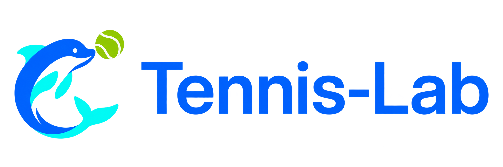
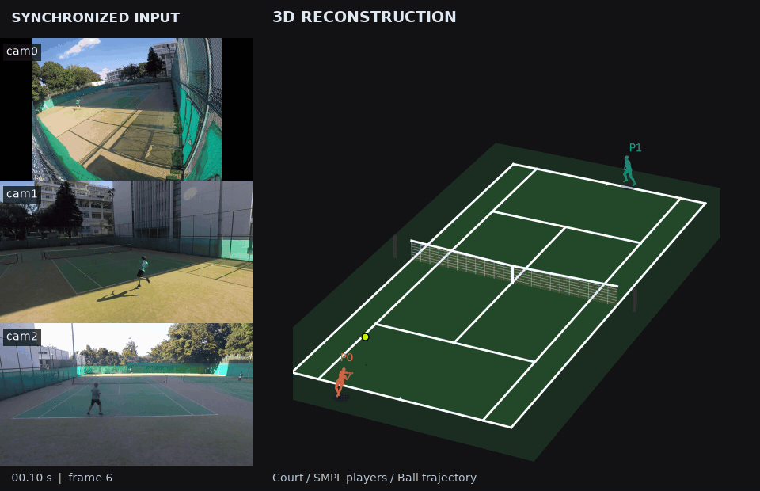

<div align="center">
  
</div>

<hr>
<div align="center">
  <a href="README.md"></a>
  <a href="README.ja.md"></a>
  <a href="README.zh-CN.md"></a>
  <br>
  <a href="https://huggingface.co/Motoki098/tennis-lab-models"></a>
  <a href="https://huggingface.co/datasets/Motoki098/tennis-lab-multiview-sample"></a>
  <br>
  <a href="LICENSE"></a>
  <a href="LICENSES.ja.md#published-artifacts"></a>
  <a href="LICENSES.ja.md#sample-dataset-terms"></a>
</div>

## 目次

1. [概要](#overview)
2. [モデルダウンロード](#model-downloads)
3. [ローカルでの実行](#run-locally)
4. [ライセンス](#license)
5. [引用](#citation)

<a id="overview"></a>

## 1. 概要

同期済みの固定カメラ **3〜5台** のテニス動画から、コート座標系で選手の動作とボール軌道を3D再構成する研究用パイプラインです。各視点のコート・選手姿勢・ボールの2D検出を、カメラ校正・視点間の対応付け・三角測量と身体復元で統合します。



© 2026 Motoki0705 · CC BY-NC-ND 4.0 · [帰属表示と適用範囲の詳細](LICENSES.ja.md#sample-dataset-terms)。

公開サンプル `video_000/clip_000` の3視点（左）と、同じフレームの3D再構成（右）です。
ボールは三角測量の前に動きの外れ値を除去し、頑健な2次LOESSで平滑化しています。
このデモは保存済み検出観測から球だけを再処理し、元のカメラ・人物復元を固定しています。
補間した2D点は観測に数えず、3Dには実観測2視点以上を要求します。
比較と制約は[CPU再処理・デモ検証記録](knowledge/nodes/tennis_scene/000031-run-scene-ball-loess-20261026.md)を参照してください。

入力動画は事前に同期し、FPS・解像度・フレーム数を揃えます。入力の制約と、欠測・品質情報を含む出力形式は [パイプラインのREADME](src/tennis_scene/README.md) を参照してください。

<a id="model-downloads"></a>

## 2. モデルダウンロード

### 重み・body model・補助資産

<!-- checkpoint-assets:start -->
| 資産 | 配置先（`ckpt/`相対） | 入手先 | ライセンス・条件 |
| --- | --- | --- | --- |
| court | `court_detection/multiscale_depth3/b863df1f01f0.ckpt` | [配布元](https://huggingface.co/Motoki098/tennis-lab-models) | DINOv3 License |
| ball | `ball_detection/i935-mixed-ft-s42-epoch09.ckpt` | [配布元](https://huggingface.co/Motoki098/tennis-lab-models) | CC BY-NC 4.0 |
| detector | `dino/checkpoint0029_4scale_swin.pth` | [配布元](https://drive.google.com/drive/folders/1qD5m1NmK0kjE5hh-G17XUX751WsEG-h_) | DINO / Apache-2.0¹ |
| vitpose | `vitpose/vitpose-h-multi-coco.pth` | [配布元](https://drive.google.com/drive/folders/1eebJ13FUEXrKBawHpJroW0sNSxLjh9xD) | ViTPose / Apache-2.0¹ |
| hmr2 | `hmr2/epoch=10-step=25000.ckpt` | [配布元](https://drive.google.com/drive/folders/1eebJ13FUEXrKBawHpJroW0sNSxLjh9xD) | HMR2 / MIT¹; SMPL条件は別 |
| gvhmr | `gvhmr/gvhmr_siga24_release.ckpt` | [配布元](https://drive.google.com/drive/folders/1eebJ13FUEXrKBawHpJroW0sNSxLjh9xD) | GVHMR非商用条件 |
| body_model | `body_models/smplx/SMPLX_NEUTRAL.npz` | [配布元](https://smpl-x.is.tue.mpg.de/) | SMPL-X Model License / 登録・同意 |
| aflink | `person_tracking/AFLink_epoch20.pth` | [配布元](https://drive.google.com/file/d/1DFMUkL-dc-j8-fibcJIq-46Xoq_bFoO9/view) | AFLink重みの条件は未確認 |
| tracking_encoder | `player_association/person_vit_clip_reid.pth` | [配布元](https://drive.google.com/file/d/1GnyAVeNOg3Yug1KBBWMKKbT2x43O5Ch7/view) | CLIP-ReID / MIT¹ |
| smpl_faces | `body_models/smplh/neutral/model.npz` | [配布元](https://mano.is.tue.mpg.de/) | MANO / SMPL+H License / 登録・同意 |
| dinov3 | `dinov3/dinov3_vitb16_pretrain_lvd1689m-73cec8be.pth` | [配布元](https://ai.meta.com/resources/models-and-libraries/dinov3-downloads/) | DINOv3 License / 申請 |
| smpl_hmr2_mean_params | `body_models/gvhmr/smpl_mean_params.npz` | [配布元](https://github.com/zju3dv/GVHMR/blob/ee960bb6e2ea2d381aa97f08e9b71ef320b624b1/hmr4d/network/hmr2/configs/smpl_mean_params.npz) | GVHMR・SMPL・SMPL-X条件 |
| smpl_smplx_to_smpl | `body_models/gvhmr/smplx2smpl_sparse.pt` | [配布元](https://github.com/zju3dv/GVHMR/blob/ee960bb6e2ea2d381aa97f08e9b71ef320b624b1/hmr4d/utils/body_model/smplx2smpl_sparse.pt) | GVHMR・SMPL・SMPL-X条件 |
| smpl_smpl_coco17_regressor | `body_models/gvhmr/smpl_coco17_J_regressor.pt` | [配布元](https://github.com/zju3dv/GVHMR/blob/ee960bb6e2ea2d381aa97f08e9b71ef320b624b1/hmr4d/utils/body_model/smpl_coco17_J_regressor.pt) | GVHMR・SMPL・SMPL-X条件 |
| smpl_smplx_verts437 | `body_models/gvhmr/smplx_verts437.pt` | [配布元](https://github.com/zju3dv/GVHMR/blob/ee960bb6e2ea2d381aa97f08e9b71ef320b624b1/hmr4d/utils/body_model/smplx_verts437.pt) | GVHMR・SMPL・SMPL-X条件 |
| smpl_smpl_neutral_joint_regressor | `body_models/gvhmr/smpl_neutral_J_regressor.pt` | [配布元](https://github.com/zju3dv/GVHMR/blob/ee960bb6e2ea2d381aa97f08e9b71ef320b624b1/hmr4d/utils/body_model/smpl_neutral_J_regressor.pt) | GVHMR・SMPL・SMPL-X条件 |
<!-- checkpoint-assets:end -->

¹ これらは配布元のコードのライセンス表示です。コードの許諾が、学習元データ・body modelや別配布重みの全権利を一括して許諾するとは扱いません。詳しくは[第三者の重み・body model資産](LICENSES.ja.md#third-party-weights)を参照してください。

### マルチビューサンプル

<!-- sample-assets:start -->
| 配置先 | 入手先・条件 |
| --- | --- |
| `data/samples/cam0.mp4` | [公開Dataset](https://huggingface.co/datasets/Motoki098/tennis-lab-multiview-sample) / CC BY-NC-ND 4.0 |
| `data/samples/cam1.mp4` | [公開Dataset](https://huggingface.co/datasets/Motoki098/tennis-lab-multiview-sample) / CC BY-NC-ND 4.0 |
| `data/samples/cam2.mp4` | [公開Dataset](https://huggingface.co/datasets/Motoki098/tennis-lab-multiview-sample) / CC BY-NC-ND 4.0 |
| `data/samples/clip.json` | [公開Dataset](https://huggingface.co/datasets/Motoki098/tennis-lab-multiview-sample) / CC BY-NC-ND 4.0 |
| `data/samples/LICENSE` | [公開Dataset](https://huggingface.co/datasets/Motoki098/tennis-lab-multiview-sample) / CC BY-NC-ND 4.0 |
<!-- sample-assets:end -->

配布元への登録・条件への同意・申請が必要な資産もあります。[資産の取得案内](docs/installation/README.ja.md#required-assets)に従って揃えてください。取得CLI（`src.utils.model_weights`・`src.utils.sample_dataset`）は取得ファイルを検査し、[preflight](docs/installation/README.ja.md#preflight)は実行前に必要資産とCUDA拡張を検査します。

<a id="run-locally"></a>

## 3. ローカルでの実行

動作要件・環境構築・サンプル実行は **[導入ガイド](docs/installation/README.ja.md)** を参照してください。

開発用の環境診断・lint・型検査・テストは [spinのREADME](.spin/README.md) を参照してください。

<a id="license"></a>

## 4. ライセンス

独自コード・文書は、個別の表示があるものを除き [Apache License 2.0](LICENSE) です。[NOTICE](NOTICE) も参照してください。
重み・サンプルdataset・GIF・第三者の資産には、それぞれ別の条件が適用されます。適用範囲・出典・帰属表示は [LICENSES.ja.md](LICENSES.ja.md) を参照してください。

<a id="citation"></a>

## 5. 引用

以下はリポジトリの引用例です。再現のため、利用したcommitも併記してください。上流研究の引用・帰属表示は [LICENSES.ja.md](LICENSES.ja.md) から各出典を辿って確認してください。

```bibtex
@software{tennis_lab,
  author = {{Tennis-Lab contributors}},
  title = {Tennis-Lab},
  url = {https://github.com/Motoki0705/tennis-lab}
}
```
