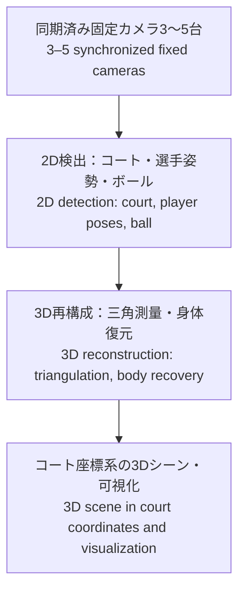

# Tennis-Lab 🎾

## 概要と全体像 / Overview

同期済みの固定カメラ **3〜5台** のテニス動画から、コート座標系で選手の動作とボール軌道を3D再構成する研究用パイプラインです。各視点のコート・選手姿勢・ボールの2D検出を、カメラ校正・視点間の対応付け・三角測量と身体復元で統合します。

A research pipeline that reconstructs player motion and ball trajectories in court coordinates from **3–5 synchronized fixed cameras** filming tennis. It combines per-view 2D detection of the court, player poses and ball with camera calibration, cross-view association, triangulation and body recovery.




公開サンプル `video_000/clip_000` の3視点（左）と、同じフレームの3D再構成（右）です。
The three views of the public sample `video_000/clip_000` (left) and its 3D reconstruction at the same frame (right).

入力動画は事前に同期し、FPS・解像度・フレーム数を揃えます。入力の制約と、欠測・品質情報を含む出力形式は [パイプラインのREADME](src/tennis_scene/README.md) を参照してください。

Synchronize the videos beforehand and use matching FPS, resolution and frame counts. See the [pipeline README](src/tennis_scene/README.md) for input constraints and the output format, including missing observations and quality information.

## 導入手順 / Getting started

Linux x86-64、またはNVIDIA GPUが利用できるWSL2で、Python 3.11・uv・CUDA toolkit 13系と対応ドライバを使います。検証GPUはRTX 5060 Ti（VRAM 16 GB）で、より小さいVRAMでの動作下限は未検証です。C++ビルドツールとffmpegなども必要です。

Use Linux x86-64 or WSL2 with an NVIDIA GPU, Python 3.11, uv, a CUDA 13 toolkit and a compatible driver. The tested GPU is an RTX 5060 Ti with 16 GB VRAM; minimum VRAM has not been established. C++ build tools and ffmpeg are also required.

**[導入ガイド](docs/installation/README.md)を上から順に進めてください。** 以下は流れの要約です。環境構築の全コマンド、資産の配置先・SHA-256、検証環境と実測値はガイドを正本とします。

**Follow the [installation guide](docs/installation/README.md) in order.** The steps below are an overview. The guide is the canonical source for complete setup commands, asset paths and SHA-256 checksums, the tested environment and measurements.

1. **取得・依存同期 / Clone and sync** — リポジトリをcloneし、`uv sync --locked` で環境を作り、DINOとDINOv3のsubmoduleを初期化します。[cloneと依存関係](docs/installation/README.md#cloneと依存関係--clone-and-sync)を参照してください。<br/>
   Clone the repository, create the environment with `uv sync --locked`, and initialize the DINO and DINOv3 submodules. See [Clone and sync](docs/installation/README.md#cloneと依存関係--clone-and-sync).
2. **CUDA拡張 / CUDA extension** — GPUに対応する設定で[DINO CUDA拡張](docs/installation/README.md#dino-cuda-extension)をビルドし、生成されたライブラリを `PYTHONPATH` に設定します。<br/>
   Build the [DINO CUDA extension](docs/installation/README.md#dino-cuda-extension) for your GPU and add the generated library directory to `PYTHONPATH`.
3. **重み・サンプル / Weights and sample** — 自作重みはHF Model [`Motoki098/tennis-lab-models`](https://huggingface.co/Motoki098/tennis-lab-models)、3カメラのサンプルはHF Dataset [`Motoki098/tennis-lab-multiview-sample`](https://huggingface.co/datasets/Motoki098/tennis-lab-multiview-sample)から取得します。取得CLIと、第三者の全重み・body model・補助資産の公式入手先は[必要資産の表と取得案内](docs/installation/README.md#必要資産--required-assets)にあります。登録・申請が必要な資産も、各配布元の条件に従って揃えます。<br/>
   Get the project weights from HF Model [`Motoki098/tennis-lab-models`](https://huggingface.co/Motoki098/tennis-lab-models) and the three-camera sample from HF Dataset [`Motoki098/tennis-lab-multiview-sample`](https://huggingface.co/datasets/Motoki098/tennis-lab-multiview-sample). The download CLIs and official sources for all third-party weights, body models and supporting assets are in [Required assets](docs/installation/README.md#必要資産--required-assets). Obtain assets requiring registration or approval under their upstream terms.
4. **一括確認 / Preflight** — [preflight](docs/installation/README.md#一括確認--preflight)で全資産とCUDA拡張を検査し、`status: ok`・終了値0を確認します。欠損や不一致があれば解消してから進めます。<br/>
   Run [preflight](docs/installation/README.md#一括確認--preflight) to check all assets and the CUDA extension. Continue only after it reports `status: ok` and exit code 0; resolve missing or mismatched assets first.
5. **再構成・可視化 / Reconstruct and visualize** — [サンプル実行](docs/installation/README.md#サンプルで3d再構成--run-the-sample)でSceneResult v2を保存・検査し、[可視化](docs/installation/README.md#可視化--visualize)でMP4を生成します。<br/>
   [Run the sample](docs/installation/README.md#サンプルで3d再構成--run-the-sample) to save and validate a SceneResult v2, then [visualize it](docs/installation/README.md#可視化--visualize) as an MP4.

開発用の環境診断・lint・型検査・テストは [spinのREADME](.spin/README.md) を参照してください。
For development environment checks, linting, type checking and tests, see the [spin README](.spin/README.md).

## 参照リポジトリとライセンス / References and licenses

独自コード・文書は、個別の表示があるものを除き [Apache License 2.0](LICENSE) です。移植・参照したリポジトリ、第三者のコード・重み・body model資産・データ・論文の出典と条件は [LICENSES.md](LICENSES.md) にまとめています。これらの第三者素材と、下記の公開重み・サンプル・GIFにはルートのApache-2.0は適用されず、それぞれの条件が適用されます。

Original code and documentation are under the [Apache License 2.0](LICENSE) unless stated otherwise. [LICENSES.md](LICENSES.md) records the repositories used or adapted and the sources and terms for third-party code, weights, body-model assets, data and papers. These third-party materials and the published weights, sample and GIF below retain their respective terms and are outside the root Apache-2.0 license.

- **ボール検出の重み / Ball detector weights:** [CC BY-NC 4.0](https://creativecommons.org/licenses/by-nc/4.0/legalcode.en)。帰属表示等の条件に従い、非商用の複製・共有・改変物の共有ができます。<br/>
  Noncommercial copying, sharing and sharing of adaptations are permitted subject to attribution and the other license terms.
- **コート検出の重み / Court detector weights:** [DINOv3 License](https://github.com/facebookresearch/dinov3/blob/main/LICENSE.md)。DINOv3のbackboneを含むため、checkpoint全体に同契約を適用します。独自の非商用条件は追加しません。<br/>
  The entire checkpoint is distributed under the DINOv3 License because it includes the DINOv3 backbone. No separate project-specific noncommercial restriction is added.
- **公開サンプルと上のGIF / Public sample and GIF above:** [CC BY-NC-ND 4.0](https://creativecommons.org/licenses/by-nc-nd/4.0/legalcode.en)。帰属表示等の条件に従い、非商用の共有ができます。改変物の作成・複製は非商用で認められますが、その共有は許諾されません。<br/>
  Noncommercial sharing is permitted subject to attribution and the other license terms. You may create and reproduce adaptations for noncommercial purposes, but the license does not permit sharing them.

研究・非商用デモは想定用途の説明であり、各ライセンスに追加の用途制限を設けるものではありません。第三者資産・パイプライン出力の条件と、AFLink重みの利用条件が未確認であることも含め、詳しくは [LICENSES.md](LICENSES.md) を確認してください。

Research and noncommercial demos are intended uses, not additional restrictions on the licenses. See [LICENSES.md](LICENSES.md) for the terms of third-party assets and pipeline outputs, including the unresolved usage terms of the AFLink weights.

サンプル・GIFの帰属表示: © 2026 Motoki0705, “Tennis-Lab Multiview Sample” / GIF。GIF内の身体はGVHMRによる復元を描画しています。SMPL-Bodyの出典はMax Planck Institute for Intelligent Systems（[Body License / CC BY 4.0](https://smpl.is.tue.mpg.de/bodylicense.html)）です。[帰属表示と適用範囲の詳細](LICENSES.md#サンプルdatasetの利用条件)を参照してください。

Sample and GIF attribution: © 2026 Motoki0705, “Tennis-Lab Multiview Sample” / GIF. The bodies shown in the GIF are recovered with GVHMR. SMPL-Body is attributed to the Max Planck Institute for Intelligent Systems ([Body License / CC BY 4.0](https://smpl.is.tue.mpg.de/bodylicense.html)). See the [full attribution and scope](LICENSES.md#サンプルdatasetの利用条件).

### 引用 / Citation

以下はリポジトリの引用例です。再現のため、利用したcommitも併記してください。上流研究の引用・帰属表示は [LICENSES.md](LICENSES.md) から各出典を辿って確認してください。

The suggested repository citation is below; include the commit used for reproducibility. Follow the sources linked in [LICENSES.md](LICENSES.md) for upstream citation and attribution requirements.

```bibtex
@software{tennis_lab,
  author = {{Tennis-Lab contributors}},
  title = {Tennis-Lab},
  url = {https://github.com/Motoki0705/tennis-lab}
}
```
