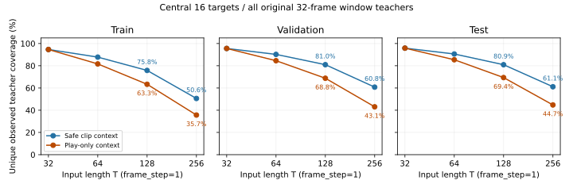

## 結論と状態

CPU調査は完了した。**比較条件は未合意**で、#1369 の人間の判断と親issueへの反映は残る。
推奨案は、文脈をreference/PTSの境界を守ったclip内へ広げ、中央16枚を固定し、
まずT=128上限の共通集合を採るもの。T=256は全splitで成立するが、短いclip・低FPS・TrackNetの教師を強く落とす。
256を主比較へ含める場合は全Tを256共通集合へ揃え、低いcoverageを受け入れる判断が必要。
具体的な未合意規則は同runの[評価プロトコル案](../../runs/run-ball-temporal-target-survey-20261022/protocol.md)。
親の比較目的・固定軸・実験行列は[親issue #1367](https://github.com/Motoki0705/tennis-lab/issues/1367)を参照する。

## 入力・列挙・分母

[先行転送調査](000061-run-ball-colab-transfer-feasibility-20261022.md)と同じ固定manifest・snapshotを使った。
全1,800 clips・1,065,949 framesのindex/metadataと必要な原注釈だけを読み、RGB復号・GPU・Colab/Drive操作はしていない。
入力の固定値・API版・検査結果は[inputs.json](../../runs/run-ball-temporal-target-survey-20261022/inputs.json)。
全69除外clipもmetadataで確認し、元manifestの窓が既存APIから再生成されることと、
既存clipの意味的identity、split間の元動画group非重複を検査した。

anchorは元manifestのframe_step=1・32枚窓。中央 `[start+8,start+24)` を教師・採点領域候補とし、
Tを変えても同じ中央16枚を使う。(a)は文脈全体が同一play区間内、(b)はclip内の
`hybrid.eligible_spans`（reference-onlyと大きいnative PTS gapを跨がない）内。play外の教師なし文脈を許す。
新たな不在専用anchorやclip全体の均一gridを採択した調査ではない。

先行JSONには本文の表にないvalidation/testの幾何計数も保存されていた。今回(a)の全split・Tの候補数は
そのJSONと一致した。今回追加したものは中央教師の分類・不在の原注釈照合、(b)、一意教師coverageと構成監査。

以下の教師数は**中央領域の一意frame数**。observedは単一観測球、emptyは確認済み`reviewed_empty`、
outは単一`out_of_frame`、maskは未知・推定・未レビュー・複数球などの除外。
既存hybrid APIでChat空ラベルの元注釈hash・frame対応・notesを検証し、
1,120 Chat clipsで検証した空ラベルのうち、notes付き14,347 framesを不在から除外した。
元窓全32枚の一意教師を主なcoverage分母とし、中央16枚だけの分母・snapshot全体の分母もJSON/CSVに残した。

| split | 元32窓数 | observed分母 | empty分母 | out分母 | 中央16だけにしたobserved保持率 |
|---|---:|---:|---:|---:|---:|
| train | 31,868 | 490,492 | 134 | 1,932 | 94.62% |
| val | 5,632 | 85,626 | 2 | 304 | 95.55% |
| test | 6,046 | 91,456 | 5 | 270 | 95.83% |

中央16化は1窓の教師を半分にするが、元窓が重なるため、一意observedの減少は約4〜5%にとどまる。
全mask中央ブロックは学習候補から明示的に除く。表の候補数はこの除外前で、「有効」は除外後。
位置教師がなく確認済み不在だけの中央ブロックは残す。幾何候補のmask数と、
除外後の`usable_masked`を区別する。教師数とcoverageはこの除外で変わらない。

## (a) 文脈もplay区間内

| split | T | 中央候補 / 有効 | clips | groups | observed | empty | out | mask | observed coverage |
|---|---:|---:|---:|---:|---:|---:|---:|---:|---:|
| train | 32 | 31,868 / 31,809 | 1,324 | 254 | 464,094 | 127 | 1,628 | 30,490 | 94.62% |
| train | 64 | 26,775 / 26,726 | 1,306 | 254 | 400,399 | 105 | 1,356 | 26,540 | 81.63% |
| train | 128 | 20,768 / 20,730 | 1,213 | 253 | 310,619 | 73 | 1,015 | 20,581 | 63.33% |
| train | 256 | 11,678 / 11,656 | 855 | 227 | 174,877 | 29 | 555 | 11,387 | 35.65% |
| val | 32 | 5,632 / 5,621 | 190 | 33 | 81,814 | 0 | 271 | 6,066 | 95.55% |
| val | 64 | 4,874 / 4,867 | 188 | 33 | 72,386 | 0 | 217 | 5,381 | 84.54% |
| val | 128 | 3,967 / 3,960 | 182 | 33 | 58,871 | 0 | 174 | 4,427 | 68.75% |
| val | 256 | 2,485 / 2,482 | 148 | 33 | 36,872 | 0 | 91 | 2,797 | 43.06% |
| test | 32 | 6,046 / 6,032 | 217 | 33 | 87,644 | 5 | 213 | 6,722 | 95.83% |
| test | 64 | 5,267 / 5,254 | 213 | 33 | 78,100 | 5 | 178 | 5,989 | 85.40% |
| test | 128 | 4,286 / 4,274 | 208 | 33 | 63,430 | 5 | 138 | 5,003 | 69.36% |
| test | 256 | 2,777 / 2,771 | 152 | 33 | 40,913 | 5 | 72 | 3,442 | 44.74% |

## (b) reference/PTS境界を守るclip内文脈

| split | T | 中央候補 / 有効 | clips | groups | observed | empty | out | mask | observed coverage |
|---|---:|---:|---:|---:|---:|---:|---:|---:|---:|
| train | 32 | 31,868 / 31,809 | 1,324 | 254 | 464,094 | 127 | 1,628 | 30,490 | 94.62% |
| train | 64 | 29,188 / 29,134 | 1,311 | 254 | 430,453 | 113 | 1,532 | 28,259 | 87.76% |
| train | 128 | 25,182 / 25,136 | 1,289 | 254 | 371,688 | 81 | 1,324 | 24,395 | 75.78% |
| train | 256 | 16,783 / 16,747 | 1,179 | 253 | 247,993 | 39 | 865 | 16,592 | 50.56% |
| val | 32 | 5,632 / 5,621 | 190 | 33 | 81,814 | 0 | 271 | 6,066 | 95.55% |
| val | 64 | 5,261 / 5,254 | 189 | 33 | 77,244 | 0 | 254 | 5,656 | 90.21% |
| val | 128 | 4,721 / 4,714 | 185 | 33 | 69,324 | 0 | 220 | 5,144 | 80.96% |
| val | 256 | 3,552 / 3,546 | 182 | 33 | 52,030 | 0 | 167 | 4,066 | 60.76% |
| test | 32 | 6,046 / 6,032 | 217 | 33 | 87,644 | 5 | 213 | 6,722 | 95.83% |
| test | 64 | 5,646 / 5,633 | 214 | 33 | 82,830 | 5 | 193 | 6,242 | 90.57% |
| test | 128 | 5,037 / 5,025 | 211 | 33 | 74,014 | 5 | 179 | 5,483 | 80.93% |
| test | 256 | 3,812 / 3,804 | 182 | 33 | 55,884 | 5 | 127 | 4,309 | 61.10% |

## coverageと構成の偏り

(b)のT=256は(a)より多くの教師を保つが、元32窓の教師に対してtrainで約半分となる。
T=128ならtrain/validation/testで75.78%/80.96%/80.93%を保ち、254/33/33 groupsが残る。
T=256では50.56%/60.76%/61.10%、253/33/33 groups。group数がほぼ保たれても、その中のframe構成は大きく変わる。

| split/source | T=128 observed / 元32比 | T=256 observed / 元32比 | observed groups 128→256 |
|---|---:|---:|---:|
| train / Chat | 348,720 / 76.93% | 236,468 / 52.17% | 245→245 |
| train / Meiji | 14,944 / 68.33% | 7,394 / 33.81% | 1→1 |
| train / TrackNet | 8,024 / 52.38% | 4,131 / 26.96% | 8→7 |
| validation / Chat | 48,876 / 80.02% | 36,179 / 59.23% | 31→31 |
| validation / Meiji | 19,847 / 86.27% | 15,676 / 68.14% | 1→1 |
| validation / TrackNet | 601 / 39.08% | 175 / 11.38% | 1→1 |
| test / Chat | 49,161 / 81.16% | 37,522 / 61.95% | 31→31 |
| test / Meiji | 23,882 / 82.91% | 17,919 / 62.21% | 1→1 |
| test / TrackNet | 971 / 46.66% | 443 / 21.29% | 1→1 |

例として(b)のtrainでは、25 FPSの保持率がT=128の64.11%から256の24.39%へ、
60 FPSは83.02%から66.88%へ変わる。T=256は低FPS側を強く落とす。
正確な有理数FPSを丸めずに集計した全T・両案のsource/FPS/cross内訳は
[source-fps.csv](../../runs/run-ball-temporal-target-survey-20261022/source-fps.csv)。

元32窓から(b)T=256へ絞ると、trainのobservedに占めるChatは92.42%→95.35%、
Meijiは4.46%→2.98%、TrackNetは3.12%→1.67%。
validationではMeijiの単一元動画 `video_000` が26.87%→30.13%、
testでは別の単一元動画 `video_001` が31.49%→32.06%を占める。
これは多数の独立したMeiji動画の成績を推定できる構成ではない。
元32窓と各共通集合の全group計数は同runの`groups-*.csv`にあり、0教師となったgroupも行を残した。

## 不在・遮蔽に関する限界

(b)T=128の共通集合に残る確認済み不在はtrain 1,405 / validation 220 / test 184 frames。
内訳はemptyが81/0/5、outが1,324/220/179。T=256では904/167/132まで減る。
validationのemptyは中央16化した時点で0なので、T上限や文脈条件を変えても回復しない。
自然遮蔽フラグを持つobserved教師も全split・全候補で0だった。未確認の遮蔽位置を教師へ昇格させて埋めない。

一方snapshot全体では確認済み不在がtrain 124,233 / validation 31,885 / test 35,763 framesある。
既存play anchorを中心にする今回の集合は、不在全体の評価には強い選択偏りがある。
確認済み不在のFPR/FNRは規則案で定義したが、emptyのvalidation支持数は0、
負例のあるsourceも限られるため、その適用範囲を必ず報告する。
全clipの不在性能も判断したい場合は、不在専用の共通target集合と較正・採点の位置付けを別途合意する。
この調査ではその新集合や学習混合比を決めていない。

## 代替案と下流への影響

- 推奨: (b)、中央16、T上限候補128、最大Tで成立する有効中央ブロックの共通集合。
  T=32にも前後8枚の文脈があり、窓先頭のMDDゼロと局所時間畳み込みの端から教師を離す。
  中央長を16以外へ変える場合は、この集計を流用せず教師数・窓端距離を再調査する。
- 256を主比較へ含める案: (b)の256共通集合を全T・両モデルへ適用。
  より長い文脈を検査できるが、短い/低FPSのデータへの一般化はこの集合だけから主張できない。
- (a)を選ぶ案: play外の画像を使わない範囲へ問題を限定する。
  trainのT=256ではobserved coverageが35.65%、227 groupsに減り、
  比較対象がさらに長いplay区間へ偏る。非playの文脈が害になるかはCPU調査から分からない。

採用後は #1372 が集合・中央maskを常設manifestへ変換し、#1374 が参照clipと原注釈を配布する。
今回の候補列挙は凍結manifestの代用品ではない。#1376 は同じ条件を保つGPU実行可否と予算を確認する。
上限を変更すれば共通集合も変わるため、32事前学習開始前に確定する。

## 再現・通常検証

実行入口・成果物形式・検証手順は同runの[README](../../runs/run-ball-temporal-target-survey-20261022/README.md)。
このrunはCPUでの幾何・教師集計であり、学習曲線・精度・速度の測定はない。TensorBoardは対象外。
画像payloadを開かず、元manifest/index/metadataと1,800 shardのsize/mtime/ctime/inodeが不変なことを検査した。
研究条件の合意とmainへの反映は親が行い、このworktreeからpush・issue/PRへの書き込みはしていない。
