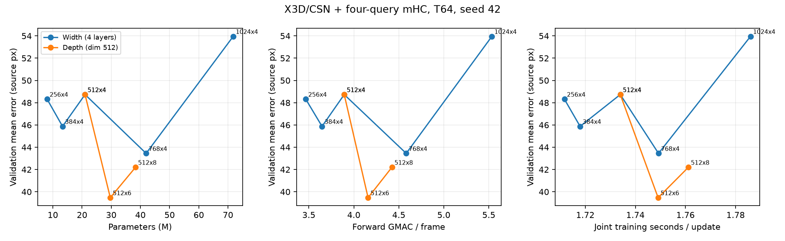

共通CNN＋DPT T32を10,000更新し、同じ共通encoderとAdamW状態から7条件のquery T64を独立に各6,000更新した。全52,000物理更新・固定validation・最終集計と実Drive保存を完了した。queryごとの来歴16,000更新を7回分の物理費用には数えない。5ch RGB＋MDD・720p・seed42・128 frames/updateを固定し、モデルの幅/層数だけを比較する。各queryは4本のstreamをmHCで混合し、head幅64、CNN凍結600、解除後CNN LR比0.1、warmup0、cosine horizon12000の前半6000、activation checkpointing無効・frame chunk nullを維持した。

| 条件 | mean px | median px | P95 px | ≤20px | params M | GMAC/frame | joint s/update |
|---|---:|---:|---:|---:|---:|---:|---:|
| d256・4層 | 48.318 | 21.932 | 201.501 | 44.48% | 8.026 | 3.466 | 1.712 |
| d384・4層 | 45.877 | 19.553 | 190.906 | 51.23% | 13.311 | 3.646 | 1.718 |
| d512・4層 | 48.733 | 25.800 | 184.108 | 30.59% | 21.021 | 3.893 | 1.734 |
| d768・4層 | 43.450 | 17.637 | 185.238 | 56.65% | 41.947 | 4.582 | 1.749 |
| d1024・4層 | 53.957 | 29.466 | 187.446 | 21.85% | 71.785 | 5.534 | 1.786 |
| d512・6層 | 39.471 | 13.210 | 178.311 | 67.26% | 29.673 | 4.158 | 1.749 |
| d512・8層 | 42.204 | 17.442 | 170.289 | 57.04% | 38.325 | 4.423 | 1.761 |

query 7条件で主指標の最小値は **query-d512-l6-T64の平均39.471px**。幅を大きくするほど主指標が改善する単調な関係は得られなかった。最も大きいparameter数の条件が最良という結果ではない。幅512は今回の固定6kでは4→6層で平均誤差が改善し、8層では6層より増えた。一方、P95は8層の170.289pxが最小で、主指標の最良条件と一致しない。単一seed・6k更新の観測であり、大容量モデルの一般的な優劣や十分に収束した場合の順序を示すものではない。seed分散・独立test、最良条件の追加学習は未評価である。

共通DPT T32・10k時点の平均誤差は34.432px、中央値8.873px、20px以内率86.14%で、いずれも今回のquery条件より良い。これはdecoder・T・学習段階と更新予算の異なる参考値で、容量だけを変えた7条件の比較とは分ける。query追加で精度が改善したとは結論しない。

誤差・20px以内率は85,473 observed framesが分母で、validation全体は128,668 owner frames、scoredは117,358 frames。同じvalidationのowner/teacher/frame IDとdecoderを全8構成で照合し、全queryの6,000更新についてpack ID・抽出順と拡張の一致を確認した。全更新は有限値、128 frames/updateであり、各条件のsource・固定plan・初期化来歴・freeze/LRも一致した。評価はすべてvalidationで、独立testとは区別する。CNN構成の異なる#1367/#1514との直接の優劣比較や、sceneの採用モデル変更は行っていない。

joint時間はCNN凍結解除後さらに5更新を除いた更新606〜6000の中央値で、入力待ち・拡張・forward/backward・optimizerを含む。更新外のcompile・validation・Drive保存・入力検証は含まない。総parameterはCNN込み、理論GMACはforwardのConv/Linear/attention行列積で、正規化・活性化・MDD・I/O・backwardを含まない。理論値から実測時間を代用せず、両方を図示した。容量2倍あたりの改善量は総parameter比のlog2で誤差差を割り、GMAC比による値も[全比較JSON](../../runs/group-i1675-capacity-scaling-s42-52k/summary.json)へ保持した。

学習は複数VMをまたぐ再開を含み、L4・ソフトウェア条件は維持したが、GPUクロックやI/O・compile cacheの状態を統制した反復速度測定ではない。1.712〜1.786s/updateという小さな差の再現性や、CNN/I/Oのどちらが実時間の律速かは、この測定だけでは判断しない。

実Driveの全8 completed世代について、receipt/markerの内容hash、全payloadの集合・サイズ・MD5を照合した。評価summary・全52,000行log・run設定・COMPLETED・latestを実bytes/SHAで読み戻し、元Git sourceと照合した。最終COMPLETEDとANALYSIS_COMPLETED、JSON/CSV/表/図はVMの閉じた出力とDriveの実bytesが一致し、元の固定report.pyをCPUで別の一時出力へ再計算したsummary JSONもbyte一致した。学習の再投入やGPU実測の追加はしていない。[検証記録](../../runs/group-i1675-capacity-scaling-s42-52k/verification.json)に実測の照合範囲を残した。

過去の一部条件は記録上のGit参照が未公開で、そのcommit objectを取得できなかった。参照を取得済みと扱わず、実行時に保存された全source hashを復元済みの固定コードへ直接照合した。全件の内容一致を確認し、記録上の参照・その取得可否・内容照合先commitを検証JSONで区別する。元の実行記録やcheckpointは書き換えていない。

重み・frame別予測・生logはDriveへ保持する。Gitには小さな指標・図・来歴検証結果だけを記録する。TensorBoardは使わずtrain.jsonlを正本とする。本groupで全容量比較が完了した現在地と主指標の最良条件をsummaryへ反映した。追加seed・独立testがないため、採用checkpointは維持する。
