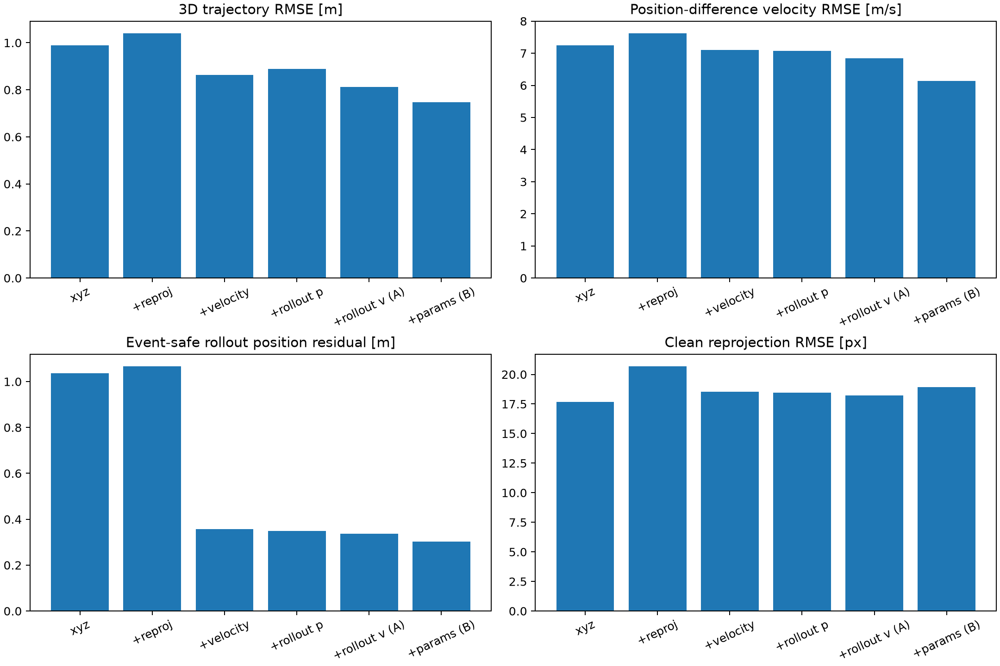
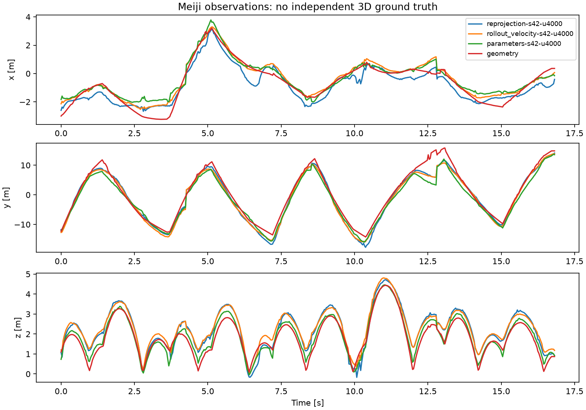
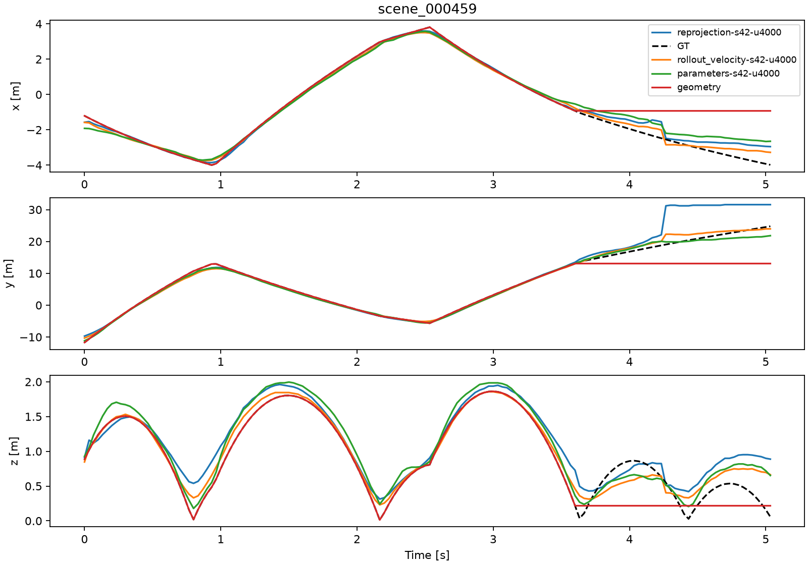

同じデータ・入力・backbone・更新予算で比較すると、候補Bの直接座標は主対照より3seedすべてでtest軌道RMSEが小さかった。一方、損失を一つずつ増やすほど全軸が改善する結果ではなかった。rollout位置だけの追加はseed42の位置RMSEを悪化させ、Bの積分出力は直接座標より大きく外れた。採用基準はユーザー指定で設けておらず、この結果から方式や本番checkpointを自動採用しない。

評価条件は[学習前に固定したプロトコル](../../runs/group-i1044-progressive-losses-u4000/protocol.md)。各4,000 optimizer updatesの短予算で、seed42の6条件と、validationだけで選んだB・主対照のseed43/44を計10run実施した。初回CUDA中断3件は失敗ノードに保存し、同seed・同設定で最初から再試行した。失敗を成功10件に含めず、途中checkpointを引き継いでいない。

trainは800scene中128frame以上の715sceneからランダム窓、validationは100sceneの固定中心128frame（短いものは全長）、testは全100scene・35,704frameを非重複128frame窓で推論し連結して評価した。カメラ抽選と欠損条件は全比較で固定。主指標は有効全frameの3D軌道RMSE[m]で、以下はすべてtestの値である。mean±SDはseedごとの値の算術平均±標本SDであり、独立したtest集合や信頼区間ではない。保存・再計算・ハッシュ照合は[最終評価run](000067-run-i1044-final-evaluation.md)に集約した。

| seed42条件 | 軌道RMSE m | 速度head RMSE m/s | 位置差分速度 RMSE m/s | 位置差分加速度 RMSE m/s² |
|---|---:|---:|---:|---:|
| 位置のみ | 0.988 | 13.599 | 7.250 | 305.617 |
| ＋clean再投影（主対照） | 1.040 | 14.036 | 7.622 | 320.301 |
| ＋速度教師 | 0.863 | 3.060 | 7.106 | 298.742 |
| ＋rollout位置 | 0.890 | 3.029 | 7.074 | 296.364 |
| ＋rollout速度（A） | 0.811 | 3.075 | 6.841 | 285.902 |
| ＋物理head等（B） | 0.748 | 2.503 | 6.135 | 257.419 |

| 同じseed42条件 | rollout位置 m | rollout速度 m/s | clean再投影 px | 地面下率 % | ODE fit残差 m |
|---|---:|---:|---:|---:|---:|
| 位置のみ | 1.036 | 0.897 | 17.681 | 0.0616 | 0.272 |
| ＋clean再投影（主対照） | 1.067 | 0.882 | 20.686 | 0.1176 | 0.586 |
| ＋速度教師 | 0.358 | 1.894 | 18.519 | 0.1008 | 0.263 |
| ＋rollout位置 | 0.350 | 1.870 | 18.462 | 0.0644 | 0.573 |
| ＋rollout速度（A） | 0.337 | 1.666 | 18.208 | 0.0588 | 0.522 |
| ＋物理head等（B） | 0.303 | 1.259 | 18.940 | 0.0420 | 0.201 |

速度教師追加では位置RMSEが1.040→0.863 m、速度headが14.036→3.060 m/sとなった。rollout位置追加は残差0.358→0.350 mと差分運動を少し下げるが、位置RMSEは0.863→0.890 mへ悪化した。rollout速度追加（A）では位置0.811 m、rollout速度1.666 m/sへ下がった。Bは位置0.748 m・速度head2.503 m/sだが、再投影はAの18.208→18.940 px、窓境界を跨がない差分加速度も61.222→69.017 m/s²へ悪化した。Bはheadと複数の補助損失を一群として加えた比較で、B内部の各項の独立効果は未同定。

位置/主対照では速度headを損失で拘束しないため、速度headのRMSEが大きくてもrollout速度残差は小さい。残差単独を運動の正確さとみなせない。ODE fitは最初の12clip内の各GT飛行区間の先頭最大32frame（6frame以上）に限定し、通常条件は3,541frame、支持率1・失敗0/12。全100sceneの物理適合や最適解を保証しない。

| seed | 主対照 test RMSE m | B test RMSE m | B−主対照 m | 主対照の全view欠損 m | Bの全view欠損 m |
|---|---:|---:|---:|---:|---:|
| 42 | 1.040 | 0.748 | -0.292 | 2.671 | 2.290 |
| 43 | 1.337 | 1.198 | -0.138 | 6.756 | 6.298 |
| 44 | 1.061 | 0.844 | -0.216 | 2.371 | 2.872 |

3seed平均±SDは主対照 **1.146±0.166 m**、B **0.930±0.237 m**（平均値の比で18.8%減）。方式選択にも使ったseed42を除く確認seed43/44では **1.199±0.195→1.021±0.250 m**。2つの確認seedは両方改善したが、少数seed・共通test集合の記述結果である。Bの平均速度headは13.399→2.483 m/s、rollout位置は1.017→0.325 m、再投影は20.163→17.993 px。一方、rollout速度残差は0.922→1.242 m/sと全seedで悪化した。欠損781frameではseed44が悪化しており、全体平均から欠損補完の一貫した改善は言えない。全指標のSDとpaired差は[repeated_seeds.json](../../runs/run-i1044-final-evaluation/report/repeated_seeds.json)、確認seedだけの集計は[posthoc.json](../../runs/group-i1044-progressive-losses-u4000/posthoc.json)。

層別の例（seed42、同じframe集合）:

| 層 | frame数 | 主対照 RMSE m | B RMSE m |
|---|---:|---:|---:|
| 観測あり | 34923 | 0.973 | 0.674 |
| 全view欠損 | 781 | 2.671 | 2.290 |
| イベント±2frame | 5951 | 0.933 | 0.623 |
| イベント近傍以外 | 29753 | 1.060 | 0.771 |
| 有効1view | 1343 | 3.401 | 2.012 |
| 有効6view | 5835 | 0.253 | 0.256 |
| hard | 8085 | 1.093 | 0.796 |
| clay | 16460 | 0.826 | 0.692 |
| grass | 11159 | 1.261 | 0.791 |
| clip長128未満 | 1019 | 1.054 | 1.552 |
| 欠損区間1–4frame | 20 | 0.948 | 0.723 |
| 欠損区間5–15frame | 144 | 4.396 | 3.934 |
| 欠損区間16frame以上 | 617 | 2.119 | 1.735 |

短clipと6viewではBが退行し、少数支持の欠損層もある。バウンド0/1の層は支持数0で値はnull。全23層×16条件の支持数と値は[strata.json](../../runs/run-i1044-final-evaluation/report/strata.json)。rollout・差分・再投影はそれぞれ固有の支持集合で、差分速度34,450、差分加速度33,208、再投影138,856観測（評価可能率1）のように分母を区別する。

| Bのseed | 直接座標RMSE m | GT区間で積分 m | 予測区間で積分 m | event F1 | 予測/正解event数 |
|---|---:|---:|---:|---:|---:|
| 42 | 0.748 | 4.338 | 2.366 | 0.717 | 2025/1154 |
| 43 | 1.198 | 4.244 | 2.753 | 0.725 | 1990/1154 |
| 44 | 0.844 | 4.230 | 2.564 | 0.724 | 1983/1154 |

GT区間・予測区間での積分はいずれも直接出力より誤差が大きい。GT区間はイベント境界を知る診断であり、初期状態・場は予測値なので数値的な上限性能を保証しない。予測eventの過剰分割によって状態を頻繁にresetし誤差累積が短くなる可能性があり、予測区間の積分がGT区間より良いことをイベント推定の優位とは解釈しない。この原因仮説は未分離。積分失敗0/100とは別に、全eventの一対一対応が成立しないclipを失敗とする厳密なpartition指標は各seed100/100だった。

Bのdrag RMSEは約0.00408 /m、windは1.633–1.638 m/s、有効Magnusは0.198–0.199 /s。eventの一致分の平均時刻差は0.32–0.65 msだが、余分なeventを除いた条件付き平均なのでF1/個数と併記する。全パラメータ・積分速度・支持数は[physics_head.json](../../runs/run-i1044-final-evaluation/report/physics_head.json)。

GT自己評価のrolloutは位置3.78e-7 m・速度4.36e-7 m/s。ジッターは位置RMSE0.0708 m、rollout位置0.100 m、1frame時間ずれは位置1.210 m、rollout位置1.215 mだった。衝突越境の対照は座標自体のRMSEが0でも、rollout位置0.227 m・速度4.596 m/sへ増える。GTのODE fit残差0.00760 mは有限回の非線形fit精度も含むため、厳密な積分自己検証とは分ける。幾何補間は全100clipで成立し位置0.884 m・再投影4.982 px・fit0.0500 mだが、B seed42より位置誤差が大きい。物理fitや再投影だけの良さを3D精度と同一視しない。旧9,000更新checkpointの全長testは0.998 mで、更新数・headが異なる参考値に限る。

実観測はMeijiの固定505frame、3camera、29.97003Hz、1,389観測（全view欠損0）。以下は独立3D GTのない再投影診断である。

| seed | 主対照 再投影px | B直接 再投影px | B予測区間積分 再投影px | 主対照/B直接 ODE fit残差m |
|---|---:|---:|---:|---:|
| 42 | 106.32 | 68.20 | 109.09 | 2.086/1.803 |
| 43 | 89.10 | 92.79 | 90.42 | 1.816/1.366 |
| 44 | 186.15 | 163.63 | 136.45 | 1.721/1.519 |

実観測の再投影はseed43で微悪化し、他2seedは改善した。固定2D注釈はmodel-assistedで、court点は保存校正から生成している。歪みを補正しない平面校正の誤差を含み、生の検出器からのend-to-end性能でもない。未知の実イベントを跨ぎ得る32frame固定窓fitは、GT区間内の合成rolloutと異なる。実3D精度向上や物理モデルの不一致をこのclipだけで確定できず、Cの学習補正を追加する根拠もまだない。

保存図で見つかった128frame境界を、全frameの主評価を変更せず事後診断した。内部境界k=128nのk−1,k,k+1は689/35,704frame（1.93%）で、位置誤差SSEの約8–10%を占めた。同一flight内でも窓を跨ぐ速度stencilは220/34,450（0.64%）、加速度は424/33,208（1.28%）しかないが、主対照の誤差SSEの80.55%・93.87%を占める。Bでも78.39%・92.90%である。境界以外の差分速度は主対照3.372→B2.861 m/s、差分加速度は79.830→69.017 m/s²。全長運動指標の大部分を窓の継ぎ目が占めるため、速度headの精度と連続した座標列の精度は別に判断する。

代表例scene_000459ではframe127→128の主対照yが22.099→31.198 m、GTは18.777→19.052 mだった。代表3clipは主対照test RMSEの最小・中央値・最大から可視化用だけに選び、方式やcheckpoint選定には用いていない。境界定義・全6条件の集計・計算dtypeと全体指標との照合は[CPUスクリプト](../../runs/group-i1044-progressive-losses-u4000/analyze_saved.py)とposthoc.jsonに保存した。repo rootから `PYTHONPATH=. .venv/bin/python knowledge/runs/group-i1044-progressive-losses-u4000/analyze_saved.py` で、元の重みやデータを使わず再計算できる。

再投影の外れ値も保存test配列で調べた。主対照seed42の138,856観測・20.686pxを再計算し、scene_000759がSSEの6.60%（frame124で2view平均398.86px、単view最大563.90px）、scene_000344が5.52%、scene_000300が5.27%を占めた。clip RMSE最大はscene_000300の97.13pxでframe0から大きく、窓境界だけでは説明できない。これら上位3clipの寄与は17.39%で、1clipだけの外れ値ではない。原因は未同定。学習時validationの125.816pxは別split・中心窓の値であり、その予測配列は保存されていないため該当frameの特定は未確認である。

出力勾配は200更新ごとにraw/weightedの両方を記録した。600更新以降の記録点で、各新損失が依存する出力へのweighted勾配は有限・非ゼロだった。依存しない出力の勾配は0であり、異常と扱わない。rollout位置のxyz勾配は後半に位置教師と同程度以上になる一方、Bの再構成→parameter勾配は数桁小さい。これは出力に対するL2で、trunkの勾配競合や損失間の角度を測ったものではない。[重み付き出力勾配（削除済み）](../../runs/run-i1044-final-evaluation/artifact-manifest.json#/files/57)、[学習曲線](../../runs/run-i1044-final-evaluation/report/validation_learning.png)と個別runのscalarが根拠。

次の検証候補は、窓の重複/結合による連続性を同じ推論条件で比較すること、長い同予算でA/B/主対照を追加seed確認すること、Bのheadと個々の補助損失を分離すること、独立した実3D/校正データで一般化を調べること。今回はこれらを追加実行していない。短予算の今回結果はB直接出力の改善を観測する材料となったが、全軸の優位・積分出力の採用・実運用での最適性は未実証のままである。

選定済み10 checkpointは2026-10-14にworktree外の `/home/kamimura/artifacts/tennis-lab/blcs/progressive-losses-20261013/` へコピーし、全6,235,579,406 bytesを元receiptのSHA-256と照合した。[保存先台帳](../../runs/group-i1044-progressive-losses-u4000/checkpoint-storage.json)に元path・新path・size・hashを記録し、各runノードのcheckpoint参照も更新した。新しい保存先の`selection.json`はpathだけを移した別receiptであり、knowledge内の元receipt・rawログ・repro・評価値は変更していない。

固定10runの追加seed・一括評価・report controllerは実行時commitに保存し、常設コードから除去した。[学習前固定プロトコル](../../runs/group-i1044-progressive-losses-u4000/protocol.md)と各runのreproが当時の入口を保持する。現行の学習・単独評価・保存再計算は[ablation](../../../src/tasks/blcs/ablation/README.md)に置く。この構造整理で再学習・方式再選択・testの再選定は行っていない。
