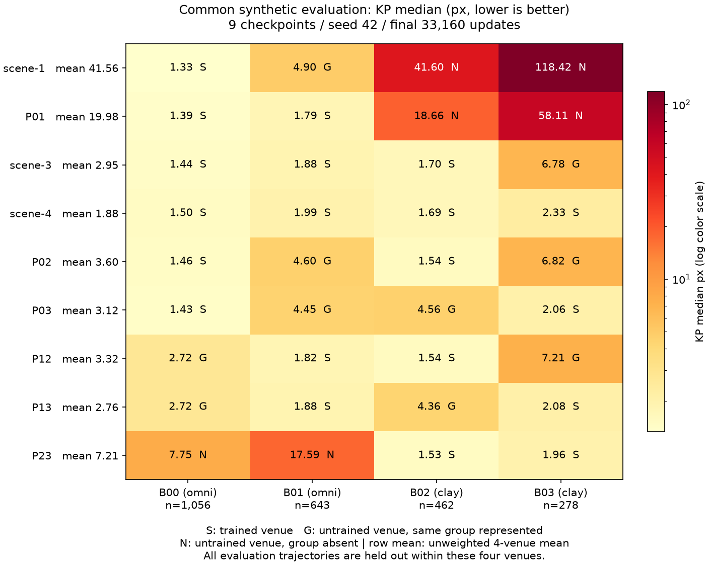

## 観測と現在判断

同じ群の2ペアは、異なる群の4ペアより実画像valの全5指標で悪い向きだった。主指標KP中央値の群平均は57.362726対4.567010 px、raw δは **+52.795716 px**。このseed42の全6ペア配置では、群を混ぜた方が良いという記述的な観測を得た。B01だけの不調では説明し切れず、P23（B02+B03）もKP中央値46.807262 pxと大きい。ただし、群の混合が一般に有効、サーフェスが原因、同じ群を増やしても無効、という因果結論にはしない。採用checkpointは変更しない。

P03（B00+B03）は今回9条件中の実画像KP中央値で最良（2.973217 px）。KP平均・SEG mIoU・LINE DiceもP03が最良だが、semantic-line mIoUはscene-4が最良（0.249646、P03は0.238451）。過去の4条件だけでの「4sceneが5指標全て最良」という観測は当時の範囲で正しく、旧[4条件group](000055-group-court-scene-diversity-colab-s42.md)やnode51〜54・証跡は書き換えない。

## 条件と来歴

B00/B01はオムニ、B02/B03はクレー。[人間との合意](https://github.com/Motoki0705/tennis-lab/issues/1581#issuecomment-6533537917)と既存manifestのscene membershipを照合した。P01は旧scene-2の学習済みcheckpointを一度だけ再利用し、新規に学習したのはP02/P03/P12/P13/P23の5条件。[manifest run](../synthetic_data_generation/000029-run-court-scene-pair-manifests-v1.md)はcross-topic memberとして参照し、複製しない。

全条件が合成train5,500枚、BS8、seed42、33,160更新。凍結DINOv3-S、Transformer384・8層・6heads・FFN1024、DPT512、dense head256/depth2、長辺512、warmup4,974、lr1e-4のcosine→1e-6、3,316更新ごとのval/saveを固定した。新5条件の原config guardがmanifest・出力先・再開指定以外の一致を確認した。最終checkpointの選択は固定更新数で、共通評価値による選び直しはしていない。

再開と完了・Drive保存は[実行run](000056-run-court-scene-pair-execution-s42.md)、全9件のraw評価hash・checkpoint/config/data digest・入力順序digestは[sources.json](../../runs/run-court-scene-pair-comparison-s42/sources.json)。全16stage完了と最終管理jobのcompleted/returncode0・Drive保存・所有Court session停止を記録した。原Colabは各実checkpoint payloadを検証してから完了印を公開し、今回のCPU集計は全checkpointを再download/再loadしたものではない。

## 実画像valの全6ペア

KPのpxは**長辺512の前処理後モデル座標**で、原画像のpxではない。KP平均・中央値は小さいほど良く、IoU/Diceは大きいほど良い。全checkpointを同じ実画像val2,211枚・同じIDと順序・評価batch8で測った。表の値は別々に学習したcheckpointの集計指標であり、独立seedの反復ではない。

| condition | kp_mean_distance_px | kp_median_distance_px | seg_miou | line_dice | semantic_line_miou |
| --- | --- | --- | --- | --- | --- |
| P01 | 83.445953 | 67.918190 | 0.163656 | 0.361014 | 0.190592 |
| P02 | 21.996677 | 3.492845 | 0.546425 | 0.417768 | 0.233586 |
| P03 | 18.578781 | 2.973217 | 0.560843 | 0.479189 | 0.238451 |
| P12 | 57.826164 | 7.782028 | 0.363125 | 0.372920 | 0.182549 |
| P13 | 37.305748 | 4.019950 | 0.340451 | 0.403202 | 0.188957 |
| P23 | 83.237862 | 46.807262 | 0.315832 | 0.290563 | 0.143752 |

[全精度の6ペアCSV](../../runs/run-court-scene-pair-comparison-s42/real_pairs.csv)と[9条件CSV](../../runs/run-court-scene-pair-comparison-s42/real_all.csv)。

### 群contrastと加法性

指標ごとに δ = mean(P01,P23) − mean(P02,P03,P12,P13)。各sceneは同群側に1回、異群側に2回現れるため、**加法的なscene主効果という仮定の下で**その寄与が相殺される。符号は変換せず、誤差の正値、IoU/Diceの負値が同群側の悪化を表す。主指標のδは条件ごとのKP中央値のcontrastであり、sampleをpoolした中央値の差やsample単位のpaired推論ではない。

加法性点検は (P02+P13) − (P03+P12)。加法モデルなら0だが、非加法なscene間作用と単一試行の確率的な差を分離できない。**分散、標準誤差、seed間のばらつきの推定、検定、信頼区間として用いない。**

| metric | same_group_mean | cross_group_mean | delta | additivity |
| --- | --- | --- | --- | --- |
| kp_mean_distance_px | 83.341908 | 33.926843 | 49.415065 | -17.102520 |
| kp_median_distance_px | 57.362726 | 4.567010 | 52.795716 | -3.242450 |
| seg_miou | 0.239744 | 0.452711 | -0.212967 | -0.037092 |
| line_dice | 0.325788 | 0.418270 | -0.092481 | -0.031139 |
| semantic_line_miou | 0.167172 | 0.210886 | -0.043714 | 0.001542 |

KP中央値の加法性点検は−3.242450 pxで0ではなく、異群平均4.567010 pxに対しても無視できる大きさとは扱わない。KP平均では−17.102520 pxである。δの観測と併記し、sceneの主効果以外の構造や再開/最適化の影響が残ることを示す。[全精度CSV](../../runs/run-court-scene-pair-comparison-s42/contrasts.csv)。

## B00の2,750枚に何を足すか

共通のB00上位2,750枚に、同じB00の次の2,750枚（scene-1）、B01（P01）、B02（P02）、B03（P03）を足す配置。各条件は同じ事前学習重みから独立に学習した5,500枚・33,160更新のモデルで、B00モデルへの継続学習を比べているわけではない。sceneを共有すればnested順位prefixを共有する。

| condition | added_2750 | kp_mean_distance_px | kp_median_distance_px | seg_miou | line_dice | semantic_line_miou |
| --- | --- | --- | --- | --- | --- | --- |
| scene-1 | B00 | 53.948612 | 5.813770 | 0.241277 | 0.439808 | 0.221295 |
| P01 | B01 | 83.445953 | 67.918190 | 0.163656 | 0.361014 | 0.190592 |
| P02 | B02 | 21.996677 | 3.492845 | 0.546425 | 0.417768 | 0.233586 |
| P03 | B03 | 18.578781 | 2.973217 | 0.560843 | 0.479189 | 0.238451 |

P01はscene-1より全5指標で悪化し、P03は全5指標で改善した。P02はKP・SEG・semantic-lineが改善する一方、LINE Diceは0.439808→0.417768と悪化した。これだけで任意の同群/異群scene追加に一般化しない。[B00追加CSV](../../runs/run-court-scene-pair-comparison-s42/b00_addition.csv)。

参考のscene-3とscene-4も総train5,500枚・合成fit-val500枚・33,160更新で同じ総予算だが、各sceneの配分が違う。scene-3はtrain B00/B01=1,833、B02=1,834、fit-val B00/B01=167、B02=166。scene-4は各train1,375、fit-val125。ペアは各train2,750、fit-val250、scene-1はB00 train5,500、fit-val500。3/4sceneとの順位はscene数・構成・各scene内密度が交絡する参考比較であり、追加sceneだけの効果としない。

## 4scene共通合成評価

全9checkpointに同じval軌道の採択画像2,439枚（B00=1,056 / B01=643 / B02=462 / B03=278）を使った。学習時の条件別500枚合成valとは別の共通評価集合。どのtrain軌道とも重複しないが、同じ4会場内の別軌道であり、新しい未見会場の評価ではない。

各セルを **S＝学習済みscene、G＝未学習scene・同群を学習済み、N＝未学習scene・同群なし** に区分する。以下はKP中央値px。行の平均は4sceneを同じ重みで平均し、sample数で重み付けしない。scene中央値の単純平均であって2,439画像のpooled中央値ではない。

| 条件 | B00 | B01 | B02 | B03 | 4scene単純平均 |
|---|---:|---:|---:|---:|---:|
| scene-1 | 1.334 S | 4.896 G | 41.602 N | 118.423 N | 41.564 |
| P01 | 1.389 S | 1.786 S | 18.656 N | 58.109 N | 19.985 |
| scene-3 | 1.438 S | 1.882 S | 1.697 S | 6.779 G | 2.949 |
| scene-4 | 1.502 S | 1.985 S | 1.692 S | 2.331 S | 1.878 |
| P02 | 1.457 S | 4.598 G | 1.540 S | 6.824 G | 3.605 |
| P03 | 1.426 S | 4.449 G | 4.561 G | 2.058 S | 3.123 |
| P12 | 2.717 G | 1.821 S | 1.543 S | 7.214 G | 3.324 |
| P13 | 2.720 G | 1.880 S | 4.363 G | 2.084 S | 2.762 |
| P23 | 7.755 N | 17.590 N | 1.531 S | 1.964 S | 7.210 |

[全5指標の36セル・区分CSV](../../runs/run-court-scene-pair-comparison-s42/synthetic_long.csv)と[全CSV/JSONの再現bundle](../../runs/run-court-scene-pair-comparison-s42/README.md)。各指標の9×4値と4scene平均を別CSVとcomparison.jsonへ保存した。

scene-1の未学習クレーB02/B03（N）は41.602/118.423 px、P01でも18.656/58.109 pxで大きい。P23の未学習オムニB00/B01（N）は7.755/17.590 px。同じ群がある未学習scene（G）はこの行列では全てNより低い範囲だが、例えばP02のB01=4.598やB03=6.824 pxに対し、学習したsceneの誤差は約1.5 pxで、同じ群があれば完全に代替できるわけではない。G/Nは異なるscene・学習組合せなので、区分間を統制された因果比較として扱わない。scene-4の4scene平均は1.877616 pxで、この合成主指標では最良。実画像の最良P03とは順位が異なる。

## 学習履歴と制約

- **単一seed42**。全数値は別々の条件のcheckpoint指標で、seed間の変動は未測定。検定・CI・有意差・一般的因果効果を主張しない。
- **再開**。旧P01/scene-2は26,528、新P03は19,896、P13は6,632、P23は29,844更新から再開。optimizer/scheduler/loops/RNG等のfull-stateを戻したが、不完全epochのsampler位置・worker RNGの厳密継続は保証しない。VM消失前の未保存末尾の実最終更新はnullを保持する。
- **履歴の切断**。新5ペアのTensorBoard8ファイルを選択取得・内容照合し、旧attemptは対応する保存更新までを採用した。P03/P13/P23の未採用train/loss末尾をそれぞれ24/5/61点除外し、10個のscheduled validation更新を確認した。曲線はfit-timeの合成500＋実画像2211 aggregateであり、本表の最終domain別指標や共通合成2439指標と同じではない。eventファイルはDriveに保持する。
- **群の交絡**。オムニ/クレーの違いは会場のコート面数・照明・生成密度等とも結び付いている。結論の範囲はサーフェスを含めて似たscene群であり、surfaceだけの効果を分離していない。
- **評価の範囲**。合成は同じ会場内の新しい軌道。実画像2211 valは過去比較と同じ集合で、独立した新規撮影testではない。旧条件別合成val500枚の値を共通評価値へ読み替えない。
- **採用**。この比較で標準pipelineやcheckpointを変更しない。主指標の最良と本番での下流精度・安定性の採用判断は別である。

後続候補はseed43/44での差の再現性、3sceneから1つずつ抜く配置、会場を固定したsurface対照、実画像のsurface層別評価。これらは今回実施していない。新しい予算・実験の採択はこの記録から自動的には決めない。

## 記録の検証とsummary

[集計run](000066-run-court-scene-pair-comparison-s42.md)のcompare.pyはraw hash・identity/order/checkpoint来歴を検証し、crosscheck.pyがrawから独立に再計算する。手計算による数値テスト、不正入力guard、再開末尾の切断テストを先に設計した。過去の4学習node/4旧run・旧group・manifest nodeは編集せず、新nodeと関係だけを追加した。

summary_impact: updated。Courtの「manifestまで済み・学習評価は今後」という記述を完了した全6ペアの観測と限界へ置き換え、次の比較候補を更新する。現行採用checkpointとdeployment registryは変更しない。
