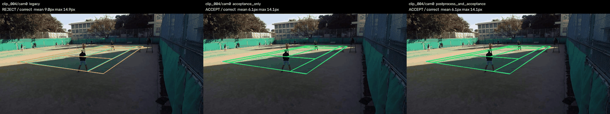
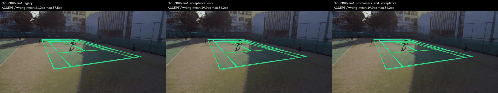
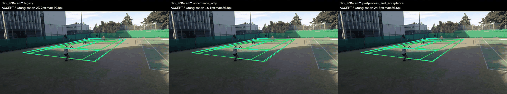
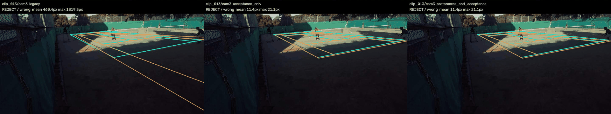

全276件の受入目標は未達。新しい採否・後処理は誤採用を増やしたため、現案のmerge・採用を推奨しない。
`status`は評価の実行状態であり、issueの受入合格を意味しない。閾値や参照を結果に合わせて変更していない。
現在の後処理品質と次に必要な証拠が明らかになったため、`summary_impact: updated`とする。

## 固定した条件と再現

親の実装指示（decision `034d02f3ff9549ccb586f02dc859db6b`、turn `e44ec0d835d84da4a40866b173f394f1`）で、
2026-11-16の人間の「4cameraともそのまま使う」という承認を受けた。
参照のanchor点・Hはplanningから一切変更せず、`human_reviewed` / `approved_for_evaluation`と承認根拠だけを記録した。
原画像1920×1080の**参照**の画像内KPを共通maskとし、平均10px以下かつ最大25px以下を正しいとする。
推定が画像外へ出ても採点対象から外さず、参照の画像外外挿は採点しない。
許容差・誤採用0・正しい推定の採用90%以上の目標は全件取得前にprotocolへ固定した。

旧処理／採否のみ変更／後処理も変更の3条件。同じframe 0、同じcheckpoint・decoderのraw KP/LINEを使う。
旧幾何は`b46b97869`、新幾何はbundleの`current_geometry/`に固定し、評価中の作業treeの編集から分離した。
GPU取得3ジョブは共有queue、half、codex、issue 2190で完了した。モデルの学習や動画内共有は実施していない。
全candidate配列とrawはoutputsに保持し、Gitには小さな集計、正確なscript・job・source snapshot、入力hash、図を保存した。

旧条件の採否は元可視化の276/276件と一致し、camera別採用29/63/52/8も再現した。
領域またはinlier数が違った7件は`legacy-reproduction.json`に保持した。GPU再実行と数値処理の差を分離しておらず、
過去の描画Hとの完全同一性は主張しない。以下の旧値は**今回の凍結rawに対する旧処理の再評価**である。

## 全276件の混同行列

各条件は候補を順位付けして1つ選び、採否を決める。拒否時は品質cost最良の診断候補を採点するが、
そのHを下流へ流すfallbackはない。TP=正しい採用、FN=正しい診断候補の拒否、FP=誤った採用、TN=誤った診断候補の拒否。
条件ごとに選択候補も変わるため、分母の縮小を見逃さないよう、後段で「全候補に正解が存在する画像」の救済率も示す。

| camera | 条件 | TP | FN | FP | TN | 正しい候補の採用率 |
|---|---|---:|---:|---:|---:|---:|
| cam0 | 旧処理 | 1 | 3 | 28 | 37 | 25.0% |
| cam0 | 採否のみ | 4 | 0 | 38 | 27 | 100.0% |
| cam0 | 後処理も変更 | 2 | 0 | 38 | 29 | 100.0% |
| cam1 | 旧処理 | 4 | 0 | 59 | 6 | 100.0% |
| cam1 | 採否のみ | 3 | 0 | 48 | 18 | 100.0% |
| cam1 | 後処理も変更 | 2 | 0 | 49 | 18 | 100.0% |
| cam2 | 旧処理 | 0 | 0 | 52 | 17 | 対象0件 |
| cam2 | 採否のみ | 0 | 0 | 65 | 4 | 対象0件 |
| cam2 | 後処理も変更 | 0 | 0 | 65 | 4 | 対象0件 |
| cam3 | 旧処理 | 3 | 1 | 5 | 60 | 75.0% |
| cam3 | 採否のみ | 0 | 2 | 24 | 43 | 0.0% |
| cam3 | 後処理も変更 | 0 | 2 | 24 | 43 | 0.0% |
| all | 旧処理 | 8 | 4 | 144 | 120 | 66.7% |
| all | 採否のみ | 7 | 2 | 175 | 92 | 77.8% |
| all | 後処理も変更 | 4 | 2 | 176 | 94 | 66.7% |

旧処理では正解候補が存在する43画像中8画像を採用（18.6%）、採否のみでは7/43（16.3%）、
後処理も変更では4/40（10.0%）。cam2は全828候補中に許容差を満たすものがなく、採否だけでは正解を作れない。
全3312候補を個別に判定すると、旧TP/FN/FP/TN=15/37/389/2871、採否のみ13/39/351/2909、
後処理込み11/38/349/2914。候補gateのFP数は減っても、最終の領域選択では誤採用が増えた。
全件CSVとcamera別集計はbundleの`meiji4-cases.csv` / `meiji4-summary.json` / `all-candidate-confusion.json`に保存した。

## 誤差とclip間のばらつき

下表の誤差は各画像の可視参照KP平均誤差の中央値。ばらつきはcamera別・全14投影点の
clip中央値からの距離p95で、画像外の外挿も含む。拒否された診断候補を含み、採用された出力だけの精度ではない。

| camera | 誤差中央値px：旧 / 採否 / 後処理 | clipばらつきp95 px：旧 / 採否 / 後処理 |
|---|---|---|
| cam0 | 16.73 / 18.02 / 18.19 | 34.68 / 42.94 / 42.84 |
| cam1 | 14.15 / 15.10 / 14.93 | 14.69 / 14.30 / 13.71 |
| cam2 | 22.22 / 21.08 / 20.83 | 20.65 / 21.72 / 21.61 |
| cam3 | 16.22 / 16.41 / 16.13 | 122.93 / 41.84 / 38.25 |

cam3の画像別平均誤差の平均は50.40→18.54→17.93pxと改善したが、中央値はほぼ変わらない。
極端な外挿の裾を減らした結果であり、参照との一致や受入合格とは解釈しない。
新処理で採用したcam3の24画像はすべて許容差外だった。
採用出力だけの画像別平均誤差の平均も11.19→16.71→16.61pxと悪化した（`accepted-metrics.json`）。

左から旧処理／採否のみ／後処理も変更。水色=承認参照、緑=採用、橙=拒否した診断候補。
元解像度の図はoutputsに保持した。画像の見た目の「概ね整合」を今回の数値上の正解に置き換えていない。

## 実装と失敗の解釈

- native gridの境界1cell未満、1cell以内に重なるsemantic KPを等式制約から除外し、rawは保持する。
  最大8点の選択はconfidenceだけでなくtemplate上の分布を考慮する。境界・重複indexを診断へ残す。
- seedで見えた線を最適化中に画像外へ移しても残差から消さない。元から見えない線は要求しない。
- gateは見える各線の一致と長手方向のcoverage、縦横の独立支持、正規化条件数、全14点の投影不確かさ、
  線1本を除いた局所影響を確認する。各物理線を1群として扱い、画素数を独立制約数に数えない。
  共通の元画像対角で距離を比較し、全点が画像内という条件を廃止した。閾値は参照に合わせて探索していない。
- `quality.schema=court_quality_v1`のscoreは低いほどよいcostで、誤差の推定値や正解確率ではない。
  品質不合格は`quality_rejected`、採用Hはnull、調査Hは別field、下流はゼロ・全無効。
  設定と実装identityをcacheに含め、暗黙の別推定への切替は設けていない。

今回のscoreは、同じモデルが出したKP/LINEの相互整合性を高く評価する。
LINEの位置自体がずれていれば、局所条件数がよくても誤りを証明できない。これが誤採用を残す原因候補であり、
参照なしの品質scoreだけを#2191の正解保証に使ってはいけない。
正解候補を落としている点もあり、外挿不確かさと順位が実精度を適切に分離できていない。
新処理で正しい候補を拒否した38候補の理由は、`unstable_projection`28、
`visible_line_mismatch`14、`unstable_line_influence`11（重複あり）。
画面外14点までの不確かさをgateにすることが、可視参照点では正しい部分観測を過剰に落とす可能性も残る。
同一画像のcrop間rawを統合する試案も少数例で試したが、改善が安定せず採用しなかった。
次に検討するなら、原画像の塗線へ独立に位置合わせしてモデルLINEの系統誤差を検出する方法が必要。
これは追加の実装方針として親へ返し、今回の評価値を良く見せるために参照や閾値を動かさない。

## 回帰・検証

全GPU取得・旧新幾何処理・3条件の品質集計を完了した。実画像資産は正規の`storage_tier hydrate`で復元した。
元実画像のtestは定義されていない。代わりにSyntheticCourt V3 B00〜B03の明示的testを使ったが、
既定checkpointの学習集合との重複は未確定なので独立汎化性能とは扱わない。
入力順・split descriptor/index・各raw manifest・checkpointのhashと正確な取得コマンドをbundleに保存した。

Court APIの幾何推定はfull-frameのみで比較した。採否による母集団の変化を隠さないため、
全体の成立数と、**両条件が成功した同一画像・同一可視GT点**の原画像px誤差を分けて示す。

| 入力 | 旧/新の成立 | 失った / 得た推定 | 共通画像数 | 共通点の平均誤差px 旧→新 |
|---|---:|---:|---:|---:|
| 元実画像val 2211 | 2211 / 2097 | 114 / 0 | 2097 | 2.0946 → 2.0455 |
| synthetic明示test 886 | 573 / 558 | 45 / 30 | 528 | 14.2049 → 13.9438 |

**非劣化条件も未達**。成功した集合だけのわずかな平均誤差改善を、全体の品質改善とは呼ばない。
元valで失った114件はすべて`joint_optimization_failed`で、境界・重複による除外は0件だった。
支持点選択と可視線固定を含むjoint fit段階の回帰であり、両変更の寄与の分離は未実施。
全可視GTに対するraw KP平均距離は実val 2.9406px、synthetic test 5.8367px。
rawは3条件で共用し、headやdecoderは変更していない。学習時のモデル座標px指標やSEG/pose再評価と混同しない。
元valのscene gate適用時の採用数は2153→2200→2086、syntheticは30→16→33。
後者は部分観測が多く、旧scene gateによる全点画像内条件をCourt APIの成立数と取り違えない。
補助正誤ラベルは1920×1080で決めた許容差を対角比で換算したもので、別途人間が承認した施設別目標ではない。

| 既存scene | 画像数 | 採用 旧 / 採否のみ / 後処理 | 参照と限界 |
|---|---:|---:|---|
| meiji_3cam | 171 | 165 / 139 / 131 | video_000/clip_000の既存手動参照3画像のみ。今回再承認なし |
| tennis_clip | 1 | 1 / 1 / 1 | 参照なし。旧新の14点投影差は平均0.260px、最大0.411px |

meiji_3camの既存手動参照3画像の平均誤差中央値は10.783→10.783→9.506px。
新処理では許容差内の診断候補を1件拒否した。残る168画像とtennis_clipはGT誤差を測れず、
採用数・投影差のみを記録した。全件で悪化しないとは断定できない。
`other-scene-cases.csv`、`scene-summary.json`、`val-*`、`test-*`に行別値と集計を保持する。

追加テストは17ケース。合成点で境界・重複・partial court・退化配置・可視線消失・Jacobianを検査し、
既存の領域選択とcomponent保存nodeを拡張した。設定がcache identityに入ること、旧設定の明示拒否、
品質未評価の領域を渡せないことを確認した。実画像2件のraw KP/LINE fixtureからhybrid→quality→下流maskを実行する
integrationはGPU/重み不要で、モデルforwardだけを固定している。

- 関連geometry/inference/component/config/model契約: 209 passed、47.63秒。
- 設定/cache追加後の関連node: 44 passed、26.81秒（上と重複）。
- 実画像fixture: 2 passed、9.68秒、callは2.10/2.28秒。CPU共有中の初回4.62/6.28秒もlogを残した。
- 品質必須化後の領域/component: 21 passed、5.09秒（上と重複）。
- CIで見つかったplanning再現source漏れの既存node: 1 passed、10.62秒。
- 各code commitでpre-commitのruff/mypy通過。validatorは指定なし、起動0回。

実行数は重複するので合算しない。209件の既存集合にはCUDA pose数学の1ケースを含み、
GPUモデルの全件推論はすべてqueueで行った。テスト増分とコマンド・実測は`verification.json`とlogsに保存した。
初回HEAD `fac844847`のCIは、planningの未追跡scriptが空の保存patchに欠けていたため失敗した。
元の保存済みsourceを補い、元コマンド・source内容・測定値を変えずにローカル検証を通した。
最終HEADのCI結果はPR #2200へ残す。CI成功は、このrunの受入精度の合格を意味しない。

## 未確認事項と親への判断材料

#2190の誤採用0・正しい推定の採用90%以上・既存入力の非劣化は達成していない。merge/issue closeは行わない。
参照の点や10px/25pxを変更する提案ではなく、原画像の塗線による独立の位置合わせと、
joint fitの支持点選択の見直しへ進むかを親へ返す。#2191へschemaは提示できるが、このscoreの精度保証はできない。
動画内共有、モデル再学習、SEG/semantic LINE/poseの再評価、未知会場での一般化、merge後のmain確認は未実施。
