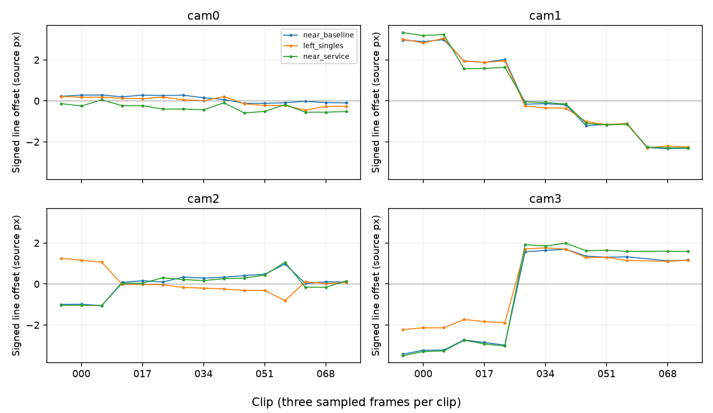
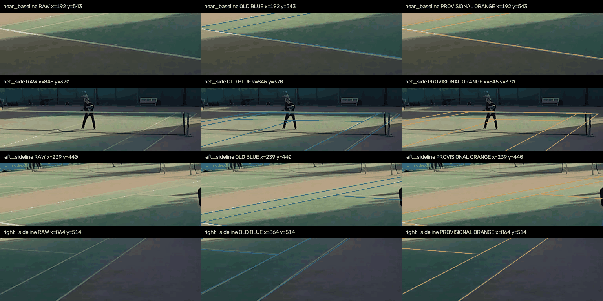
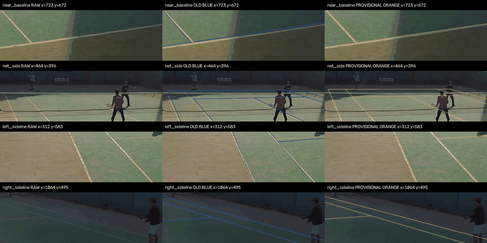
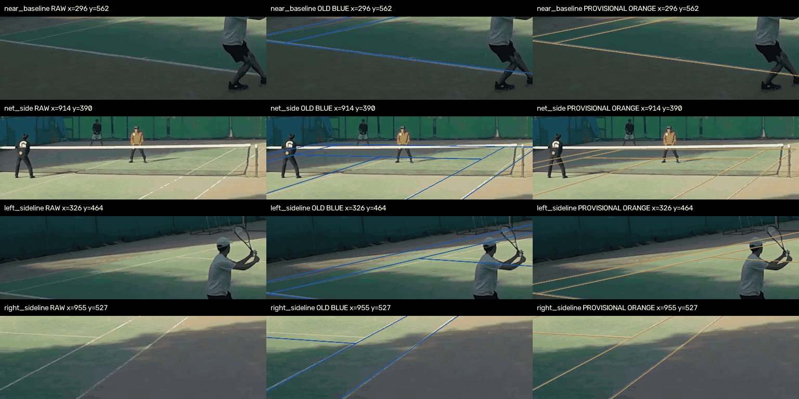
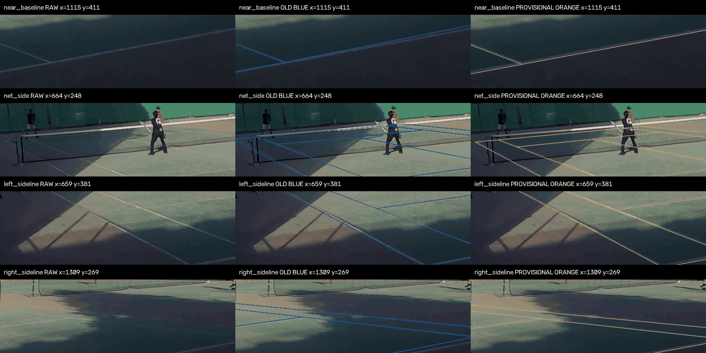
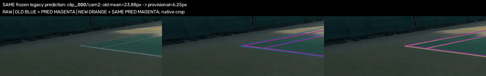
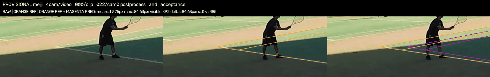
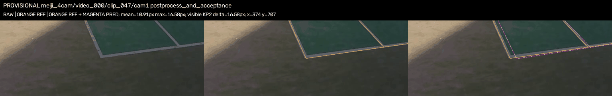
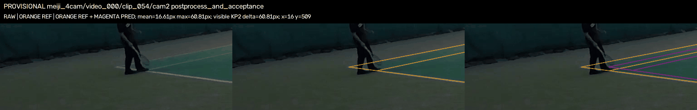
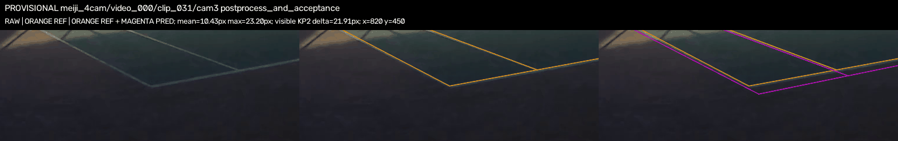

旧参照には数px〜数十pxのずれがあった。白線中心から独立に作った仮参照では、誤採用は旧処理144→105件、採否のみ175→116件、後処理込み176→116件に変わった。したがって旧参照の144〜176件をそのまま推定誤りとは呼べない。一方、白線から大きく離れた推定も残り、仮集計でも誤採用0・正しい推定の採用90%以上には届かない。

**新参照は未再承認。`human_reviewed=false`、`approved_for_evaluation=false`のまま。** 親から許可された仮評価であり、人間承認後の受入結果ではない。`status: done`はこの再評価の実行完了を表す。全cameraの奥ベースラインは直接測定できず、cam1/3の数pxの時間変化もある。参照誤差と推定誤りを区別する必要が生じたため`summary_impact: updated`。

## 参照の作成と固定

[親note](https://github.com/Motoki0705/tennis-lab/issues/2150#issuecomment-6914138836)と継続指示turn `35c6b7b214bd4c70b7a180a6913a1867`を根拠に白線中心へ合わせ直した。原画像1920×1080、clip 000/017/034/051/068それぞれのframe 0・中央・末尾、計15frame/camera、60枚をCPUで読み出した。`frames.json`にframe index、元動画、RGBとPNGのhashを保持する。座標は`src/utils/schema/court.py`のcourt metres、14KPと9本の地面線を使用。モデルのKP/LINE、推定H、正誤ラベルは参照作成に入力しない。初期Hは以前の手指定参照。

白色の指標をRGBの最小成分とし、線法線方向のprofileを0.5px刻みで読む。Gaussian sigma 0.6px、反対向きのedge対（幅1〜18px、contrast 6以上）を抽出し、両edgeの中点を線中心とする。線ごとのRANSAC（1.5px、seed 2190、500試行）と幾何整合の支持線選択で遮蔽や別の白い物体を外れ値にする。縦横各2本以上・計5本以上を要求し、正規化8自由度Hをsoft-L1（1.5px）で最適化する。画像内の単一edgeを白線中心とみなさない。

最初のRGB試行ではcam1のネット上端を地面の線として拾い、視覚確認で棄却した（`fit-a1/rejected.json`）。そのHでは予測の正誤を評価していない。原画像で指定したネット上端の帯±8pxを全frameで明示的に除外した。net maskは候補の中心と両edgeを除き、画素の塗りつぶしで人工edgeを作らない。座標・hashは`net-exclusions.json`。

48px探索→6px探索の中間Hは、時期による白線位置の変化を外れ値として削ってしまった。そのため最終段は12pxの帯から**frameごと**に線を測り、各frame・線の最大24位置を等間隔に使った。最終Hは元の手指定Hから最適化し、各sampled clipで2frame以上、各使用線で8frame以上の支持を要求する。単一のpoolで早期frameを捨てた低残差を「固定camera」と誤認しない。失敗frameを別frameや旧Hで補完しない。

最終参照と全設定・入力manifest・fit scriptを`reference/freeze.json`で固定してから、別scriptで凍結推定の採点を開始した。参照の凍結後に点・fit設定・推定・gate・順位・許容差を変更していない。旧参照ファイルも履歴としてそのまま保持した。手順と各中間結果の扱いは[reproduce.md](../../runs/run-court-white-line-reference-20261116/reproduce.md)。

## 白線残差と時間変化

全cameraのHは得たが、線やframeの測定失敗がある。far/nearはschema上の名称。奥側はネットの除外帯と重なる部分が多い。未測定線の投影は他の線からの**外挿**であり、独立に白線中心を確認できた点として扱わない。

| camera | frameのH | 最終Hに使えなかった線 | 旧→新参照の可視KP差 平均 / 最大px |
|---|---|---|---:|
| cam0 | 15/15 | far_baseline(0/15) | 9.07 / 15.99 |
| cam1 | 15/15 | far_baseline(0/15), right_doubles(4/15), far_service(2/15) | 18.07 / 31.35 |
| cam2 | 15/15 | far_baseline(0/15), far_service(4/15) | 22.33 / 47.68 |
| cam3 | 14/15 | far_baseline(0/15), far_service(1/15) | 10.63 / 37.85 |

cam3/clip_068/frame 0は`insufficient_consistent_court_lines`。同clipの中央・末尾は成功したため、宣言した2frame/clipの条件を満たす14frameのHを仮固定した。失敗frameのHはnullのまま。

次は**同じ測定中心**への垂直距離の絶対値p95（旧→新、px）。sample点・frameごとの中央値/p95は`reference/cam*-measured-centres.csv`、`line-frame-residuals.csv`、`references.json`に保存した。Hに利用した観測へのfit残差であり、独立な正解精度ではない。支持不足の線も残差だけは診断用に保持する。

| 線 | cam0 | cam1 | cam2 | cam3 |
|---|---:|---:|---:|---:|
| far_baseline | 未測定 | 未測定 | 未測定 | 未測定 |
| near_baseline | 2.93→1.15 | 6.27→3.53 | 6.00→1.37 | 13.88→3.68 |
| left_doubles | 2.94→0.97 | 5.87→2.31 | 16.11→3.37 | 3.96→2.39 |
| right_doubles | 4.50→0.71 | 6.83→3.04† | 5.53→1.43 | 6.62→3.01 |
| left_singles | 1.79→1.08 | 8.67→3.15 | 10.45→1.79 | 3.62→2.73 |
| right_singles | 3.00→0.64 | 6.76→3.06 | 1.85→1.16 | 7.26→2.89 |
| far_service | 5.25→4.28 | 5.10→4.73† | 8.22→5.73† | 7.28→2.56† |
| near_service | 4.29→1.19 | 13.40→3.54 | 11.68→1.51 | 7.37→3.63 |
| centre_service | 1.11→0.88 | 6.48→3.49 | 8.95→1.57 | 6.55→2.80 |

† 最終Hに使う8frameの条件を満たさない。far_serviceはcam0でも新p95 4.28pxで、近側の線ほど強い根拠ではない。

near_baseline / left_singles / near_serviceのframe中央値の最大幅は、cam0約0.7px、cam1約5.6px、cam2約2.1px、cam3約5.5px。cam1は時期による漸変、cam3はclip017と034の間に段差がある。**画像とコートの対応が完全に固定とはいえない**。物理cameraの動き・映像処理のどちらが原因かは未確認。camera別共通Hと個別frame Hの可視KP最大差はcam0/1/2/3で3.40/3.98/2.57/6.09px。個別frame H自体も測定誤差を含む。

推定と同じframe 0のHが得られた19画像で補助比較すると、3条件57判定中6判定が共通Hとの比較から変わる（`framewise-sensitivity.csv`）。これは不確かさの診断だけで、全276件の表をframe別Hや有利なHで置き換えていない。

## 人間の確認資料

worktreeの`outputs/tennis_scene/evaluate/court-reference-white-lines-20261116/review/index.html`を開く。4camera×clip000/034/068×4領域（手前ベースライン・ネット側・左右サイドライン）の48crop。元画像の512×160pxをそのまま保存し、原画／旧参照青／新参照橙／両方を切替可能。100/200/400%表示で確認でき、明るさ調整は表示だけ。12枚の`camN-clipXXX-native-comparison.png`も原解像度のまま保存した。描画の下にある白線を原画表示で確認する。

Git内の次の概要図は一覧用の縮小・減色版で、再承認には上記の元解像度PNGを使う。

## 凍結した3条件の再評価（仮）

A=旧処理、B=採否のみ変更、C=後処理も変更。元の`court-acceptance-implementation-20261116/meiji4-evaluation/meiji_4cam/`276件を使った。別の`scene-evaluation`にはclip033/cam0のB/Cの選択候補が2件だけ異なるsnapshotがあり、前回の主報告を再現する`meiji4-evaluation`を正本にした。その2件の相違原因は未調査。副snapshotでの初回集計はoutputsの`evaluation-secondary-snapshot`に保存し、主表には混在させていない。

推定点・採否・region index・qualityが旧新参照で完全一致することと、旧参照の平均誤差・正誤が前回保存値に一致することを全件assertした。元推定ファイル集合のhashは`evaluation/summary.json`。正解は変更せず**参照の画像内KPの平均10px以下かつ最大25px以下**。TP=正しい採用、FN=正しい診断候補の拒否、FP=誤った採用、TN=誤った診断候補の拒否。拒否時の診断候補は下流へ流さない。

| camera | 条件 | 旧参照 TP/FN/FP/TN | 仮参照 TP/FN/FP/TN | 正しい推定の採用率 旧→仮 | 誤った推定の拒否率 旧→仮 |
|---|---|---|---|---:|---:|
| cam0 | A | 1/3/28/37 | 9/6/20/34 | 25.0%→60.0% | 56.9%→63.0% |
| cam0 | B | 4/0/38/27 | 9/2/33/25 | 100.0%→81.8% | 41.5%→43.1% |
| cam0 | C | 2/0/38/29 | 8/3/32/26 | 100.0%→72.7% | 43.3%→44.8% |
| cam1 | A | 4/0/59/6 | 4/0/59/6 | 100.0%→100.0% | 9.2%→9.2% |
| cam1 | B | 3/0/48/18 | 13/3/38/15 | 100.0%→81.2% | 27.3%→28.3% |
| cam1 | C | 2/0/49/18 | 13/3/38/15 | 100.0%→81.2% | 26.9%→28.3% |
| cam2 | A | 0/0/52/17 | 33/2/19/15 | 対象0件→94.3% | 24.6%→44.1% |
| cam2 | B | 0/0/65/4 | 39/0/26/4 | 対象0件→100.0% | 5.8%→13.3% |
| cam2 | C | 0/0/65/4 | 38/0/27/4 | 対象0件→100.0% | 5.8%→12.9% |
| cam3 | A | 3/1/5/60 | 1/16/7/45 | 75.0%→5.9% | 92.3%→86.5% |
| cam3 | B | 0/2/24/43 | 5/7/19/38 | 0.0%→41.7% | 64.2%→66.7% |
| cam3 | C | 0/2/24/43 | 5/9/19/36 | 0.0%→35.7% | 64.2%→65.5% |
| all | A | 8/4/144/120 | 47/24/105/100 | 66.7%→66.2% | 45.5%→48.8% |
| all | B | 7/2/175/92 | 66/12/116/82 | 77.8%→84.6% | 34.5%→41.4% |
| all | C | 4/2/176/94 | 64/15/116/81 | 66.7%→81.0% | 34.8%→41.1% |

採用数はA/B/C=152/182/180で全く変わらない。cam3は新参照のKP3（近側右doubles）が画像外になり、可視点が14→13になった。他cameraは14のまま。共通maskでも比較し、旧FP=143/175/176、新FP=105/116/116。判定の変化は画像外点の除外だけでは説明できない。共通maskの全表もJSONに保持する。

選択候補の正しさの分母も参照で変わるため、**全候補中に正解がある画像**を分母にした救済率も報告する。下表は「正しく採用できた画像数 / 正解候補が存在する画像数」。

| camera | A 旧→仮 | B 旧→仮 | C 旧→仮 |
|---|---:|---:|---:|
| cam0 | 1/19 (5.3%) → 9/44 (20.5%) | 4/19 (21.1%) → 9/44 (20.5%) | 2/17 (11.8%) → 8/44 (18.2%) |
| cam1 | 4/14 (28.6%) → 4/37 (10.8%) | 3/14 (21.4%) → 13/37 (35.1%) | 2/14 (14.3%) → 13/35 (37.1%) |
| cam2 | 0/0 (対象0件) → 33/60 (55.0%) | 0/0 (対象0件) → 39/60 (65.0%) | 0/0 (対象0件) → 38/60 (63.3%) |
| cam3 | 3/10 (30.0%) → 1/43 (2.3%) | 0/10 (0.0%) → 5/43 (11.6%) | 0/9 (0.0%) → 5/42 (11.9%) |
| all | 8/43 (18.6%) → 47/184 (25.5%) | 7/43 (16.3%) → 66/184 (35.9%) | 4/40 (10.0%) → 64/181 (35.4%) |

## 誤差・clip間のばらつき

誤差は各画像の可視KP平均誤差の中央値。拒否された診断候補も含む。clipばらつきは全14点のclip中央値からの距離p95で、画像外外挿も含む。参照だけを変えたため、**推定のclipばらつきは不変**。cam3の裾がCで小さいことを、今回参照を直した効果とは呼ばない。

| camera | A 誤差 旧→仮px | B 誤差 旧→仮px | C 誤差 旧→仮px | ばらつきp95 A/B/C px |
|---|---:|---:|---:|---:|
| cam0 | 16.73→13.15 | 18.02→14.99 | 18.19→15.81 | 34.68 / 42.94 / 42.84 |
| cam1 | 14.15→13.40 | 15.10→12.09 | 14.93→11.86 | 14.69 / 14.30 / 13.71 |
| cam2 | 22.22→9.86 | 21.08→9.68 | 20.83→9.68 | 20.65 / 21.72 / 21.61 |
| cam3 | 16.22→12.19 | 16.41→12.54 | 16.13→12.34 | 122.93 / 41.84 / 38.25 |

画像別平均誤差の平均、全可視点p95、全候補の混同行列は`evaluation/summary.json`、276件×3条件×旧新参照の行別値は`evaluation/cases.csv`に保存した。

## 参照のずれと残る推定誤り

採用済み画像で旧FP→仮TPになったのはA/B/C=47/63/63件、逆の旧TP→仮FPは8/4/3件。単に全例の誤差が小さくなる補正ではない。特に旧AのTP8件は全て仮FPに変わった。参照変更後のラベルを人間の承認済み正解として扱わない。

cam2/clip000の旧処理は、同じ採用・同じ推定で平均23.88→6.25px、FP→TP。左は原画、中央は旧参照青と推定マゼンタ、右は仮参照橙と同じ推定。旧参照のずれが大きかった代表例。

残る仮FPはA105/B116/C116件。**337件すべて**の原解像度cropを`remaining/index.html`に保存した。推定入力と同じframe 0を動画から読み、保存済みrawのRGB hashと照合した。モデル出力は参照固定後の採点・比較画像にのみ用いた。

meiji_4cam/video_000/clip_022/cam0、C：可視KP平均19.75px、最大84.63px。独立に測れた2本の線の交点KP2で84.63px。左=原画、中=仮参照橙、右=仮参照と推定マゼンタ。

meiji_4cam/video_000/clip_047/cam1、C：可視KP平均10.91px、最大16.58px。独立に測れた2本の線の交点KP2で16.58px。左=原画、中=仮参照橙、右=仮参照と推定マゼンタ。

meiji_4cam/video_000/clip_054/cam2、C：可視KP平均16.61px、最大60.81px。独立に測れた2本の線の交点KP2で60.81px。左=原画、中=仮参照橙、右=仮参照と推定マゼンタ。

meiji_4cam/video_000/clip_031/cam3、C：可視KP平均10.43px、最大23.20px。独立に測れた2本の線の交点KP2で21.91px。左=原画、中=仮参照橙、右=仮参照と推定マゼンタ。

cam0/clip022の約85pxとcam2/clip054の約61pxは、白線交点から明らかに離れており、参照の数pxの不確かさだけでは説明できない推定誤り。cam1/clip047とcam3/clip031は平均10px境界に近く、時間変化・線の測定誤差の影響がある。337件全てを画像だけで確定した推定誤りとは断定しない。各cameraの代表例は「直接測れた線の可視交点での差が大きいCの採用例」で、平均的な性能を表す標本ではない。

## 参照に依存しない回帰結果（再掲）

このターンでは推論・幾何・gateを変更も再実行もしていない。[前回run](000070-run-court-acceptance-implementation-20261116.md)の入力hash・split来歴・行別結果を正本とする。

| 入力 | 旧→新の幾何成立 | 失った / 得た推定 | 共通画像数 | 共通GT点平均誤差px 旧→新 |
|---|---:|---:|---:|---:|
| Court元実画像val 2211 | 2211→2097 | 114 / 0 | 2097 | 2.0946→2.0455 |
| synthetic明示test 886 | 573→558 | 45 / 30 | 528 | 14.2049→13.9438 |

元valの114件は全て`joint_optimization_failed`、境界・重複KPの除外は0件。共通成功集合の誤差低下は、成立数の退行を取り消さない。実画像は正規hydrateで復元、実test splitは未定義。syntheticは明示testだがcheckpointの学習集合との非重複は未確認。meiji_3camの採用は165→139→131/171、tennis_clipは1→1→1/1で、前者の手動参照は3画像のみ、後者にGTなし。この点も今回変わらない。

## 検証・残る判断

今回の追加はoffline解析scriptと証拠。productionの`src/`・設定・`tests/`は`b533eb7ab`から変更なし。GPU利用0、学習0。数値検証3件は白線の両edge中点、暗い影の除外、外れ値を含む非affine Hの線選択→fit回復を検査し、3 passed / 2.04秒、最大call 0.11秒。初回の3件目は実際の線外れ値除外を省いたloss単体を試して失敗したため、実際の測定→fitの契約を検査する設計に直した。許容誤差は0.8pxから0.1pxへ厳しくし、fit実装や参照は変更していない。初回と最終ログを両方保持する。

knowledge検証は683 nodes、0 error・0 warning。再現script検査は427 repro.sh / 528参照、欠損・検証不能0件。凍結hash・未承認flag・1,656行からの混同行列再集計・src/tests無変更も確認した。独立validatorの指定なし、実施0回。pre-commit・対象HEADのCI結果はPR #2200へ記録する。前回の209件などのcodeテスト結果を今回の追加検証として数え直さない。

親には元解像度cropでの参照再承認と、cam1/3の時間変化・未測定の奥線をどう扱うかの判断を返す。現状は全276件の「承認済み参照による」目標達成を認定できない。仮評価でもFP0・正しい採用90%の目標は未達で、Court valの非劣化条件も未達のまま。閾値・実装を仮参照に合わせて調整せず、merge・issue closeは行わない。
