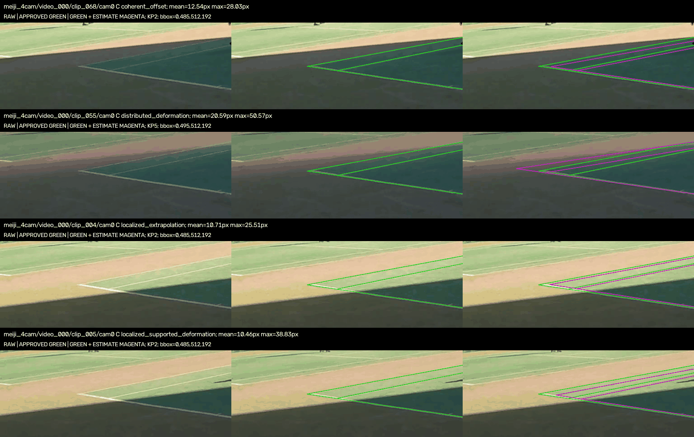
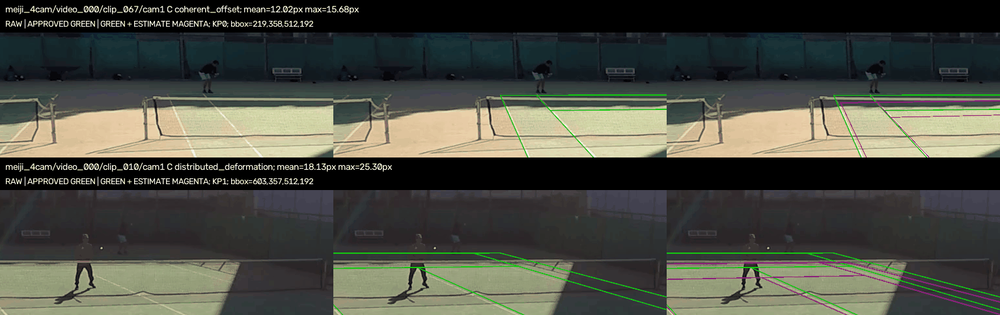
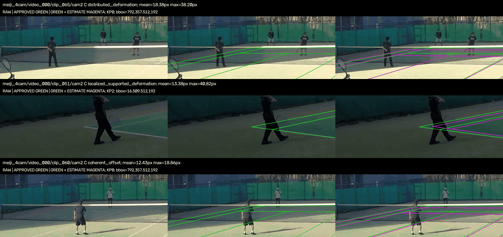
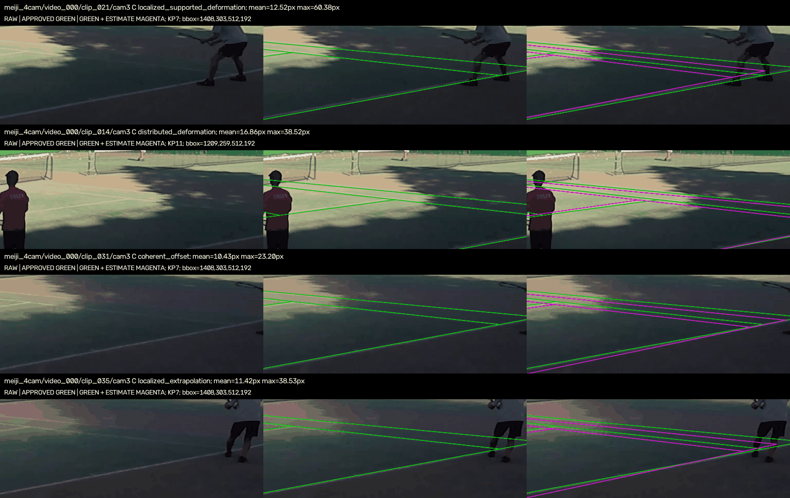
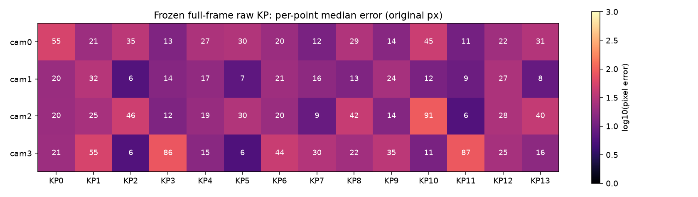
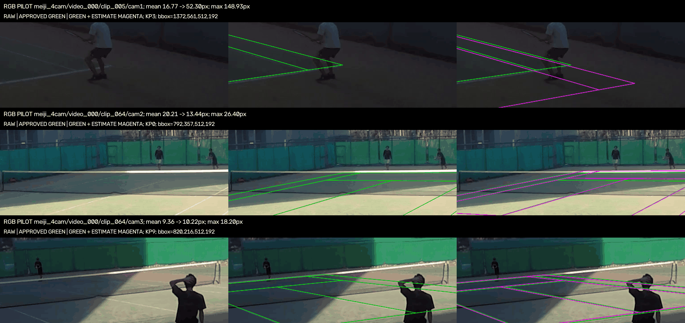

承認済み参照でも現行案は誤採用を残す。**推奨は、(a)の回帰修復を先に行い、その上で(b)のRGB白線精密化と独立評価を進める案**。既存RGB fitをそのまま採用する提案ではない。#2191には、信頼できる推定を動画内で共有して欠測を救う役割を持たせる。#2190の単frameの目標を共有結果に置き換えない。

このrunは分析・計画のみ。`src/`・設定・production testは`7b59c4730`から変更なし。GPUを使用せず、新しいモデルrawを取得していない。人間の[GPU停止指示](https://github.com/Motoki0705/tennis-lab/issues/2150#issuecomment-6918621524)による親のstop後は、完了済みCPU測定を確認し、保存結果の集計・文書化だけを再開した。`status: done`は分析の実行完了で、受入合格でも実装承認でもない。

## 参照の承認と不変性

[2026-11-16の親note](https://github.com/Motoki0705/tennis-lab/issues/2150#issuecomment-6917118209)で、人間が元解像度cropを見て「承認する」を選んだことを確認した。奥ベースラインの外挿、cam1/3の約5pxの時間変化は了解済み。区間分割せず、平均10px・最大25px、FP0・正しい推定の採用90%以上を維持する。

[run 71](000071-run-court-white-line-reference-20261116.md)の参照と結果のmetadataを承認済みに更新した。承認前後のHは完全一致し、カメラ別混同行列・誤差・候補配列・採否・順位も不変。元の参照bytesを`preapproval-reference.json`へ保存し、作成時のfreeze/script/コマンドを保持した。`approval.json`に前後のhashと根拠がある。履歴JSON/CSVの`provisional`キーは同一の承認済み白線参照を指す。

## 誤採用337件の分類

A=旧処理、B=採否のみ変更、C=後処理も変更。元の`meiji4-evaluation`に固定した全276画像・3312領域から再集計し、FP105/116/116と全TP/FN/FP/TNがrun 71と一致した。

分類は**誤差の形状**であり、それだけで物理的な原因を確定しない。採否に追加した規則でもない。次の優先順で全FPを排他的に分類した。

1. 大きな別領域・反転：承認コートとのpolygon IoU<0.5または隅の向きが逆。
2. 全体の位置ずれ：誤差ベクトルの中央値を引くと10px/25pxを満たす。GTを使う説明用の仮想補正で、推論に適用していない。
3. 局所外挿：最大3点の大誤差を除くと許容差内になり、その全点が選択支持点のcourt座標凸包の外側。
4. 支持内も含む局所変形：同じ少数点の条件だが、誤りを支持外だけに限定できない。
5. 分布した変形：上記以外。画面全体に分布する位置・形状誤差で、平行移動だけでは直らない。

| camera | 条件 | 全体位置ずれ | 局所外挿 | 支持内も含む局所変形 | 分布した変形 | 大きな別領域・反転 | 合計 |
|---|---|---:|---:|---:|---:|---:|---:|
| cam0 | A | 2 | 6 | 3 | 9 | 0 | 20 |
| cam0 | B | 10 | 1 | 5 | 17 | 0 | 33 |
| cam0 | C | 11 | 1 | 3 | 17 | 0 | 32 |
| cam1 | A | 49 | 0 | 0 | 10 | 0 | 59 |
| cam1 | B | 33 | 0 | 0 | 5 | 0 | 38 |
| cam1 | C | 34 | 0 | 0 | 4 | 0 | 38 |
| cam2 | A | 6 | 2 | 0 | 11 | 0 | 19 |
| cam2 | B | 3 | 0 | 2 | 21 | 0 | 26 |
| cam2 | C | 5 | 0 | 3 | 19 | 0 | 27 |
| cam3 | A | 0 | 6 | 0 | 1 | 0 | 7 |
| cam3 | B | 3 | 1 | 6 | 9 | 0 | 19 |
| cam3 | C | 3 | 1 | 6 | 9 | 0 | 19 |
| all | A | 57 | 14 | 3 | 31 | 0 | 105 |
| all | B | 49 | 2 | 13 | 52 | 0 | 116 |
| all | C | 53 | 2 | 12 | 49 | 0 | 116 |

cam1のCは38件中34件が全体位置ずれ。cam0/2/3では非一様な変形も多い。大きな別コートを選んだと判定する例は0だが、同じコート内のsemantic KP/線の誤対応が無いとはいえない。生のKPには数百px以上外れた点もある。採用Hが同じコート上にあることと、入力の対応が正しいことを区別する。

cameraごとの代表例を以下に示す。各分類のCの平均誤差中央値に近い例を選び、最大誤差の可視KPを中心にcropした。左から原画、承認参照（緑）、参照＋推定（マゼンタ）。外挿点も正式な評価対象なので、その点が描画される場合がある。全件ラベル・選択領域は`candidate-analysis/false-accepts.csv`、原解像度cropはoutputsの`figures/index.html`。

## 正解候補がある画像を救えていない理由

「順位負け」は正解候補がgateを通るのに別候補を選ぶ場合。「gate拒否」は正解候補が全てgate不合格の場合。この2つを混ぜない。分母は選択後の正解数でなく、全領域の最終候補に正解が存在する画像数。

| camera | A 救済 / 順位負け / gate拒否 | B 救済 / 順位負け / gate拒否 | C 救済 / 順位負け / gate拒否 |
|---|---|---|---|
| cam0 | 9 / 1 / 34 （計44） | 9 / 3 / 32 （計44） | 8 / 4 / 32 （計44） |
| cam1 | 4 / 25 / 8 （計37） | 13 / 3 / 21 （計37） | 13 / 3 / 19 （計35） |
| cam2 | 33 / 5 / 22 （計60） | 39 / 4 / 17 （計60） | 38 / 3 / 19 （計60） |
| cam3 | 1 / 0 / 42 （計43） | 5 / 2 / 36 （計43） | 5 / 2 / 35 （計42） |
| all | 47 / 31 / 106 （計184） | 66 / 12 / 106 （計184） | 64 / 12 / 105 （計181） |

Bの184画像のうち106画像はgate拒否、12画像が順位負け。順位だけを理想化しても、現在のgateのまま救えるのは66+12=78画像まで。Cでは64+12=76/181。これはGT oracleによる上限で、実現した改善ではない。

旧候補poolの正解画像184件に対し、後処理を変えたpoolは4件を失い1件を得て181件になった。Cの表は181を分母とし、184とすり替えない。正解候補が生成されていない画像は順位/gateだけでは救えないが、保存された各領域の最終Hだけからモデルの情報量の絶対上限までは言えない。

| camera | Aの正解候補を全て落とす理由（画像数・重複あり） | Bの理由（画像数・重複あり） |
|---|---|---|
| cam0 | inliers_below8: 34 | unstable_projection: 32, unstable_line_influence: 13 |
| cam1 | inliers_below8: 8 | unstable_projection: 16, visible_line_mismatch: 9, unstable_line_influence: 2 |
| cam2 | inliers_below8: 22 | unstable_projection: 16, unstable_line_influence: 2, visible_line_mismatch: 4 |
| cam3 | inliers_below8: 41, all14_inside: 39 | unstable_projection: 36, unstable_line_influence: 28, visible_line_mismatch: 2 |

B/Cは投影不確かさのgateが中心。現方式は画像外の点まで含む全14点の不確かさを使うため、可視領域では正しい部分観測も落とす。一方、モデルKP/LINEが同じ方向にずれれば、その相互整合性や局所的な条件数が良くても実画像での正確さは保証しない。gateを単に緩める提案にはしない。全正解候補の拒否理由は`recovery.csv`に残した。

## raw KP/LINEの精度

モデルを再実行せず、凍結KP/LINEを測定した。KPは元画像1920×1080のpx距離。まずfull-frameの全69frame/camera、参照の画像内KP（cam0〜2は14点、cam3は13点）を比較する。遠方/近側はcourt上の半面で定義し、confidenceから遮蔽を推定しない。

| camera | raw KP中央値 / p95 px | 遠方中央値px | 近側中央値px | LINE距離のframe中央値の中央値px | LINE距離のframe p95の中央値px |
|---|---:|---:|---:|---:|---:|
| cam0 | 19.60 / 139.18 | 21.60 | 16.04 | 5.82 | 25.63 |
| cam1 | 15.93 / 63.85 | 20.68 | 8.37 | 5.44 | 29.82 |
| cam2 | 19.73 / 105.70 | 20.91 | 14.10 | 6.01 | 21.87 |
| cam3 | 21.16 / 101.14 | 24.29 | 12.46 | 5.74 | 19.26 |

LINEはnative probabilityから既存のridge抽出を行い、参照線の内側10〜90%の81点から最近傍ridgeまでを元pxで測った。semantic LINEではなく、別の線の近傍を拾う可能性があるので、semantic正しさを保証する指標ではない。native gridの量子化も含む。full-frameのnative pitchは約3.75pxで、KPの15〜21pxの中央値は半cellの丸め誤差だけでは説明できない。

Cが選ぶcrop内の可視KPでは、全camera合算の中央値14.62px・p95 84.67px。全3312領域では、参照KPがcrop外なのにraw validな出力が11,441点あり、そのうち境界1cellのflagが付くのは1,210点。境界・重複のどちらにも該当しないものも7,586点ある。画面外のsemantic点は必ずしも端そのものに集まらず、内側の別のpeakにも割り当てられる。境界幅を広げるだけでは解決しない。

全領域の境界flag付き1,442点の誤差中央値は495.08px、crop外のvalid 11,441点は396.42px。C選択cropの境界flagは57点（中央値149.28px）、crop外は188点（159.45px）。crop外の値を通常の可視点精度へ混ぜず、測定不能/誤対応の診断として分けた。

遮蔽は、事前に決めたclip000/017/034/051/068×4cameraの280点の原画像cropを、モデル出力を隠してagentが確認した。人間による新しいGT承認ではない。124点は塗線を確認、8点は明瞭な人物遮蔽、7点は遮蔽物の縁で不確定、136点は遠方の線/ネット領域で判定不能、5点は画像外。未知を遮蔽や可視へ自動補完していない。

| 原画像確認の層 | full-frame 点数 | raw誤差 中央値 / p95 px | C選択crop内の点数 | raw誤差 中央値 / p95 px |
|---|---:|---:|---:|---:|
| 塗線を確認 | 124 | 13.02 / 139.95 | 114 | 11.13 / 121.25 |
| 明瞭な人物遮蔽 | 8 | 36.73 / 60.84 | 7 | 40.16 / 48.93 |
| 遮蔽物の縁・不確定 | 7 | 20.43 / 33.35 | 7 | 13.98 / 94.41 |
| 遠方baseline・不確定 | 77 | 21.32 / 74.79 | 77 | 15.65 / 68.16 |
| 遠方service/ネット領域・不確定 | 59 | 24.26 / 72.18 | 59 | 19.01 / 64.22 |

遮蔽8点は少数で、camera/KPの構成も異なるため、遮蔽だけの因果効果とは解釈しない。残りのclipへこのラベルを拡張しない。`occlusion-review/annotations.json`と`visibility-observations.csv`に根拠と適用範囲を保持する。

既存のconfidenceベースKP-only推定をそのまま適用すると、full-frameでは正解0/276、C選択cropでも4/276だった。KP+LINEのCでは正しい診断候補が79/276ある。したがって、幾何処理は既にrawの外れ値を補っている。raw誤差が大きいことを「モデルの固定された精度上限」と断定しない。一方、モデル出力相互の整合性だけでは位置の偏りを除けず、原画像の独立な位置証拠を使う余地がある。

## 回帰原因の切り分け

対象はval喪失114、synthetic喪失45/獲得30、両datasetから順序で等間隔に選んだ成立維持16ずつ、計221画像。重み・raw・optimizer設定を固定し、分析用module内だけで3変更をon/offした。production sourceは編集していない。

- O: 境界/重複KPの除外。
- S: confidence中心から空間的な広がりを重視するKP選択への変更。
- V: 初期候補で見えていた線を最適化中も要求する変更。

最初の1176 solveでは、再構築したLINE距離場の微差が比較に混ざることを確認した。次に画像ごとのLINE evidenceを一度だけ作り、全変更条件で同じ配列を使う1176 solveを実行した。Oによる除外が空のケースはO0/O1が同じ入力なので、重複実行せず等価であることを明示した。

| 対象 | 全変更off | Oのみon | O+V on・S off | O+S on・V off | 全変更on |
|---|---:|---:|---:|---:|---:|
| val喪失114 | 114 | 114 | 114 | 0 | 0 |
| synthetic喪失45 | 43 | 10 | 6 | 6 | 2 |
| synthetic獲得30 | 5 | 14 | 20 | 23 | 27 |
| val成立維持control16 | 16 | 16 | 16 | 16 | 16 |
| synthetic成立維持control16 | 16 | 16 | 16 | 16 | 16 |

**valの114件はすべてSが原因。** Oは除外点なし、Vを外しても回復しない。Sを旧選択へ戻す対照ではVを残しても114/114が成立する。全114件の6seed＝684seedが、KP集合が4回以内に安定しないため破棄されていた。667seedは選択集合を再訪するcycle、17seedは4回とも異なる集合。optimizerの反復予算切れを増やしただけの問題ではない。旧成立HのGT平均誤差中央値は1.74pxで、精度の良い出力を失っている。

ただし、Sだけを全面的に旧式へ戻すとsyntheticで得た推定も失う。空間的支持という目的を維持し、離散的な支持点集合の探索と連続H最適化を分離する設計が必要。32controlは成立を維持したが、残り全val/testでの新実装の非劣化を示したものではない。

syntheticの元の45喪失は、joint optimization 24、line support 8、候補曖昧性10、jointly supported候補なし3で、sceneの新しい採否gateより前で停止していた。対応する旧HのGT平均誤差中央値24.90px、p95 87.53px。以前の対角比換算10/25pxで許容内なのは6/45で、全喪失を正しい推定の喪失とは呼べない。成立数の変化とGT精度を分けて評価する。

LINE固定対照で喪失transitionを再現した41件は、Oを外すと回復32、Sを外すと回復4、Vを外すと回復3、O/Vどちらでも回復1、複合効果1。残り4件は元のtransitionを再現しない。獲得30件ではOが必要9、Sが必要7、Vが必要4、冗長/複合2、transition未再現8。単独変更除去による説明であり、要因の加算的な寄与率ではない。

Oが関わる42件を境界/重複に分けた対照では、再現した喪失29件が境界だけで停止17、重複だけで停止10、どちら単独でも停止2。残る4喪失例はこの再構築では同じtransitionにならない。獲得9件は境界除外だけで回復6、重複だけで回復2、どちらでも回復1。喪失群で除外された境界48点・重複44点のうち、可視GTかつ既存H閾値内の点も1点・3点ある。近接peakを独立な対応点として二重に数えないことと、両方のsemantic仮説を無条件に捨てることは別の設計判断。

### 数値再現性の限界

同じbinary maskを12回、OpenCV 5.0.0・1threadでdistance transformすると出力は2種類で、LINE距離場の最大差は0.000061px。ridge点そのものは一致した。通常関数と計測を挿入した関数も対照し、計測scriptだけが原因ではないことを確認した。ただし、この微差だけを全不一致の唯一の原因と確定したわけではない。

最初の再実行ではsyntheticの9件でstatusが元runと違った。LINE固定対照でも旧/新のいずれかのstatusが元runと違うものは14件、喪失/獲得transitionが再現しないものは4+8件。**元runのLINE距離場・seedごとの最適化/選択履歴が保存されていないため、この12件の歴史的な帰属は一意に確定できない。** 新しいraw取得や再推論で埋めず、この範囲の帰属を未確定として止めた。元の573→558、45喪失/30獲得を新対照の数値で上書きしない。case別の一致/不一致、trace、入力hashは保存した。今回のpaired対照も距離場は同じprocess内で共有して前後hashを照合したが、配列自体は保存していないため、別実行でのbitwise再現は保証しない。今後の比較では距離場も保存する必要がある。

## 3案の比較と推奨

### (a) 支持点選択・H最適化

期待値は、valの114/114回復が実際の対照で示されたこと、B/Cの順位負けは各12画像であること。Sを単にrevertするとsyntheticの獲得も失い、観測点除外には別のtrade-offがある。順位だけではBの正解pool184件のうち78画像までで、現在のFP116を0にする根拠にもならない。

提案は、支持点集合を明示的な候補として固定して解く方式へ整理し、cycleを暗黙の別Hへの切替で救わないこと。最終Hに実際に使った集合・残差・停止理由を一致させる。境界は打ち切られた観測、重複は相関する観測として扱い、可視性・独立した支持を失う場合は明示的に失敗する。画像内の可視領域の不確かさと、画面外の外挿診断を分ける設計も検証する。閾値の緩和で106件を通す方針ではない。

### (b) 原画像の白線中心で精密化

中断前に、参照作成に使っていないclip005/013/022/030/039/047/056/064×4cameraの32画像で、既存RGB fitterを分析用に試した。初期値は凍結CのH。参照H・参照の点・手指定net maskはfitに入力せず、1frameのRGBだけから48px→6pxの既存探索を行った。支持frame数だけを単frame用の1と明示し、他は既存CFGを使った。パラメータは結果を見て調整していない。これはproduction実装の変更ではない。

| camera | 初期Cの正しい候補 | RGB fit後の正しい候補 | 正解を失った数 | fit時間中央値 秒 |
|---|---:|---:|---:|---:|
| cam0 | 2/8 | 8/8 | 0 | 0.533 |
| cam1 | 1/8 | 7/8 | 0 | 0.458 |
| cam2 | 4/8 | 7/8 | 0 | 0.582 |
| cam3 | 2/8 | 7/8 | 0 | 0.489 |
| all | 9/32 | 29/32 | 0 | 0.528 |

画像別平均誤差の中央値12.02→2.29px。20画像を許容内へ直し、初期正解9件は維持した。元のCの全候補に正解があったのは22/32画像だが、そのpoolに無かった7画像もRGBで許容内になった。モデル候補の順位を変えるだけでは得られない追加情報がある。以前拒否された画像のうち11画像も、RGB後のH自体は正しい。

**32件すべてfit成功でも、3件は誤り。** 29/32はH候補の正解率であり、採用率やFP0の達成ではない。cam1/clip005は平均16.77→52.30px、最大148.93pxへ悪化し、近/遠baselineを支持に使えていなかった。cam2/clip064は平均13.44・最大26.40px、cam3/clip064は平均10.22pxで、許容差を変えず不正解とした。

したがって、fit成功や小さな採用線の残差だけで採用しない。初期に見えていた線を途中で捨てていないか、線ごとの支持と残差、意味的な対応の曖昧性、支持外の投影不確かさを診断する。ネット上端を塗線として対応させる失敗は以前の参照作成でも観測しており、独立した対処が必要。現在の参照作成コードをそのまま本番に接続する提案ではない。

実測はfit中央値0.528秒・p95 0.620秒/画像、decode中央値0.053秒（CPU、1初期値）。既存の12領域を含むC幾何処理は別runで中央値28.80秒/画像だった。範囲・並列度が異なるため速度改善とは比較しない。複数初期値や採否診断を追加した場合の増分は実装後に測る。

### (c) #2191との分担

参照を読まず、既存の採用済み出力から最低quality costを選ぶだけで、B/Cは4cameraとも正解を選べた。

| camera | Cで選ばれるclip | 平均px | 最大px |
|---|---|---:|---:|
| cam0 | clip_046 | 8.36 | 22.95 |
| cam1 | clip_028 | 8.16 | 15.69 |
| cam2 | clip_062 | 7.07 | 11.55 |
| cam3 | clip_040 | 8.57 | 12.64 |

同じHと同じcamera参照を69clipに使えば数値上は276/276が許容内になる。しかし独立な試行は4cameraで、276件の独立な精度検証ではない。C採用Hのmedoidではcam1が不正解（3/4camera）。最低costでも最初の23clipだけでは1/4、最後の23clipだけでは3/4、奇数clipだけでは3/4。多数決・集約や少数clipの選択が系統誤差を消す保証はない。

#2190は単frameでの精度・拒否規則・安定した品質診断を担当し、同じ10/25px・FP0・正しい推定採用90%以上を全276件で評価する。#2191は明示したvideo_sharedで良い候補を共有し、単frameで棄却したclipを救う。共有側の成功を#2190の未達の代わりには数えない。選んだclip/frame・quality版・設定・値を動画artifactへ固定し、有効候補が無いcameraでは失敗するという#2191の契約を維持する。時間変化は診断へ残すが、人間の判断どおり区間分割はしない。

## 循環しない評価の設計

単frame/15frameの違い、モデル初期値/手指定初期値の違い、参照未使用clipというだけでは不十分。同じcamera・court template・白線抽出器の系統誤差は共有される。32画像のpilotは改善見込みを測る**開発用の比較**で、独立な精度証明として使わない。

推奨する確認は次の組合せ。

- 主評価の承認H・mask・許容差は維持し、全276件と、参照/pilot未使用の56clip×4camera=224画像を分けて示す。後者も同じcameraなので、それだけで独立とはしない。
- 例としてclip009/026/043/060×4cameraの16画像で、推定とH overlayを隠して、見える白線交点の中心を別の測定者が直接注釈する。これは評価専用で学習へ追加しない。測定者間の差も記録する。人間による手配・範囲の承認は未取得で、今回は新たな注釈を依頼していない。
- 別由来のCourt valの既存GT、synthetic testのGTで前後を比較する。実testが未定義、syntheticの学習重複未確認、3DGS由来GTの幾何誤差という既存の制限は維持する。
- 既知Hから描画した塗線・ネット・遮蔽物のfixtureで、GTをfitから作らない検証を行う。画像の一部をfit用/確認用へ分ける場合も、隣接pixelの独立性を誇張せず、物理線を単位として扱う。

独立ラベルで基準を満たさなければ、その結果を記録して停止し、承認Hや許容差を動かして救わない。現在のrawにはsemantic LINE/SEGの出力配列が保存されておらず、それらを使う識別効果は今回未確認。GPU再開前に新たなモデル出力を取らない。

## 実装案・検証契約（未着手）

推奨する着手順は、(a)の回帰修復→(b)のRGB証拠と採否→#2191への品質契約の提供。主な変更候補は`geometry/hybrid_homography.py`、`observations.py`、`line_evidence.py`、`quality.py`、新しいRGB証拠module、`inference/regions.py`、sceneのCourt componentと設定/identity。CPU RGB処理へ渡す元画像とcrop座標を一意にする。新旧方式は設定で明示し、不合格時の旧Hは診断にだけ残し、採用Hへ代用しない。

品質にはモデル内部の一致度とRGB塗線の位置残差を別に残す。物理線別の支持・残差px・coverage、支持点集合、最適化の停止理由、投影不確かさ、画像外外挿の範囲を安定したschemaで公開する。costは順位指標であり、正解確率とは呼ばない。schema/実装・RGB処理設定をcache identityへ含め、#2191で異なる版を混在させない。

| 守る契約 / 検出したい不具合 | 既存nodeの再利用と必要な追加 |
|---|---|
| 支持点がcycleして正しいHを失う | `geometry/test_hybrid_homography.py`へ既知の交互集合の軽いunit、今回のval喪失から1つの固定raw integration fixture。実際にfitした集合と診断の一致を検査 |
| 境界・重複を独立点として数える/正しい部分観測を全て消す | `geometry/test_observations.py`と`test_quality.py`を拡張。既知Hによる画面外・真の画像端・foreshortening・退化を分離 |
| LINEの微差でsolver/gateが不安定になる | 同一の固定evidenceと小さな既知摂動で、安定領域の判定と明示的な不安定診断を検査。許容差の境界を緩めるテストにはしない |
| 白線の縁・ネット・影を地面の中心と誤認 | 今回のstripe centre数値検査を再利用し、既知Hの独立描画fixtureと、原画像の固定例を追加。見えていた線の消失・別対応・RGB fit失敗で採用Hが出ないことを検査 |
| 座標・設定・cache・失敗理由の混線 | `inference/test_regions.py`、scene `test_court_kp.py`、`test_configuration.py`を拡張。元画像/cropの変換、品質schema、失敗mask、cache invalidationを検査 |

追加ケースは契約ごとに絞り、既存nodeのassert拡張を優先する。unit/integrationは各5秒以内を目安に実測し、実画像全件は受入記録として扱う。新実装は全2211 val、886 synthetic、meiji_3cam171・tennis_clip1でも前後比較する。valの114件を回復するだけで全体の非劣化を主張しない。syntheticの数値不安定例は固定evidence・履歴保存を含む比較で別掲し、元結果との差を隠さない。

## GPU再開後に必要な確認（計画のみ）

GPU禁止中はjobを登録しない。現在の幾何・gateの比較は凍結rawでCPU実行できる。今後、親が実装とGPU再開を別々に許可した場合の確認は次のとおり。

| 確認 | 入力・条件 | 所要時間の根拠と未確定分 |
|---|---|---|
| Court APIの実モデル接続・raw不変性 | 同じcheckpoint `b863df1f01f0`、同じframe0とregion設定。meiji4 276、meiji3 171、tennis_clip1の448画像・5433領域。旧/新処理と保存済みrawを比較 | 前回のdecode/infer/save合計460.5秒、うちmeiji4 276.8秒。約7.7分が同条件の取得部分の参考値。model load・queue待ち・新CPU後処理は含まず、job全体の時間は実装後のCPU実測を加えて見積もり直す |
| semantic LINEを使う案を採る場合の追加診断（任意） | 同checkpoint、今回の32画像・同regionで未保存のsemantic LINEを取得し、binary LINEの誤対応を分離できるか比較。学習なし | 既存KP/LINE取得部分だけの件数換算は約33秒。追加headの出力・保存・model loadは未計測で、総時間の確定値は出せない。これを今回の推奨案の前提にはしない |
| #2191実入口・下流の確認 | cameraごとの選択artifactを全69clipへ適用し、cache・失敗・重ね描き・再読込を確認。全sceneは親のC1/C10計画に従う | Courtの約4.6分の取得実測から全sceneのGPU/3D処理時間は算出できない。C1の完走基準値が必要。現在は未起動 |

Court val/testを後処理変更だけで比較するために、GPUで同じrawを取り直す必要はない。モデル/decoder/API契約の変更を採る場合だけ再取得の範囲を具体化する。新しいsemantic出力も、GPUをCPU推論へ置き換えて禁止を迂回しない。

## 今回の検証と親へ返す判断

分類の数値検証は3 passed / 3.63秒、各setup/call/teardownは0.005秒未満。平行移動、支持外の単一角、離れた別コートを独立に構成して分類を検査した。全混同行列・母数、参照Hの不変、未変更source、各input/hash、LINE evidenceの固定を別途照合した。knowledgeは684 nodes・0 error・0 warning、427 repro.sh / 528参照に欠損0。productionのテスト増分は0、以前の209件等を再実行したとは数えない。独立validatorは指定なし・0回。pre-commit・対象HEADのCPU CIの結果はPRへ記録する。

親への判断事項は、(a)の回帰修復を先に行ったうえで(b)へ進む実装方針、独立な評価用の点注釈の手配、#2191との品質schemaと受入の分担。GPU再開はそれらと別の人間判断が必要で、現在は起動しない。syntheticのtransition未再現12件は元の中間証拠不足で厳密な帰属が未確定。保存されていない履歴を推測で補わない。merge・issue closeは行わない。
