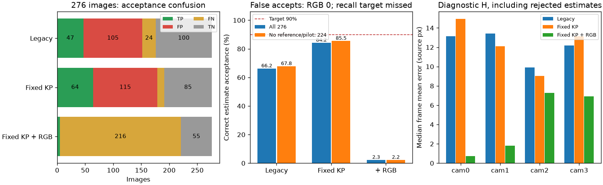
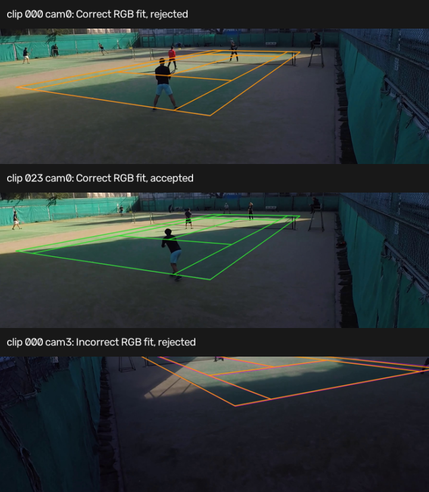

**受入目標は未達で、この候補の採用は勧めない。** RGBはmeiji_4camの誤採用を0件にしたが、正しい診断Hの採用は5/221件（2.3%）。cam1〜3は採用0/69で、4cameraの校正を成立させる目的を満たさない。独立GTの回帰でも退行した。結果を見た閾値・参照・許容差・推定式の調整は行わず、この比較で停止する。`status: done`は比較実行の完了を表し、受入合格ではない。

[人間の実装承認](https://github.com/Motoki0705/tennis-lab/issues/2150#issuecomment-6920971828)に従い、(a)→(b)を実装した。16画像の追加注釈は作らない。参照は[run 71](000071-run-court-white-line-reference-20261116.md)の承認済みHをそのまま使用し、区間分割もしない。今回の結果は[run 72](000072-run-court-approved-error-analysis-20261116.md)の推奨案を検証したもので、同案のpilot成績を受入達成へ読み替えない。

## 実装と評価の固定

(a)は各seedで空間分布／confidenceの集合候補を作り、各集合を固定してsmooth/raw LINE場で解く。境界は片側制約、重複は相関群とし、1候補に同じ群の複数点を入れない。最終Hの実際の集合・残差・終了理由を残す。(b)は原RGB1frameの明暗edge対から塗線中心を取り、coarse/fineでHを最適化する。coarseで直線支持が成立した線を初期必須集合とし、喪失・代替stripe対応・線残差・投影標準偏差・線除去変位で拒否する。fit成功だけでは採用しない。モデルHは初期値と診断に限り、RGB不合格時の代用品にはしない。

数値処理は `49f605aab` と `protocol.json` に固定した。評価中に入れた `56a0e8812` は診断の保存形式だけで、実行processは評価開始時のsourceを保持した。数値module・設定・参照のSHA、採否/順位付けの不変部分と公開API照合を `source-equivalence.json` に記録した。最終HのKP等式集合は空と明示し、初期モデルの集合・残差・終了理由は `model_geometry` に分離する。全領域の拒否時も旧Hと診断を保持する。

凍結rawはscene448画像・5433領域、Court val2211、synthetic test886。原RGB3545画像はraw取得時のRGB SHA256と全件一致した。旧処理と新処理には同一LINE evidenceを渡し、距離場・全ridge・接線等も保存した。参照/GTは候補と採否を確定した後に読み、採点だけに使用した。候補の順位keyは採否・品質score・固定順序（旧条件はinlier数とconfidence）で、参照誤差や正誤を使わない。raw、LINE配列、全case診断、原解像度画像はoutputsに保持し、内容hashの全一覧と集約hashを `artifact-inventories.json` から辿れる。

## meiji_4cam 全276画像

正しさは参照で画像内のKPの平均距離≤10pxかつ最大距離≤25px。拒否時も選択した診断候補を採点する。RGBの`geometry_valid`はfine fit Hがあるという意味で、採用を意味しない。scoreは順位costで正解確率ではない。

| 条件 | TP | FN | FP | TN | 採用数 | 正しい推定の採用率 | 正解候補がある画像 |
|---|---:|---:|---:|---:|---:|---:|---:|
| 旧処理 | 47 | 24 | 105 | 100 | 152 | 66.2% | 182 |
| (a) 支持点固定 | 64 | 12 | 115 | 85 | 179 | 84.2% | 176 |
| (a)+(b) RGB | 5 | 216 | 0 | 55 | 5 | 2.3% | 265 |

camera別のセルは **TP / FN / FP / TN**。

| camera | 旧処理 | (a) | (a)+(b) | RGBの正しい推定の採用率 |
|---|---|---|---|---:|
| cam0 | 9 / 6 / 19 / 35 | 8 / 5 / 32 / 24 | 5 / 64 / 0 / 0 | 7.2% |
| cam1 | 4 / 0 / 59 / 6 | 12 / 1 / 41 / 15 | 0 / 62 / 0 / 7 | 0.0% |
| cam2 | 33 / 2 / 20 / 14 | 39 / 0 / 24 / 6 | 0 / 52 / 0 / 17 | 0.0% |
| cam3 | 1 / 16 / 7 / 45 | 5 / 6 / 18 / 40 | 0 / 38 / 0 / 31 | 0.0% |

4cameraすべて採用されたclip数は旧2／(a)9／RGB0。4cameraの選択した診断Hが全て正しいclip数は1／1／29であり、RGBでの精度改善を採用へつなげられていない。

## 参照・pilotに使わない224画像

参照の5clipとpilotの8clipを除く56clip×4camera。全276件のraw/candidateは以前の原因分析で参照しており、この224画像を完全に未知の評価集合とは呼ばない。JSONの`holdout`はこの部分集合の識別名。

| 条件 | TP | FN | FP | TN | 正しい推定の採用率 |
|---|---:|---:|---:|---:|---:|
| 旧処理 | 40 | 19 | 85 | 80 | 67.8% |
| (a) 支持点固定 | 53 | 9 | 96 | 66 | 85.5% |
| (a)+(b) RGB | 4 | 175 | 0 | 45 | 2.2% |

## 救済と拒否の理由

RGBは正解候補がある265画像のうち260画像で、正解候補を全てgateが拒否した。採用済み候補の順位による喪失は0。選択したRGB診断候補では、初期支持線の喪失268、投影不確かさ173、線除去の影響195、線残差31、対応の曖昧さ35、線除去後の非拘束23（複数理由あり）。正しいHの拒否216件中213件に初期線喪失のflagがある。

coarseで直線が見つかったことを、正しい意味の塗線の初期支持と同一視する現定義では、精度のよいHも拒否する。cam0の正しい拒否でfar_service喪失53・left_doubles38、cam1はfar_baseline61、cam2はfar_service52、cam3はfar_service38だった。どの初期stripeがネット等だったかを全件で独立注釈したものではなく、その物理原因は断定しない。全件の線別診断はoutputs、camera別集計は `report/rgb-rejection-analysis.json`。

以前から正解候補がある**固定184画像**で比べると次の通り。新しい候補集合の分母へ置き換えない。

| 条件 | 救済 | 順位負け | 正解候補の全gate拒否 | 今回の正解候補なし | 救済率 |
|---|---:|---:|---:|---:|---:|
| 旧処理 | 47 | 30 | 105 | 2 | 25.5% |
| (a) 支持点固定 | 61 | 16 | 89 | 18 | 33.2% |
| (a)+(b) RGB | 2 | 0 | 176 | 6 | 1.1% |

## 誤差とclip間のばらつき

以下は**拒否も含む選択した診断H**。左がframe平均誤差の中央値、右が参照の可視KPにおけるclip中央値からの変位p95（px）。採用Hだけの性能とは異なる。

| camera | 旧処理 誤差 / ばらつき | (a) | (a)+(b) |
|---|---:|---:|---:|
| cam0 | 13.15 / 35.20 | 14.94 / 37.71 | 0.74 / 1.63 |
| cam1 | 13.40 / 14.68 | 12.11 / 13.05 | 1.82 / 11.61 |
| cam2 | 9.90 / 20.46 | 9.04 / 21.59 | 7.26 / 13.14 |
| cam3 | 12.19 / 90.29 | 13.15 / 44.43 | 6.90 / 22.65 |

cam3は中央値誤差12.19→6.90px、ばらつきp95 90.29→22.65pxへ低下したが、選択したHが許容内なのは38/69、採用は0/69。安定性・参照一致・下流利用の目的全体は未達。

縮小図は概要用。全69clipの4camera画像と、各camera・3条件の原1920×1080を保持した画像（診断panelを右に追加）、計897枚を `outputs/tennis_scene/evaluate/court-fixed-support-rgb-20261117/review/index.html` から開ける。緑=採用、橙=拒否した診断H、magenta=承認済み参照。RGBの誤採用は0件なので、誤採用の代表図はない。

## 独立GTでの回帰

Court valは元実画像の正式val全2211件。元実画像testは定義されていない。syntheticはB00〜B03の明示test全886件で、checkpointの学習重複は未確認。元画像の同じ可視GT点を比較する。ここでの成立はモデルsolverまたはRGB fine fit Hがある数、採用は別列。

| dataset / 条件 | 成立 | 採用 | 全成立HのGT平均px | p95 px |
|---|---:|---:|---:|---:|
| Court val / 旧処理 | 2211 | 2153 | 2.0851 | 4.1421 |
| Court val / (a) 支持点固定 | 2211 | 2200 | 2.0834 | 4.1547 |
| Court val / (a)+(b) RGB | 2211 | 2035 | 2.1955 | 4.4608 |
| synthetic test / 旧処理 | 579 | 30 | 15.6776 | 73.2844 |
| synthetic test / (a) 支持点固定 | 541 | 23 | 15.4373 | 73.4404 |
| synthetic test / (a)+(b) RGB | 154 | 0 | 18.8857 | 65.8433 |

成立集合が変わる比較では、上の平均だけを改善の根拠にしない。同じ画像・GT点でのpaired比較は次の通り。

| dataset / 新方式 | 共通成立画像 | 旧→新 GT平均px | 成立の喪失 / 獲得 | frame平均が1px超悪化 / 改善 |
|---|---:|---:|---:|---:|
| Court val / (a) 支持点固定 | 2211 | 2.0851 → 2.0834 | 0 / 0 | 0 / 0 |
| Court val / (a)+(b) RGB | 2211 | 2.0851 → 2.1955 | 0 / 0 | 56 / 23 |
| synthetic test / (a) 支持点固定 | 521 | 15.2572 → 15.4696 | 58 / 20 | 43 / 41 |
| synthetic test / (a)+(b) RGB | 154 | 6.4112 → 18.8857 | 425 / 0 | 131 / 4 |

(a)はvalの過去の114件喪失を114件すべて回復し、全2211件が成立した。GT平均はほぼ同じだが、p95まで全て改善したとは主張しない。syntheticでは今回のpaired比較で58喪失・20獲得、以前の30獲得のうち維持は14件に留まり、「獲得した推定を失わない」という目的は未達。過去の45喪失のうち30件は回復した。

syntheticの(a)喪失58件はjoint_optimization_failed32・insufficient_line_support8・ambiguous_candidates18。これらのsolve記録ではfixed_support_inconsistent226・converged135・optimizer_failed1だった。集合の循環はないが、固定候補集合が最終残差gateを満たせない問題と、線支持/曖昧性の拒否が残った。予算切れだけを原因とは扱わない。

RGBはvalのGT平均・p95を悪化させ、採用は旧2153→2035（151喪失・33獲得）。共通採用2002画像のGT平均だけなら2.0663→2.0095pxだが、この条件付き改善で退行を取り消さない。syntheticではfine fit154件、採用0件。共通154件のGT平均も6.4112→18.8857pxへ悪化しており、拒否基準を緩めれば解決する結果ではない。

過去の凍結synthetic baselineは573成立、前案は558成立だった。今回の保存LINE場による旧処理replayは579成立。meijiの旧条件の総混同行列は過去と一致するが、正解候補poolは184→182となった。過去のLINE場/solver履歴が未保存なので、数値再現差の一意な原因は確定しない（run 72の制限を継承）。過去の値を上書きせず、今回の3条件では同一LINE配列を共有して比較した。

## 既存sceneと評価の独立性

meiji_3camは全171画像で採用165→128→3、tennis_clipは1→1→1。meiji_3camの手動GTは既存3画像だけで今回の再承認はなく、tennis_clipにはGTがない。全画像での正確さの非劣化は主張しない。meiji_3camの大きな採用減少自体が利用上の退行である。

承認参照と(b)は同系統の白線edge抽出を使う。1frame対15frame、モデルH対手指定初期Hという違いだけで循環を解消したとは言えない。224画像の別掲も同camera・同抽出器のbiasを消さない。別由来GTのCourt val、既知幾何から作るsynthetic、既知Hで独立に描いた人工画像を反証用の証拠として並べた。人工画像は塗線・net・遮蔽物・部分画面外で最大1.5px未満を確認したが、実入力全体の成功へ一般化しない。独立16画像の注釈を作らない人間の決定を維持した。

## 実行・検証・残る判断

CPU比較は3545画像・8530領域、10processで5446.15秒。meiji4の1画像（12領域）の条件別時間中央値は旧19.53秒、(a)19.07秒、RGB25.30秒。model forwardと入力/LINE保存を除く同時実行下の値で、単独のend-to-end GPU latencyではない。

関連unit 202 passed / CUDA bf16 1 skipped、追加のRGB crop座標契約1 passed、integration/model/settings 50 passed（別node）で、distinct成功253件。診断修正後23件を再実行（重複）。追加は9case、既存の支持集合・残差・境界/重複nodeも拡張した。最長callは3.41秒、実画像fixtureは2.32/2.17秒。RGB不確かさgateを無効化する一時変異を検出し、source bytesを戻して成功を確認した。公開region APIは4camera×2方式に実画像のRGB採用例1camera×2方式を加えた10条件で、凍結headによるオフライン選択と一致した。共有LINE配列の非破壊性も4画像で前後hashを照合した。

pre-commit ruff/mypyは成功。`56a0e8812` の[CPU CI](https://github.com/Motoki0705/tennis-lab/actions/runs/43912888898)は全10分割・Python・Lint・system依存が成功し、[Knowledge CI](https://github.com/Motoki0705/tennis-lab/actions/runs/43912889019)も成功した。記録追加後の最終HEADのCI結果はPR #2200へ追記する。validatorは指定なし、試行0・完了0。

GPUは再開承認後に共有queueのhalf/provider codex/issue2190へ1jobを登録したが、`/var/lib/tennis-lab-actions` の権限でlock-namespaceが使えず、モデル起動前に失敗した。training-queue skillの「never repaired or bypassed」に従い迂回しなかった。今回の新CUDA forward/API実機確認は未実施。既存のqueue取得rawを使ったCPU比較であり、実機end-to-endを新たに通したとは報告しない。job/logはbundleに保存した。

親へ返す判断は、**この候補を採用せず、固定支持集合の候補作成と初期塗線支持/意味対応の扱いを再設計する次の修正方針**、および共有GPU lock復旧後の実機確認である。現状のacceptedを必須にすると、#2191がmeiji4のcam1〜3で共有できる候補はない。閾値緩和・参照変更・動画共有による単frame目標の代替はこのrunで行わない。merge・issue closeは親の担当であり実施しない。
