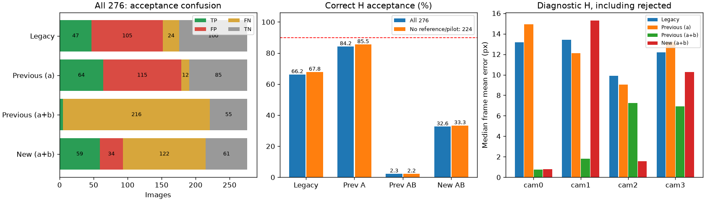
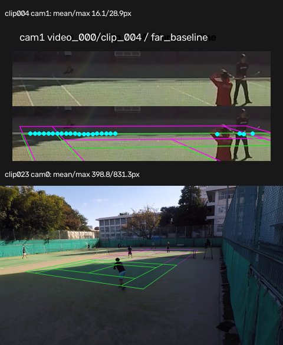

**受入未達で、この版の採用・mergeは勧めない。** meiji4の誤採用は34件（cam0 1、cam1 33）、正しい診断Hの採用は59/181=32.6%。誤採用0・採用90%の両目標を満たさない。cam3は0/69採用で、4cameraすべて採用されたclipも0。syntheticと既存sceneの非退行も達成しなかった。`status: done`は実装・全件比較・記録の完了で、受入合格ではない。

[親の次修正の指示](https://github.com/Motoki0705/tennis-lab/issues/2150#issuecomment-6925940896)に従った。参照は[承認済みrun 71](000071-run-court-white-line-reference-20261116.md)、許容差は元1920×1080で参照の画像内KPの平均≤10px・最大≤25pxを維持した。数値閾値は変えず、Court val209・synthetic99の固定subset、synthetic喪失58件、既知Hの人工画像で設計を確認した。2026-11-16 19:30 UTCに数値source/設定を凍結し、非meiji4 3269画像の比較を完了してからmeiji4全276画像を評価した。結果を見た追加実装・参照/閾値の調整はしていない。

## 変更と検証契約

(a)は空間分布とconfidenceから支持集合を作り、集合を固定したまま2つのLINE場で解く。最適化後に見つかった集合を親candidate IDつきの別候補にする。同じseed/集合は再実行せず、1 seed最大8集合。集合の循環を別Hへの暗黙の切替で救わず、採用Hの実際の集合・残差・終了理由を記録する。境界の片側観測、重複の相関群は維持した。`fixed_subsets`は前方式として明示的に選べる。

(b)はmodel近傍6pxとcoarseのstripeを候補にし、両方向2本ずつのprojective gridを残る線で検査する。確認した近傍対応数、全体支持数、残差で候補を選ぶ。model投影・global一致・代替stripeの検査を通った線を初期必須集合とし、その他のstripeの喪失は診断へ分離した。確認済みの位置から3pxを越えて動く場合も拒否する。これら6px/3px等は既存設定で、新しいGT由来の調整値ではない。

線除去でrankが不足するときは、任意のHへの移動量を不安定性と数えず`essential_lines`に記録する。不可欠な線の意味確認と、全線を用いた投影分散の合格を要求する。計算可能な線除去変位は従来どおり使う。旧方式`paired_edges_v1`と新方式`semantic_consensus_v2`、候補数を含む設定はcache identityに入る。モデル内部一致度とRGB線残差/coverageは別々に残し、RGB不合格時に旧Hを採用Hへ代用しない。

## 読み方

TP/FN/FP/TNは選択された採用Hまたは診断Hと参照の比較。FNは正しい診断Hを拒否した画像。RGBの「成立」はfine fit Hの存在で、採用ではない。正解候補を持つ画像の救済も別に数える。要求の4条件に、今回(a)単独を加えて原因を分離した。旧3条件は[run 73](000073-run-court-fixed-support-rgb-20261117.md)の同じ保存LINE場に対する結果を再利用した。

## 全276

|条件|TP|FN|FP|TN|採用|正しい推定の採用率|正解候補がある画像|
|---|---:|---:|---:|---:|---:|---:|---:|
|旧処理|47|24|105|100|152|66.2%|182|
|前回(a)|64|12|115|85|179|84.2%|176|
|前回(a)+(b)|5|216|0|55|5|2.3%|265|
|今回(a)|60|14|114|88|174|81.1%|182|
|今回(a)+(b)|59|122|34|61|93|32.6%|260|

## 参照・pilot未使用224

|条件|TP|FN|FP|TN|採用|正しい推定の採用率|正解候補がある画像|
|---|---:|---:|---:|---:|---:|---:|---:|
|旧処理|40|19|85|80|125|67.8%|149|
|前回(a)|53|9|96|66|149|85.5%|142|
|前回(a)+(b)|4|175|0|45|4|2.2%|215|
|今回(a)|50|11|92|71|142|82.0%|147|
|今回(a)+(b)|49|98|28|49|77|33.3%|211|

## Camera別（TP / FN / FP / TN）

|camera|旧処理|前回(a)|前回(a)+(b)|今回(a)|今回(a)+(b)|
|---|---|---|---|---|---|
|cam0|9 / 6 / 19 / 35|8 / 5 / 32 / 24|5 / 64 / 0 / 0|8 / 4 / 32 / 25|9 / 56 / 1 / 3|
|cam1|4 / 0 / 59 / 6|12 / 1 / 41 / 15|0 / 62 / 0 / 7|12 / 1 / 41 / 15|30 / 1 / 33 / 5|
|cam2|33 / 2 / 20 / 14|39 / 0 / 24 / 6|0 / 52 / 0 / 17|37 / 0 / 26 / 6|20 / 31 / 0 / 18|
|cam3|1 / 16 / 7 / 45|5 / 6 / 18 / 40|0 / 38 / 0 / 31|3 / 9 / 15 / 42|0 / 34 / 0 / 35|

## 成立・採用（成立 / 採用）

|入力|旧処理|前回(a)|前回(a)+(b)|今回(a)|今回(a)+(b)|
|---|---|---|---|---|---|
|tennis_court_detector_val|2211 / 2153|2211 / 2200|2211 / 2035|2211 / 2200|2211 / 2018|
|synthetic_court_test|579 / 30|541 / 23|154 / 0|565 / 21|168 / 28|
|meiji_3cam|171 / 165|171 / 128|154 / 3|171 / 132|171 / 105|
|tennis_clip|1 / 1|1 / 1|1 / 1|1 / 1|1 / 1|

## 同じGT点での誤差比較

|入力・条件|共通画像|旧mean px|新mean px|成立喪失/獲得|採用喪失/獲得|
|---|---:|---:|---:|---:|---:|
|tennis_court_detector_val 前回(a)|2211|2.0851|2.0834|0/0|1/48|
|tennis_court_detector_val 前回(a)+(b)|2211|2.0851|2.1955|0/0|151/33|
|tennis_court_detector_val 今回(a)|2211|2.0851|2.0861|0/0|1/48|
|tennis_court_detector_val 今回(a)+(b)|2211|2.0851|2.0282|0/0|164/29|
|synthetic_court_test 前回(a)|521|15.2572|15.4696|58/20|16/9|
|synthetic_court_test 前回(a)+(b)|154|6.4112|18.8857|425/0|30/0|
|synthetic_court_test 今回(a)|541|15.8596|15.9823|38/24|16/7|
|synthetic_court_test 今回(a)+(b)|165|8.4396|19.0954|414/3|28/26|

## camera別の誤差・ばらつき（frame mean中央値 / 可視KPのclip変位p95、px）

|camera|旧処理|前回(a)|前回(a)+(b)|今回(a)|今回(a)+(b)|
|---|---|---|---|---|---|
|cam0|13.15 / 35.20|14.94 / 37.71|0.74 / 1.63|14.60 / 43.81|0.79 / 7.77|
|cam1|13.40 / 14.68|12.11 / 13.05|1.82 / 11.61|12.50 / 14.00|15.29 / 30.24|
|cam2|9.90 / 20.46|9.04 / 21.59|7.26 / 13.14|9.70 / 20.89|1.56 / 86.48|
|cam3|12.19 / 90.29|13.15 / 44.43|6.90 / 22.65|12.61 / 45.17|10.26 / 81.29|

## 旧正解候補184画像の救済

|条件|救済|順位負け|全正解gate拒否|今の候補に正解なし|
|---|---:|---:|---:|---:|
|旧処理|47|30|105|2|
|前回(a)|61|16|89|18|
|前回(a)+(b)|2|0|176|6|
|今回(a)|58|16|102|8|
|今回(a)+(b)|46|11|122|5|

## 採否と推定のどこが未達か

正しいHの拒否に初期支持線喪失が付く数は、前回213/216から今回7/122へ減った。ただし、その修正を採用全体の正しさへつなげられなかった。正解候補がある260画像のうち184画像は全正解候補をgateで拒否し、17画像は正しい採用候補があっても別のHを順位で選んだ。旧固定184画像の救済46件は旧処理47件にも届かない。

- cam0の正しいH拒否56件では線除去の影響が46件。さらにclip_023で平均398.77px・最大831.28pxの別Hを誤採用した。実際のRGB測定点は**手前baselineに中央値0.44pxで一致する線を、奥baselineとして扱っていた**。低残差でも物理線IDが正しいとは限らない。
- cam1の誤採用33件は全てfar/near baselineを必須かつessentialとして扱い、service lineの支持はどちらも0件だった。clip_004の保存H・scoreをCPUで厳密に再現し、測定点がネット上端に並ぶことを元解像度cropで確認した（平均16.06px・最大28.91px）。モデル近傍と他方向の線の一致は、この奥baselineの意味を証明していない。
- cam2はTP20/FN31で、正しいH拒否の線除去影響19件・外挿分散11件などが残る。
- cam3は参照許容内の診断H34件を全て拒否し、全69画像に外挿分散のflagが付く。単frameから4cameraの校正を成立させる目標は未達。

採否だけでなく、選択した診断Hの精度も前回RGBから退行した。4cameraのHがすべて正しいclipは29→12。cam1のframe平均誤差の中央値は1.82→15.29px、cam3は6.90→10.26px、cam3の可視KPのclip変位p95は22.65→81.29pxだった。近傍モデルを意味対応の根拠に使う今回の方法と、essential lineの扱いは、この実データでは不十分だった。

上のcam1 cropは上段が原画像、下段が実際の測定点（水色）・推定（緑）・参照（マゼンタ）。全原解像度と測定点の保存先は`artifact-inventories.json`、詳細は`report/rgb-measurement-inspection.json`を参照する。Hとquality scoreの再現一致を確認した後の観察で、参照や実装を調整するために使っていない。

## 回帰の原因と残存

Court valは前回回復した114件を維持し、全2211件が成立した。(a)の同一GT点の平均は旧2.085103→2.086088pxでほぼ同等だが、厳密な数値一致ではない。RGBは平均2.028157pxへ改善した一方、採用は旧から164喪失・29獲得。前回RGBとの比較でも70喪失・53獲得であり、平均誤差低下だけを非退行と扱わない。

syntheticの前回(a)喪失58件中35件を回復したが、今回の旧処理比較は38喪失・24獲得。前回(a)との比較でも18喪失・42獲得である。旧Hが許容内だった18件を失っており、成立数だけの問題ではない。残る38件は曖昧候補30・線支持不足4・最適化失敗4。30件の保存解を同じfloat64・保存LINEで再採点し、全件で少なくとも1つの競合Hが既存の線支持gateにも合格することを確認した。無効な競合候補を除外するだけでは解決しない。過去run70の45喪失の回復は34/45、30獲得の維持は14/30に留まる。RGBは共通165画像で旧8.439557→新19.095401pxと悪化し、採用28件の内訳も正21/誤7（旧30件は正27/誤3）だった。

meiji3の採用減少を分けると次のとおり。行はH生成、列は採否規則。候補全体に同じgateを適用した画像単位の数であり、参照で採否を調整した値ではない。

| H | 旧gate | モデル品質gate |
|---|---:|---:|
| 旧処理 | 165 | 139 |
| 前回(a) | 163 | 128 |
| 今回(a) | 164 | 132 |

旧Hでも新gateだけで26件減るため、全減少を支持集合の変更に帰すことはできない。今回(a)の支持候補による回復は部分的で、旧165件には戻らなかった。今回RGBは171件成立・105件採用、前回154/3から増えたが旧165採用には届かない。既存GTの3画像ではRGB平均/最大誤差はcam0 10.05/31.06、cam1 5.48/20.78、cam2 4.49/8.46px。GTがない残り168画像の正誤は未確認。tennis_clipは全方式1/1成立・採用だがGTなし。

## 証拠、独立性、実行

全3545画像・8530領域を凍結raw、保存LINE場、取得時と同じ元RGBでCPU比較した。入力raw8530、LINE8530、RGB3545の全ファイルをrun73の内容inventoryと照合した。raw/LINE/参照の再取得やCourtモデルのforwardは行わない。非meiji4の実行3728.40秒、meiji4は893.91秒（10 CPU process、モデルforwardを含まない）。旧3条件の時間はrun73当時の測定なので、今回と同時実行の速度比較にはしない。

参照と(b)は同系統の白線抽出を使い、完全に独立した評価ではない。224画像も過去のraw分析では参照済みで、未知のholdoutとは呼ばない。Court valのGT、syntheticのレンダラGT、既知Hの人工画像を別の証拠として併記したが、val/syntheticの一部は今回の設計にも使用した。syntheticの学習重複は未確認、実画像testは未定義。meiji3の3画像GTは今回の再承認なし。16画像の追加注釈は人間の指示により作らなかった。奥baselineが外挿であること、cam1/3の約5pxの時間変化もrun71の承認条件として維持する。

全69clip×4camera×5条件の元解像度と69枚の4camera一覧、計1449 JPEGを`review/index.html`へ保存した。元PNGへのリンクもあり、物理線別の残差・coverage・初期必須・線除去の影響を見られる。大きな画像・全候補・pickleはoutputsに保持し、versioned bundleには小さな集計・case表・図と内容inventoryへの参照を置く。[再現手順](../../runs/run-court-semantic-support-20261117/reproduce.md)を正本とする。TensorBoardは学習していないため該当しない。

最終sourceで関連CPU pytestは144 passed / CUDA bf16 1 skipped（145収集）、最長case4.391秒。追加は4case。旧「未確認stripeでも喪失不可」のtestは、今回の指示に合わせて未確認net stripeを採用Hへ混ぜない契約へ置換し、確認済み線の喪失拒否を別caseで保持した。既知Hの支持集合不整合、片方向2線のrank喪失と外挿、coarse第一stripeの曖昧性を検証する。旧方針への2つのメモリ内変異をassertが検出し、復元後の成功も確認した。公開region APIと評価scriptはmeiji3の3画像×2条件で採否・領域が一致した。pre-commit ruff/mypyは成功、validatorは指定0・試行/完了0。コードHEAD 3049e2158の通常CIとKnowledge CIは成功（`code-ci.json`）。最終記録HEADのCIはPR/子issueに残す。

**実行上の逸脱:** 初回の関連pytestでCUDAを無効化せず、既存CUDA unit 1件をqueueを通さず実行した（call1.67秒）。今回のCPU限定指示に反したworkerの確認漏れで、先の「GPU使用なし」を子issueで訂正した。そのテストは終了し、以後の最終検証は`CUDA_VISIBLE_DEVICES=''`で実行、該当caseのskipを確認した。詳細は`execution-incident.json`。Courtモデルの新CUDA推論・新raw取得・queue登録・infra操作は行っていない。このunitを正式なCourt実機確認の代わりに扱わない。

## 親へ返す判断

1. 現案を採用せず、**片方向2線だけの意味確認（ネットと塗線、near/farのID）と候補の順位**を再設計するか。model Hとの近さだけでは独立した意味証拠にならない。正しいHを拒否する影響/分散も同時に検証する必要がある。
2. (a)の残る複数のKP/LINE支持Hを、支持の分布・数やRGBの証拠で比較する設計を続けるか。現在はモデル段の曖昧性でHを返さず、RGB段へ進めない。閾値緩和や旧H代用による回復は行っていない。
3. 共有GPU lockが正規に復旧した後の、queue経由のCourt CUDA公開経路確認。現段階でのmerge/issue close、#2191による単frame目標の代替は行わない。

summaryの「未採用」という判断を維持しつつ、残る主因を初期支持線喪失から意味対応・順位・不確かさ・モデル候補の曖昧性へ更新する。追加修正は親の判断を待つ。
