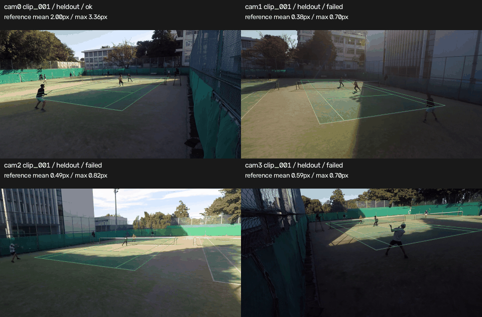
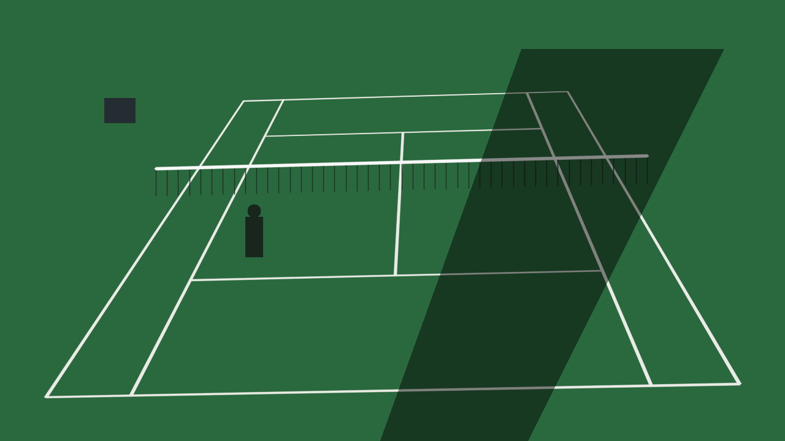

**全69clip成立の受入は未達。** 手指定なしの共通Hは4cameraとも参照に対するmean10/max25pxを満たしたが、
heldoutの局所driftが169/276件で検査不能となり、4cameraがそろって使用できるclipは0/69だった。
単一frameで局所Hを再認定するdriftの可観測性が、共通Hの精度とは別の停止要因である。
閾値は変更せず、検査不能を安全とみなさない。人間の確認は未完了。
summary_impactはupdatedとし、この停止要因を現在の課題へ反映する。既定clipやcheckpointの採用は変えない。
実験の実行と保存は完了したが、全clip受入の目標未達としてstatusをfailedにした。

## 製品境界と評価条件

凍結モデル候補をRGB・動画hashで照合し、`prepare_video_court(...)`が同じvideo/cameraの共通Hを準備する。
video bundleとcamera文書を内容アドレスで保存し、clip court nodeはcamera文書hashを使う。
全source、設定、使用clip/frame、採否、局所drift、既存モデル候補との差を保持する。
明示的なbuild/load、build中断後のcamera再利用、内容変更・破損・別scopeの拒否、
dataset markerの変化と単一／複数clip計画の一致をintegrationで確認する。
load時に検出器へ切り替えず、共通Hの不成立・drift検査不能は失敗する。
共有観測schema v3のframe 0は適用先であり、直接観測したframeとして扱わない。
旧ball3d reader・固定幾何import・direct_annotationは明示的に非対応とする。

対象は全69clip×4camera。初期値は参照作成clipを除いた64clipのframe 0、fitは全69clipの
`floor(k*(N-1)/5), k=1,2,3`、診断と評価は `floor(4*(N-1)/5)`。
これは製品既定の全clip選択とは別の、親が承認したsubsetである。
run 71の15frame/cameraは、初期値・fit・評価のすべてから除く。先頭frame画像には参照作成frameも含むが、目視用途だけである。
参照Hは評価器だけで読む。推定器に参照H・手指定点・ネット除外帯は渡さない。

共通Hと参照Hの距離はcameraごとに同じ値を69回使うため、69回の独立精度測定ではない。
heldout RGBの残差と局所driftを別途測定する。参照と推定器は白線抽出部品を共有し、独立性には限界がある。
数値driftは各clipのheldout 1frameに限り、frame間の移動や全動画の安全を保証しない。
Court valの1枚画像GTを動画共有の評価として流用しない。

## 実データ結果

|camera|参照mean / max (px)|使用可 / 69|うちwarning|検査不能|使用したfit frame / 要求207|
|---|---:|---:|---:|---:|---:|
|cam0|2.00 / 3.36|44|0|25|199|
|cam1|0.38 / 0.70|60|3|9|186|
|cam2|0.49 / 0.82|3|0|66|127|
|cam3|0.59 / 0.70|0|0|69|146|

primaryは承認済み参照のvisible indices（cam0/1/2は14点、cam3は13点）で計算した。
全14点でも許容内で、cam3のmeanは0.582px、maxは同じ0.698px。
参照との数値比較上の誤採用は0 cameraだが、共有する1つのHを69回数えた独立性のない値である。
holdout画像の白線残差と、共通Hと局所Hとの差は[全件表](../../runs/run-court-video-shared-acceptance-20261117/cases.csv)と
[線ごとの残差](../../runs/run-court-video-shared-acceptance-20261117/drift-lines.csv)に分けた。
実sourceに束縛した`SharedCourtModule`も全276件で確認し、107件は同camera内で同じKP配列を返し、169件は明示的な失敗を返した。

|camera|選んだモデル候補（すべてframe 0・旧判定では不採用）|RGB初期値のclip/frame|fitに寄与したclip数|旧判定を通ったseed clip数 / 64|
|---|---|---|---:|---:|
|cam0|clip061 / region06|clip033 / 82|69|26|
|cam1|clip064 / region06|clip001 / 112|68|58|
|cam2|clip001 / region00|clip067 / 108|64|50|
|cam3|clip001 / region00|clip001 / 112|62|7|

これは初期値の来歴で、最終Hは各cameraの複数frameのRGB測定からfitしたもの。
全69clipをfit対象として要求したが、意味対応が成立しなかったframeは支持に使わず、要求した集合と実際の使用集合を両方保存した。
原候補の旧採否だけで除外すると、この4つの初期値は残らなかった。採否を通らない候補も初期値に使うという親の指示に従った結果である。

検査不能169件のうち119件は局所投影の不確かさ、50件は独立線・有限端・対応の不足。
後者の理由は複数併記されるため、理由文字列の件数をそのまま足さない。
不確かさ超過はcam0/1/2/3で25/1/38/55件。支持不足等は0/8/28/14件。
局所Hが数値的に成立したframeのprojection std中央値は4.49/4.31/5.12/7.14pxだった。
cam2の多くは5px付近、cam3は観測できた全frameで5px超だったが、結果を見て基準を広げていない。
[原因と分布](../../runs/run-court-video-shared-acceptance-20261117/drift-causes.json)を保持する。

先頭276画像とheldout276画像、手前baseline・net側・左右sidelineの原寸crop 1104組を作成した。
cropはraw/overlayを別保存し、失敗・warningを画像にも明示する。
概観図は縮小しているため、品質確認にはoutputsの`review/index.html`で原寸・200/400%表示を使う。
browserで276件/4camera/69clip、原寸canvas、warning表示、拡大、連続切替後の正しい画像を確認した。
このbrowser動作確認は人間の品質承認ではない。

親へ返す次案は、共有fitで確定した線の対応を引き継ぎ、clip内の複数frameの支持を使うdrift診断の設計である。
動いた1frameを時間平均で隠さないことと、独立した人工データでの検証が必要。
今回の169件を安全として通す変更や、数値閾値の緩和は提案しない。次の実装開始は親の判断に従う。

## 独立した人工動画

[別描画器](../../runs/run-court-video-shared-acceptance-20261117/synthetic.py)はliteralの物理court座標と
既知のprojective Hから5cmの白線矩形を描く。モデルの出力や白線抽出器からGTを作らない。
1280×720、固定seed、開発unitとは異なる8視点×5frameに、浮いた静止ネット、影、動く人物と遮蔽物を含めた。
閾値を凍結した後に実行し、結果に合わせた変更はしない。
`synthetic-protocol.json`に真値H・初期値・設定・source hashを保存し、詳細な局所Hと残差はoutputsに保持する。

|検証|結果|
|---|---|
|共通Hを回復|8/8。1920×1080換算の最大mean 0.613px、最大max 2.026px|
|横方向の地面線を除いた負例|8/8拒否、誤採用0|
|静止frameのdrift|7/8がok、1/8が検査不能|
|5px移動（元解像度へscale）|7/8がwarning、1/8が検査不能|
|11px移動|6/8が閾値超過による失敗、2/8が検査不能|

検査不能の4例は局所投影の不確かさが5px換算を超えた（1280×720の実値3.334〜3.489px、上限3.333px）。
これを「移動を正しく推定できた」と数えず、20/24だけを期待分類一致とした。
動いた16例が安全と誤判定された例は0だが、うち3例は移動量を確定できない保守的な失敗である。
人工netや人物は実映像の全形状を代表せず、実データの合格を代替しない。

## 実装・検証中の修正

最初の製品buildがheldoutに入る前に、共通Hの線残差の明示記録を追加した。
局所fitで使わなかった線を不確かさ計算へ入れないこと、bootstrapの単一frame採否を
動画全体の初期値資格と混同しないことも修正した。単一frameが意味を確定できなくても初期値として記録し、
採用は全fit frameの支持で判断する。3/10/25pxや支持・不確かさの閾値は変えない。

最初のCIでは実行時の設定カタログがTYPE_CHECKING内の`VideoCourtConfig`を解決できず失敗した。
runtime importへ直すと、Python側に置いた既定値もcomposition所有契約に反したため削除した。
YAMLと`from_config`がclipモードのNoneを決める。数値既定は変更していない。
この修正前のreplay153画像は完全一致だったが、全件の受入として数えず別保存した。

4threadでも約1.2コアしか使用できなかったため、独立frame測定はspawnによるCPU processへ移した。
実fit RGBの3frameで、sequential/processの点配列dtype/shape/bytes・全診断・RGB hashが完全一致した。
閾値・処理順序・推定方式を変えず、最終buildを新しい実装hashで開始した。
3回の中断buildは完了camera文書0、heldout未評価で、protocol/log/停止理由をoutputsに分けて保持する。

最終幾何31ケースは13.12秒、最大case 2.49秒。設定カタログを含む関連487ケースは143.85秒で成功した。
skip 1は既存の空parameter集合（compact domainなし）で、GPUの代用成功とは扱わない。
既存の全domain cold import検査は約70秒、source auditは26.27秒。新integrationの最長は4.57秒。
実Hydra入口の2 E2Eと、他のpipeline既存回帰はrun 76にも実測を残す。
今回のtest増分は幾何31・integration23・E2E2の56ケースで、既存数値検証を削除していない。
pre-commit ruff/mypyは各実装commitで成功した。TensorBoard曲線は学習を行っていないため対象外。

製品buildが終わってから、warningの直接表示をrun.jsonとreview画像へ補った（推定数値の変更なし）。
この境界を含む36ケースは28.96秒、追加したwarningケースは2.14秒で成功した。
同時実行中の既存galleryは7.66秒、複数clip integrationは5.54秒だった。5秒目安を超えた実測もそのまま残す。
追加bootstrap fixtureの最初の診断frameは可観測性が不足して正しく失敗したため、診断frameだけを全線のあるfixtureへ直した。
bootstrap側の曖昧な支持は残し、独立人工評価の4件の検査不能も保持した。

## 既定clipの互換性と成果物

run 75の旧ソースとの対比較driverを再利用し、全3545画像/8530領域でH・投影・支持mask・残差の
dtype/shape/bytes、solver状態、候補診断、採否、選択regionが完全一致した。
CPU 8 processで5530.11秒。入力を再生成せず、raw8530・保存LINE8530・RGB3545の計20605ファイルの
サイズ/hashも元inventoryと全件一致した（68.56秒）。
比較は同じ凍結入力に対する互換性で、ニューラルforwardの再実行や精度改善ではない。
[replay結果](../../runs/run-court-video-shared-acceptance-20261117/legacy-replay-summary.json)、
[入力照合](../../runs/run-court-video-shared-acceptance-20261117/input-integrity.json)、
[数値ソース照合](../../runs/run-court-video-shared-acceptance-20261117/evaluated-source.json)を保持する。

meiji_3cam 171画像/2109領域、meiji_4cam 276/3312、synthetic test 886/886、tennis_clip 1/12、
Court val 2211/2211のすべてが一致。run 73保存の旧採否・regionとも差は0件だった。
build後の変更はreceipt/review表示と、最終の全変更ファイルmypyで必要だった局所変数の型注釈。
共有/幾何の23ファイルとreplay固定の数値ソース・設定はbyte一致し、型注釈を加えたestimatorも
moduleと全nested functionのbytecode・定数・名前・引数が同一であることを確認した。
最終の全変更ファイルpre-commitはruff/mypyとも成功した。

参照作成60frameと、seed256・fit828・評価276frameの重複は、clip内indexだけでなく
元動画pathとsource frame番号でも0件だった（[split照合](../../runs/run-court-video-shared-acceptance-20261117/split-integrity.json)）。
成果物の内容hashと使用frame・設定は動画storeに残し、[集計](../../runs/run-court-video-shared-acceptance-20261117/evaluation-summary.json)と
[inventory](../../runs/run-court-video-shared-acceptance-20261117/artifact-inventories.json)から追跡できる。
native画像、全予測、測定点、replay比較はoutputsに保持し、削除していない。
PR #2222はDraftのまま親へ返す。最終HEADのCI結果はPR側に記録する。

一括CLI接続は#1752で行い、このrunで一括CLI受入済みとは書かない。
GPUモデルforward・実3D再構成・人間の画像確認・merge後確認はこのCPU評価で実施していない。
