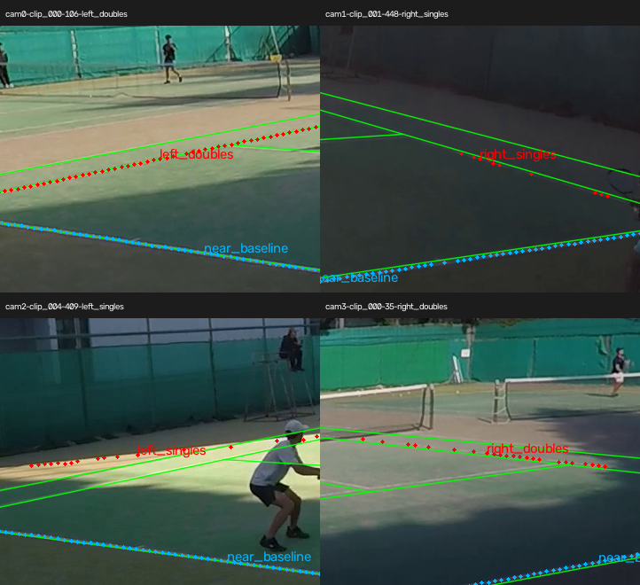

**人間の共通H承認と `unobservable_policy=warn` の方針により、69/69clipで4cameraの共通Hを利用可能。**
共通Hはrun 77から再fitせず、bundleと4camera文書の内容hash・ファイルbytesを維持した。
run 78の測定値も変更せず、検査不能は理由・frame付きwarningへ再分類した。信頼できる10/25px超過は引き続き失敗する。
これは自動検査の精度改善や検査不能の解消ではなく、共通Hを採用する運用方針の明示的な変更である。
summary_impactはupdated。既定clip・checkpointは変更せず、動画共有の利用方針と残る検出限界を更新する。

## 人間の確認と採用方針（2026-11-17）

親からの継続指示（turn `c4c7bed22d114a2da39b7a77252fca41`、[子issueへの記録](https://github.com/Motoki0705/tennis-lab/issues/2191#issuecomment-6946828202)）により、
人間が確認ページの3clip×4cameraと原寸の拡大cropを見て、次の判断をしたと伝達された。

> 緑の線は完全にコートを示している。これを下流で用いていけばよい

これを**共通Hそのものの人間確認**として記録する。全69clip画像を人間が全覧したという意味ではない。
3clipのIDは親の指示に指定されていないため推測しない。全69clipで同じcamera Hを使うことは機械的に確認した。
方針変更の根拠は、(1) 共通Hが承認済み参照と一致した、(2) 人間が共通Hを目視確認した、
(3) 検査不成立の主な原因は隣接線の誤った拾い方で、10px級の整合したcamera移動の証拠がない、の3点である。
個々の検査不能frameすべての原因が確定したという主張ではない。

**限界: clipの途中でcameraが動いた場合、自動では検出されないことがある。**
警告を消して静止確認済みと扱わず、元の測定判定・数値・理由・frameをreceipt、表、galleryに残す。
線の候補を保持し、共有した線配置で対応を検証するdrift改善は将来の課題として残す。

`court_kp.video_shared.unobservable_policy: warn|fail` を設定に追加し、既定を人間の判断どおり `warn` とした。
`drift_unobservable`／線の矛盾はwarnなら警告、failなら従来の失敗。共通H不成立、入力破損、
信頼できる `D_mean > 10px` または `D_max > 25px` は失敗のまま。別H・別camera・clip推定への切替はない。
この方針をcourt nodeとdataset markerのidentityへ含め、切替時は必要なconsumerを再計算する。
共通Hとdrift bundleは変更せず、読み取り時に純粋関数で判定を適用する。

|camera|使用可 / 69（warning含む）|warning|失敗|
|---|---:|---:|---:|
|cam0|69|48|0|
|cam1|69|12|0|
|cam2|69|30|0|
|cam3|69|69|0|

保存済み1,380frameを再集計し、使用可276/276 camera-clip、4cameraがそろうclipは69/69。
warningは159 camera-clip／467frameで、信頼できる10/25px超過は0件。
実court component全276件は同camera内で同一KPを返し、元のfail方針で返せた121件ともbyte一致した。
再集計とcomponent確認は4.11秒、画像decode・白線抽出・H再fitは行っていない。
Hとdrift成果物のbytes/hash、全測定値の不変を照合した。
[新方針の集計](../../runs/run-court-video-drift-lines-20261117/policy/summary.json)、
[clip表](../../runs/run-court-video-drift-lines-20261117/policy/clips.csv)、
[frame表](../../runs/run-court-video-drift-lines-20261117/policy/frames.csv)が現在の適用結果である。
新galleryは元のraw画像・原寸cropを参照し、警告・理由・frame・方針を表示する。
原寸表示・拡大・raw/overlay cropを利用でき、旧失敗ラベル付きの全画面JPEGへのリンクは表示しない。

以下は方針変更前に凍結した測定と、厳格なfail方針での評価履歴。測定条件や元の成果物は書き換えない。

## 固定した入力・方式

共通Hのbundleは `4ac8e386763687fcb6c81f46abf0774e38fc118af4f79b31cdb6e3c2283e3f75`。
共通fitの方式・設定・使用frame・推定値・全camera文書は不変である。
推定値の参照mean/maxはcam0 2.00/3.36px、cam1 0.38/0.70px、cam2 0.49/0.82px、cam3 0.59/0.70pxのまま。
これはcamera内で同じHの比較を69回使う値であり、69回の独立精度測定ではない。
参照と推定器が白線抽出部品を共有する独立性の限界も変わらない。

診断は `floor(k*(N-1)/10), k=[1,3,7,8,9]` の5frame/clipを、結果を見る前に固定した。
旧heldoutの4/5を含む。候補frame 0、fit 1/5・2/5・3/5、参照15frame/cameraと、
clip内index・元source frameの両方で重複しない。先頭frameの画像は目視用で、数値判定の対象ではない。
[frame protocol](../../runs/run-court-video-drift-lines-20261117/frame-protocol.json)の `settings_frozen:false` は
frame選定時の記録で、数値設定の凍結は後の[frozen profile](../../runs/run-court-video-drift-lines-20261117/frozen-profile.json)が正本。
参照H・手指定点・ネット除外帯を診断器へ渡していない。CPUのみ。

共有fitの `supported_lines` をそのまま物理線のIDとして使い、各frameで符号付きの垂直offsetを測る。
画像上の平行移動・回転・一様scaleの4自由度を推定し、可視KPの変位と不確かさへ伝播する。
2本の交差線だけでは交点回りのscaleが不定なので、初期解には3線、最終解には4線以上を要求する。
1物理線につき10/90 percentileの2空間アンカーだけを数え、密な画素を独立支持として加算しない。
最低横1線・縦2線、2方向12度以上、アンカーsigma下限1px、最大投影std 5px、線残差3pxを使う。
1920×1080の対角長へ正規化し、3px warning・mean10/max25px失敗・検査不能は失敗を維持した。
warningにはmean変位から2stdを引いても3px超という条件を使う。

frame間の平均や共分散共有は一切行わず、各frameを独立に判定しclipはworst frameで決める。
同じ姿勢のframe群という仮定はない。疎なサンプル間の急変は検証していない。
線方向が不足する、異なる変位が同等に支持される、観測線が同じ4自由度変位で説明できない場合は失敗。
4自由度で表せないprojectiveなcamera変化も矛盾として失敗しうるため、失敗だけで移動有無を断定しない。

## 開発集合と独立人工評価

開発seed 219178の別8視点について、静止・5px・11px×2frameの48件と、横方向の地面線を除いた8件を測定。
56/56が期待どおり、移動の安全誤判定0。最低支持・不確かさはこの結果を根拠に2026-11-17 09:28:27 UTCに凍結した。
その後、run 77の8視点×静止/5px/11pxを再評価し、24/24一致、検査不能0、移動の安全誤判定0だった。
run 77では20/24一致・4検査不能だった。真値Hから独立に5cm白線、浮いたnet、影、人物、遮蔽物を描く。
既知Hの代わりに抽出器の出力をGTとして使っていない。

run 77は人工共通H行列を保存していなかったため、**人工fixtureだけ**を旧ソースで再構成した。
5frame×8視点のRGB hashとrun 77のprojection誤差mean/maxが1e-9以内で一致した。
実動画の共通Hを再fitしたという意味ではない。復元matrix・検証値・乱数seedはbundleへ保存する。
人工の広い画角・均一paintは、実映像の狭い投影、隣接線、弱い線、遮蔽をすべて代表しない。
今回の人工合格は実動画の全clip採用を代替しない。

## 実動画の測定結果（旧fail方針）

|camera|使用可 / 69|うちwarning|失敗＝検査不能 / 69|frame使用可 / 345|frame矛盾|観測可能frameの最大投影std中央値(px)|
|---|---:|---:|---:|---:|---:|---:|
|cam0|21|0|48|217|128|2.47|
|cam1|61|4|8|334|11|2.20|
|cam2|39|0|30|294|51|2.79|
|cam3|0|0|69|98|247|2.79|

数値として信頼できる10/25px超過、投影std上限超過、方向不足による失敗は0件。
失敗437 frameはすべて `non_similarity_or_conflicting_line`。
観測可能943 frameのうち30frameがwarningで、cam1の4clipに集約される。
共通Hは全cameraで参照目標内のまま。155件を安全として通していない。
旧run 77は1frame/clip、新runは5frameのworst判定なので、107→121使用可という数だけを方式の同条件比較と解釈しない。
同じ4/5 frameだけの比較は `result-integrity.json` に別に残す。

全frame表はcamera別の `frames-cam0.csv`〜`frames-cam3.csv`、clip表は `clips.csv`。
旧clip推定との差・採否・選んだモデル候補の来歴はrun 77の値を保持してclip表にも引き継いだ。
HTMLでは全5測定frameと先頭frameを選べ、frameごとの変位・std・判定・矛盾線を参照できる。
先頭276枚・診断1,380枚のoverlayと、手前baseline・net側・左右sidelineの原寸raw/overlay crop 6,624組を保持する（237.79秒）。
CPU browserでframe切替・5行の表・原寸canvas・拡大・warning・連続切替・cropと画像の対応を確認した。
初回評価時は人間の品質承認前だった。現在の承認範囲と適用結果は冒頭の方針変更の節を参照。

## 本当のcameraの動きと測定限界の切り分け

|camera|矛盾した物理線の件数（1frameに複数あり）|事後の部分集合でも検査不能|
|---|---|---:|
|cam0|左doubles 123、左singles 4、centre service 1|0/128|
|cam1|右singles 11|0/11|
|cam2|左singles 27、near service 22、near baseline 10、centre service 1|10/51|
|cam3|右doubles 149、near service 54、near baseline 43、右singles 42、centre service 1|43/247|

代表cropは元画像も確認した。cam0 clip000/frame106は、左doubles用の探索で近傍の別の線を拾い、
符号付きoffsetが約+16.69pxになる一方、他の線はほぼ0px。cam2 clip004/frame409も左singlesが約−23.03px、
他の線は約1px。cam3 clip000/frame35は右doublesが約−10.26px、他は約+2〜4px。
これらはcamera全体の整合した10px級変位より、線の候補抽出・対応の限界を示唆する。
cam1の代表frameは暗いsidelineと部分的な支持で、他の線が示す3〜4pxの変位と線の傾きが整合しない。
影・人物・隣接線の寄与を、今回の目視だけで全437frameの確定原因へ一般化はしない。

事後分析として、最初の診断が記録した整合subsetだけで同じ4自由度を解き直した。
これは矛盾線を除くと何が残るかの説明であり、**成果物・採否・受入には使っていない**。
437件中384件で条件付きの変位が観測可能だった。mean範囲はcam0 0.09〜0.87px、cam1 3.58〜3.98px、
cam2 0.15〜1.21px、cam3 0.83〜4.66px。いずれも10/25px失敗を裏付ける大変位ではない。
残るcam2 10件・cam3 43件はsubsetでも検査不能で、真のprojective motionと測定の限界を分離できない。
初回は条件付きの値を受入に使わず、全155 camera-clipを失敗のまま親へ返した。現在も条件付きfitを下流には使わず、元の共通Hをwarning付きで使用する。

次案は、drift専用の抽出で正しい弱い線の候補を早期に落とさず、共有した線配置と複数線の変位から
候補の対応を検証する設計。現在の3/10/25pxや不確かさの閾値を緩める案ではない。
狭い画角・隣接線・部分遮蔽を含む独立人工開発集合も必要。追加実装の判断は親が行う。

## 成果物と互換性

新診断は元Hのstoreを変更せず、別の内容アドレスstoreに保存する。
`build_video_drift` は明示した全camera/clipのframe計画を受け取り、動画hash・時間軸を前後で照合する。
`court_kp.video_shared.drift_directory` と `drift_digest` を元Hの明示loadに添えて使う。
H digestと診断camera digestを別々にclip cacheとdataset markerへ入れ、receiptには全frameの結果を残す。
指定した診断の破損・別parent H・不足はエラーで、旧診断へ切り替えない。
両設定を省略した場合だけ元のv1埋込み診断を使うので、過去のartifact/replayを再現できる。

既存geometry・共有fit・estimatorとclip推論の数値ソースはbyte一致。
初回評価ではYAMLの既存値が一致し、追加は診断load用のnull項目2つだった。今回の方針変更は `unobservable_policy: warn` を加えたもので、既定clipの数値設定は不変。
親の許可どおり、run 77の全3,545画像/8,530領域の完全一致replay（mismatch 0）を再利用した。
このCPU評価をGPUモデルforward・3D再構成・未測定frameの安全の確認とは扱わない。後から伝達された人間の共通H承認は冒頭に範囲付きで記録した。
一括CLIへの接続は#1752が担当し、この子でCLI全体を受入済みとは書かない。

## 検証・実装中の修正

テストは、変位回復・covariance・画素数で支持を水増ししないこと・方向不足・矛盾・競合する帯・非similarity・
1frameの急変を平均で隠さないことをunitで検証した。integrationは既存のfake動画/実store/計画を再利用し、
診断変更時の依存node再計算、元H不変、marker/receipt、明示失敗、破損・別parent拒否、
単一/複数clipの一致、明示load設定、正確なframe計画とRGB来歴を確認する。
追加22ケース（unit12、integration10）。既存の8自由度診断のテストも歴史的artifact契約として保持する。

関連143ケースは20.35秒、設定catalogを含む464ケースは205.68秒で成功した（suite間に重複あり）。
既存cold importは最大64.77秒、source auditは24.92秒。新境界のcaseは同suiteで最大2.60秒だった。
追加のRGB reader・motion 13ケースは9.04秒、最大0.15秒。
診断あり/なしの単一/複数clip比較2ケースは22.16秒、各6.77/7.07秒で5秒目安を超えた。
実storeと複数計画を使い、実動画CPU評価との同時実行時の実測である。runtime明示loadは0.11秒。

初回起動はdataset pathの正規化契約で測定前に停止したため、絶対pathへ修正した。
初回全件実行ではdecoded BGRを `rgb_sha256` として記録していたので、BGR→RGB変換をreaderへ補った。
channel最小値を使う測定式は不変で、全1,380frameを再実行し、来歴hash以外の全診断・判定が完全一致した。
最終drift bundleは `7a4be8bf20397552a7b287131c3cb0e5fa57ba0dedc16e4a05fa23287c81a7f6`。
実court componentも全276件で確認し、121件は同camera内で同一KP、155件は明示失敗となった（96.37秒）。
修正前の文書とログもoutputsへ保持し、最終成果物としてはRGB版だけを指定する。
数値profile凍結後のmotion sourceの変更はmypy用コメント1行だけで、AST完全一致を記録した。
元の凍結sourceと固定設定を残し、再現時もその差だけを許す。実データ結果による設定調整は0回。
実装commitのpre-commitはruff/mypyとも成功した。最初のhookは追加testのimport整形で停止し、整形後に通過した。
validator指定は0回のため起動していない。

初回はPR #2222をDraftで返した。方針変更を反映して統合レビューへ渡し、merge・issue closeは親が行う。

## 方針変更の検証

実装は `56656531c6dd1721d3967790dacbebad07ce0abd`。元の数値測定の実装は `edf33290d` のまま。
新規12ケース（policy unit 7、integrationの増分5）を追加し、旧検査不能失敗テストは明示 `fail` の契約として維持した。
新しい既定warnで共有Hを使うこと、元の測定を改変しないこと、確かな10/25px超過・共通H不成立は失敗すること、
方針切替のcache/marker無効化、receiptとcomponentの一致、galleryの理由・frame表示を確認した。
関連75ケースは17.72秒、設定catalogとreviewを含む508ケースは202.22秒で成功（suite間は重複する）。
新規integration最長は2.30秒。既存の全component gallery描画は5.80秒、cold importは最大65.88秒、source auditは24.33秒。
前者は全schemaと実store描画の整合、後者は設定領域全体の契約を確認する既存ケースなので、狭いunitでは置き換えない。

代表的な誤変更として、確かな閾値超過までwarning化する変更を一時注入し、mean11px／max26pxの2ケースが失敗した。
元ソースをhash一致で復元すると同じ2ケースが成功した。[故障注入記録](../../runs/run-court-video-drift-lines-20261117/policy/mutation-summary.json)を保持する。
pre-commit ruff/mypyは成功。新galleryの276件・159 warning・人間確認範囲・frame切替・原寸・拡大・cropリンクをCPU browserで確認した。
既存の原寸画像・cropを再利用し、旧判定のfull JPEGへはリンクしない。初回に試した任意のcanvas保存はlocal-file環境で成立しなかったため採用せず、requiredな表示とcrop参照に絞った。
このbrowser動作確認は、親から伝達された人間の共通H承認とは別の検証である。

共通H・既存geometry・estimator・clip推論componentの数値ソースはbyte一致で、既存YAML値も同一。
[方針変更後の照合](../../runs/run-court-video-drift-lines-20261117/policy/default-replay-reuse.json)を根拠にrun 77の完全一致replayを引き続き再利用した。
自動drift検査の改善、実GPUのscene全処理、一括CLI接続（#1752）、merge後確認はこの変更に含めない。
