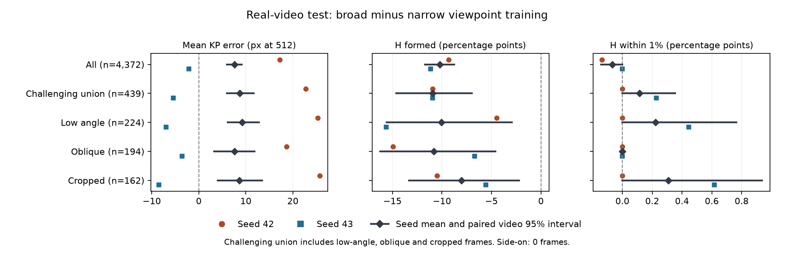

## 結果

事前基準で**部分的支持**。広分布のseed 43はtest全体と難視点集合でKP平均誤差が下がり、難視点集合でH@1%が0枚から1枚になった。seed 42では両集合でKP平均誤差が増えた。両seedの両集合でH成立率が下がり、2 seed平均のKP誤差は全体と各難視点層で増えた。この条件で視点分布を広げても堅牢性の一貫した向上は観測されなかった。 [事前の実験設計](https://github.com/Motoki0705/tennis-lab/issues/2633#issuecomment-7190709855) · [全精度の比較JSON](../../runs/run-i2633-court-viewpoint-comparison/comparison.json)

| 集合 | 画像 / 動画 | KP平均（長辺512換算px） 狭→広 | H成立率 狭→広 | H@1%件数 狭→広（画像×2 seed） |
|---|---:|---:|---:|---:|
| val 全体 | 4,468 / 249 | 102.61 → 111.65 | 32.30% → 23.03% | 7/8,936 → 1/8,936 |
| test 全体 | 4,372 / 249 | 103.50 → 111.07 | 32.41% → 22.19% | 7/8,744 → 1/8,744 |
| test 難視点の和集合 | 439 / 106 | 106.02 → 114.70 | 30.98% → 20.05% | 0/878 → 1/878 |
| test 低角 | 224 / 41 | 100.55 → 109.73 | 30.58% → 20.54% | 0/448 → 1/448 |
| test 斜め向き | 194 / 78 | 111.31 → 118.89 | 31.96% → 21.13% | 0/388 → 0/388 |
| test 見切れ | 162 / 46 | 100.47 → 109.09 | 28.40% → 20.37% | 0/324 → 1/324 |
| test 横向き45°以上 | 0 / 0 | — | — | — |

KPの平均は各seedで可視点をプールし、その後seedを等重みで平均した。H成立は同一PROSACによる写像の生成を数え、H@1%は可視GT点への平均再投影誤差が画像対角長の1%以下の写像を全画像分母で数えた。低角と見切れのH@1%は同じ1画像を含む。学習run別の中央値とP90、valの層別値、分母と件数は指標CSVにある。 [指標CSV](../../runs/run-i2633-court-viewpoint-comparison/metrics.csv)

test全体の広−狭の差はKP平均+7.57 px（対応付き動画bootstrap 95%区間 +5.95〜+9.13）、H成立率−10.22ポイント（−11.70〜−8.74）。難視点の和集合ではKP平均+8.68 px（+5.99〜+11.70）、H成立率−10.93ポイント（−14.62〜−6.97）。区間は評価動画の抽出に伴う変動を示す。seed間の差は図の点で示す。

## 同じ描画プールから作った2条件

B00〜B03の既存プール19,934枚を検査した。両群とも各シーン128枚、計512枚で、シーン内の対象コート配分を揃えた。各候補の対象コートに4点以上のrenderer可視KPを要求した。狭分布の512枚は、同じ撮影カメラに対して水平位置差3 m、高さ差1 m、光軸差15°、水平画角差12°の全上限を満たす。広分布は126枚を共有し、残る386枚を撮影近傍の外の方位45°×高さ0.5 m×水平画角10°の区画から選んだ。シーン平均の実効区画数は方位7.33→7.83、高さ3.39→4.73、水平画角1.67→2.88。fitの共通合成valは学習と重複しない軌道から64枚を選んだ。 [描画プール](../synthetic_data_generation/000028-run-court-scene-diversity-6000-v1.md) · [選択の内訳](../../runs/run-i2633-court-viewpoint-comparison/preparation.json)

4本とも凍結DINOv3-S/16、Transformer幅384・8層、DPT 128ch、同じ5種の教師と事前学習backboneを用いた。長辺512、batch 8、6,000更新、seed 42と43で揃え、各runの最終更新を採点した。収録動画を分けた`real-video-v1`のvalとtestには、元TCDの全498動画を割り当てた。同じTCDで追加の実画像学習対照を作るには、評価の動画分割を変更する必要がある。 [固定registry](../../runs/run-i2633-court-viewpoint-comparison/registry.json) · [実行と照合](000083-run-i2633-court-viewpoint-comparison.md)

## 結果を使える範囲

実画像の層別はGT座標から同じ規則で決めた。低角はコート中央での投影Jacobianの短長軸比から求めた角度が12°以下、斜め向きは射影の深度係数から求めた角度が5°以上、見切れはGTに画面外点がある画像。カメラ校正値のないTCDで測った画像幾何の指標で、層は互いに重複する。真横に近い視点はこの分割に該当画像がなく、性能は未測定。テストしたモデルは合成画像だけで6,000更新を行い、正確なHが得られた実画像は両条件で少なかった。研究結果の範囲はここで固定したモデルと2 seed、4シーン、TCDの動画分割である。 [採点と層別の定義](../../runs/run-i2633-court-viewpoint-comparison/protocol.py)

summary_impact は `updated`。Court Detectionの現状に、軌道分布だけを変えた比較と主指標の方向を反映する。
