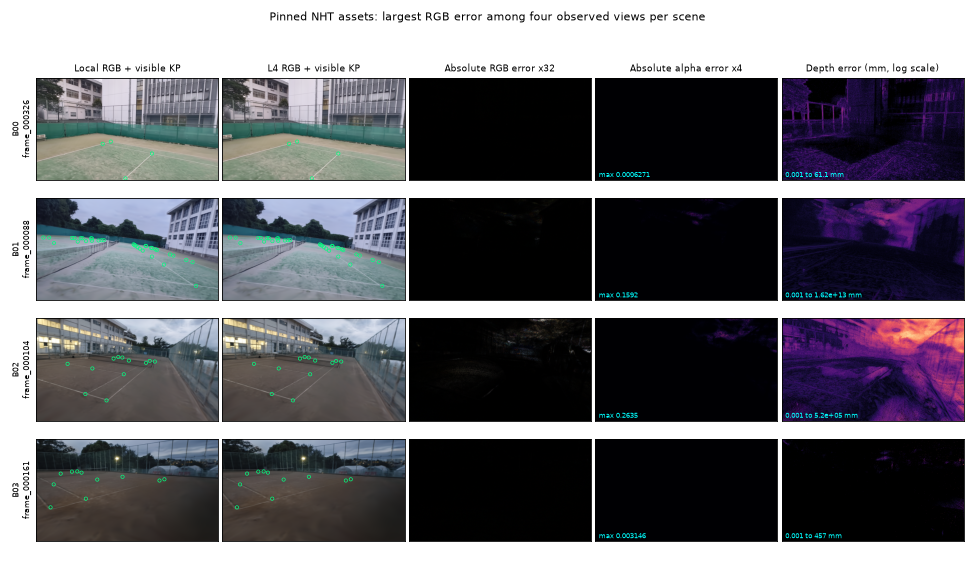

## 結論

資産転送・旧alignmentの読み取り・固定版NHTのL4描画は確認できた。ただし、RGB/alpha/depth全体の等価性を合格にする許容差は正当化できず、#1351の第3受入条件は未完了。資産はstagingに維持し、採用先へのcopyは実行していない。後続の本番生成には未承認の候補資産として渡す。

これは完了した数値比較の記録であり、Court Detectionの精度実験ではない。同じGPUでの2回は全float32配列が完全一致したが、GPUを変えたときの差は2回とも再現した。GPU内のランダムな非決定性で説明できる証拠はない。

## 資産・コード・比較条件

資産の正本は添付の `assets.json`（`court_scene_assets_v1`）。B00〜B03の公開export・カメラ・疎点群・checkpoint・runtime config・確定alignmentをbyte単位で保持した24ファイル、958,142,735 bytesで、manifestを含む転送bundleは25ファイル、958,152,199 bytes。manifest SHA-256は `a9281d9a41e39fc944e684f7bdeb5b3517cb9424b297d318a557bcb263e8009b`。Drive配置・ローカル再取得・Colab取得後の全照合を通過した。stagingのpathとIDは `run.json` に記録した。

動画・captured images・SfM中間物・alignment heatmapは含めない。旧alignmentを既存の `load_alignment_result` とmetric adapterで読み、意味・幾何・座標変換を変更しない。この依存closureを完成済みscene-pipeline workspaceとして扱わない。

実行コードはtennis-lab `5d2ffbb692e68e0c0093e1358ba7fa6f7ab19f7d`、NHT `d4962c503f76d27fef27ac3f458edddc0a7d35c2`、gsplat `c8d5acd22314c1c1144a30e635e08d9c738a8b39`。Colabではinstallerのみ、ローカルの `7e8c926fe76c02d59c92b03c00e846297a2e2551` までの修正を適用した。回収patchのhunkはこのcommitと一致し、Git indexの短縮桁数だけが異なる。renderer・checkpoint・camera・alignmentの変更はない。コマンド・patch・各jobのsource snapshotを添付した。

4シーン各4つの既存公開カメラを、原解像度959×539、batch=1、appearance overrideなしで各GPU2回描いた。ローカルは共有training queueのresource=allを使用したRTX 5060 Ti、ColabはL4。Torch 2.9.1+cu130・gsplat 1.5.3・tinycudann 2.0・NumPy 2.4.6は一致し、Pythonはそれぞれ3.11.15/3.11.16。保存RGB/alpha/depthはfloat32である。内部FullyFusedMLPの演算を強制的にfloat32へ変更する実験ではない。

depthは `nht_scene_units_per_metre` で割ってメートルへ変換した。KP14の投影座標・class ID・physical index・in_front/in_frameとrenderer-visibleを比較した。renderer-visibleは既存のalpha>=0.01かつdepth>0の半径1px近傍判定であり、コート面との遮蔽距離一致を意味しない。既存packed datasetはJPEGと疎なラベルのみなので、alpha/depthの比較元は同じrequestのqueue再描画を使った。

## 数値差と許容差の判断

次の表は各シーン4視点を結合した全画素の値である。RGBは0〜1、depthはm。最大値も保持し、平均だけで合格にしない。

| Scene | RGB MAE / RMSE | PSNR dB | alpha MAE / 最大 | depth MAE / 最大 m |
|---|---:|---:|---:|---:|
| B00 | 7.78403e-05 / 0.000173169 | 75.231 | 1.44261e-08 / 0.00188786 | 2.33464e-06 / 0.166065 |
| B01 | 7.2212e-05 / 0.000211837 | 73.480 | 8.66891e-05 / 0.159166 | 31046.9 / 1.6215e+10 |
| B02 | 0.000349355 / 0.00126099 | 57.986 | 0.000300284 / 0.263484 | 0.143757 / 520.196 |
| B03 | 0.000101388 / 0.000161238 | 75.851 | 1.41208e-07 / 0.0102372 | 2.10363e-05 / 1.50378 |

392 KPの幾何・renderer判定は全点一致し、画像内かつrenderer-visibleは249点。投影UVとKP camera depthの差も0だった。2回分では784 KP、renderer-visible 498点を検査した。local/local、L4/L4のRGB・alpha・depth差は全画素0。local/L4の2回の比較結果は一致した。

全画像でRGBのRMSEは0.000161〜0.001261で、同じローカル画像をquality=95のJPEGへencodeするRMSE 0.003537〜0.004983より小さい。ただし最大RGB差はB02の0.166748であり、JPEG平均誤差より小さいことだけをdepthや教師の等価性へ拡張しない。JPEG化は本番assemblerと同じ `np.round(rgb * 255).astype(np.uint8)` を使い、JPEG差をraw RGB差と分けた。JPEG RGBのGPU間PSNRは51.31〜54.24 dB。過去の異なる視点のJPEGとの比較ではない。

B01/frame_000088の(x=481,y=6)では、localのalpha=0.004035・depth=401.809mに対し、L4はalpha=0・depth=16,214,958,705.176mだった。この視点にはlocalで8画素、L4で10画素の「alpha=0かつpositive depth」があり、いずれも有効surfaceとは扱えない。gsplatのexpected depthがalphaを最小1e-10にclampして除算する実装と整合するが、除算前の量は今回保存しておらず原因の確定ではない。alpha=0の画素を除いても差は残り、両画像alpha>=0.99のB02でもdepth最大差12.124m。巨大値の除外だけでは全体の一致を説明できない。

B01のalpha=0.01閾値を跨ぐ画素は2点で、(505,6)は0.010164→0.009974、(482,12)は0.009825→0.010148。どちらも投影コート外で、今回のKP判定は変わらなかった。可視KP一致を全alpha raster一致として数えない。

コート領域は保存KPの四隅0,1,3,2をnear=0.01mとviewportでhomogeneous clippingし、PILでrasterizeした診断用mask。背景除去を受入条件へ後付けするためのmaskではない。全画素・両側alphaの閾値別・コート領域の分布と最大画素の値は `outlier-audit.json` に残した。

| Scene | コートpixel数 | RGB最大差 | depth P99 / P99.9 / 最大 m |
|---|---:|---:|---:|
| B00 | 603,958 | 0.013916 | 1.53624e-05 / 2.98714e-05 / 0.0610563 |
| B01 | 560,252 | 0.00341797 | 9.37818e-05 / 0.000985412 / 0.137215 |
| B02 | 505,829 | 0.0341797 | 0.000491203 / 0.00478158 / 0.0361511 |
| B03 | 366,027 | 0.000976562 | 9.40341e-06 / 4.1375e-05 / 0.0475549 |

同じGPU内の繰返し差が0なので、観測したGPU間差をそのまま「ノイズ床」として最大値以上の許容差へ広げる根拠はない。全画素合格には上表のRGB/alpha/depth最大差以上を認める必要があり、背景の極大depthに加えてコート上の最大13.7cmも含まれる。コートdepthのP99.9は最大4.78mmだが、上位0.1%を無条件に切り捨てる方針は合意されていない。

診断の物差しとしてRGB 1/255、depth 1cmを使うと、コート領域で閾値を超える画素はB00が2/13、B01が0/57、B02が2951/114、B03が0/3（RGB/depth）。これらは原因を絞るための集計で、承認済みの受入閾値ではない。現時点で根拠をもって合格にできるのはbyte照合、同GPUでの再現、今回のKP inventory一致まで。全rasterのGPU間許容差は未確定として返す。

## 速度・メモリ・導入時間

checkpoint loadは同期付きtorch.load、resident loadはshader構築まで、batch時間は同期待ち・CPU配列回収まで。先頭cameraを別記し、warm FPSは後続3cameraの合計時間で算出した。public callは入力検証・checkpoint hash・PNG/NPY保存を含む。数枚の既存cameraの測定であり、大規模生成のthroughputではない。

| Scene | L4 checkpoint load s | L4 warm FPS（2回の範囲） | L4 public FPS（2回、初回cold除外） | local warm FPS（2回の範囲） |
|---|---:|---:|---:|---:|
| B00 | 0.178–0.201 | 55.213–55.850 | 2.485–2.485 | 40.094–48.800 |
| B01 | 0.178–0.188 | 44.440–44.770 | 2.954–2.975 | 34.077–38.850 |
| B02 | 0.179–0.187 | 44.460–44.508 | 3.283–3.317 | 33.868–38.139 |
| B03 | 0.180–0.187 | 46.600–46.884 | 3.276–3.287 | 35.969–40.372 |

L4は最初のB00 batchが3.053sで、lazy compile等の初回処理を含む。L4の2回目B00は0.0258s、checkpoint loadは全シーン2回で0.1778〜0.2013s。PyTorch peak allocatedは459.6〜468.5MiB、reservedは620〜628MiB。100msサンプリングのdevice memory.usedはL4が892〜900MiB、localが2259〜2267MiB。device全体には背景使用が含まれ、観測peakは瞬間peakの下限である。正確な値と全batch時間は両GPUのmetrics JSONに置く。

Colabのuv syncは26.430s。最初のrender-only setupは951.585sでhelp/importを通ったが初回描画はABI不整合で失敗し、成功導入時間とは扱わない。修正後のsetupは既存cacheがある同VMで898.111sで、cold install時間ではない。Colabの資産download+verifyは49.987s、manifest/幾何検証は22.592s。最初のupload+verifyは135.532s、local download+verifyは115.386s。setup・転送・描画・Drive永続化の待ち時間を混同しない。

## 導入失敗と修正

最初はgsplat/csrc.soのundefined symbol `c10::cuda::CUDAErrorLogCapture` を観測し、続くJIT経路はNinjaをPATHから解決できず停止した。build isolation時のTorch未固定と整合するABI不一致で、build時Torchの正確な版は取得していない。installerを固定Torch導入後の同環境で `--no-build-isolation` によりgsplatだけを再buildする形へ修正した。再導入にもTorch/CUDA版を明示し、ninja等とtool-bin PATHを用意し、gsplat.csrcを直接importしてnative不整合を隠さない。広いreinstallでTorch更新が候補になった中間試行はcancel済みで、成功と数えない。

最初のNotebook提出はpendingのまま接続を失ってcancelし、保存を確認した。接続断では同じassignmentにreconnectし、実コマンドを重複投入しなかった。

## 中断からの回収・停止確認

前回agentのcapacity終了時にrender-nativeはfinalizingだったが、その後2026-10-22T07:38:48Zにcompleted/returncode=0/drive_saved_atをDriveへ保存済みだった。今回Driveから32枚分の全配列・manifest・source・metrics・visibilityを `download --verify` で回収し、元のmetricsと測定sourceの一致を確認した。7 job全てにterminal状態とdrive_saved_atがあり、失敗・cancelも保持した。setup-native-pinned、assets、render-nativeは成功。失われた必須成果物は見つからず、VM内の一時ファイル以外に再生成を要するものはない。

今回の `doctor --remote` はActive assignments=0、usage rate=0.00/hr。`stop` はSession is absent from Colab registryで拒否され、新VMを取得していない。今回のstop成功と偽らず、この結果を添付した。local baselineも別のDrive outputへverify付きで保存し、比較に使ったraw配列を残す。

## 再現と残課題

`run.json`、`render-inventory.json`、`colab-operations/`、`local-queue/` が実行版・コマンド・hash・状態の根拠。raw配列はDriveの `outputs/synthetic_data_generation/profile/court-assets-verify/{renders-native,local-reference}` に置き、Gitには含めない。取得した資産rootと両raw出力を指定し、添付 `recompute.sh` でCPU比較を再実行できる。学習していないためTensorBoard・収束曲線は対象外。

親への推奨は、資産をstagingのまま保持し、固定した単一camera・外れ画素でrasterizerの数値差を切り分けること。renderer/precisionを修正するか、背景depthの有効性と領域別の誤差上限を明示して許容するかは、今回の結果を左右する未合意の判断である。既存のrenderer設定やalpha/depthの意味を黙って変更して合格にしない。新Colabが必要なら、まず未pushのinstaller修正を親がpushし、そのcommitと新しい一意sessionを使う。今回回収した32枚を全て再描画する必要はない。

軌道生成・大規模生成・学習・alignment再推定・wheel cacheは対象外。NHTのimage-free変更はoriginのbranchへpush済みだがmainには未mergeで、NHT側のPRが必要である。
