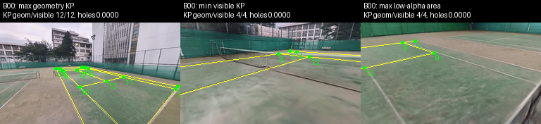
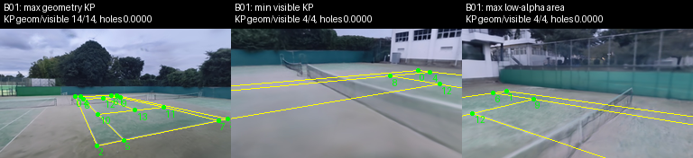
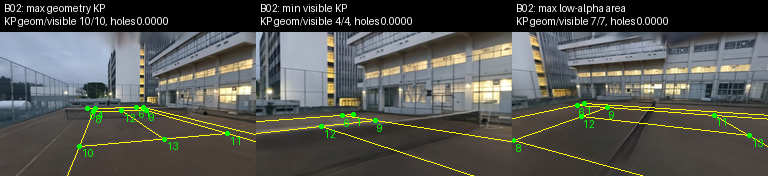
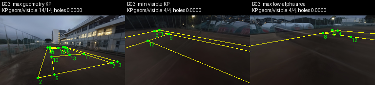

## 結論と未確定事項

push済み `dc5c253ee` のままColab L4で生成・復旧・取得・合成専用32更新・実画像全val/test評価を完了した。
4シーンから1,102枚を採択し、batch8の学習を約9.8GiBの観測peakで実行できた。
これは時間・容量の試走であり、精度スケーリング・収束やproduction checkpoint採用の証拠ではない。
本実験の上限・更新回数・seed・長時間比較・scene組合せ・D2の変更は未承認のため、#1356は人間の判断待ちである。
[判断依頼と選択肢](../../runs/run-court-scale-pilot-l4-20261023/decision-request.md)に推奨と予算をまとめた。

## 生成品質と幾何

| scene | 候補 | 幾何通過 | QA採択 | QA拒否 | 採択/候補 | 本体秒 | JPEG B |
|---|---:|---:|---:|---:|---:|---:|---:|
| B00 | 311 | 289 | 276 | 13 | 88.75% | 131.851 | 18,645,359 |
| B01 | 376 | 353 | 345 | 8 | 91.76% | 126.234 | 17,424,938 |
| B02 | 263 | 243 | 243 | 0 | 92.40% | 106.456 | 11,070,710 |
| B03 | 259 | 238 | 238 | 0 | 91.89% | 105.033 | 9,702,729 |

幾何拒否86、QA拒否21（全て対象courtのrenderer可視KPが4未満）。穴率によるQA拒否は0、補充と空軌道は0。
採択画像の可視KPは全sceneで最小4・中央値7。最大はB00=12、B01=14、B02=10、B03=14。
採択内ROI穴率は全て0だが、α<0.9面積の最大はB00=2.10%、B01=38.03%、B02=7.03%、B03=34.62%。
このα指標は採用済みD5の診断に留め、閾値やQAを変更していない。

全1,102画像でpose→教師KPの往復投影とaccepted ledger/storeを照合した。
これは固定された3DGS・court幾何の内部整合で、独立した実世界の3D正確度の測定ではない。
strict fetchでは96storeと688ファイルのbyte inventoryが一致した。初回1cacheをDrive保存してから元rootを改名・保持し、
空rootへ復旧して残り95cacheを新規生成した。復旧分の再描画はない。
採用bundle/hashと生成recipeは前提どおり固定し、メインtreeの資産・既存Drive出力は変更しなかった。

代表図は採択内の「geometry KP最大・renderer可視KP最小・α診断最悪」をstable IDで選んだ。
4図を実見し、部分court、低い視点のぼけ（特にB00/B01）、B03の暗い外観を確認した。
穴率0を鮮明な画質の保証にしない。QA拒否RGBは公開storeに無く、拒否理由はledgerを根拠とする。
各sceneの軌道MP4もDriveへ保存し、ローカルPyAVでH264・640×392・10/8/11/11framesを再生可能と確認した。

## 実画像splitと写り方

元8,841行の既知退化1行を除外した8,840画像を、既存real-video-v1・seed42で再凍結した。
val=4,468画像/249動画、test=4,372画像/249動画、動画重複0。既存registryと一致し、canonical registry hashは
`d943d569c87e0974590eeaf01cdc1b526da4f6eeb0ca65bbd54c05a12c32d60a`。
ファイルbytesのhash（data_manifest内）とは区別する。

元のreal注釈に写り方分類は無かったため `in_frame_kp14_v1` を定義した。
original画像で`0≤u<width, 0≤v<height`を満たす対象court KPが14ならfull、12〜13ならnear_full、0〜11ならpartial。
合成は正のcamera depthも要求し、occlusionは両者で揃わないため分類には使わない。
これは投影範囲の分類で、障害物や画像占有率・見かけの鮮明さを表す分類ではない。
全9,942画像のassignment JSONLとそのSHAはDrive上のframing/と小さなsummaryから辿れる。

| 集合 | full | near_full | partial |
|---|---:|---:|---:|
| 合成B00 | 0 | 1 | 275 |
| 合成B01 | 6 | 8 | 331 |
| 合成B02 | 0 | 0 | 243 |
| 合成B03 | 2 | 1 | 235 |
| 合成計 | 8 (0.73%) | 10 | 1,084 |
| 実画像val | 4,400 (98.48%) | 55 | 13 |
| 実画像test | 4,210 (96.29%) | 142 | 20 |

valのnear/partialは27/11動画、testは35/14動画に由来するが、同じ動画の別画像は複数分類に入り得る。
少数のpartial画像で独立な多動画への性能を推定しない。D2見直しの推奨根拠はvalと合成の支持範囲差で、testの値で方式や条件を選んでいない。

## 32更新学習と参考評価

ViT-B凍結・Transformer768/8層/12heads・DPT512・全dense headとposeを学習。
長辺512・合成のみbatch8・workers4・seed42・compile有効、warmup4、val/checkpoint32。
32更新・scheduler last_epoch32・全記録loss有限を確認し、同じexact step32 checkpointをval/testへ適用した。
standalone評価は既存evaluate_checkpointを使い、batch順序/構成を変えず、同じlogitから写り方別accumulatorを追加した。
全画像accumulatorと通常の5指標の一致、ID順hash、件数の一致をassertした。poseは評価対象外。

| split/分類 | N | KP平均px | SEG mIoU | LINE Dice | semantic LINE mIoU |
|---|---:|---:|---:|---:|---:|
| val/full | 4,400 | 250.576 | 0.071115 | 0.000440 | 0.082027 |
| val/near_full | 55 | 247.019 | 0.080959 | 0.000345 | 0.081634 |
| val/partial | 13 | 224.987 | 0.110373 | 0.000296 | 0.081395 |
| val/all | 4,468 | 250.482 | 0.071336 | 0.000438 | 0.082021 |
| test/full | 4,210 | 250.673 | 0.072052 | 0.000435 | 0.082007 |
| test/near_full | 142 | 241.094 | 0.083710 | 0.000337 | 0.081608 |
| test/partial | 20 | 235.809 | 0.107557 | 0.000287 | 0.081313 |
| test/all | 4,372 | 250.344 | 0.072568 | 0.000431 | 0.081991 |

未収束の時間計測用モデルであり、この小さな数値差をfull/partialの優劣やD2の因果効果と解釈しない。
checkpoint SHAは`d0081fca5023858aad70de5a87362cb1f4d89ce101899dc646e2dca8a82643a7`。
正確な条件・時刻・I/O・評価summaryはrun bundle、全checkpoint/PNG/原評価JSONはDriveのrun/evaluate pathにある。

## 費用・運用と次の実験

[費用モデル](../../runs/run-court-scale-pilot-l4-20261023/cost-model.md)は描画・永続化・fetch・setup・学習・評価・容量を分け、
N/Sだけでなく候補C、幾何通過R、cache Kを変数に残した。96cache試走の描画469.6秒に対し、durable command計2,018.8秒、fetch703.5秒。
数千cache時のDrive page費、preflightのN/K依存、密度64候補cacheのthroughputは未同定である。
小さい本番条件の計測を計画値と比較し、事前に定めた予算停止基準で進める必要がある。

当sessionの確保は2026-10-23 14:02:06〜16:15:25 UTC（JST23日夜〜24日未明、2.222時間）。
全8jobのterminalとDrive保存を確認してstopし、diff回収のtracked patchは空・untracked対象0だった。
stop後doctorのactive assignments=1は他セッションで、当担当sessionはstopped。
account残高の差は他セッションの利用が混じるため当runの消費量にはしない。

失敗も保持した。setup/inputsの3回はNotebook/SSH応答断で未実行のままcancel・保存した。
最初のtraining jobは報告用CPU planにuv toolのPATHを渡し忘れて失敗し、学習前に停止した。
PATHを補った別jobで続行した。sourceの不具合ではなく提出commandの誤りで、失敗jobを成功扱いしていない。
切断した2つの保存済みcancel jobのlocal CLI clientだけをPID/start token確認後に終了し、接続し直した。
稼働中のNotebook clientや他セッションは操作していない。

既存sourceの別問題として、scalingのbest-val callbackが設定-1を無視してsave_top_k=1を固定している。
過去bestをDrive deletefileへ送る経路があるため、本実験前に修正が必要。
pilotはval1回なので削除無しをI/O traceで確認した。担当境界に従いsourceは修正していない。
まずD2の全面支持範囲を再検討し、max/U/追加比較を人間が事前に選び、retention修正後に#1357以降へ進むことを提案する。
