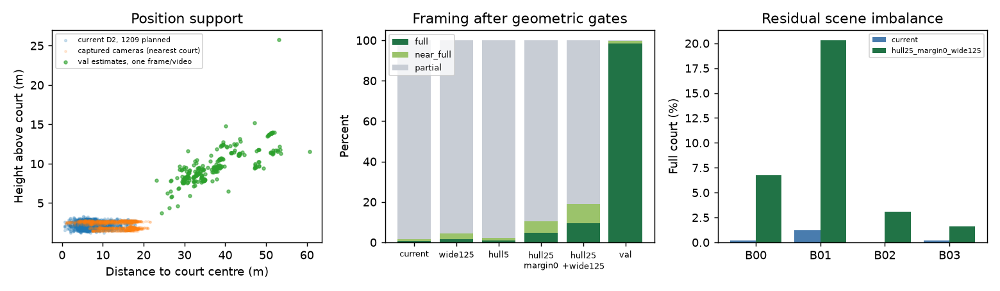
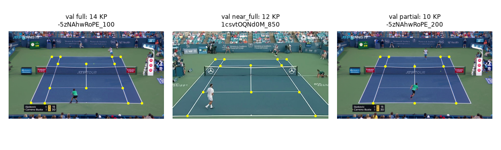

## 結論と停止点

前回の全面不足は再現した。主因は低く近いcamera配置で、HFOVだけの不足ではない。
同じ4scene・seed42の128軌道prefixでは、拡張25%・margin0m・HFOV92.5/110/125°の組合せが
全sceneに全面を持つ候補になったが、全面率は9.38%でvalの98.48%との差が残る。
幾何通過の10.45%は撮影camera hullの外にあり、QA・画質を確認する前に採用できない。

このrunは**CPU比較の完了記録**であり、D2採択や#1356全体の完了を意味しない。
依頼の「必要な比較scriptが未pushなら停止」に従い、L4開始前に止めた。
新規描画・学習・Colab sessionは全て0。親がこのcommitをpushした後に192枚を比較する。
既存の採用bundle、前回のDrive dataset、main tree資産、本番recipe、生成・選択・QAのsrcは変更していない。
checkpoint保持の修正は別の子#1470の範囲であり、このrunでは扱わない。

全表と未測定項目は[比較レポート](../../runs/run-court-d2-support-cpu-20261024/evidence/comparison.md)、
CPU再現とL4再開は[再開手順](../../runs/run-court-d2-support-cpu-20261024/resume.md)、
機械可読の入口は[run.json](../../runs/run-court-d2-support-cpu-20261024/run.json)。

## 元データ・原因分解と限界

前回datasetを新しいworktree内rootへstrict fetchし、1,102 JPEG・store・教師を読み直した。
全候補→幾何通過→QA採択のfull/near_full/partialは、それぞれ8/10/1191、8/10/1105、8/10/1084。
保存されたscene別KP数ヒストグラム、QA拒否21件と理由も一致した。
12件の幾何拒否はnear/far未定義でprojectionがnullだったため、診断だけで物理14点を直接投影し、拒否状態を維持した。
既存の代表画像も見直し、B01のぼけとB03の暗さを確認した。穴率0を画質の保証にしない。

1,209候補中854点が対象courtの内側、1,079点では対象KPの一部が後方だった。
固定poseのHFOVだけを155°まで広げても全面は54点に留まる。
camera位置とjitter XYを固定した注視高0/0.75/1.5mの診断では、全面数は全て8だった。
通常recipe変更ではview/point ID由来のjitterも変わるので、この固定pose診断と同じ介入とは見なさない。

valは固定real-video-v1のIDを先に選び、4,468枚だけの幾何を集計した。testの写り方・推定camera・精度は処理していない。
各val動画の辞書順先頭1枚から既存のfit_planar_cameraで推定し、249件中248件が通った。
仮定付き高さの中央値9.44m、水平距離36.97m、HFOV32.69°に対し、現D2は高さ2.16m・距離6.56mだった。
fx=fy・principal pointが画像中心・歪みなしという仮定と単眼平面の不確実性があり、実camera正解ではない。
動画各1枚の分布を全val画像のcamera分布として扱わない。

## 候補・費用と次の実験

現D2、上限125°の3層、5%拡張、25%拡張＋margin0、25%＋広角の5計画を同じ128本で比較した。
5%案はB02の全面を支えず、25%の2案だけが全sceneで全面を持った。
広角単独と25%単独を対照に残し、組合せのQAと画質を確認する。
D5とD6は変更せず、hull拡張の数値を3DGS品質の保証と見なさない。

[条件付き費用再計算](../../runs/run-court-d2-support-cpu-20261024/cost-scenarios.json)は前回のcurrent表を再現した。
組合せ案では仮に基準G96・約6,379枚とすると、旧24k/48k/96kの倍率系列について
追加seed/長時間比較込みで約194–212 / 267–299 / 370–427時間になる。
これは前回のscene別QA率・容量・throughputを移植した計画値で、実測節約ではない。
端点の予想枚数も約25.5k/51.0k/102.1kへ変わり、基準Gの変更でcacheが減る効果を含む。
新候補のQA・JPEG容量や大規模Drive一覧費で変わり得るため、最終予算・G・max/U/seedは親が判断する。

[凍結選択](../../runs/run-court-d2-support-cpu-20261024/render-selection.json)は4条件×4scene×12枚＝192枚。
full/near_full/partialを層別し、対象KP≥4・ROI穴≤1%を既存evaluate_renderで判定する。
拒否の補充・学習・新しいsrc経路は無い。母集団率の参考値はN_h/n_hで重み付けし、rawの均等サンプル率と分ける。
全192 recordを既存plannerで再生成し、ID/camera/target/projection/jitterを含むhashが一致した。
GPUの実行成功は未検証であり、push後は保存・停止までを完了してから別nodeに実測を残す。

推奨は、この192枚で画質とQAを確認してからD2を決めること。
valに近い高く遠い配置まで必要なら、strategyに固定された高さ分布や軌道の設計変更が必要になり得る。
今回はそのsrcを変更せず、変更範囲の判断を親へ返す。

## 通常検証

[validation.json](../../runs/run-court-d2-support-cpu-20261024/validation.json)に実行コマンドと結果を保存する。
CPUの通常テスト40件、9本の報告scriptのruff/mypy、known-camera fixture、
半開画像境界、層別重み付け、201枚予算の拒否、選択順不変性、全192カメラhashの一致を確認した。
全CPU再現scriptはGPUを使わず、選択と費用JSONを凍結版とbyte比較する。
新しい学習は無いためTensorBoard曲線は無い。前回runの学習曲線や収束判断を更新しない。
