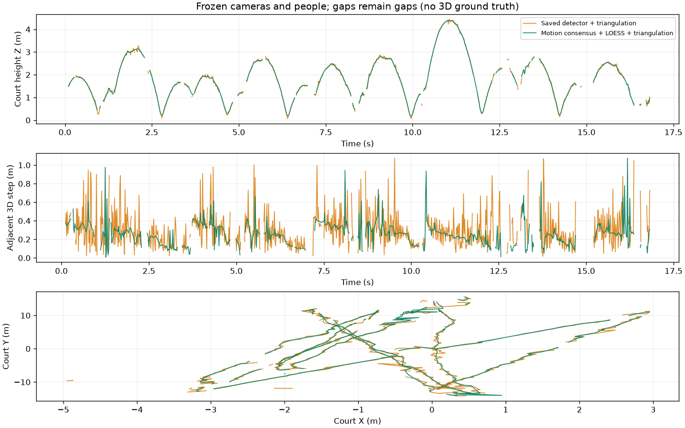

## 観測と比較条件

公開サンプルMeiji `video_000/clip_000` のREADME用sceneと、削除済みworktreeから保全されていたcomponent storeを発見し、保存済みのproduction検出観測に外れ値除去・LOESSを適用して球を再三角測量した。元storeの採用descriptor依存鎖、scene・sidecar・使用配列のchecksum、元動画3本の明示的なpath置換とchecksumを検査した。元のstore、export、動画は変更していない。

[v5プレゼンテーション](https://github.com/Motoki0705/tennis-lab/releases/tag/tennis-scene-presentation-v5)で用いた局所2次運動consensus・頑健な2次LOESSの方式とパラメータを共通utilityへ移した。プレゼンテーションのDPT checkpointとは異なる、README元runのproduction detector出力をそのまま再利用する。短い支持不足・長い欠損・解像度/FPSの違いを明示的に扱い、短い連続的な方向転換の再検査を保持した。手作業で除外frame区間を指定していない。

現行pipelineは`ball_points` v4をside推定・camera alignment・球三角測量へ渡す。本比較はこれら全段の再実行ではなく、**元のカメラ・side・人物復元を固定した球だけのreplay**である。通常runnerはsrcのcode fingerprint変更で全componentを無効化するため、旧artifactを新identityへ付け替えず、実験用entrypointと別出力を作った。`replay.json`とscene metadataへ元index・artifact参照・code指紋・再実行/固定範囲を記録した。人物・コートの20配列は元sceneと完全一致した。

## 定量的な結果と制約

| 指標 | 元の球三角測量 | 外れ値除去＋LOESS後 |
|---|---:|---:|
| 有効3D frame / 1010 | 821 | 859 |
| 各結果の採用inlier再投影中央値 (px) | 3.519 | 2.895 |
| 各結果の採用inlier再投影p95 (px) | 10.617 | 9.384 |
| 有効な隣接3D移動量p95 (m) | 0.688 | 0.412 |
| 有効な隣接3D移動量の最大 (m) | 1.074 | 1.077 |
| 共通802 frame・元2D観測への再投影中央値 (px) | 3.554 | 4.810 |
| 同・p95 (px) | 11.294 | 12.697 |

cam0/1/2で元の764/945/714実観測から31/35/42を除外し、733/910/672を採用した。診断用の短い補間は136/75/134 frameだが、下流へ渡す`observed`・confidence・uvへは混ぜていない。実観測2view未満で3Dが有効になったframeは0。元の有効frameのうち19が無効化され、57が新たに有効になった。同一入力・同一codeで独立に2回実行し、sceneの球配列・component配列/出所・replay manifestは完全一致した。



採用inlierの自己整合指標と隣接移動量の大部分は改善したが、最大の跳びは改善しない。元の未平滑観測への追従残差は増えた。比較対象のinlier集合も変わるため、自己整合誤差の減少を独立な位置精度の向上とは解釈しない。共通frameの隣接移動量p95でも0.682→0.405 mへ減ったが、滑らかさの指標である。人手3D基準やbounce/hit時刻GTはなく、カメラ校正やdetectorの精度は再評価していない。

最大移動は元sceneの570→571から、新sceneの969→970へ移った。後者は元sceneでは無効だった区間で、3viewから2viewへ変わる時点に1.077 mの跳びが残る。両viewの2D平滑化座標に大きな跳びは見えず、カメラ集合の変化と固定校正の不整合が関係する可能性があるが、原因は未確定である。lost_validの57〜59はバウンド付近で、2D実観測を保持しているにもかかわらず3D速度gateが3frameを欠損にする。過平滑化や方向転換付近の復元悪化がないとは主張しない。762/764はcam0の離れた検出候補を除外し、実観測が1viewだけになった。これら3区間を3カメラの実写cropと[局所比較図](../../runs/run-scene-ball-loess-20261026/extremes.png)で確認し、全19frameの理由を[extremes.json](../../runs/run-scene-ball-loess-20261026/extremes.json)へ残した。手動の区間除外や、このclipに合わせた3D速度閾値の変更は行っていない。

30/60/120fpsの速い動き・バウンドと単発外れ値の合成試験では、真の急な動きを保持し、外れ値だけを除外した。欠損の内側・長い欠損・両端・疎な観測、解像度倍率、noise低減と位相、storage round-tripとgeometry maskの回帰を確認した。補間/除外された点だけでは2つ目のviewを供給できないことを実際の三角測量まで検査した。pipeline・gallery・共通utilityの138テスト、変更Pythonのruff/mypyが通った。validator評価は指定されていないため0回。

## 公開デモと表示の確認

READMEの3言語が参照する`multiview_reconstruction.gif`を新sceneからCPUで再生成した。960×620、168frame、16.75秒。元frame 6〜1008を6frameごとに描画し、欠測を跨いだ軌跡線を作らない。入力パネルの全504比較でラベル部分を除くRGB最大差0、GIFと元PNGの最小PSNRは36.31 dB。代表6frameと2D比較動画から抽出した4frame、全区間の軌道比較図で、外れ値除外、球の欠損、バウンド付近の形状を目視確認した。この確認を全frameの真の3D位置の保証へ広げない。

同じ新sceneの3Dパネルから、直接公開されていた旧`rich_scene_rendering.gif`も置き換えた。Blender revealも同じsceneで再生成し、球の表示補間を0にして3D欠損を保つ。CPU llvmpipeを明示し、adapter probeでも確認した。Blenderの全1010frameの球位置・表示mask、9frameのmesh頂点で差0、カメラ投影の最大差0.000131 px。元frame 96と描画plateのPSNRは43.13 dBだった。169枚の960×540 PNGから16.917秒のMP4を作り、公開GIFは400×225・135frame・16.88秒。切り替え・自由視点を含む代表6frameを目視確認し、3つのGIFとMP4を全編デコードした。詳細は[Blender検証](../../runs/run-scene-ball-loess-20261026/blender-validation.json)と[media検証](../../runs/run-scene-ball-loess-20261026/media-validation.json)を参照。

2026-10-26時点の[公開先監査](../../runs/run-scene-ball-loess-20261026/public-demo-audit.json)では、GitHub Pagesはなく、公開HFモデル/Datasetにも描画済みGIF・動画demoはなかった。Datasetの3本のMP4は元入力。該当著者のHF Spacesは空だった。身体配置だけのGIFと元入力の`tennis_clip.gif`は球の再構成demoではない。過去の検出・追跡release、v5プレゼンrelease、knowledgeの過去runは固定した履歴であり、書き換えない。任意の第三者mirrorや過去commit URLの全網羅はしていない。

## 再現と次の確認

[run.json](../../runs/run-scene-ball-loess-20261026/run.json)に実行環境・path対応、[replay.json](../../runs/run-scene-ball-loess-20261026/replay.json)に元入力と使用artifact、`uncommitted.patch`に元commitからのcode差分を保存する。予測NPZ/NPY、元動画、全PNG、MP4、Blender bundleは`outputs/scene-ball-loess/`と保全元に残し、knowledgeへ大容量成果物を複製しない。学習はなくTensorBoard曲線はない。

```bash
bash knowledge/runs/run-scene-ball-loess-20261026/repro.sh \
  SOURCE_STORE VIDEOS_DIR CHECKPOINT_ROOT NEW_OUTPUT_DIR BLENDER_BIN
```

`VIDEOS_DIR`は`cam0.mp4`〜`cam2.mp4`を持つ明示的なrootで、元sourceのchecksum一致を要求する。checkpoint rootには既存のSMPL faces/regressor、BlenderにはCPUのllvmpipeを使う。出力先は新規で、元storeと重ならない場所を指定する。

本runは1clip・固定カメラ条件であり、既存のモデル/checkpoint採用判断を変更しない。次は独立したball 2D/3Dとbounce/hit時刻GTで、平滑化のbias、方向転換の保持、検出外れ値除去のprecision/recallを測る。別clipと欠損の多い条件も分けて評価する。
