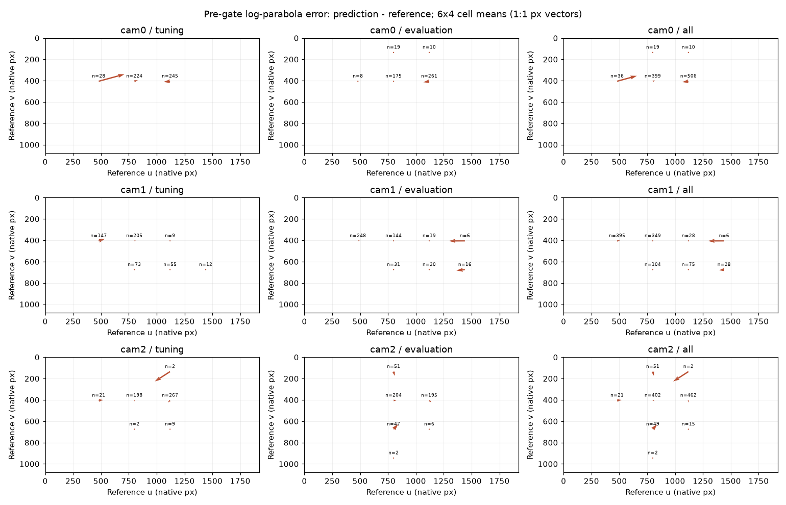
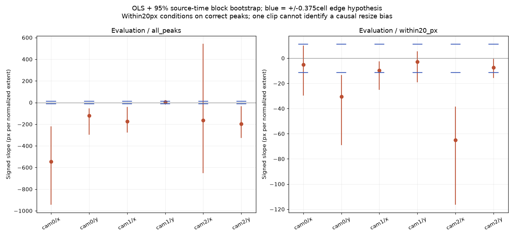
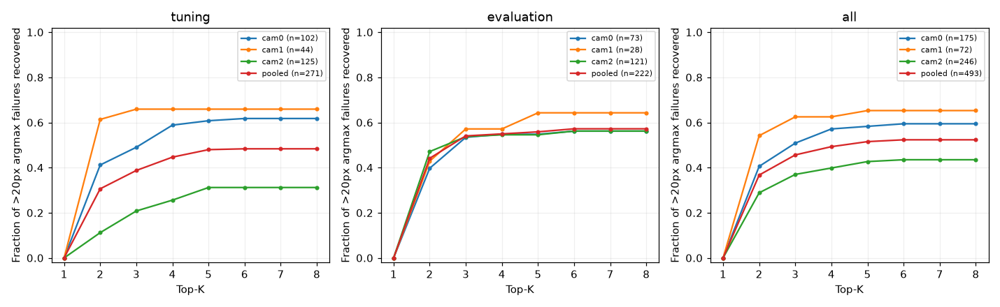
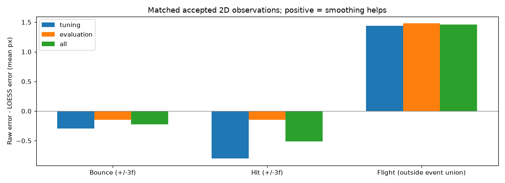
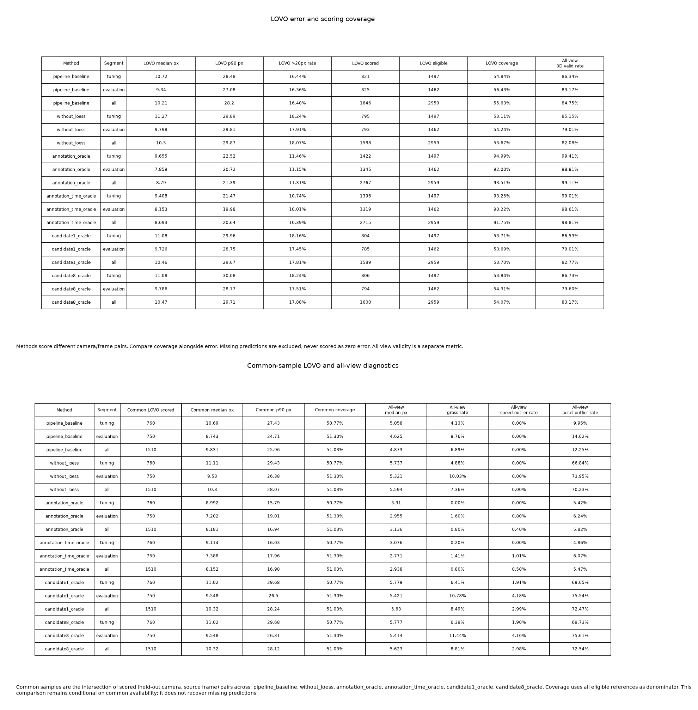

## 条件と診断の範囲

親 #1554 合意revision 6、子 #1558。公開clip_000の3camera・1010frameの固定bundleだけをCPU replayした。
正解は #1668 readerを通した人間提供JSONで、直接観測2589・承認推定370をともに採点し、出自を保持する。
cam0末尾外挿28点と座標なし43点は補完しない。入力・動画hashは基盤loader/readerで検証する。
方式runnerへ注釈を渡さず、baseline/LOESSなしを既存runnerで全view・3つのLOVOに再実行した。
新しいproduction方式や既定設定の変更はない。srcへの追加は、camera/frameの共通採点集合を比較する
`paired_error_summary` だけであり、coverage変化による見かけの改善を避けるために必要だった。

以降のannotation/time/candidate oracleは、ラベルを使う**採点専用の診断**である。
`scoring_diagnostics_only/` に保存し、方式の登録・入力変換として公開しない。
固定校正自体は元runが全cameraから作ったものであり、校正段階まで独立したLOVOではない。
主評価は[505,1010)、調整は[0,505)、全区間は参考。診断条件は実行前に固定し、後半を見て変更していない。

## 主評価: frame [505,1010)

LOVOは個別残差をpoolする。独立3D正解はなく、以下はnative画素への再投影誤差である。

| 結果 | 中央値 / p90 px | >20px率 | 採点数/1462 | 全view有効3D率 |
|---|---:|---:|---:|---:|
| pipeline_baseline | 9.340 / 27.078 | 16.36% | 825 | 83.17% |
| without_loess | 9.798 / 29.810 | 17.91% | 793 | 79.01% |
| annotation_oracle | 7.859 / 20.722 | 11.15% | 1345 | 98.81% |
| annotation_time_oracle | 8.153 / 19.976 | 10.01% | 1319 | 98.61% |
| candidate1_oracle | 9.726 / 28.749 | 17.45% | 785 | 79.01% |
| candidate8_oracle | 9.786 / 28.767 | 17.51% | 794 | 79.60% |

3区間・各LOVOと全viewの完全な指標は [fold-metrics.csv](../../runs/run-ball3d-error-decomposition-20261103/fold-metrics.csv)、
直接観測/推定別のpool値は [run-summary.json](../../runs/run-ball3d-error-decomposition-20261103/run-summary.json)。
基盤の採点・保存形式・可視化を再利用し、独自のloaderや3D scorerは作っていない。

## 共通採点集合での内訳（正 = 誤差が減る）

次表は参照−比較の中央値差/p90差と>20px率差で、行ごとに共通camera/frameだけを比べる。
独立した因果成分や加算できる予算ではない。全view・LOVOの棄却が変わることを、採点数と共通数で区別する。

| 操作（参照→比較） | 区間 | 共通n | 中央値差 px | p90差 px | >20px率差 pp |
|---|---|---:|---:|---:|---:|
| fit_annotation_clocks | evaluation | 1316 | -0.342 | +0.262 | +0.684 |
| fit_annotation_clocks | tuning | 1392 | +0.166 | +0.857 | +0.431 |
| fit_annotation_clocks | all | 2708 | +0.017 | +0.204 | +0.554 |
| nearest_top8_vs_top1 | evaluation | 785 | +0.000 | +0.187 | +0.255 |
| nearest_top8_vs_top1 | tuning | 804 | +0.000 | +0.000 | +0.000 |
| nearest_top8_vs_top1 | all | 1589 | +0.000 | +0.706 | +0.126 |
| remove_detector_errors | evaluation | 801 | +1.777 | +6.432 | +6.367 |
| remove_detector_errors | tuning | 802 | +1.606 | +12.482 | +10.474 |
| remove_detector_errors | all | 1603 | +1.704 | +9.148 | +8.422 |
| remove_loess | evaluation | 790 | -0.608 | -2.858 | -1.899 |
| remove_loess | tuning | 789 | -0.547 | -1.936 | -2.662 |
| remove_loess | all | 1579 | -0.402 | -2.337 | -2.280 |

- detector誤差を注釈に置換するoracleは、共通801点で中央値1.777px・p90 6.432px改善する。
  これは復号・候補・mask・confidence・平滑化などが混ざる置換で、復号だけの効果ではない。
- LOESSを外すと共通790点で中央値0.608px・p90 2.858px悪化する。
- 候補oracleは既存2D採用maskと採点可能maskを保ち、各保持cameraで注釈に最も近い候補を選ぶ。
  K1/K8は同じunit weight・幾何閾値で、LOESS/3D速度gateなし。K8は共通785点で中央値差0、
  p90は0.187px改善し、coverageは785→794点になる。最適なjoint 3D候補選択の下限保証ではない。
  baselineとの単純差にはconfidence/速度gate等の違いもあるため、候補効果はK1/K8の対で読む。
- 校正誤差だけを取り除いた値は独立camera/3D正解がなく識別不能。時刻補正後のoracleにも、
  校正・注釈・補間・運動モデルの残差が混ざる。残差をすべて校正誤差と呼ばない。

## 2D復号と位置バイアス仮説

productionのnative argmax/log-parabolaを64frameずつCPUで再復号し、閾値/gate前の弱いpeakも残した。
signed errorは予測−参照。画像6×4区画の平均ベクトル、score、注釈の連続差分速度（px/s）、
画像端からの距離を、camera・区間・参照kind別に出した。整数argmaxも別に採点した。
注釈速度は前frameの有効注釈がある場合だけで、split境界や欠測を跨がない。

各軸で `error = intercept + slope * (reference_position/(dimension-1) - 0.5)` をOLS回帰した。
source時刻の25frame blockを499回再標本化し、95% percentile CIを出す（seed1558）。
係数は画像幅/高さ全体あたりのpx、仮説±0.375cellの端誤差に相当する傾きの絶対値は11.25pxである。
全peakには大誤検出が混ざるため、事前固定の<=20px条件でも併記した。

| camera/軸 | 区間 | <=20px n | 傾き px/extent | 95% CI |
|---|---|---:|---:|---:|
| cam0/x | evaluation | 400 | -5.216 | [-29.288, 9.821] |
| cam0/y | evaluation | 400 | -30.467 | [-68.644, -13.624] |
| cam1/x | evaluation | 456 | -9.623 | [-24.820, -2.718] |
| cam1/y | evaluation | 456 | -2.832 | [-18.877, 5.265] |
| cam2/x | evaluation | 384 | -64.946 | [-116.172, -38.732] |
| cam2/y | evaluation | 384 | -7.444 | [-15.431, -0.918] |
| cam0/x | tuning | 395 | -16.064 | [-28.476, -5.787] |
| cam0/y | tuning | 395 | -43.333 | [-81.789, -3.457] |
| cam1/x | tuning | 457 | -6.774 | [-13.449, 1.933] |
| cam1/y | tuning | 457 | -14.783 | [-32.321, 2.180] |
| cam2/x | tuning | 374 | -30.017 | [-63.986, -4.005] |
| cam2/y | tuning | 374 | -2.642 | [-18.299, 12.352] |
| cam0/x | all | 795 | -10.678 | [-22.962, 0.724] |
| cam0/y | all | 795 | -34.923 | [-54.093, -17.258] |
| cam1/x | all | 913 | -9.653 | [-15.710, -3.978] |
| cam1/y | all | 913 | -6.219 | [-17.890, 1.493] |
| cam2/x | all | 758 | -38.197 | [-77.424, -20.952] |
| cam2/y | all | 758 | -6.319 | [-13.020, -0.223] |

後半の<=20px集合では、+11.25の一律傾きは6軸すべてのCI外で、-11.25もcam0/y・cam2/xのCI外。
したがってx/y共通の単純な±0.375cell線形バイアスを支持する結果ではない。
ただし<=20pxは誤差に条件付けた選択であり、主に画像中心の軌道しか覆わず画像端まで外挿できない。
単一clipの空間・時刻・blur・推定注釈が交絡し、CIは多重比較を補正していない。
教師規約にバイアスが存在しないと証明したものでも、推奨補正値をfitしたものでもない。
全peak/条件付き・直接観測/推定・3区間の切片/傾き/両CI/位置支持範囲は
[regression-coefficients.csv](../../runs/run-ball3d-error-decomposition-20261103/regression-coefficients.csv) に残す。

## 候補の回収可能性

argmaxが注釈から厳密に20pxを超えた点が分母、validな候補が20px以内なら回収とする。
弱い候補も残すgate前の上限で、候補を実際に選べる割合や3D精度保証ではない。

| K | 前半（271失敗） | 後半（222失敗） | 全区間（493失敗） |
|---:|---:|---:|---:|
| 1 | 0 (0.00%) | 0 (0.00%) | 0 (0.00%) |
| 2 | 83 (30.63%) | 98 (44.14%) | 181 (36.71%) |
| 3 | 105 (38.75%) | 120 (54.05%) | 225 (45.64%) |
| 4 | 121 (44.65%) | 122 (54.95%) | 243 (49.29%) |
| 5 | 130 (47.97%) | 124 (55.86%) | 254 (51.52%) |
| 6 | 131 (48.34%) | 127 (57.21%) | 258 (52.33%) |
| 7 | 131 (48.34%) | 127 (57.21%) | 258 (52.33%) |
| 8 | 131 (48.34%) | 127 (57.21%) | 258 (52.33%) |

後半はK6で127点（57.21%）に達しK8まで増えない。前半は131/271（48.34%）。
一方、採用maskを保つ3D candidate oracleの改善は小さく、回収可能なpeakの多くが既存maskで
下流へ届かない可能性がある。mask前で候補とview/時間整合を扱う #1560/#1563/#1564 の
検証動機になるが、後半値からこれらの設定を選ばない。camera/参照kind別の曲線もJSONに保存した。

## LOESS: 方向転換と飛行中

前後で同じ採用観測だけを比較する。event窓はsource rowの±3frameの和集合、飛行中は補集合。
1frame差のcamera記録を勝手に統一せず、重なった窓は1残差を1回だけ数える。

| 区間 | 群 | n | 前/後 中央値 px | 平均(前−後) px |
|---|---|---:|---:|---:|
| evaluation | bounce | 65 | 4.367 / 4.800 | -0.145 |
| evaluation | hit | 46 | 9.331 / 10.891 | -0.149 |
| evaluation | flight | 1014 | 5.089 / 3.604 | +1.481 |
| tuning | bounce | 72 | 4.265 / 4.424 | -0.293 |
| tuning | hit | 57 | 10.142 / 8.802 | -0.801 |
| tuning | flight | 1026 | 5.011 / 3.818 | +1.440 |
| all | bounce | 137 | 4.278 / 4.667 | -0.223 |
| all | hit | 103 | 9.624 / 9.601 | -0.510 |
| all | flight | 2040 | 5.056 / 3.700 | +1.461 |

後半は飛行中の平均誤差が1.481px改善する一方、バウンド/打球では0.145/0.149px悪化する。
中央値とpaired差の中央値は別の量であり、すべてのイベント点が悪化するという意味ではない。
camera・参照kind別、p90・悪化割合を含む結果はsmoothing.jsonに保存した。
3DでLOESSありの方が良い結果と、イベント近傍2Dで丸まりがある結果は両立する。

## 注釈三角測量と時刻診断

同じ固定cameraのannotation oracleが幾何参照であり、保証された数学的下限ではない。
cam0を時刻gauge 0とし、[0,505)の連続3点が有効な固定支持だけでSampson距離をsoft-L1最小化した。
各cameraのoffsetの絶対値は0.99frame以下、scale=1pxを実行前に固定した。

- cam1: -0.249274frame = -4.158723ms
- cam2: -0.774858frame = -12.927212ms

cameraのframe tはworld frame t+offsetを観測する符号で、上限に張り付いたcameraはない。
前半の目的残差（絶対Sampson）の中央値は2.939→2.579px、p90は9.546→9.769px。
目的関数のロバスト総和の最小化であり、p90を最小化したものではない。
後半LOVOは7.859/20.722px→8.153/19.976px（中央値/p90）で、中央値が悪化したことを保持した。
共通1316点では中央値0.342px悪化、p90 0.262px改善、平均0.210px改善、>20px率0.684pp改善。
coverageも92.00%→90.22%に低下するので、周辺分布だけから改善と結論しない。

fitは全cameraの前半ラベルを使う診断であり、blind LOVOでclockを推定した結果ではない。
LOVOの三角測量は保持cameraの注釈を除外cameraの時刻へ隣接2点補間し、
**元の未変更の除外camera注釈**を共通scorerで採点する。欠測/端/splitは跨がず外挿しない。
全viewはcam0時刻の軌道を共通offset投影で採点し、split直前の1点を無効にして投影補間も境界を跨がない。
clock値は校正・注釈・補間誤差も吸収するため、物理的な同期ずれの真値ではない。

## v1実行時の検証・再現・制限

[test-plan.md](../../runs/run-ball3d-error-decomposition-20261103/test-plan.md) を実装前に作成した。
追加8caseは非対称camera・時刻と手計算を使い、共通採点集合・符号/単位・候補padding・
20pxの境界・欠測/split・event和集合・heldoutラベル隔離を検証する。
時刻補間の符号を反転した故障注入は期待する数値assertで失敗し、復元後の関連35caseが成功した。
`--collect-only` 35件/6.24秒、`--durations=0 --durations-min=0` 35 passed/25.47秒、`-n 0`。
新規case最大2.255秒。再利用した小動画の公開入口integrationは10.031秒で5秒基準を超えるが、
3cameraの実codec→同期render→全frame decode→HTML接続を保つ唯一の入口なので維持した。
importを含むwallとcaseの合計18.488秒を混同しない。詳細nodeとsetup/call/teardownはtest-results.json。
cache生成を防ぐテストimportへの変更後、新規8caseを再実行して8 passed/17.64秒を確認した
（cache-fix-tests.txt）。変更Pythonのruff/mypyも成功した。
GPU・検出器再推論・学習・新checkpointは不要で使用していない。

実行commit、資源・成果物checksum・動画decodeと目視検証はverification/run-summary/visual-reviewを参照する。
出力191ファイルのSHA-256/サイズと未宣言ファイルなしを再照合し、既存foundationのbaseline/LOESSなし/oracleの
採点値は実行時間を除いて完全一致した。比較MP4は1200×1150、1010frameを全decode、HTML参照切れ0。
代表frame 0/252/505/757/1009、6枚の図と極端frame 765/581/580/980/304/303のcropを目視確認した。
GNU timeのwallは394.45秒、最大RSS 1,132,100KiB、swap 0。script perf_counterは
408.296秒で、異なる時計の原値を統合せず保持した。
大きなscores/decode/配列/動画/HTMLはoutput_dirに残し、小さなJSON/CSV/図だけをknowledgeへ保存する。
この解析にTensorBoardやseed間学習曲線は適用しない。独立clip・camera/3D正解・物理clock真値はない。
既定pipelineとcheckpointの採用判断は変更しない。当初のPRは #1669 にstackした。現在は基盤merge後のmainへ積み直し、人間の統合比較後の判断までmergeしない。

実行時wrapperは `executed-repro.sh` に同一bytesで保全した。v1の記録時点では `repro.sh` は
knowledge保存規約に合わせて `PYTHONDONTWRITEBYTECODE=1` を追加しただけで、
その時点のsrcおよびdiagnostics.py/plots.py/run.pyはv1実行commitから差分0だった。
今回のrun.pyの採点API対応は、以下の再採点記録に分ける。
検証時に生成されたbytecode cacheは解析成果物ではないため除去した。

## mainへ積み直した後の再採点（v2）

基盤 #1669 はレビュー指摘3件の修正後、merge commit
`b41016207dc4551287ea50fe3b13eb54357389fb` でmainへmergeされた。
`git rebase --onto origin/main 3abc5e7595bccabf4ed558ce209a9b4bc117a73c` を実行し、
取得時のmain `2df2a9debe6a8b85c31ce98055edecc4658a1431` の上へ積み直した。
新しいmerge commitは作っていない。summaryの内容競合は基盤のレビュー結果と本診断を両方保持し、
sequence 33の論理的な衝突は本ノードを34へ移して解消した。

`paired_error_summary` とrunner script/testの採点を `FixedInputBundle` の入口へ合わせた。
結果のbundle/camera/frameと正解identityは基盤の `error_samples` で照合し、迂回しない。
`annotation_oracle` の廃止されたbundle_sha256引数を外し、可視化にもbundleを渡す。
基盤の `requires_court_lines=False` のbaselineと、テスト方式の明示宣言を保持する。
本診断はLINE観測を要求しない。基盤の既存の採点・三角測量・表生成の挙動は追加変更していない。

**予測replay・時刻fit・動画render/encodeは再実行していない。** 保存済み24結果を共通のtyped loaderで
読み、新APIで再採点した。再採点だけのCLIは `rescore.sh` / `rescore.py`、実行commitはrepro欄である。
同じ固定bundleと正解JSONのdigestを照合し、v1の191ファイルは既知のmanifest digestから全SHA/サイズを再検証した。
全6結果の既存method score field（全view・LOVO・3区間・参照kind・coverage・運動/event診断等）と
pairwise内訳はv1と**厳密に一致**した。新しいcohort field以外の誤差値に変化はない。
`diagnostics.py` はv1の記録hashと同一bytesで、復号・gate・LOESS・三角測量の6計算ファイルは
元基盤headから差分0。さらにfoundation_v2の8結果のpositions/valid/used_viewsを本保存結果と照合して完全一致を確認した。
これらを根拠に、予測や注釈fitの再計算は行わず、保存済み結果を用いる再採点に限定した。
共通scoresのruntimeはv1の予測実行時間を引き継ぐ値で、今回の再採点時間とは区別する。

v2はv1を変更せず新規directoryへ保存した。24結果・動画・診断図を同一bytesで再利用し、
基盤の `tables.py` の定義によるLOVO count/eligible/coverageの主表と、全6結果共通cohort表を更新した。
動画はv1で全1010frameをdecode済みのbytesをそのまま使い、今回decodeしたとは記録しない。
更新した指標図を目視確認し、HTML参照切れは0。v2の191ファイルのSHA/サイズも別途再照合した。
再採点はGNU time wall11.00秒、最大RSS700,864KiB、swap0だった。

全6結果（oracleを含む）の共通cohortは前半760点、後半750点、全区間1510点。
後半は対象1462点の51.30%であり、基盤の3結果共通768点とは異なる集合である。
可用性だけによる共通集合なので、欠測の回復や無条件の性能差を示すものではない。

| 結果 | 後半の共通n | 中央値 / p90 px | >20px率 |
|---|---:|---:|---:|
| pipeline_baseline | 750 | 8.743 / 24.712 | 14.13% |
| without_loess | 750 | 9.530 / 26.383 | 16.27% |
| annotation_oracle | 750 | 7.202 / 19.010 | 8.27% |
| annotation_time_oracle | 750 | 7.388 / 17.960 | 7.33% |
| candidate1_oracle | 750 | 9.548 / 26.502 | 16.40% |
| candidate8_oracle | 750 | 9.548 / 26.306 | 16.13% |

3区間・observed/estimated別の共通cohort値とそのcamera/frame identityは
[rescore-summary.json](../../runs/run-ball3d-error-decomposition-20261103/rescore-summary.json) に保存した。
従来のpairwise比較は結果2つだけの共通集合、今回のcohortは全6結果の共通集合なので混同しない。

API移行後の `--collect-only` は53件/5.69秒、`--durations=0 --durations-min=0` は
53 passed/17.76秒（`-n 0`）。case合計12.351秒、最大case2.864秒、最大setup0.01秒。
追加はpaired入口のbundle/frame不一致の拒否2ケースで、正解identity拒否3ケースは既存nodeを拡張した。
ノード別の時間はrebase-test-results.json、原ログはrebase-test-collection/durations.txtに保存した。
ruff/mypyは成功し、knowledge validatorは0 errors（既存219 warnings）、repro path検証は0 missing（既存28 unverifiable）だった。
後半の値に合わせた調整や、モデルの変更はない。

v2の実パスはartifacts.output_dir、全ファイルの目録はartifacts-v2.json。

- artifacts.json SHA-256: `f13a2be8ca868b86eeee6efc9e5d9c805edbf75832228e728ff5db04f7fa6926`
- index.html SHA-256: `320d3d3d651e5f0b3a44d31db5964dcfde65740158ba9ddfe5e9a2e9e6924a45`
- scores.json SHA-256: `088b7be2597431d19f6a1b14328f58d949e597e58aaf1cfb5bda79142682822b`
- comparison.mp4 SHA-256: `cd37cb723f2acde64380cd82cdb2ee552bf0d89c7cf85845ae651999676cd74f`
- paired-budget.json SHA-256: `6dc87795203746225c62509cd3a5e26c0ba15b9e28205d9755c2ddb939c16713`
