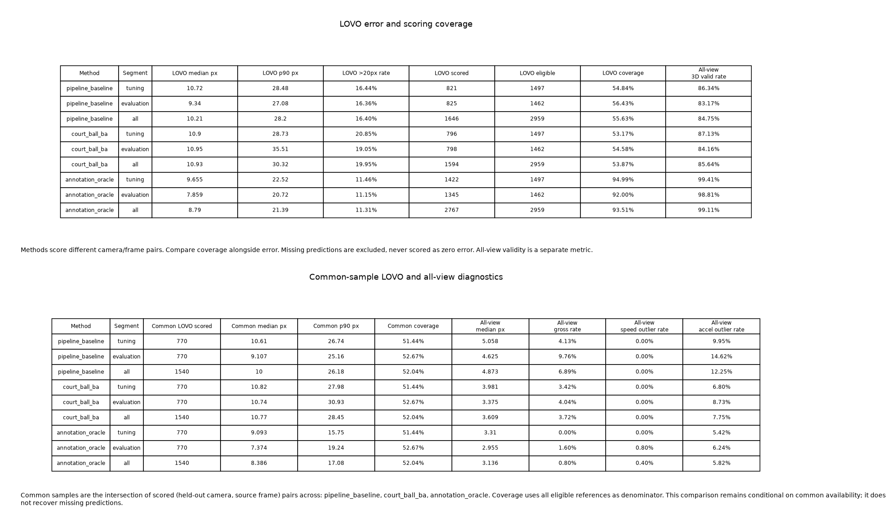

## 結果と判断

後半 **[505,1010)** のLOVOは9.340/27.078→10.946/35.507px、20px超率16.36→19.05%へ悪化した。
採点も825→798点、coverage 56.43→54.58%へ下がった。baselineと本方式の共通791点でも
9.273/26.589→10.921/37.261px、20px超率16.06→19.22%へ悪化しており、集合の差だけでは説明できない。
全viewの再投影中央値は4.625→3.375px、有効3Dは420→425/505frameへ改善したが、
主指標とholdoutの結果から採用を支持しない。後半を見て設定を変えていない。

前半は10.716/28.483→10.899/28.731px、全区間は10.208/28.196→10.930/30.320px。
3区間・全view・LOVO別の表は [metrics.md](../../runs/run-court-ball-ba-20261103/metrics.md)、
参照kind別・共通集合・各foldの小さな数値は [metrics.json](../../runs/run-court-ball-ba-20261103/metrics.json)。
全採点・イベント・速度/加速度等はoutputsのscores.jsonにある。
oracleを含む3方式共通の後半770点と、2方式共通791点を混同しない。
3方式共通ではbaseline 9.107/25.161、本方式10.738/30.930、oracle 7.374/19.237pxである。
共通集合も可用性に条件付けられ、欠測の精度を回復した値ではない。

## 方式・観測数とgauge

実装の仕様は [ball_calibration README](../../../src/tennis_scene/ball_calibration/README.ja.md)。
焦点倍率・姿勢・camera中心、相対時刻とlatent 3D点を同時に最適化する。
主点・aspect・歪みゼロを固定してPinholeCameraを維持し、metric courtで空間gaugeを固定する。
時刻は選択camera中の辞書順先頭を0とし、各LOVO foldで独立にfitする。
除外cameraの観測・校正変更・時刻推定は方式へ渡さず、採点では元cameraと時刻0を使う。

固定bundleのraw KPは各camera14点・frame0のみ。元homography採用5/7/8点だけでfitし、
未採用9/7/6点をholdoutにする。各camera7変数へ10/14/16個のcourtスカラー残差を与え、
数値Jacobianは全camera・全foldでrank7だった。全viewではcourt40残差、ball568観測から
1136座標残差を使い、camera21+clock2+latent720=743変数をfitした。prior・深度penaltyは観測数に数えない。
ballはbaseline inlierの連続3frame支持からclip全体に等間隔に最大240対応を選ぶ。
時刻変更で支持を消さず、最終位置は補正後2Dを既存の三角測量・速度gateへ戻して得る。

LINEは元storeに座標がなく、KPだけの局所識別性を確認して `requires_court_lines=False` とした。
v2 bundleの作成、court再推論・GPU・学習は行っていない。raw court型とreaderをproduction共有位置へ
移し、評価側はre-exportする。同じ固定bundle loader/runner/scorer/result/rendererを使い、別loader・ball scorerを作らない。
courtの画素残差と重ね描きだけは共通基盤にないため、このrunの比較scriptで作った。

全viewのfitは17回でftol収束。焦点距離はcam0 568.832→584.117、cam1 1044.207→1046.713、
cam2 1097.930→1071.099px。時刻はcam0=0、cam1=-0.260869frame（-4.352ms）、cam2=-0.119206frame（-1.989ms）。
各LOVOは12/8/9回で収束し、camera/clockの境界到達はない。
全foldのcamera位置・姿勢差・offset・支持数は [calibration-summary.json](../../runs/run-court-ball-ba-20261103/calibration-summary.json)。

## 未使用court観測

| camera | holdout数 | baseline median/p90 px | BA median/p90 px |
|---|---:|---:|---:|
| cam0 | 9 | 11.053 / 319.275 | 14.165 / 323.480 |
| cam1 | 7 | 21.766 / 343.279 | 24.855 / 339.033 |
| cam2 | 6 | 7.781 / 10.079 | 6.888 / 8.859 |

cam0/1の中央値は悪化、cam2は改善した。raw KPには大きな誤検出があるため、これは独立したcourt真値ではない。
元の選択・初期校正にも条件付けられており、無条件のholdoutではないことを明示する。
各foldの全holdout・score>=0.5の内訳は [court-holdout.json](../../runs/run-court-ball-ba-20261103/court-holdout.json)。
outputsのcourt-overlay.png/HTMLは実frame0上にモデルのcourt線とraw KPを重ねる。
投影した線を保存されていないLINE実測と偽らない。

## 先行知見との関係

[誤差分解 PR #1670](https://github.com/Motoki0705/tennis-lab/pull/1670) の時刻oracleはGT使用の診断で、
本方式のblindな時刻推定と同じではない。oracleに余地があっても本方式の成功保証にはならない。
同診断と [多仮説 PR #1672](https://github.com/Motoki0705/tennis-lab/pull/1672) でのcoverage低下、
[decode PR #1673](https://github.com/Motoki0705/tennis-lab/pull/1673) の全view改善とLOVO悪化を設計時に確認した。
本方式ではLOESSを維持し、支持/coverageと共通集合を同じ重さで報告する。
camera調整へのball誤対応の混入、平面courtの弱い支持、piecewise線形の時間補間、priorの釣合いは
制限の候補だが、ablationで悪化の因果量を分けていない。

## テスト・実資産と再現

実装前の [test-plan.md](../../runs/run-court-ball-ba-20261103/test-plan.md) に契約・故障・層・既存node・予算を記録した。
非対称3camera・正負の既知時刻・独立投影で復元を検証し、camera順反転/holdout破壊、時間符号・欠測、
退化・静止・solver失敗、公開config→assembler→実codec→SceneResult、LOVO隔離を確認した。
既定fixedは元main `6372e2267a8fee7b88f9c77d8be1691620bf2030` のcomponentから生成した
12frameの固定期待配列と、位置・画素・valid・inlier・理由・再投影の全値が厳密一致する。
元source/checksumと再生成入口はfixtureとcapture_main.pyにある。既存テストの削除・統合はない。

`test.sh` のcollect-onlyは137件/11.15秒、durations=0は137 passed/86.57秒（-n 0）。
新規19case合計11.917秒、最大5.327秒・最大setup1.18秒。
全137nodeとphase時間は [test-results.json](../../runs/run-court-ball-ba-20261103/test-results.json)。
5秒を超えた新規caseはLOVO integrationで、実4foldのfitと除外viewを変えた再fit・型付き保存を一つの契約として検証する。
mockでは2viewのcamera/clock推定と除外view漏れを守れないため、この小さな20frameの実行を保持した。
setupはmodule scopeで共有した32frameの合成復元1回であり、2testで初期化を重複させていない。
5秒超の既存pipeline回帰も、実component接続・scene保存復元の固有契約として残す。
時間の符号を反転する故障注入で数値assertが失敗し、元bytesへ復元後に成功した（fault-injection.txt）。
ruff/mypy成功。GPUを使うテストは実行していない。

実行commitはrepro欄。GTを読む前に全8予測を保存し、全4baseline結果の位置/valid/使用viewが
foundation_v2とbitwise一致した。元storeとの差は最大9.5367e-7mで2µm許容内。
採点用oracleを含む12結果をtyped loaderで再読込し、181ファイルのSHA/サイズ/未宣言ファイルなしを照合した。
動画1200×1128・1010frameを全decode。代表0/252/505/757/1009、極端765/581/580/981/980/1000のcrop、
指標/軌道/court重ね描きを目視確認し、HTML参照切れは0。直接観測と承認推定の記号、unknown/末尾外挿除外を確認した。
v2の目視対象画像・動画は、目視したv1と同じbytesであることをSHAで確認している。
実パス・入力と成果物hashはfrontmatterと [artifacts.json](../../runs/run-court-ball-ba-20261103/artifacts.json)。
大きな動画/HTML/court画像・全採点JSON・配列はoutputsに残し、knowledgeは小さな指標と図・再現証拠だけを保存する。

GNU time wall202.93秒、script timer210.01秒、最大RSS1,128,836KiB・swap0。時計の原値は別々に残す。
baselineはLOESS再計算、本方式adapterは照合済みのpinned pointsを使うため、runtime 50.43対13.18秒を
最適化されたproduction速度差として解釈しない。学習ではなくTensorBoard/checkpointは該当しない。
再現はこのcheckoutでrepro.shの第3引数に**新しい**directoryを渡す。過去入力・出力を上書きしない。

## v1からv2への保存契約の修正

v1（a26d3efce）の最終確認で、時刻補正して3Dへ渡した2D座標をsource-frameの保存欄へも返していた点を発見した。
v2ではball artifactとSceneResultの2D座標/maskを元frameの観測のまま保ち、再標本化した配列を診断欄へ分けた。
公開config→sceneのintegrationに、非ゼロoffsetでも元の2D/maskを保つ数値assertを追加した。
solverの目的関数・設定は変更していない。全8予測の位置/valid/使用view/camera/offsetはv1とbitwise一致し、
全accuracy/coverage/運動・event採点値もruntime以外は厳密一致した。比較MP4も同じSHAである。
v1の173ファイルは不変で、元測定・checksumはrun配下のv1/にも保持した。正式成果物はv2とする。

1clip・承認推定を含む2D参照で、独立3D正解・歪み/主点推定・校正共分散の推定はない。
LOVOで基準cameraが変わると時刻gaugeも変わり、除外viewの絶対時刻は復元できない。
次は #1568 で同じ入力の他方式と比較する。改良するなら未使用clip又は前半だけで独立ablationし、今回後半を再調整に使わない。
実装と比較成果物は完成。人間の採否・親のレビュー/統合比較は未実施で、PRはmergeしない。
