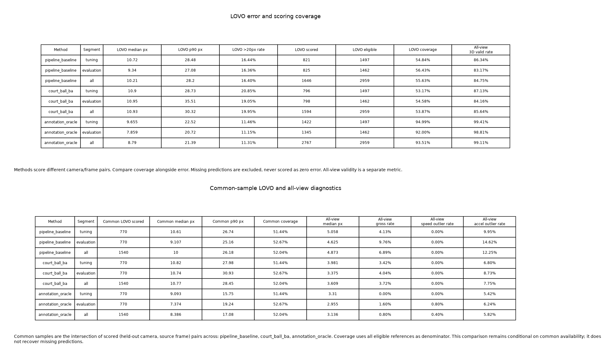

## 2026-11-05の人間の採否決定とコードの所在

[親 #1554の採否決定・最新合意revision 7](https://github.com/Motoki0705/tennis-lab/issues/1554#issuecomment-6652565114)でbaseline維持が決定した。
誤差分解の診断（PR #1670）だけをmainへmergeし、6方式のPRと統合比較PR #1682はmergeせずcloseした。
このノードに対応する[PR #1681](https://github.com/Motoki0705/tennis-lab/pull/1681)も未mergeでclose済み。branchは再現のため残している。
人間は「heatmapの精度そのものが悪く、baselineを超えるには検出モデルの学習戦略の改善が必要」と判断し、
後処理・三角測量の側で改善策を試す後継作業（#1683）をキャンセルした。以下の実測値と研究上の結論は変更していない。

`repro.commit` は当時の再現コード版 `9fc9adc0b8986460e7978c4a79d7c44c9cd30310` を指す。
元branchは `codex/ball3d-court-ball-bundle-adjustment`（close時head `3ef4c7d82655f79612ce7a2e0c11d8126a899665`）。
このノードとrun bundleの取り出し元は統合branch `codex/ball3d-integrated-comparison` の
[commit `784dce5a15038965818f82933f9d13c92d50e143`](https://github.com/Motoki0705/tennis-lab/tree/784dce5a15038965818f82933f9d13c92d50e143)。
mainにない方式固有のsrc・testsは、元branchの履歴とこの統合commitに保存されている。
run内のreproduce/repro・再採点・検証scriptと本文のコマンドは、そのコードを必要とする歴史的な再現記録で、main上でそのまま実行できるものではない。
再現・再採点時は保存元の統合commitをcheckoutした環境で、本文の固定入力・実行版・byte照合条件を確認する。run bundle自体は取り出し元と同じbytesを保持した。

## 結果と判断

後半 **[505,1010)** のLOVOは9.340/27.078→10.946/35.507px、20px超率16.36→19.05%へ悪化した。
採点も825→798点、coverage 56.43→54.58%へ下がった。baselineと本方式の共通791点でも
9.273/26.589→10.921/37.261px、20px超率16.06→19.22%へ悪化しており、集合の差だけでは説明できない。
全viewの再投影中央値は4.625→3.375px、有効3Dは420→425/505frameへ改善したが、
主指標とholdoutの結果から採用を支持しない。後半を見て設定を変えていない。

前半は10.716/28.483→10.899/28.731px、全区間は10.208/28.196→10.930/30.320px。
3区間・全view・LOVO別の表は [metrics.md](../../runs/run-court-ball-ba-20261103/metrics.md)、
参照kind別・共通集合・各foldの小さな数値は [metrics.json](../../runs/run-court-ball-ba-20261103/metrics.json)。
全採点・イベント・速度/加速度等はoutputsのscores.jsonにある。
oracleを含む3方式共通の後半770点と、2方式共通791点を混同しない。
3方式共通ではbaseline 9.107/25.161、本方式10.738/30.930、oracle 7.374/19.237pxである。
共通集合も可用性に条件付けられ、欠測の精度を回復した値ではない。

## 方式・観測数とgauge

実装の仕様は [ball_calibration README](https://github.com/Motoki0705/tennis-lab/blob/784dce5a15038965818f82933f9d13c92d50e143/src/tennis_scene/ball_calibration/README.ja.md)。
焦点倍率・姿勢・camera中心、相対時刻とlatent 3D点を同時に最適化する。
主点・aspect・歪みゼロを固定してPinholeCameraを維持し、metric courtで空間gaugeを固定する。
時刻は選択camera中の辞書順先頭を0とし、各LOVO foldで独立にfitする。
除外cameraの観測・校正変更・時刻推定は方式へ渡さず、採点では元cameraと時刻0を使う。

固定bundleのraw KPは各camera14点・frame0のみ。元homography採用5/7/8点だけでfitし、
未採用9/7/6点をholdoutにする。各camera7変数へ10/14/16個のcourtスカラー残差を与え、
数値Jacobianは全camera・全foldでrank7だった。全viewではcourt40残差、ball568観測から
1136座標残差を使い、camera21+clock2+latent720=743変数をfitした。prior・深度penaltyは観測数に数えない。
ballはbaseline inlierの連続3frame支持からclip全体に等間隔に最大240対応を選ぶ。
時刻変更で支持を消さず、最終位置は補正後2Dを既存の三角測量・速度gateへ戻して得る。

LINEは元storeに座標がなく、KPだけの局所識別性を確認して `requires_court_lines=False` とした。
v2 bundleの作成、court再推論・GPU・学習は行っていない。raw court型とreaderをproduction共有位置へ
移し、評価側はre-exportする。同じ固定bundle loader/runner/scorer/result/rendererを使い、別loader・ball scorerを作らない。
courtの画素残差と重ね描きだけは共通基盤にないため、このrunの比較scriptで作った。

全viewのfitは17回でftol収束。焦点距離はcam0 568.832→584.117、cam1 1044.207→1046.713、
cam2 1097.930→1071.099px。時刻はcam0=0、cam1=-0.260869frame（-4.352ms）、cam2=-0.119206frame（-1.989ms）。
各LOVOは12/8/9回で収束し、camera/clockの境界到達はない。
全foldのcamera位置・姿勢差・offset・支持数は [calibration-summary.json](../../runs/run-court-ball-ba-20261103/calibration-summary.json)。

## 未使用court観測

| camera | holdout数 | baseline median/p90 px | BA median/p90 px |
|---|---:|---:|---:|
| cam0 | 9 | 11.053 / 319.275 | 14.165 / 323.480 |
| cam1 | 7 | 21.766 / 343.279 | 24.855 / 339.033 |
| cam2 | 6 | 7.781 / 10.079 | 6.888 / 8.859 |

cam0/1の中央値は悪化、cam2は改善した。raw KPには大きな誤検出があるため、これは独立したcourt真値ではない。
元の選択・初期校正にも条件付けられており、無条件のholdoutではないことを明示する。
各foldの全holdout・score>=0.5の内訳は [court-holdout.json](../../runs/run-court-ball-ba-20261103/court-holdout.json)。
outputsのcourt-overlay.png/HTMLは実frame0上にモデルのcourt線とraw KPを重ねる。
投影した線を保存されていないLINE実測と偽らない。

## 先行知見との関係

[誤差分解 PR #1670](https://github.com/Motoki0705/tennis-lab/pull/1670) の時刻oracleはGT使用の診断で、
本方式のblindな時刻推定と同じではない。oracleに余地があっても本方式の成功保証にはならない。
同診断と [多仮説 PR #1672](https://github.com/Motoki0705/tennis-lab/pull/1672) でのcoverage低下、
[decode PR #1673](https://github.com/Motoki0705/tennis-lab/pull/1673) の全view改善とLOVO悪化を設計時に確認した。
本方式ではLOESSを維持し、支持/coverageと共通集合を同じ重さで報告する。
camera調整へのball誤対応の混入、平面courtの弱い支持、piecewise線形の時間補間、priorの釣合いは
制限の候補だが、ablationで悪化の因果量を分けていない。

## 初版のテスト・実資産と再現

実装前の [test-plan.md](../../runs/run-court-ball-ba-20261103/test-plan.md) に契約・故障・層・既存node・予算を記録した。
非対称3camera・正負の既知時刻・独立投影で復元を検証し、camera順反転/holdout破壊、時間符号・欠測、
退化・静止・solver失敗、公開config→assembler→実codec→SceneResult、LOVO隔離を確認した。
既定fixedは元main `6372e2267a8fee7b88f9c77d8be1691620bf2030` の凍結したgeometry/reconstructionを
同じNumPy/SciPyで実行し、12frameの位置・valid・inlier・理由・再投影の全値を厳密比較する。
画素/maskの固定期待値も厳密比較する。元source/checksumと再生成入口はfixtureとcapture_main.pyにある。
現行kernelの速度gateを変える故障注入で、凍結mainが同時に変わらず数値assertが失敗することも確認した。
既存テストの削除・統合はない。

`test.sh` のcollect-onlyは138件/83.76秒、durations=0は138 passed/99.54秒（-n 0、importlib）。
新規19case合計3.352秒、最大1.431秒・最大setup0.34秒で、5秒/1秒の目安内。
全138nodeとphase時間は [test-results.json](../../runs/run-court-ball-ba-20261103/test-results.json)。
CIで落ちた既定値所有の契約を、既存のconfiguration catalog監査1caseも加えて確認した。
全case合計30.848秒とpytest全体99.54秒は別であり、source-complete catalogのimport/収集コストも隠さず記録した。
setupはmodule scopeの32frame合成復元1回を2testで共有する。旧測定はv1/、v2-before-config-audit/にも残す。
時間の符号を反転する故障注入で数値assertが失敗し、元bytesへ復元後に成功した（fault-injection.txt）。
ruff/mypy成功。GPUを使うテストは実行していない。

実行commitはrepro欄。GTを読む前に全8予測を保存し、全4baseline結果の位置/valid/使用viewが
foundation_v2とbitwise一致した。元storeとの差は最大9.5367e-7mで2µm許容内。
採点用oracleを含む12結果をtyped loaderで再読込し、181ファイルのSHA/サイズ/未宣言ファイルなしを照合した。
動画1200×1128・1010frameを全decode。代表0/252/505/757/1009、極端765/581/580/981/980/1000のcrop、
指標/軌道/court重ね描きを目視確認し、HTML参照切れは0。直接観測と承認推定の記号、unknown/末尾外挿除外を確認した。
v2の目視対象画像・動画は、目視したv1と同じbytesであることをSHAで確認している。
実パス・入力と成果物hashはfrontmatterと [artifacts.json](../../runs/run-court-ball-ba-20261103/artifacts.json)。
大きな動画/HTML/court画像・全採点JSON・配列はoutputsに残し、knowledgeは小さな指標と図・再現証拠だけを保存する。

GNU time wall202.93秒、script timer210.01秒、最大RSS1,128,836KiB・swap0。時計の原値は別々に残す。
baselineはLOESS再計算、本方式adapterは照合済みのpinned pointsを使うため、runtime 50.43対13.18秒を
最適化されたproduction速度差として解釈しない。学習ではなくTensorBoard/checkpointは該当しない。
再現は保存元branch／統合commitのcheckoutでrepro.shの第3引数に**新しい**directoryを渡す。mainでは方式実装が不足する。過去入力・出力を上書きしない。

## v1からv2への保存契約の修正

v1（a26d3efce）の最終確認で、時刻補正して3Dへ渡した2D座標をsource-frameの保存欄へも返していた点を発見した。
v2ではball artifactとSceneResultの2D座標/maskを元frameの観測のまま保ち、再標本化した配列を診断欄へ分けた。
公開config→sceneのintegrationに、非ゼロoffsetでも元の2D/maskを保つ数値assertを追加した。
solverの目的関数・設定は変更していない。全8予測の位置/valid/使用view/camera/offsetはv1とbitwise一致し、
全accuracy/coverage/運動・event採点値もruntime以外は厳密一致した。比較MP4も同じSHAである。
v1の173ファイルは不変で、元測定・checksumはrun配下のv1/にも保持した。正式成果物はv2とする。

## 初回CIでの修正（レビュー前の履歴）

初回head 681475cd6のCIは、runtime型の新fieldにPython defaultを置いたため、
「既定値は構成が所有する」という中央監査に違反した。defaultを削除してfrom_configでYAML由来の値を必ず渡した。
同CIで固定float配列との位置差1.1920929e-7mも検出したため、許容差を緩めず、
同じ数値環境で動くchecksum固定のmain計算核との厳密比較へ回帰oracleを改めた。
これらは設定/テスト契約の修正で、比較方式・定数・保存済み予測は変更していない。
実験codeは引き続きrepro欄の9fc9adc0bであり、この時点（head 92c343cb0）のsrcとの差はruntime fieldのdefault削除だけ。
CIのURL・原因・再検証は [ci-fixes.json](../../runs/run-court-ball-ba-20261103/ci-fixes.json)。

次のhead 4363c2adaではBA/既定回帰を含むCPU 9laneが成功し、残るlane9で既存DINO unitが失敗した。
mainから未変更のtestがfake repositoryへ親moduleだけを差し替え、先行する実upstream loss testの
子moduleを残していた。古いMSDA参照を事前注入する再現は修正前に失敗し、子namespaceをmonkeypatchで
分離/復元した後は成功した。productionのキャッシュ拒否と既存assertは変えていない。
追加caseなし。同nodeのcollect-onlyは1件/4.77秒、成功は1件/12.15秒（caseのphase合計0.03秒）。
既存file全体はcollect-only 27件/8.80秒、27 passed/7.31秒で、全node/phaseと原因の証拠を
[dino-ci-fix.json](../../runs/run-court-ball-ba-20261103/dino-ci-fix.json) とdino-*.txtに残した。
138件のBA関連測定とは別実行であり、足して単一pytest測定にはしない。実データの再計算はない。

## 明示レビュー pr-1681-1 の修正（2026-11-04）

親run `parent-1554-4faf8b2d105f476f9c1dd2fd6a734b5c` はhead 92c343cb0へrequest_changesを出した。
前回はruntime fieldのdefaultだけを削除しており、ネストしたBA6項目と評価adapterの暗黙生成が残っていた。
`BundleAdjustmentConfig` の6fieldと `CourtBallBAMethod` の全設定を必須引数へ変えた。
標準pipelineは従来どおりYAML由来の値を明示渡しする。実データrunのfactoryも同じHydra compositionと
`PipelineRuntimeConfig.from_config` を通し、テストの設定もcompositionから作る。
点の採用thresholdは固定bundleの契約を明示渡しし、観測の採用条件を変えない。

新unit `test_adjustment_is_in_the_actual_configuration_audit_catalog` は既存の
`SOURCE_CONTRACT_DECLARATIONS.adapter_symbols` と実際の `ADAPTER_CONTRACTS` の両方に対象symbolがあること、
6fieldがrequired/composition-ownedであることを確認した（case合計0.002秒）。評価adapterも既存inspectorで確認する。
既存integrationへ、6項目を別々の値へoverrideして実run factoryと標準pipelineの数値出力を比較するassertを追加した。
`max_ball_frames=12` が実際のfit frame数へ反映することも確かめた。設定の読戻しだけではない。
監査自体は変更していない。既存探索は、設定module外のdefault付きConfig宣言と、default付きのネスト型を
それぞれ除外する。今回の修正で対象に入るが、この探索漏れ全般は未修正である。

DINOのtest fileは指定のa8982a7e0と同じ内容に統一した。
`git diff origin/main -- tests/unit/submodules/models/dino/test_extension.py` と
`git diff origin/main a8982a7e0 -- tests/unit/submodules/models/dino/test_extension.py` がbytes一致する。
事前読込False/Trueの2caseを含め28caseを確認し、以前の調査記録は履歴として残した。

最新の収集は551件/91.84秒、全phase付き実行は551 passed/309.84秒（-n 0）。
設定監査全体389件、BA20件、DINO28件を含む。全case合計236.901秒、BA20件合計4.349秒、
BA最大case1.648秒で、pytest全体時間とは分ける。既存のcold import 2caseは87.820/74.034秒、
全source auditは34.498秒、宣言とcatalogの全source照合は6.449秒。
これらは異なるimport順序/公開source全体を守る既存監査のため残した。
変更した9 Python fileのruff/mypyは成功し、型注釈整理後の公開integrationも再確認した。
全node/phase/静的検査と正確なコマンドは [review-fix](../../runs/run-court-ball-ba-20261103/review-fix/)。

実装commit `9ffbc3ea83d5eb191cc1e5468520eb06fe7f7562` で、固定bundleからBAの全view+3 LOVOを再実行した。
YAMLはレビュー対象HEADからbytes不変で、6項目は旧Python値と型も含め一致した。
値は3.0/6.0/1.0/0.75/240/200。方式の全configもv2の保存内容と一致する。
数値処理の3関数のASTは旧HEADと同じで、実予測の位置/valid/使用view/camera/offset/dtypeと全診断が
4foldとも厳密一致した。baseline・採点・動画は再実行せず、正式v2も変更していない。
GT・動画・GPU・検出再推論なし。照合18.17秒、最大RSS644,992KiB。

新しい照合記録だけを次へ保存した。
`/home/kamimura/projects/tennis-lab/outputs/tennis_scene/evaluate/ball3d_comparison/clip000_20261103/court_ball_ba_config_review_v1_20261104/verification.json`
SHA-256は `473554ecc235acbd955704e5c9b3d17ae1a0ff5b06cd48a0c0dfbc155a41aea0`。
同じ記録の小さな写しとreviewの確認方法は
[review-record.json](../../runs/run-court-ball-ba-20261103/review-fix/review-record.json) にある。
予測が同じなので主指標とcoverageの悪化、および採用を支持しないという結論は変わらない。

1clip・承認推定を含む2D参照で、独立3D正解・歪み/主点推定・校正共分散の推定はない。
LOVOで基準cameraが変わると時刻gaugeも変わり、除外viewの絶対時刻は復元できない。
#1568で同じ入力の他方式との統合比較を完了した。未使用clip又は前半だけの独立ablationは当時の未検証候補として残すが、後処理側の追加改善は2026-11-05にキャンセルされた。今回後半を再調整に使っていない。
実装と比較成果物は完成し、統合比較後の2026-11-05に人間が不採用を決定した。PR #1681はmergeせずclose済み。
