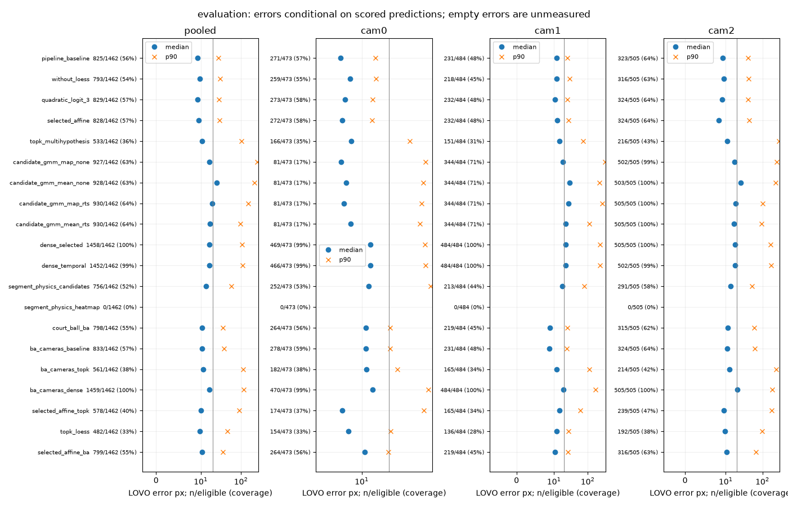

## 結果と推奨案

**6組合せを加えても、baselineの後半LOVOとcoverageを一貫して改善する条件は確認できなかった。
当面baselineを維持する案を推奨する。人間が採否を決める。既定・方式PR・統合branchをmergeしていない。**
主評価は後半[505,1010)。baselineは中央値9.340/p90 27.078px、20px超16.36%、825/1462点（56.43%）。
補正なし3×3 logitは9.230/28.232px、15.92%、829点で、中央値と20px超率は下がるがp90は上がる。
同じ824点でも9.162/28.193px対baseline 9.348/27.085pxと、中央値と裾のtradeoffが残る。
前半で選んだaffineは9.491/29.633px、18.60%、828点へ悪化し、前半の改善を一般化できなかった。
後半を見て補正なしへ選び直したものではなく、補正なしは子の前半base winnerとして実行前から併記した。

全20予測条件と4参考診断の3区間・LOVO主表は [metrics.md](../../runs/run-ball3d-integrated-comparison-20261104/metrics.md)、
全viewと各held-out cameraの数値は [fold-metrics.csv](../../runs/run-ball3d-integrated-comparison-20261104/fold-metrics.csv)。
基盤scorerの全参照kind・運動・イベント診断はoutputsのscores.jsonにあり、独自採点ではない。

| 組合せ | 後半median/p90 px | >20px率 | 採点/1462・coverage |
|---|---:|---:|---:|
| BA camera×baseline | 10.824/37.279 | 19.45% | 833・56.98% |
| BA camera×top-K | 11.523/113.133 | 29.59% | 561・38.37% |
| BA camera×dense | 16.618/115.649 | 42.84% | 1459・99.79% |
| 選定affine復号×top-K | 10.258/90.875 | 27.34% | 578・39.53% |
| top-K→既存LOESS | 9.783/45.281 | 21.99% | 482・32.97% |
| 選定affine復号→BA | 10.718/35.586 | 18.65% | 799・54.65% |

## coverageと各方式の長所・短所

共通・追加・喪失の後半主表は [cohort-primary.md](../../runs/run-ball3d-integrated-comparison-20261104/cohort-primary.md)、
3区間のpool値は [cohort-pooled.csv](../../runs/run-ball3d-integrated-comparison-20261104/cohort-pooled.csv)。
全24条件×3区間×4camera層×3参照kindの864層で2本ずつの件数式を検算し、
共通＋追加＝方式全採点数、共通＋喪失＝baseline全採点数が1728式すべて成立した。
件数・中央値・p90・20px超率の周辺値も基盤scorerの3456値と一致した。
全方式共通集合は失敗した物理heatmapを含むため空で、失敗条件を除く19予測条件でも後半121/1462点（8.28%）に限られる。
2組ごとの共通集合を主に使い、方式ごとに違う共通集合同士を同じ集合の結果とは解釈しない。

- baselineは今回の比較の基準となる裾の小さい誤差を保つが、主評価の43.57%は採点できない。
  復号だけの補正なし版には小さな中央値改善がある一方、affine選定の前半改善は後半へ一般化しない。
- top-Kは複数候補と時間対応を残すが、単独は10.780/103.597px・533点。
  baselineにない追加180点は19.721/244.478px・20px超49.44%、472点を喪失する。
  選定復号の合成は周辺値を10.258/90.875px・578点へ動かすが、追加194点の46.39%が20px超、baselineの441点を失う。
- top-K→LOESSは元top-Kより周辺誤差が小さくなるが、採点集合も変わる。
  baselineとの共通344点は9.161/27.767px対8.726/28.130pxで、p90と20px超率はわずかに下がる一方で中央値は悪化する。
  追加138点は14.266/183.690px・39.86%、喪失481点のうち398点はbaselineで20px以内だった。
  出力の選別と座標変更の寄与を分離しておらず、平滑化だけの因果効果とはしない。
- GMMはMAP/mean/各RTSと不確かさを返すが、4版すべてLOVOが悪化する。
  MAPの採点純増102点は402追加−300喪失で、追加点は38.460/363.652px・65.92%。
  喪失300点のうち279点はbaselineで20px以内だった。不確かさの被覆率はこのrunでは再集計しておらず、子ノードを参照する。
- denseは1458/1462点まで可用性を増やしbaselineの825点を失わないが、共通点でも12.676/36.828pxへ悪化する。
  追加633点は29.066/313.385px・60.35%。temporal版やBA cameraとの合成も主指標の改善を支持しない。
- 区間物理の候補点版は運動・時刻を明示推定するが、共通756点でもbaseline 9.067/26.253pxに対して13.637/58.198pxへ悪化した。
  heatmap版は全4foldで未収束、valid・採点数0、誤差は未測定である。別solverやbaselineで埋めていない。
- BA単独は全view自己再投影を下げてもLOVOは10.946/35.507px・798点へ悪化する。
  cameraだけを渡すbaseline合成は元825点を保持し8点を追加（8点すべて20px以内）する長所があるが、
  共通825点を10.812/37.548px・20px超19.64%へ悪化させる。camera精密化や出力増加だけを精度改善とは扱わない。

## 保存済み結果との照合・表示修正

14単独条件と4参考診断の各4fold、計72結果で、frame軸・3D位置・valid/使用view・共分散・camera・offset・全診断を厳密照合した。
18条件すべて一致し、統合で単独の数値は変わらなかった。runtimeとcode出自は同一性の対象から分けて記録する。
top-K/GMM/denseの既存cohort_v1とも全区間・camera・参照kindの2160分布が厳密一致した。
新しい6組合せは新規予測であり、既存値の流用ではない。全96結果は同じ固定bundleからCPUで再実行した。

最初の表示scriptはfoldの分布だけを持つreprojection_pxから対象数を読もうとして停止した。
基盤のreprojection_by_reference_kind.allを表示へ結ぶreport_v2.pyを別commitで適用し、元の実行codeと失敗記録を保持した。
予測・scorer・設定の変更や再実行はない。表示修正前後のscores.jsonはbyteも同一だった。
追加unit1件と既存integration2件はcollect3件、3 passed/10.27秒（wrapper12.220秒）、全phaseをtable-fix-testsに残した。
一次suiteとの重複2件を除く全体は795 distinct node、新規は13件である。
この表示修正は新しい統合比較scriptの不具合であり、方式PRの修正ではない。

## 可視化・資源・限界

全20予測条件動画は1200×1260、絞り込み4条件動画は1200×1150。
ともに59.94006fps・1010frameを1枚ずつ読み書きし、保存後の全decodeに成功した。
入力3動画も独立に各1010frameを全decodeした。極端frameのcropは全条件/絞り込みの各8frame、
元のcamera別イベント25行は同kind・同frameの20組の表示へまとめ、各±3frame内で最大LOVO誤差の1frameを表示する。
この20は物理イベントの真値数ではない。596/597、622/623、852/853の1frame差と元行・注記を保持する。

絞り込みはbaseline、補正なし3×3 logit、選定affine、top-K→LOESSで、後半中央値→p90→20px超率による表示だけの選択。
設定を選び直していない。代表0/252/505/757/1009、指標図、全条件/絞り込みの極端crop、bounce596/hit622付近を目視した。
直接観測の緑十字・承認推定の白菱形、全view ring・LOVO斜め十字を区別し、unknownと末尾外挿の正解非描画を確認した。
大きなLOVO外れはcrop外にもあり、crop内に見えないことを欠測とは解釈しない。全条件の重畳は混雑するため絞り込み動画を併記した。

HTMLは動画を埋め込まず相対pathで開く。portable/index.htmlと44fileの移設用ZIPを作り、コピー後も参照切れ0。
新しい成果物1671fileのchecksumを照合し、既存8比較directoryの3037fileも不変だった。
実パス・全checksum・動画・検証の正本は [artifact-receipt.json](../../runs/run-ball3d-integrated-comparison-20261104/artifact-receipt.json) とoutputsのfinal-artifacts.json。
予測配列・動画・ZIP・大きな全採点JSONはoutputsに置き、knowledgeへコピーしない。

予測はGNU time wall1483.96秒、script perf_counter1523.852秒、最大RSS669048KiB。
表示v2はGNU time wall265.06秒、script266.928秒、最大RSS1181992KiB。
異なる時計の原値を統合せず保持する。GPU・検出器再推論・学習は0、swap回数0。
baselineのLOESS再計算、BAのpinned points利用、各foldの反復fitなどが異なり、時間を最適化されたproduction速度差と解釈しない。

対象は1 clip。baselineと大半の方式は固定の近似pinhole校正で、BAも同じ固定観測からの精密化である。
人間承認の推定を含む2D参照で、独立3D・court・物理clock真値はない。元校正自体は全view由来で、校正段階まで独立したLOVOではない。
foldごとに時刻gaugeが変わり、除外cameraの絶対時刻は復元できない。近似探索・局所最適化・候補選択の因果寄与は未分離。
全view自己再投影・運動の滑らかさ・coverageだけで方式を採用せず、未使用clipまたは前半だけで独立ablationすることを次の案とする。
今回の後半を再調整には使わない。学習ではないためTensorBoardやcheckpoint比較は該当しない。

## 固定条件と実行一覧

親 #1554 合意revision 6、子 #1568。親が全方式の未merge headを統合した境界commit
`cecb863797d3e5468f26005d1286e29c7eaf997a` から作業した。ほかのノードの番号・本文は変更しない。
実行コードは `3bf09cf51`、一覧を実行前にcommitしたのは `a4fe4e476`。
後続の測定・記録用commitと実行コードの出自を区別し、実行byteの指紋も検証する。

[実行一覧](../../runs/run-ball3d-integrated-comparison-20261104/execution-list.md) と
[全設定・fold・入力checksum・出力先](../../runs/run-ball3d-integrated-comparison-20261104/execution-plan.json) が正本。
baseline、LOESSなし参考、前半で選んだ補正なしlogit曲面とaffine版、top-K、GMMのMAP/mean/各RTS、
dense選定/temporal、物理候補/heatmap、court+ball BA、6組合せを全viewと3 LOVOで直列実行する。
annotation / clock / candidate1 / candidate8 oracleの4行は正解を使う参考診断で、推定方式に数えない。
GMMのfold別較正値、復号のaffine係数、denseの温度/背景を含め、子の前半選定値をそのまま使い、再fit・再調整しない。
人間の正解JSONは全blind予測の保存後に初めて開き、基盤のreader・runner・採点・error_samplesをそのまま使う。

## 組合せの意味と隔離

BA camera×baseline/top-K/denseは各foldの保持viewだけでBAをfitし、そのcameraだけを次段へ渡す。
この3行はoffsetを全て0にしたcameraだけの比較である。推定clockも用いるBA単独行と混同しない。
BAのfit自体は単独行と同じcamera/clock同時fitであり、次段への受渡しだけをcameraに限定する。
全view BAをLOVOへ使い回さず、除外cameraへの採点は元校正・offset0を保持する。
既存top-K/denseは同期frameの尤度を仮定するため、非ゼロclockとの合成は新たな非同期モデルが必要で対象外とした。
元LINE座標がないbundleを別入力へ置換しない。GMM支持モデル、物理区間連続性、top-K null/運動コストの変更も、
新規モデル・再調整になるため対象外の理由を一覧に残す。

選定復号×top-Kでは、保存された各native peak cellへ既存局所fitと同じaffine補正を適用する。
元evidenceの座標はnative cellの±0.5以内という契約を持つため、補正座標を元evidenceと偽って上書きしない。
明示座標を別のcamera ID付き引数でtop-Kへ渡し、元cell/score/mask/heatmap/patchと出自を保持する。
srcの追加はこの接続用入口だけで、既定の復号・top-K計算・基盤採点は変更しない。
top-K→既存BallPointsModuleのconsensus/LOESS→再三角測量、選定復号→同じgate/LOESS→BAも実行する。
これらは事前指定した合成で、後半の値を見て設定を変える比較ではない。

## テスト設計と実測

実装前の [test-plan.md](../../runs/run-ball3d-integrated-comparison-20261104/test-plan.md) に
守る契約・故障・層・既存node・予算を記録した。新規は12caseで、二つの非対称な既知peak、元格子でのaffine、
padding、棄却状態、既知3D平行移動、camera/shape/範囲拒否を軽いunitで検証した。
組合せintegrationは制御したBA出力と実top-K/runner/scorerを接続し、4foldそれぞれの入力と
非ゼロclockを混入しないこと、除外cameraを変えないことを独立投影式で検証する。
BA solver自体、main固定配列との既定回帰、採点cohortの定義、実codec/動画は既存テストを再利用した。
HTMLの新規testは相対動画リンクを含むdirectoryをコピーし、移設先でも参照切れ0であることを確認する。

関連794caseは全て成功、`-n 2 --durations=0 --durations-min=0` のpytest実測302.04秒
（wrapper303.922秒）。`--collect-only -n 0` は794case、pytest72.45秒（wrapper74.550秒）。
全phase合計285.480秒はworkerの時間合計で、wall時間とは異なる。
新規12case合計2.262秒、最大0.661秒、最大setup0.117秒で、5秒/1秒の目安内。
5秒超は既存の設定cold import 79.266/73.307秒、全source監査35.394秒、物理solver接続19.890秒の4case。
実processのimport順・全sourceの設定契約・実solverとLOVOの接続を守る既存検証のため残した。
setupが1秒を超えたcaseはない。テストの削除・統合はない。
全node・全phase・正確な引数は [test-summary.json](../../runs/run-ball3d-integrated-comparison-20261104/test-summary.json) と
同runのtest-nodes/test-phases/test-durationsに記録する。原logはbyteを変えず3分割し、再結合SHAも記録した。

局所fitのoffsetをprocess内だけで0にする故障注入は、既知peakの数値assertで失敗した。
別processの復元後は同じnodeが成功し、srcファイルの書換えはない。
[mutation.json](../../runs/run-ball3d-integrated-comparison-20261104/mutation.json) と原logを残す。
