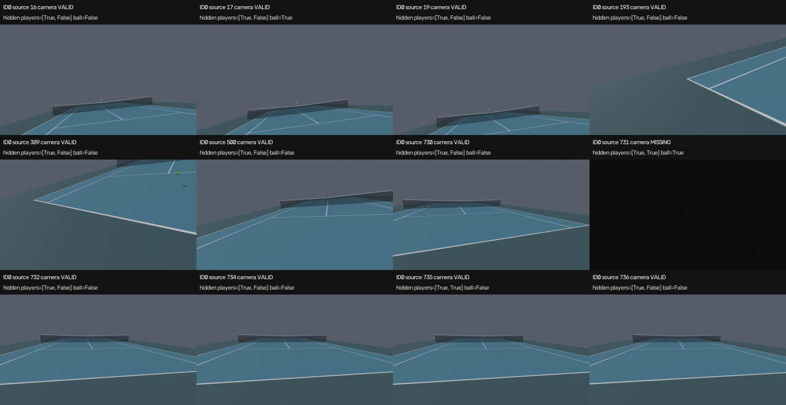
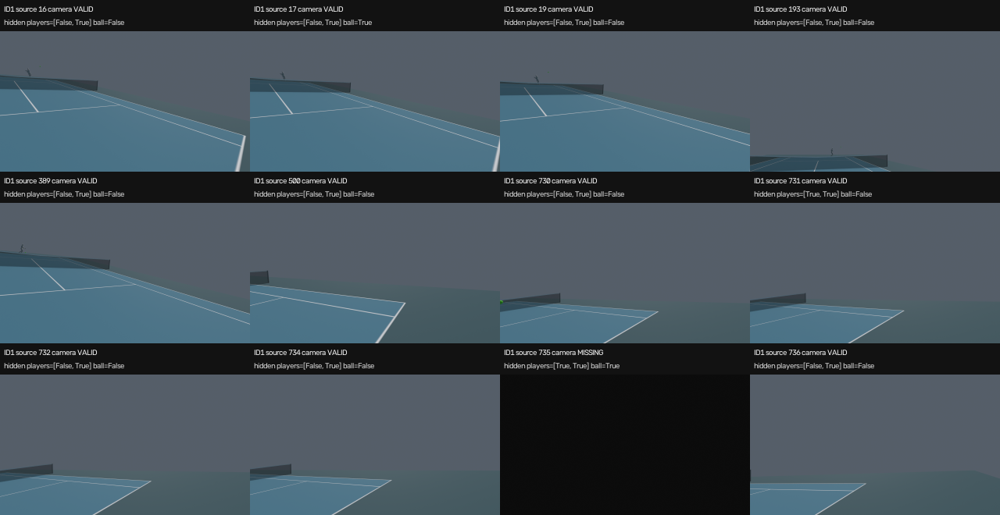

# 実描画で確認したこと

保存済みclip `clip000_20261103` のscene bundleとC2頭部カメラをそのまま読み、
ID0/ID1の同じ12元frameをBlender 5.2.1 LTS・NVIDIA L4/OPTIXで描画した。
元FPSは59.94006、1280×720・水平画角90度・球半径0.05mは仮設定であり、
視点本人のmesh全体を隠す。相手は灰色、球は緑色のPrincipled BSDF、alpha=1・emission=0。
元動画・再推論・3DGSを使わない。

24枚すべてについて、保存cameraからの姿勢、人物ID、元frame/cache index、camera/mesh/ball mask、
本人非表示を描画記録と照合した。両人とも評価済みPC2頂点と当該元frameの入力頂点との差は最大0m。
これはrendererが保存meshを忠実に読む検証であり、元の3D再構成精度の測定ではない。
球の16→17→19、ID0 cameraの730→731→732、ID1 cameraの734→735→736で、
有効→欠測→有効の表示を確認した。相手meshだけの欠測では、cameraが有効なまま相手を隠す。

agentが両人の接触表を全24frame目視し、灰色の相手・緑の球・コート/ネット、
頭部内meshで画面が塞がらないことと欠測frameを確認した。生のhead pitch/rollでコート外を向く
frameもある。注視・平滑化・欠測補間は追加していない。

camera欠測の暗いPNGにはBlender標準の8-bitディザで最大3LSBの幅があった。
この実測を受け、公開時のblank検証は最大4LSBを許容し、本描画のditherは0に固定した。
材質・camera・人物/球の位置やmaskは変更しない。255LSBの非blank画像を拒否するCPU検証も追加した。

ローカルの新しい公開コードで3本（2視点＋左右比較、各12frame）を生成し、
全36frameのdecode・FPS・長さ・表示時刻を確認した。previewは非連続sampleの一覧で、
12frame=0.2002秒であり、元frame16〜736の連続プレイ動画ではない。
このpostprocessはcommit `2791ae2fc` の公開コードによる。全区間動画と人間の受入は別に行う。

# 再現と証拠

Colab job `c3-preview-24` はcompleted・returncode=0、Drive保存は2026-11-08T17:08:46Z。
運用Codex turnはローカル回収中にtimeoutになったが、親workerがjob終了と保存を独立に照合し、
24PNG/2描画記録の回収とDriveとの内容一致を確認した。runtime終了を描画成否へ読み替えていない。

入力のportable packageはDrive root相対
`outputs/tennis_scene/visualize/player_view/blender-acceptance-20261109/package`。
元bundle/保存cameraのdigest・ID・時間軸・maskをCPUで照合してから作成した。
保存記録の`881dc286c`へ同梱`uncommitted.patch`を適用すると、この実描画のMesh Cache CUSTOM指定になる。
歴史的commandは`repro.sh`、実行したqueue scriptは同梱`c3-preview-queue.sh`。
新規Colab checkoutでpackageを元のrepo相対pathへ取得し、同scriptをcommandが参照するoutputs配下へ配置する。
既存の出力やqueue stateを再利用して上書きしない。GPU実行・帰属はプロジェクトの資源手順に従う。

全frameの描画記録とPNGは`artifacts.drive_outputs`、運用記録とsource snapshotは`artifacts.drive_record`に保存。
接触表と`preview_validation.json`をこのrunへ保持した。TensorBoardは可視化検証には該当しない。

**人間による定性受入は未了。** このrunのdoneは少数frame描画・検証の終了を意味する。
#1727/親#1723の受入やC5開始の承認を意味しない。対象動画と人間本人の判断は親が別途記録する。
標準pipeline・採用checkpoint・3D精度/球の後処理の判断を変えないため、summary_impactはnoneとした。
