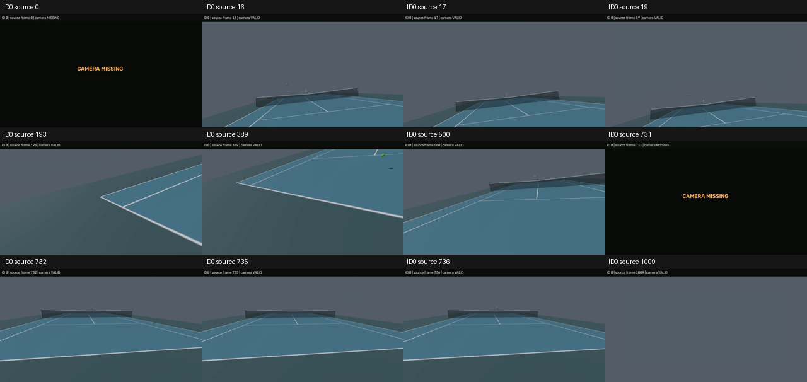
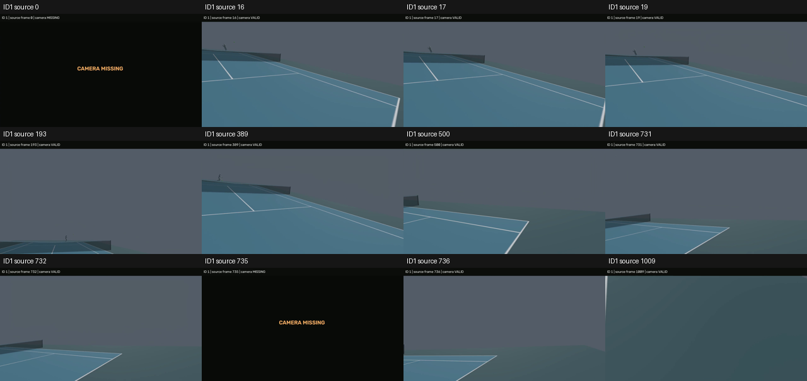

# 生成・検証の結果

保存済みclip `clip000_20261103` のC1 scene bundleとC2頭部cameraから、
ID0/ID1それぞれ元frame `[0,1010)` の選手視点動画をBlenderで生成した。
**このrunのdoneは全区間生成・検証の終了であり、人間による定性受入は未了。**
親が動画・設定と人間本人の判断を対応付けて記録するまで、C3受入完了やC5開始を意味しない。

|動画|frame数|解像度|FPS|長さ（秒）|
|---|---:|---|---:|---:|
|player_0.mp4|1010|1280×720|59.9400600012|16.850167|
|player_1.mp4|1010|1280×720|59.9400600012|16.850167|
|comparison.mp4|1010|2560×720|59.9400600012|16.850167|
|comparison_short.mp4（元frame [0,240)）|240|2560×720|59.9400600012|4.004000|

比較はID0を左、ID1を右へ同じ元frameで並べる。各画面と個別動画に人物ID・元frame・camera有効/欠測を表示する。
計3270frameを最後までdecodeし、全PTS、長さ、解像度、元FPS59.94006との対応を照合した。
containerのFPS差は約1.2e-9で、時間の再サンプリングはない。

実描画はcommit `993c7e231`、Blender5.2.1 LTS・NVIDIA L4/OPTIX、16 samples、
persistent dataとOpenImageDenoiseのGPU使用を有効にした。
先行runの388frameは保存したまま採用せず、全2020frameを同じ最終設定で新しく描いた。
1280×720、水平画角90度、球半径0.05m、本人mesh全体非表示は仮設定。
相手は灰色SMPL、球は緑の通常Principled material、alpha1・emission0、背景は簡素なコートとネット。
reveal・fade・発光・motion blur・Bezierは使わず、保存cameraの再推定・注視・安定化・欠測補間を加えていない。

元C1/C2ファイルのdigestと固定packageが一致することを独立に確認した。
全2020rowのID/source/output/cache index、camera/mesh/ball mask・camera理由code、
camera姿勢・球位置・本人非表示・材質・GPU設定を照合した。
camera matrix最大entry差は4.7644e-7（許容2e-5）、球centerと評価済みPC2全頂点の差は0m。
これは保存入力の読出し忠実度であり、3D推定精度の測定ではない。

camera有効数はID0が1007、ID1が993。欠測元frameは以下の通りで、全1010frameの時間を保持した。

- ID0: `[0,1,731]`
- ID1: `[0,1,735,741,742,750,751,752,753,754,755,756,757,758,759,760,761]`

相手meshの描画許可は両視点992frame、球はID0で854、ID1で849frame。
これはmaskから決まるhide_render=Falseの件数で、画角や遮蔽による画面内の見え方は別に確認する。
動画manifestと最終描画記録・全4動画のdigestも一致した。
組立済みreportはCPU後処理で`render_player_0.json` / `render_player_1.json`へ転記し、
元manifestのdigestとの一致を確認してDriveへ追加保存した。`delivery-report-publication.json`が対応を示す。
movieとmanifestの内容は変更していない。

agentは全動画を順次decodeして抽出した各12frame（計24frame）の接触表を目視し、
本人meshが画面を塞がないこと、灰色の相手・緑の球・コート/ネット、camera欠測表示を確認した。
生のhead roll/pitchによりコート外を向くframeもある。
視点の向き・追従・人物と球の見え方・時間対応・欠測表示の人間の定性確認はpending。

# 保存・資源・再現

Colab `c3-full-gpu-denoise` はreturncode0で完了し、Drive保存済み。
最初の閉じた元frame0〜3のcheckpointをDrive経由で回収し、PNG CRC・全mask/pose/material/PC2を照合した。
`download --verify`が最終receipt前にtimeoutしたため、独立verifyでmatches:trueを確認した。
運用Codex runtimeはこの処理中にtimeout（exit124、cleanup_complete:true）した。
終了監視の通知も遅れたため、親workerがremote terminal状態・終了コード・保存完了を独立に確認した。
runtime終了をGPU処理の成功へ読み替えていない。

全成果物と運用記録はDriveからdownload --verifyで回収した。
VM側source差分は0件（元commit993c7e231）。所有sessionのstopとCLI registryが空であることを確認した。
割当は約3.29時間でGPU上限4時間内。accountの別assignmentとは区別している。

ローカル納品先はrepo相対`outputs/tennis_scene/visualize/player_view/blender-acceptance/videos/`。
同階層の`review.md` / `reproduction.md`に人間確認用の設定・時間対応・再生成コマンドをまとめた。
同梱ファイルはその時点のsnapshotで、reviewのリンクは元の納品ディレクトリを基準とする。
大きい動画・PC2・全frame reportはGitへ複製せず、frontmatterのDrive artifacts/checkpointsに保持する。
入力packageのDrive root相対pathは
`outputs/tennis_scene/visualize/player_view/blender-acceptance-20261109/package`。

同梱queue/wrapperとgate/prefix JSONは実行時の内容を保持する。
`colab-original-repro.sh`は記録由来の原文、外側`repro.sh`がscript/JSONを元outputs位置へ配置して呼び、
成功後にCPUで最終reportを転記する。run bundleは`TENNIS_REPO`の新規checkout外に置く。
歴史的queueはColabの元checkout pathと過去の絶対deadlineを保持し、現在は予算guardで停止する。
新規生成は別予算・新runとして同梱`reproduction.md`の最終renderer CLIを使い、全frameを新しく描く。
既存の異なる入力・出力を上書きしない。

CPU側は既存integration nodeへ17case追加し計33case（collect33、最大展開7）。
33 passed / 10.94秒、観測最大call2.09秒・setup0.24秒。回帰59nodeとCLI/contract3nodeもpassed。
pytestは-n2以下、全変更コードのpre-commitはruff/mypy passed。
Blender/CUDA実描画は通常pytestへ重複追加せず、本runと少数frameの受入で記録する。
TensorBoardは該当しない。

標準pipeline・採用checkpoint・3D精度の現在の判断を変えないためsummary_impactはnone。
人間の定性受入・必要な修正と再確認、merge/issue closeは親へ引き継ぐ。
