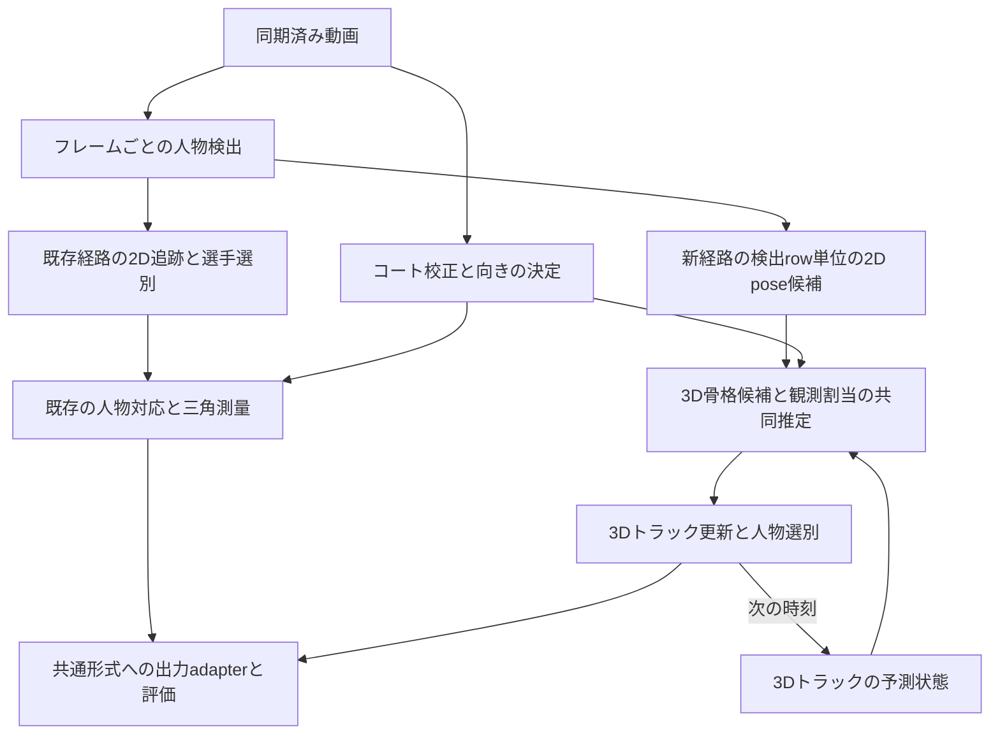

# 複数カメラによる人物対応と3D姿勢復元と追跡の先行研究調査

調査日: 2026-11-08。対象: tennis-labの同期済み固定カメラ映像に追加する人物再構成経路。

**人物の対応付け、姿勢復元、時間方向の追跡を3D状態を中心に行う構成は、先行研究によって成立が示されている。** 今回の構想には、幾何を使う4D Association Graphが最も直接的な参考になる。学習方式の比較候補はTEMPOである。ただし、前者は2D関節候補の接続も共同で解き、後者のID追跡は主にコート上面に相当する平面上の人物領域を使う。いずれも「全関節のレイの交点を選ぶだけ」で完成する方式ではない。[4D Association Graph §3–5](https://arxiv.org/html/2002.12625v1)、[TEMPO §3.2–3.3](https://arxiv.org/html/2309.07910v1)

本プロジェクトへの提案は、**全人物の2D観測から複数の3D骨格候補を作り、観測の取り合いと時間整合性を含めて選択し、3Dトラックを維持する新経路**である。最初の比較候補は追加の3D学習を要しない幾何方式とし、その結果を基準に学習方式の必要性を判断する。これは調査からの提案であり、テニス映像での優位性を実測した結論ではない。

## 1. 今回の前提と調査範囲

2026-11-08のユーザー指示を、この案件の前提として固定する。

- 人物対応だけでなく、追跡も3D上で行う。
- 既存経路を残し、今回の構想を別の新経路として実装する。
- 今回の成果物は先行研究の調査レポートとする。

調査では、外観Re-IDを必須にしない構成を中心に扱う。画像からの人物検出・関節検出は利用できる。「外観Re-IDを不要にすること」と「画像の特徴を一切利用しないこと」は区別する。また、3D座標を出力するだけの方式と、時間を通じて人物IDを維持する方式を分ける。

2019〜2023年の直接関係する9研究と、2024〜2026年の隣接する3研究を比較した。出典は原論文、著者のプロジェクトページ、公式実装。最新論文の網羅的ランキングではなく、要求に適合する設計を選ぶための調査である。各研究の書誌情報と読解箇所は末尾の研究ライブラリへのリンクにまとめた。今回、モデル実行・追加学習・テニス映像での性能測定は行っていない。

## 2. 方式の比較

表の「Re-ID」は人物同定用の外観特徴を指す。検出・姿勢推定に使う画像CNNの有無とは別である。「追跡あり」も、全関節の3D運動を使ってIDを決めることを一律には意味しない。

| 研究 | 復元と人物対応の中心 | 時間方向の扱い | 外観Re-ID | 今回の位置付け |
|---|---|---|---|---|
| [Bridgeman et al., CVSports 2019](https://cvssp-data.eps.surrey.ac.uk/projects/4d/multi_person_3d_pose_sports/) | 2D姿勢の視点間対応 → 頑健な三角測量 | 生成した3D骨格を追跡 | 必須にしない | スポーツでの幾何方式の基準。ただし対応と復元は段階的 |
| [4D Association Graph, CVPR 2020](https://arxiv.org/abs/2002.12625v1) | 関節の接続、視点間のレイ整合性、前時刻の3D関節を共同評価 | 前フレームの3D骨格を現在の対応付けに使う | 使用しない | 構想に最も近い幾何方式 |
| [VoxelPose, ECCV 2020](https://arxiv.org/abs/2004.06239v4) | 2D heatmapを3D格子へ集約し、人物位置と骨格を推定 | 論文の主対象は各時刻の姿勢 | 不要 | 3D空間で人物を分離する基本形。追跡は別途必要 |
| [TesseTrack, CVPR 2021](https://www.cs.cmu.edu/~ILIM/projects/IM/TesseTrack/) | 3D特徴領域と時間をまとめた4D CNN | 人物ごとの学習済み記述子を微分可能なmatcherで接続 | 独立した2D Re-IDを前提にしないが、学習特徴で人物を対応 | 復元と追跡の共同学習の参考。幾何だけの方式ではない |
| [VoxelTrack, arXiv 2021版](https://arxiv.org/abs/2108.02452v1) | 3D voxel上で関節を推定し人物にまとめる | 3D姿勢の位置と外観で追跡 | **使用する** | 3D追跡の対照例。Re-ID不要という要件にはそのまま適合しない |
| [MvP, NeurIPS 2021](https://arxiv.org/abs/2111.04076v2) | 人物・関節queryから複数人の3D座標を直接回帰 | 永続ID追跡は主対象外 | 独立したRe-IDは不要 | 全人物同時推定の参考。query番号を時間IDとみなせない |
| [Faster VoxelPose, ECCV 2022](https://arxiv.org/abs/2207.10955v1) | 3D特徴をxy・xz・yz平面へ投影して骨格を推定 | 永続ID追跡は主対象外 | 不要 | VoxelPoseの計算量を抑える構成。追跡は別途必要 |
| [Unified Multi-view Multi-person Tracking, arXiv 2023版](https://arxiv.org/abs/2302.03820v1) | 複数時刻・視点の2D trackletを共同対応し三角測量 | 3D trackletを窓間で接続 | なしの構成と外観追加の比較あり | 時間窓と頑健な三角測量の参考。**2D追跡を残す**ため要求との差がある |
| [TEMPO, ICCV 2023](https://arxiv.org/abs/2309.07910v1) | 多視点特徴を3Dへ集約し、平面投影と再帰ネットで姿勢推定 | 上面図の人物領域をSORTで追跡し、姿勢特徴を引き継ぐ | 学習済みRe-IDなし | 学習方式の有力候補。ただし全関節による3D追跡とは異なる |

### 2.1 幾何による共同推定から取り入れるもの

4D Association Graphの入力は、各画像の**関節候補と関節間の接続信頼度PAF**、および前フレームの3D骨格である。視点間では同種関節のレイ間距離、時間方向では既存3D関節との整合性を評価する。同じ観測を複数人に割り当てない制約を持ち、骨格の組み立て後に再投影・骨長・時間の項で姿勢を調整する。したがって、2D上で完成した人物IDを先に確定する必要がない。[原論文 §3–5](https://arxiv.org/html/2002.12625v1)

ただし、同論文§5.3では、見失った人物の再登場を新しい人物として扱う。また骨長の初期化には「3台より多いカメラから見える」高信頼フレームを使う。3カメラのMeijiへこの条件をそのまま移すことはできない。長い全視点遮蔽後の同一ID復帰を保証する研究として扱わない。[原論文 §5.3](https://arxiv.org/html/2002.12625v1)

Bridgemanらはスポーツを直接対象にし、2D姿勢の誤り修正、視点間の対応、三角測量、3D骨格追跡を構成している。スポーツにおける同色ウェア、遮蔽、速い運動を考慮する参考になるが、今回望む共同推定とは処理の順序が異なる。[著者の研究ページ](https://cvssp-data.eps.surrey.ac.uk/projects/4d/multi_person_3d_pose_sports/)

本repoでの提案は、既存ViTPoseの一人分の検出を候補として利用しながら、複数人・複数視点の3D仮説を比較する方式から始めること。ただし、box単位の骨格を不可分として扱うと、2D段階で混ざった他人の腕を修正できない。初期版では混合骨格を棄却できることを要求し、関節単位の再組み立てとPAFの導入は、その残存誤りに応じた拡張候補にする。これは4D Association Graphの完全再現ではなく、現在の観測形式に合わせる設計案である。

### 2.2 学習方式から取り入れるもの

VoxelPoseは、各画像の関節heatmapを共通の3D領域に投影して集約し、粗い人物位置と細かい関節位置を求める。画像内の一つの座標へ早期に確定せず、複数視点の支持を3Dで集める点が構想に合う。Faster VoxelPoseは体積特徴を直交する3平面に投影して計算量を抑える。いずれも、そのままで人物IDの時間的な連続性を解決するわけではない。[VoxelPose §3–4](https://arxiv.org/html/2004.06239v4)、[Faster VoxelPose §3](https://arxiv.org/html/2207.10955v1)

TEMPOは平面化した人物特徴を時間方向に引き継ぎ、SpatialGRUで姿勢と将来姿勢を求める。追跡に学習済みRe-IDを使わずSORTを使う点は要求に合う。ただし原論文§3.2の追跡対象は上面図の人物領域であり、全関節の3D状態を使った追跡とは区別する。本プロジェクトでは、これを骨格の速度・不確かさ・排他制約まで扱う方式と比較する価値がある。[TEMPO §3.2–3.3](https://arxiv.org/html/2309.07910v1)

TesseTrackは短区間の時空間記述子を学習して接続するため、単純な距離照合より多くの情報を扱える。一方、本人同定に学習済みの人物記述子を使うことまで禁止する場合には適合しない。MvPの人物・関節queryも、画像からの同時推定の枠組みであって、queryの配列位置だけで動画中のIDを維持できる根拠にはならない。[TesseTrackの方式説明](https://www.cs.cmu.edu/~ILIM/projects/IM/TesseTrack/)、[MvP §3](https://arxiv.org/html/2111.04076v2)

学習方式を使うなら、テニスの広い撮影領域、遠方の小さい人物、サーブや跳躍、カメラ配置への一般化を別に評価する必要がある。既存のPanoptic等の成績から、Meijiでの精度やVRAM使用量を推定して採用することはできない。

### 2.3 新しい隣接研究の扱い

| 研究 | 参考になる点 | 今回の主経路としての差 |
|---|---|---|
| [AvatarPose, ECCV 2024](https://eth-ait.github.io/AvatarPose/) | 人物ごとのavatarとRGB・silhouetteを使って接近・接触時の姿勢を改善 | 初期3D姿勢と人物別avatarを必要とし、姿勢とavatarを交互に最適化する。初期の人物発見・ID追跡を代替する方式としては扱わない |
| [MVTracker, ICCV 2025](https://ethz-vlg.github.io/mvtracker/) | 複数カメラの特徴を3D点群に集約し、指定点の3D軌跡と可視性を推定 | 既知カメラと推定またはセンサ深度が必要。身体関節の意味付け、人数推定、人物の出入りの処理は別途必要 |
| [TAPVid-MV, arXiv 2026 v2](https://arxiv.org/abs/2609.01899v2) | 多視点3D点追跡で、幾何復元誤差と対応誤りを分けて評価 | 任意点のbenchmarkであり、テニス選手IDと骨格の精度を直接評価するものではない |

MVTrackerの著者ページには、4視点の追跡例でも深度に27視点のDynamic 3DGSを使うPanoptic例がある。「4カメラRGBだけで同じ結果が得られる」と解釈しない。AvatarPoseも初期姿勢を既存推定器から作る。これらは将来の姿勢改善・遮蔽処理の参考として位置付ける。[MVTrackerの入力条件](https://ethz-vlg.github.io/mvtracker/)、[AvatarPose §3.2](https://eth-ait.github.io/AvatarPose/assets/paper.pdf)

## 3. 「全員のレイを飛ばす」を実装可能な問題にする

以下は先行研究を踏まえた本プロジェクト向けの定式化案であり、特定論文のアルゴリズムをそのまま記述したものではない。

各camera・frame・検出rowについて、関節座標、関節種類、検出score、観測maskを保持する。対応付ける前の観測なので、この時点で時間をまたぐ人物IDを要求しない。校正済みカメラから各関節のレイを作り、同種の関節同士から3D候補を生成する。第三以降の視点も用いて支持を確認し、複数の骨格候補を競合させる。

評価対象は、単一点のレイ間距離の最小値ではなく、**観測の割当Aと、全人物・複数時刻の3D骨格Xの組**である。例えば次の項を持つ。

```text
E(A, X) = 頑健な再投影誤差
        + 骨長・関節接続の不整合
        + 3D運動予測からの不整合
        + 観測の未説明・外れ値に対するコスト
        + 人物の生成・消失に対するコスト
```

同じ画像の同じ関節観測を別の人物へ二重使用しないこと、cameraの手前にあること、関節種別が一致することは制約とする。観測支持や未説明コストを入れずに再投影誤差だけを最小化すると、何も出力しない解や、少数の都合のよい観測だけを使う解を選べてしまう。

全員のレイを一つの点に最小二乗で集約してはいけない。人数分の仮説を同時に選ぶ必要がある。また、全カメラの人物組合せを無制限に列挙する必要もない。視点ペアからの候補生成、コート内の範囲、再投影、前時刻の3D予測で候補を絞れる。ただし新規人物の発見は既存トラックの周辺探索と別に残し、予測位置から外れた人物を永久に見失わないようにする。

3Dトラックの状態には、root位置と速度、関節姿勢、骨長、最終実観測時刻、不確かさ、支持カメラを持たせる。遮蔽中の予測と、複数カメラの実観測による再構成は別の状態で保存する。長い全視点遮蔽後に、幾何だけで二人の識別が不可能なら、曖昧性または新規IDとして扱う。特に近い体格のダブルス選手が見えない間に位置を交換した場合、3D化だけで同一性は確定しない。

## 4. tennis-labへの接続と既存経路の維持

現在の構成は[pipeline README](../../src/tennis_scene/pipeline/README.md)と[definition.py](../../src/tennis_scene/pipeline/definition.py)で確認した。旧経路を新経路の前処理として必須にすると、その2D追跡の誤りとRe-ID依存を引き継ぐため、分岐は人物対応の直前より上流に置く必要がある。



| 接続点 | 現在の事実 | 新経路で必要な扱い |
|---|---|---|
| 2D pose | [pose_estimation.py](../../src/tennis_scene/pipeline/components/pose_estimation.py)は選別済みtrackを入力にする。標準経路では追跡前に計算したpose証拠を並べ替えて使う | 検出row単位でposeを取得し、2Dの永続IDなしで入力できる新しいportが必要 |
| 外観特徴 | [人物追跡](../../src/tasks/person_tracking/README.md)と選手断片の連結にもCLIPを使う | 新経路はそれらの成果物を必須にしない。DINO・ViTPoseの推論部品を再利用する場合もCLIP実行を必須にしない |
| camera | [camera_alignment.py](../../src/tennis_scene/pipeline/components/camera_alignment.py)は対応済み人物を使って幾何品質を再検証する | 初期カメラをコート校正＋決定済みsideから構成し、新経路の人物で後から検証する。人物対応とcamera入力の循環を作らない |
| 校正とside | [現在の仕様](../../src/tennis_scene/README.md)は単一平面pinhole・無歪み近似。side決定はballを使う | 初期版で共有するなら、sideの停止条件とballへの依存も残る。Re-IDの撤去だけでside問題が解決したことにしない |
| 人物選別 | 現在はcamera内trackをコート滞在で選別する | 3D軌跡から選手を選別する。隣コートの人物や審判の候補を早期に選手人数へ押し込めない |
| 身体復元 | GVHMRとbody view選択は人物ごとの画像系列を使う | 新3D IDへの観測割当からcamera別のcrop系列を作り、対応を再度2D Re-IDで解かない |
| 保存と評価 | [SceneResult](../../src/tennis_scene/README.md)は観測・有効性maskを持つ | route、観測割当、支持view、予測のみの区間、棄却理由、3D IDを成果物で識別する。予測だけの関節を三角測量の実測へ混ぜない |

新旧のrecipeは明示的に選択し、artifactの依存と識別情報にも方式を含める。新経路の不成立時に旧経路へ静かに切り替えない。図中の名称は責務の案で、実装済みのcomponent名ではない。現行の標準component集合とIO検証も分岐に対応させる必要があり、設定値だけの追加で完了する変更ではない。

### 4.1 観測とカメラの不確かさ

3D整合性が成立するかは、人物対応以前に、校正・時刻同期・2D関節の位置精度に依存する。コート平面で小さい誤差でも、高さのある頭や手の投影が正しいとは限らない。速い手首の運動では小さい時刻ずれも、別人物の観測に見える原因になる。

現行ViTPoseのscoreはheatmapの最大値であり、確率ではない。[特徴の契約](../../src/tasks/person_tracking/README.md)に従い、そのまま分散や存在確率に読み替えない。低score、画像端、遠方、遮蔽などと実際の関節誤差の関係を調べた上で、重みや許容誤差を設計する。

広いコートを細かいvoxelで埋める場合、格子数は各軸の分割数の積で増える。粗い人物位置探索と人物周辺の細かい姿勢推定を分ける設計は有用だが、具体的な解像度・速度・VRAMは測定して決める。今回の調査から実行可能な数値は確定しない。

## 5. 再現と比較に必要なもの

### 5.1 公開実装の確認

| 方式 | 確認した公開物 | 導入時の具体的な差分 |
|---|---|---|
| 4D Association Graph | [公式README](https://github.com/zhangyux15/4d_association/blob/windows/README.md)。C++実装、Linux branchへの案内あり | PAF・関節候補入力と現行ViTPose出力の差がある。既存のtop-down poseだけでの移植は独自構成になる |
| VoxelPose | [公式README](https://github.com/microsoft/voxelpose-pytorch/blob/main/README.md)。学習・評価・camera形式の説明あり | datasetの座標、骨格定義、探索領域をテニス用に合わせる |
| Faster VoxelPose | [公式README](https://github.com/AlvinYH/Faster-VoxelPose/blob/main/README.md)。学習・評価・checkpointへのリンクあり | READMEに、公開実装はHDNのoffset branchを除去して再学習したと記載。論文版と公開コード版を混同しない |
| TEMPO | [公式README](https://github.com/rccchoudhury/tempo/blob/main/README.md)。MMPoseを含むsetup、学習・評価、Panoptic checkpointへのリンクあり | camera・骨格・領域変換と、上面図での追跡の扱いを確認する。重み取得と実行は今回未検証 |
| MvP | [公式README](https://github.com/sail-sg/mvp/blob/main/README.md)。学習・評価・モデルへのリンクあり | projective attentionの拡張buildが必要。Shelf/Campusの公開手順はVoxelPose由来の擬似3D教師を使用する |
| TesseTrack | [公式プロジェクト](https://www.cs.cmu.edu/~ILIM/projects/IM/TesseTrack/)に論文・動画・補足 | 確認したページでは実装配布先を特定できなかった。TEMPOの論文Table 1も独自再現値と明記しているため、直ちに再現可能な基準としては優先しない |

公開リンクの存在は、重みを取得できること、現在の依存関係で起動すること、テニスで動くことの検証とは異なる。表は今回確認した範囲を示す。

### 5.2 性能比較の読み方

多くの研究はPanoptic、Campus、Shelfなどで評価されている。姿勢のAP・MPJPE・PCPと、時間IDの指標は別であり、姿勢誤差が小さくてもID交換が少ないとは限らない。例えばTEMPOのTable 1ではTesseTrackを著者が再現した値を使い、元論文のsplitとは異なると注記している。異なる論文の最良値を横に並べて順位付けしない。[TEMPO §4、Table 1](https://arxiv.org/html/2309.07910v1)

本repoには、[予約未見3clipでの人物評価](../nodes/player_association/000006-run-i964-unseen-r16-20261001.md)がある。そこでの対応付けpair F1は約0.720、決定できたclipは2/3である。これは固定した人物設定とside条件での結果で、現在の全pipelineをこの調査で再実行した値ではない。同じclipを開発に繰り返し使うなら、以後は未見testと呼べない。

### 5.3 本プロジェクトで提案する評価

以下は将来の評価案であり、実行済みの実験や合意済みの閾値ではない。

| 評価対象 | 比較方法・指標 | 避ける誤判定 |
|---|---|---|
| 人物対応 | 元検出rowへの割当から既存のbox→人物ラベルと照合。pair F1、frame全体のgroup accuracy、非選手の除外とcoverage | 推定できた人物・frameだけを採点して見落としを隠す |
| 時間ID | 3D IDを各cameraの実観測へ戻して照合。IDF1、ID switch、断片化、消失後の復帰を時間条件別に集計 | 毎frameの人物集合が正しいことを追跡成功とみなす |
| 3D姿勢 | 独立3D GTがある集合で世界座標MPJPEとroot誤差。必要に応じroot相対姿勢も別記 | 人物ごとの位置合わせでコート上の位置誤差を消す |
| GTのない実映像の幾何 | 推定に使わないviewへの再投影、支持view数、骨長、棄却率を併記 | 学習・最適化に使った再投影誤差を、そのまま3D正確さとみなす |
| 遮蔽 | 3view以上、2view、1view、全view不可視で分け、実測と予測を分離 | 動きが滑らかなだけで正しい補完と判断する |
| 実行性能 | 人物数・camera数・画像解像度・検出/pose推論を含む範囲を固定し、時間・peak VRAM・失敗率を測る | 後段だけのFPSを全pipelineの速度とする |

まず新旧で同じ動画・カメラ・生の2D検出/poseを共有できる比較を作る。ただし新経路へ渡すのは旧追跡・選別で落とす前の観測とする。2D入力の違いと対応付け方式の違いを分離した比較の後で、heatmapを直接使う学習方式の全体比較を行う。

比較順序の案は、(a) 現行経路、(b) 時間情報なしの全人物3D仮説選択、(c) 同じ方式に3D運動予測と短時間窓を追加、(d) TEMPO等の学習方式である。b→cで3D追跡の寄与を測り、c→dでは2D前処理・学習データ・計算量の差も記録する。

実データでは、シングルスに加えてダブルスの交差、同色ウェア、ネット際の重なり、跳躍、画面端、隣コートの人物、全視点遮蔽を含める。cameraや時刻を摂動する診断では校正誤差と対応誤りを分け、同じ評価集合へ合わせ続けない。既存の人物boxラベルは対応の評価には再利用できるが、関節の3D GTの代用にはならない。

## 6. 実装候補の優先順位

1. **幾何による全人物の3D仮説選択と3D追跡。** 4D Association Graphの共同制約を設計の参考にし、検出rowのposeと現行カメラを使う。外観Re-IDに頼らず、失敗を候補・支持view・割当まで追える基準を作る。長い遮蔽後の再識別は別の限界として残す。
2. **TEMPOを参考にした学習方式。** 生の関節点へ早く確定することが主要な誤りなら、heatmap/特徴の3D集約と時間状態の学習を比べる。上面図の追跡で十分か、骨格全体の3D追跡が必要かを分けて検証する。
3. **追加の研究候補。** MvPは同時回帰、TesseTrackは共同学習、AvatarPoseは身体モデルによる改善、MVTrackerは点の時間対応の参考にする。VoxelTrackは外観を含む3D追跡の比較対象であり、Re-ID不要な方式の根拠にはしない。

この順序は、現在の観測・校正・評価資産を使って構想の成立条件を先に調べるための提案である。既存経路の置換や、特定モデルの採用を決定するものではない。

## 7. 書誌情報と読解記録

各エントリには著者・年・一次資料のURLと、今回の判断に使った読解箇所を保存した。PDFの再配布は行っていない。

1. [Multi-Person 3D Pose Estimation and Tracking in Sports](../Papers/paper-2019-multiperson-sports/paper.md)
2. [4D Association Graph](../Papers/paper-2020-4d-association/paper.md)
3. [VoxelPose](../Papers/paper-2020-voxelpose/paper.md)
4. [TesseTrack](../Papers/paper-2021-tessetrack/paper.md)
5. [VoxelTrack](../Papers/paper-2021-voxeltrack-human/paper.md)
6. [MvP](../Papers/paper-2021-mvp/paper.md)
7. [Faster VoxelPose](../Papers/paper-2022-faster-voxelpose/paper.md)
8. [A Unified Multi-view Multi-person Tracking Framework](../Papers/paper-2023-unified-multiview-tracking/paper.md)
9. [TEMPO](../Papers/paper-2023-tempo/paper.md)
10. [AvatarPose](../Papers/paper-2024-avatarpose/paper.md)
11. [Multi-View 3D Point Tracking](../Papers/paper-2025-mvtracker/paper.md)
12. [TAPVid-MV](../Papers/paper-2026-tapvid-mv/paper.md)
