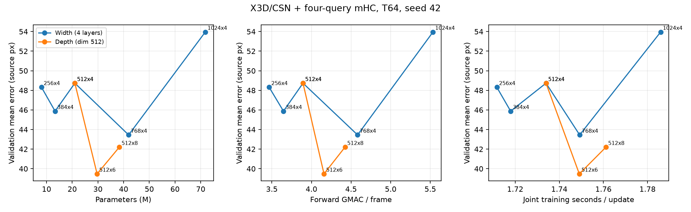

# 容量アブレーションの結果

共通CNN+DPTの10,000更新と、独立したTransformer 7条件の各6,000更新を完了。すべて固定validationで評価した。

| 条件 | mean px | median px | P95 px | ≤20px | params M | GMAC/frame | 定常 s/update | peak GiB |
|---|---:|---:|---:|---:|---:|---:|---:|---:|
| dim256・4層 | 48.318 | 21.932 | 201.501 | 44.48% | 8.026 | 3.466 | 1.712 | 12.914 |
| dim384・4層 | 45.877 | 19.553 | 190.906 | 51.23% | 13.311 | 3.646 | 1.718 | 13.054 |
| dim512・4層 | 48.733 | 25.800 | 184.108 | 30.59% | 21.021 | 3.893 | 1.734 | 13.230 |
| dim768・4層 | 43.450 | 17.637 | 185.238 | 56.65% | 41.947 | 4.582 | 1.749 | 13.621 |
| dim1024・4層 | 53.957 | 29.466 | 187.446 | 21.85% | 71.785 | 5.534 | 1.786 | 14.151 |
| dim512・6層 | 39.471 | 13.210 | 178.311 | 67.26% | 29.673 | 4.158 | 1.749 | 13.429 |
| dim512・8層 | 42.204 | 17.442 | 170.289 | 57.04% | 38.325 | 4.423 | 1.761 | 13.623 |

誤差・距離内率は85,473 observed frameが分母。全128,668 owner frameの同一性と、全query条件の抽出・拡張の一致を照合した。
定常時間はCNN凍結解除後の更新の中央値。peakは学習中の最大allocated VRAM。GMACはforwardのConv/Linear/attention行列積で、正規化・活性化・MDD・backward等を含まない。

容量はCNNを含む総パラメータ数で定義し、隣接条件の改善量をlog2(パラメータ比)で割った。全比較値はsummary.jsonへ保存した。

seed 42の各1回であり、条件差がseedのばらつきを超えるかは判断できない。独立testは未評価。CNNが異なる過去実験との直接の優劣比較、sceneモデルの採用変更は行っていない。

