# DINOv3サイズ比較：後続容量共通

Transformer・DPT・headの構成と評価条件を照合済み。backboneは完全凍結。

## synthetic_court-test (886 images)

| Model | KP px ↓ | SEG mIoU ↑ | LINE Dice ↑ | semantic LINE mIoU ↑ | pose再投影 px ↓ | 位置 m ↓ | 回転 deg ↓ | 焦点相対誤差 ↓ |
|---|---:|---:|---:|---:|---:|---:|---:|---:|
| ViT-S/16 | 4.03497 | 0.949435 | 0.637084 | 0.448173 | 184.275 | 0.672094 | 2.49063 | 0.0624117 |
| ViT-S+/16 | 4.12667 | 0.949411 | 0.6443 | 0.454984 | 14.2553 | 0.680153 | 2.3258 | 0.0644243 |
| ViT-B/16 | 3.98613 | 0.95213 | 0.644749 | 0.459139 | 11.0905 | 0.572389 | 1.75617 | 0.0622273 |
| ViT-L/16 | 4.48782 | 0.951502 | 0.650072 | 0.461894 | 9.58015 | 0.528094 | 1.77576 | 0.0546903 |

poseは合成V3の教師に対して評価。

### B00:court-sample-000897

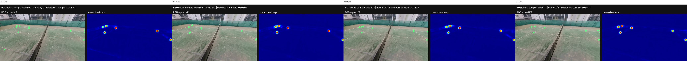

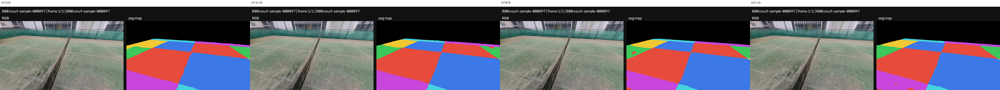

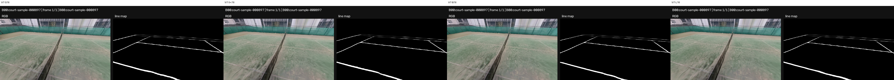

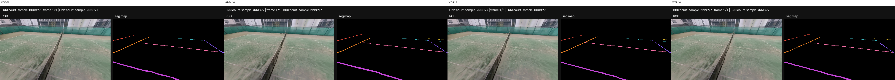

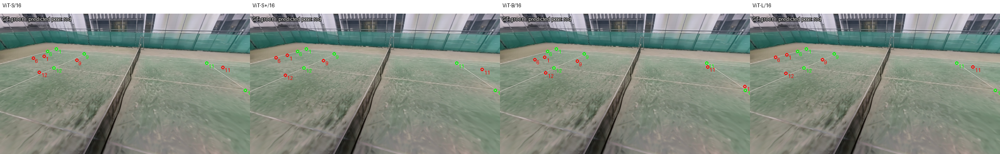

### B01:court-sample-000778

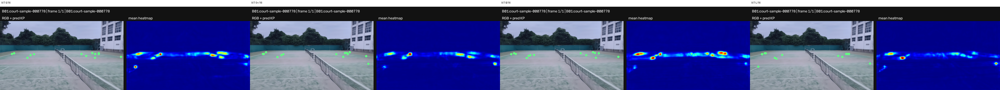

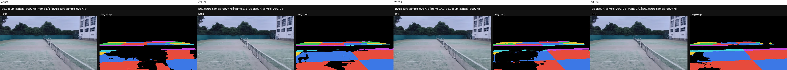

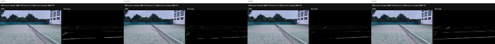

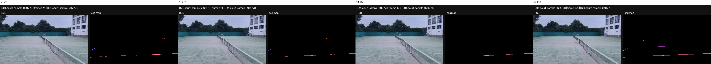

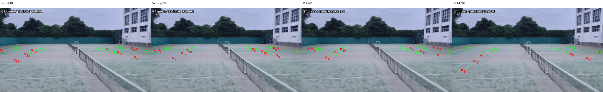

### B02:court-sample-001206

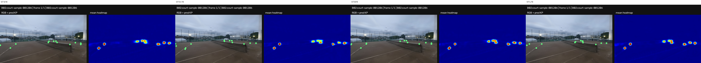

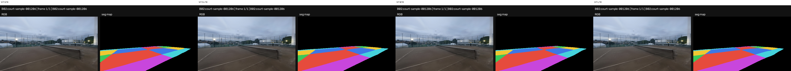

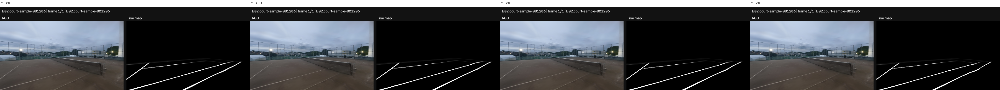

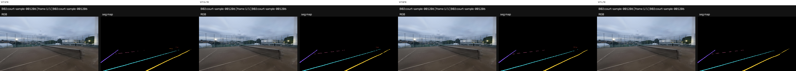

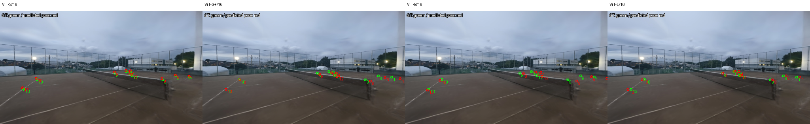

### B03:court-sample-001911

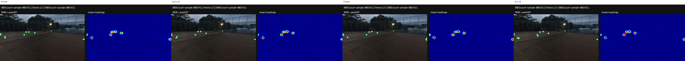

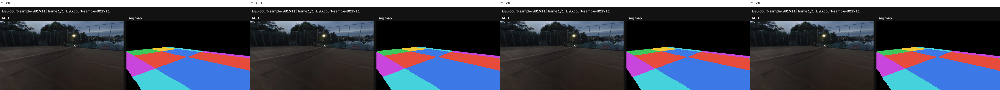

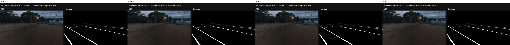

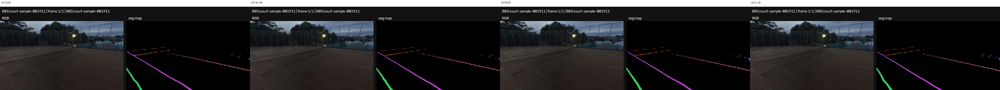

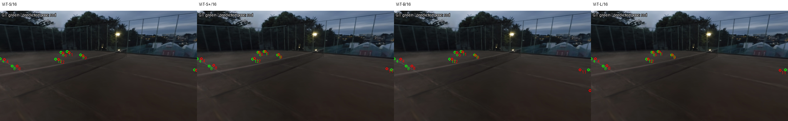

## tennis_court_detector-val (2211 images)

| Model | KP px ↓ | SEG mIoU ↑ | LINE Dice ↑ | semantic LINE mIoU ↑ |
|---|---:|---:|---:|---:|
| ViT-S/16 | 1.34646 | 0.96959 | 0.705336 | 0.484466 |
| ViT-S+/16 | 1.3426 | 0.969571 | 0.705545 | 0.484569 |
| ViT-B/16 | 1.34265 | 0.969752 | 0.7061 | 0.484282 |
| ViT-L/16 | 1.36751 | 0.970107 | 0.707917 | 0.485927 |

実画像のposeは教師がないためN/A。

### EF-hx40Q4Mg_700

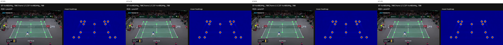

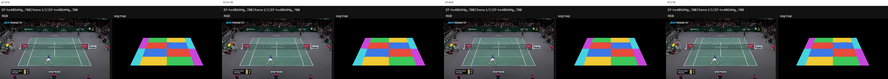

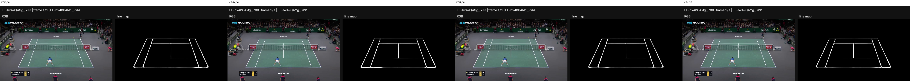

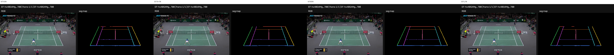

### 3_2qe9xXnuw_2400

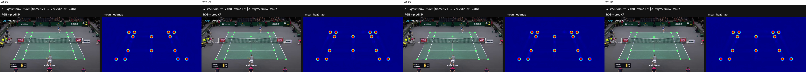

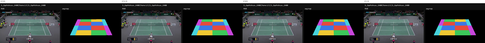

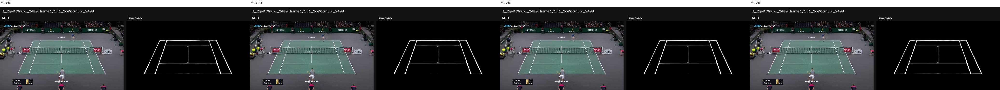

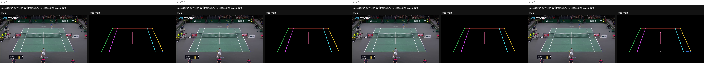

### xzjBgO51hsA_1350

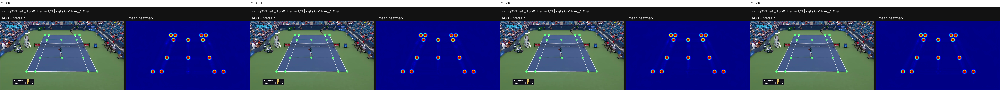

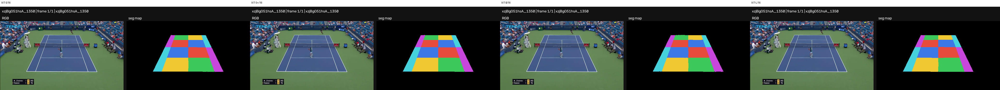

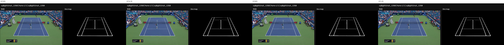

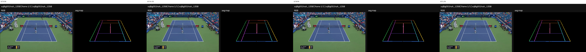

### 8iUbr7o5v2w_1650

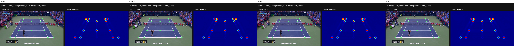

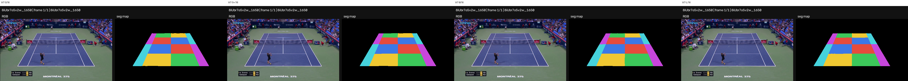

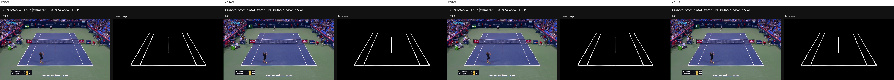

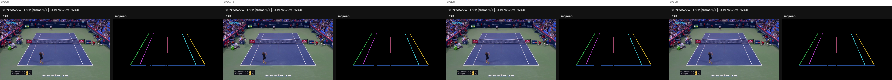

## パラメータ数

| Model | 凍結backbone | 学習射影 | 共通後続 |
|---|---:|---:|---:|
| ViT-S/16 | 21601152 | 1576960 | 128635436 |
| ViT-S+/16 | 28697472 | 1576960 | 128635436 |
| ViT-B/16 | 85669632 | 3149824 | 128635436 |
| ViT-L/16 | 303154176 | 0 | 128635436 |

KPは可視点全体の距離、mIoUは背景を含む全クラスの累積intersection/union、LINEは画像ごとのcoverage Diceの平均。
定性画像は固定IDをbatch 1で推論し、定量評価は記録した共通batch sizeを使用。
