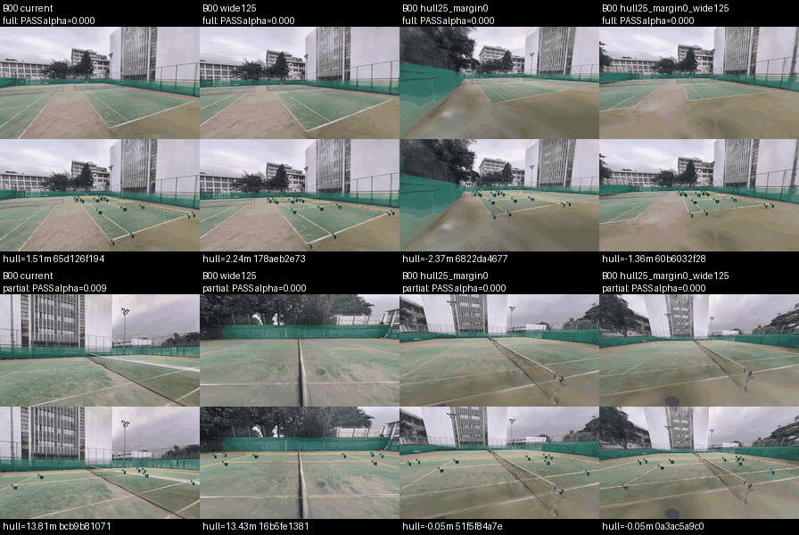
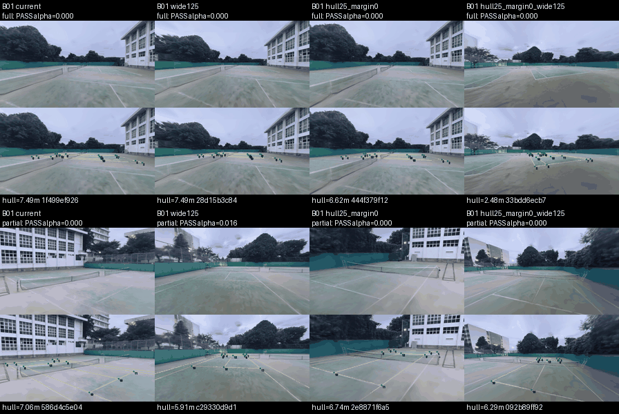
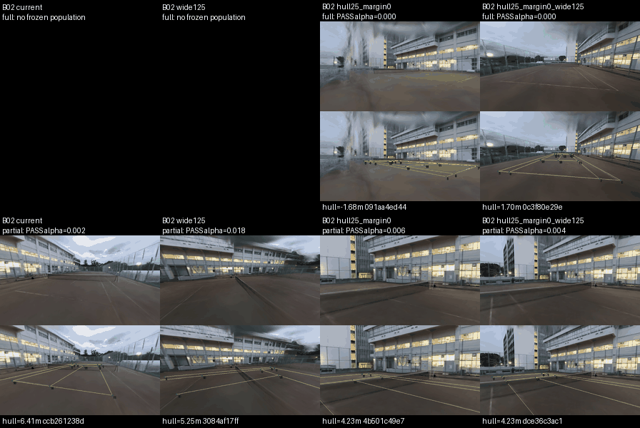
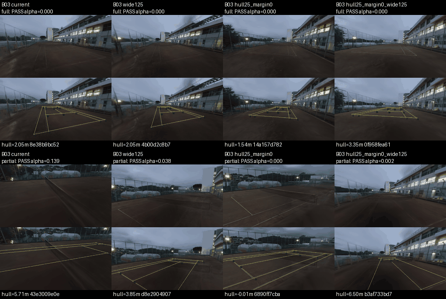

# D2凍結192視点のL4比較

## 結論

CPUで全192カメラのrequest構築・scene検証・JSON保存をsubprocess直前まで検査した後、同じ凍結対象をL4で1回だけ描画した。NHTへ依頼した192枚すべてが完成し、D5を通った。描画processは正常終了したがworkerの周期保存に失敗し、既存jobのsaveだけを再試行してDrive保存を完了した。描画は再実行していない。

**D2の変更候補には、hull拡張25%・内側margin 0m・HFOV 92.5/110/125°の組合せを推奨する。ただし本実験の開始は、親が残る画質不良と支持範囲差を受け入れるか判断するまで保留する。** この候補は4候補中で全4sceneのfullを最も増やし、今回のQA・alpha診断では新しい不採択を生じなかった。一方、原画にはhull外の伸び・ぼけとB03の暗さが残り、fullやD5 PASSを画質合格とは呼べない。

今回の観測は新規視点のQA・画質・費用であり、学習精度や収束の比較ではない。元の採用画像・評価testを条件選択に使用せず、前回のval支持範囲診断を比較の前提として保持した。src、本番recipe、採用資産、旧run、checkpoint保持は変更していない。

## 予算・固定条件・失敗の保存

親は描画上限200を「実際にNHTへ依頼したcamera数」と判断した。前回のdraw_attempts=12・completed_frames=0という台帳と、NHT呼び出し0という根拠は[予算記録](budget.json)から参照する。今回の実依頼192枚と合わせた実消費は192枚、残り8枚で、追加・補充は行わない。

4条件×4scene×12枚、seed42、128軌道prefix・密度0、既存のD5（対象renderer可視KP≥4、ROI穴≤1%）とD6（stable ID由来1m jitter）を維持した。選択・camera・projectionのdigestを凍結値と照合した。共有一時rootを絶対pathにするadapterだけで前回のpath契約違反を避け、生成・選択・QAのsrcには変更を加えていない。

最初のsetup提出はNotebook接続断で未実行のままcancel・保存し、同じL4へ再接続してsetupした。描画後のsave_failedは[初回status](evidence/render-probe-status-final.json)に残し、[save receipt](evidence/render-save.json)と[保存後status](evidence/render-probe-status-saved.json)を分けて保存した。rclone copyの600秒制限が有力だが、例外表示はOSErrorとTimeoutExpiredを区別しないため断定しない。rawを含む多数ファイルの部分保存は384件→507件と進んでいた。saveは既存結果の保存であり、NHT呼び出しを増やしていない。

全5job（未実行cancelのsetup、setup-reconnected、render-probe、collect-review、環境記録）のterminalとDrive保存を確認してColabをstopした。2026-10-24 14:31 JSTの[stop receipt](evidence/stop.json)と[停止後割当0件](evidence/doctor-after-stop.json)を保持する。回収されたtracked patchは空・untracked sourceは0件。

## QA・写り方・alpha診断

層は前回と同じin_frame_kp14_v1（full=14、near_full=12–13、partial≤11）。以下は採択数/描画数。0/0は該当する幾何母集団が無いことを示し、採択率を計算しない。拒否理由は全16scenarioで空、ROI穴率は全192枚で0だった。alpha<0.9は診断のままで、閾値化・再採択・除外は行っていない。

| 候補 | scene | full | near_full | partial | ROI alpha<0.9 最大(%) |
|---|---|---:|---:|---:|---:|
| current | B00 | 3/3 | 2/2 | 7/7 | 0.898 |
| current | B01 | 4/4 | 4/4 | 4/4 | 0.000 |
| current | B02 | 0/0 | 0/0 | 12/12 | 0.203 |
| current | B03 | 2/2 | 2/2 | 8/8 | 13.883 |
| wide125 | B00 | 4/4 | 4/4 | 4/4 | 0.000 |
| wide125 | B01 | 4/4 | 4/4 | 4/4 | 1.585 |
| wide125 | B02 | 0/0 | 4/4 | 8/8 | 4.594 |
| wide125 | B03 | 4/4 | 4/4 | 4/4 | 3.776 |
| hull25_margin0 | B00 | 4/4 | 4/4 | 4/4 | 0.000 |
| hull25_margin0 | B01 | 4/4 | 4/4 | 4/4 | 0.000 |
| hull25_margin0 | B02 | 4/4 | 4/4 | 4/4 | 0.561 |
| hull25_margin0 | B03 | 4/4 | 4/4 | 4/4 | 0.000 |
| hull25_margin0_wide125 | B00 | 4/4 | 4/4 | 4/4 | 0.000 |
| hull25_margin0_wide125 | B01 | 4/4 | 4/4 | 4/4 | 1.760 |
| hull25_margin0_wide125 | B02 | 4/4 | 4/4 | 4/4 | 0.446 |
| hull25_margin0_wide125 | B03 | 4/4 | 4/4 | 4/4 | 0.171 |

12枚を写り方で層別抽出したraw採択率を、そのまま母集団率としない。参考値はscene・層ごとに凍結した幾何母集団N_hと標本n_hを使い、Σ N_h(a_h/n_h) / Σ N_hで計算した。各scene/候補12枚の小さい相関した標本であり、本番QA率を保証する推定ではない。N_hは128軌道prefixの幾何通過集合で、将来prefix・高密度の全集合ではない。

| 候補 | raw QA | N_h/n_h参考QA率 | 参考full割合(%) | alpha<0.9 raw p90 / max (%) | hull外の実見数 |
|---|---:|---:|---:|---:|---:|
| current | 48/48 | 100.0% | 0.47 | 0.604 / 13.883 | 0 |
| wide125 | 48/48 | 100.0% | 1.51 | 1.802 / 4.594 | 0 |
| hull25_margin0 | 48/48 | 100.0% | 4.79 | 0.000 / 0.561 | 17 |
| hull25_margin0_wide125 | 48/48 | 100.0% | 9.38 | 0.000 / 1.760 | 11 |

今回のQAが全通過なので、参考full割合は前回のCPU幾何full割合と一致する。これは独立した本番の画質合格率ではない。hull外は計28枚で、ROI alpha<0.9は全て0だったが、後述のぼけ・ghostが残る。実画像valのfull 98.48%との大きな差も残り、候補組合せのB02/B03 fullは幾何母集団の約3.06%/1.63%にとどまる。

## 原画・overlayの実見

全16contact sheet（192 RGB/overlay対）と8例の原寸640×360 RGB/overlayを実見した。明るさ補正や鮮鋭化をしていない。[visual-review.json](evidence/visual-review.json)に観察、[native-cases.json](evidence/native-cases.json)に選択規則とIDを保存した。

- B00: currentの近接・低視点にも地面・線のぼけがある。組合せ候補のhull外fullには前景・フェンスの伸びが残る。
- B01: 各候補に輪郭・白線を追えるfullがあるが、地面・ネット・木のぼけは残る。
- B02: current/wide125に無かったfullをhull25系が持つ。一方、hull25_margin0のhull外fullには建物・フェンスの大きなghostがあり、alpha診断0でも品質を保証しない。組合せ候補にも周縁のぼけが残る。
- B03: 全候補に暗い地面と薄い線が残る。fullでも明瞭な画質になったとは判定しない。

候補間は同じcameraの対応比較ではなく、同じprefix・層別規則による別の視点集合である。画質の差をD2単独の因果効果と呼ばず、Laplacian分散や輝度の集計も新QA閾値にしない。

全原画・overlayの閲覧入口はローカルtmp/court-d2-probe-l4b/review/index.html。各sceneの48視点を2fpsのスライドショー4本にし、全frameのdecodeを検証した。連続した軌道・時間の動画ではない。フル閲覧bundleのDrive path・hash・サイズは[cpu-review-archive.json](evidence/cpu-review-archive.json)と転送receiptを参照する。PNG図は縮小・palette化した診断例で、原寸画像の代わりにはしない。

## 時間・メモリ・保存量

詳細は[timing.json](evidence/timing.json)。親processのcProfileであり、NHT子processのrasterizer内部は分離していない。NHT public client時間はNHT subprocess時間を含むので足し合わせない。

| 計測 | 秒 |
|---|---:|
| uv sync | 26.634 |
| render-only NHT導入 | 943.379 |
| 採用bundle取得・verify | 59.950 |
| manifest・幾何照合 | 22.096 |
| setup計 | 1052.060 |
| 全4scene入力読込 | 24.374 |
| 192 camera復元・照合 | 234.634 |
| NHT subprocess計（16回、内部描画・初期化・public保存込み） | 75.640 |
| NHT public client計（上記を含む） | 78.795 |
| QA（192枚） | 2.031 |
| JPEG encoding | 0.247 |
| raw NPZ圧縮保存 | 122.915 |
| scenarioのrender/QA/archive計 | 228.969 |
| probe process全体 | 503.126 |
| process終了から保存回復後job終了まで | 620.036 |
| 上記のうちsave再試行のfinalizing→finished | 124.689 |
| collectorの最終保存 | 20.497 |

process後620秒には、失敗した周期保存の待機・状態調査・明示save前の待機・saveの最終保存を含む。純粋な転送秒数ではない。周期保存はprocessとも重なり、独立した合計転送時間は同定していない。

GPU観測peakは742MiB（device-wide、0.5秒間隔の標本で下限）。解放後は0MiB・compute process 0。public subprocess境界のためPyTorch allocator peakは測っていない。環境はL4、Torch 2.9.1+cu130、CUDA compiler 13.0.88、g++13.3で、[environment.json](evidence/environment.json)に固定した。

raw NPZは470,585,260B、192 JPEGは10,483,336B、frame recordは4,243,492B。raw・QA拒否も保存するprobeは、本番の採択JPEG-only publicationより大きい。本番の秒/枚・bytes/枚へNPZ圧縮やworker保存待ちを移植しない。回収はJPEG/JSONの約16MB bundleに限り、raw配列192件は元のDriveに保持した。probe＋回収bundleのinspectは505.22MB/605ファイル（環境記録・CPU閲覧bundle追加前）。環境記録とCPU閲覧archive追加後の[最終inspect](evidence/drive-output-final-inspect.json)は599,389,107B・607ファイルだった。

## 24k/48k/96k系列の条件付き費用再計算

新しい層別QA率とJPEGサイズ、今回のsetupを[既存の費用モデル](../run-court-scale-pilot-l4-20261023/cost-model.md)に入れ直した。式・全条件・scene補足は[costs.json](evidence/costs.json)。入力archive・非JPEG overhead・本番render/QA/local公開・cache制御・転送・学習・評価の係数は前回のまま。今回のraw保存probeを新しい本番throughputとして代入していない。

10k共通更新・warmup500・val/checkpoint2k、主要条件のseed43/44、代表3条件の独立40k、各学習run cold setup/full fetch、前回の全checkpoint保持枠を仮定する。これらは未採用の提案。範囲はpreflight固定/線形の感度で、信頼区間や時間上限ではない。scene補足は以下の総量の外。

| 候補 | 旧最大呼称 | 主比較L4 h | 追加seed/40k込みL4 h | Drive増分GB |
|---|---:|---:|---:|---:|
| current | 24,000 | 118.8–125.8 | 223.7–240.6 | 385.2 |
| current | 48,000 | 174.0–185.7 | 311.5–342.6 | 447.5 |
| current | 96,000 | 269.0–290.3 | 438.4–493.6 | 492.9 |
| wide125 | 24,000 | 117.6–124.8 | 222.3–239.7 | 385.3 |
| wide125 | 48,000 | 173.0–185.1 | 310.3–342.6 | 447.9 |
| wide125 | 96,000 | 268.4–290.5 | 437.6–495.1 | 494.0 |
| hull25_margin0 | 24,000 | 97.3–104.5 | 193.8–211.2 | 384.9 |
| hull25_margin0 | 48,000 | 142.5–154.6 | 266.1–298.3 | 447.4 |
| hull25_margin0 | 96,000 | 220.1–242.1 | 368.9–426.1 | 493.3 |
| hull25_margin0_wide125 | 24,000 | 97.0–104.2 | 193.4–211.0 | 384.9 |
| hull25_margin0_wide125 | 48,000 | 142.3–154.5 | 265.8–298.4 | 447.4 |
| hull25_margin0_wide125 | 96,000 | 220.0–242.2 | 368.7–426.7 | 493.3 |

組合せ候補の基準G96/sceneは採択約6,505枚、旧24k/48k/96k端点は約26,020/52,040/104,080枚という外挿になる。exact枚数や上限保証ではなく、補充して合わせない。128本prefixからの層別率をG96と将来の追加prefix/高密度へ移植している。

組合せ候補のDrive増分はdataset約16.02/25.85/45.40GBと、前回の全checkpoint枠約368.83/421.52/447.87GBが主成分。保持実装の再評価や変更はしていない。current/wide125の基準G128に対しhull25系はG96という計画の違いもあるので、費用差をD2だけの節約と解釈しない。

条件別rootへの保存を仮定し、条件間cache共有の節約は見込まない。数千cacheのDrive control/page費や、全JPEGを調べるpreflightの増加は未同定。今回の保存失敗もあり、費用表を保証値として本実験全体を一括起動することは推奨しない。最新残高336.34CUはアカウント観測であり、当runの課金や将来実行可能性を保証しない。

## 親が固定する数値への推奨

| 論点 | 推奨案と根拠 |
|---|---|
| D2 | 変更候補は拡張25%・margin0m・HFOV92.5/110/125°。4候補中の全面支持が最大で、今回のD5/alphaで新しい失敗は無い。ただし目視不良とvalとの支持範囲差は残る。本番採用は親の受入判断まで保留 |
| 最大系列 | まず旧24k系列（基準・2倍・4倍、A1/A2とBの計8主条件）。変更候補なら基準G96/scene、端点は約26kの参考値。48k/96kは約266–298h / 369–427hと増え、固定10k更新では大きいデータを十分に提示できない懸念もある |
| 共通更新 | 10k、warmup500、val/checkpoint2kを維持する案。前回の定常0.814秒/更新・batch8実測に基づく。80k画像提示は基準約6.5kで約12.3周、端点約26kで約3.1周。32更新の試走から収束を証明した値ではない |
| 追加seed | 生成seed42を固定し、学習43/44をbaseline・A1最大・A2最大・B1・B4に追加。同一条件は重複排除。旧24k系列では4条件×2追加=8run |
| 長時間代表 | baseline・A1最大・A2最大の3条件をseed42・40kの独立run/scheduleで比較。max_stepsを変えたresumeは行わない。未収束の検査であり、今回追加学習は実行していない |
| scene補足 | B02+B03を1条件、seed42・共通更新数で追加し、主B00+B01との同じ2scene比較にする。組合せ候補では追加約16.65–17.77h / 15.41GB。全組合せへの拡大は提案しない |

これらは提案であり、親の合意を#1343へ記録する受入条件は未完了。現production v1はProductionRecipeで現D2を固定しているため、D2採用には別途、明示した新しい本番recipe/版と境界検証が必要になる。比較recipeを既存production v1へ黙って渡したり、今回srcを修正したりしていない。親の合意前に本番生成・本学習は起動しない。

## 再現・検証と対象外

[reproduction.md](reproduction.md)にpush済み版・CPU preflight・回収とCPU再集計を記録し、[validation.json](validation.json)に実行コマンドと結果を残す。[repro.sh](repro.sh)は回収済みbundleからQA集計・費用・時間を再生成してbyte照合する。Colab開始・NHT・学習は起動しない。

通常テスト40件、path契約3ケース、旧費用300項目とsetup更新表60項目の一致を確認した。全192画像の回収hash、QA bindingと理由、frozen selection、NHT依頼台帳を照合し、4動画の48frame decodeを検証した。画質・精度の統計的保証、追加seed、長期学習、main実験、src/recipe変更、採用資産・評価testの条件選択、checkpoint保持は今回の対象外。
