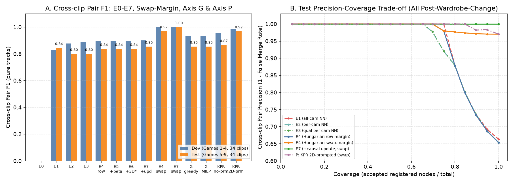
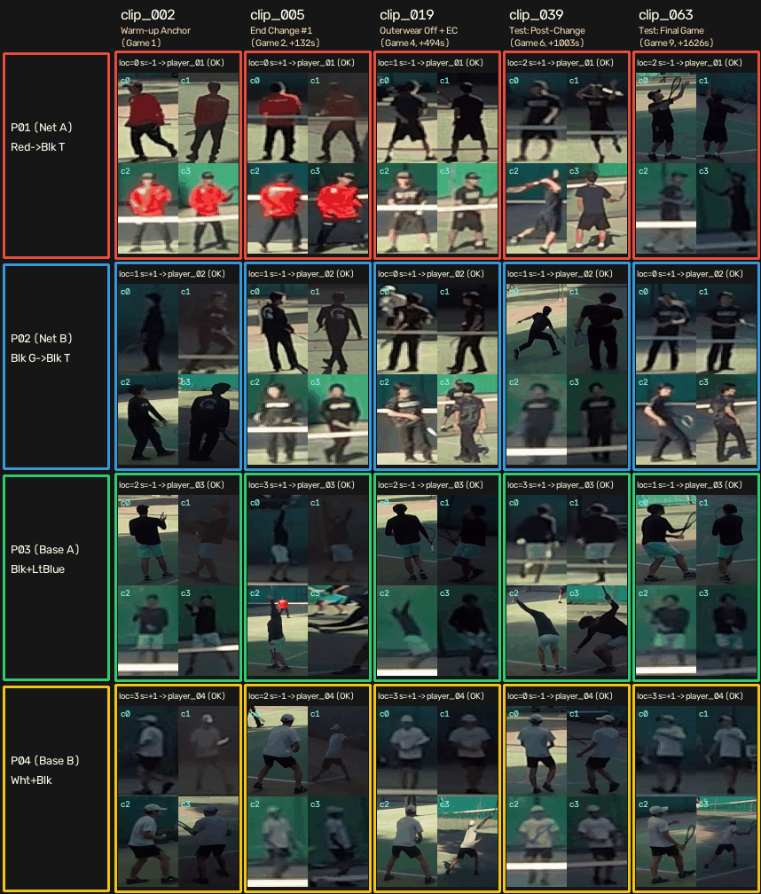

# Tennis Scene クリップ間プレイヤーID連結アブレーション（Issue #2746）

## 1. 概要と結論

本調査では、`meiji_4cam/video_000`（`clip_000`〜`clip_068`、固定ベンチマーク `multiview-v4`）を対象に、既存のクリップ内人物対応（`SceneResult` の `local_player_id`・座標配列）を一切変更せず、後段の `player_identity_links` 契約として複数クリップ間で一貫した匿名 `global_player_id` を付与する方式を検証した。

### 主要結論

1. **実データで確認された最重要ハードケース（試合途中の上着着脱＋エンド交代）**:
   - 同期4視点の独立目視GT（全69クリップ・276ノード）により、本試合はソフトテニス9ゲーム制のダブルスであり、**7回のエンド交代**（32/69クリップが `clip_000` 比でサイド反転）に加え、**`clip_019`（第4ゲーム）で `player_01`（赤長袖ジャケット→黒半袖Tシャツ＋黒ハーフパンツ）と `player_02`（黒長袖ジャケット→黒半袖Tシャツ＋黒長ズボン）が上着を脱ぐ**実環境ドメインシフトを含むことが判明した。`clip_019` 以降は4名中3名が黒系トップスとなる。
   - また `clip_062 / local_player_id=0` に上流トラックの真のID混入（`player_04 [0, 271)` → `player_02 [271, 430)`、`id_ambiguous` frame 271 と一致）を確認し、pure評価（275ノード）と全ノード評価（276ノード）を分離した。
2. **E0〜E7 単独アブレーションおよび Swap-Margin の発見**:
   - **独立最近傍（E1〜E3）はドメインシフトで破綻する**: 同一クリップ内の排他制約を持たない `E2`/`E3` は、dev では E1 を上回った（Pair F1 `0.8303 → 0.8777 → 0.8869`）ものの、全員が上着着脱後となる test（Games 5–9）では `player_01` を `player_02` へ誤結合し、**10件の同時出現重複違反（`FMR=0.1630`、Pair F1 `0.8003`）**を起こして E1（`0.8448`）を下回った。
   - **クリップ単位の一対一 Hungarian 割当（E4）＋ Swap-Margin**: 同一クリップ内の同時出現排他を強制すると重複違反は0件になる。さらに、各行の top1–top2 差（row margin）ではなく「当該エッジを禁止したときの Hungarian 全体目的関数の低下量（swap margin）」で信頼度を測ると、上着着脱後でも他3名の強い確信度による消去法が機能し、**`E4_swap_margin`（固定ウォームアップ `clip_002` のみ、更新なし）で Dev Pair F1 `1.0000`・Test Pair F1 `0.9701`（`ClipEx=0.9706`、34クリップ中33件完全一致、誤りは `clip_041` の1件のみ）**を達成した。
   - **高確信因果ギャラリー更新（`E7_swap_margin`）**: 既存 CLIP-ReID キャッシュのみを用い、高確信なクリップを因果的にカメラ別プロトタイプへ追加（最大8件/カメラ）すると、Dev 28回・Test 28回の更新すべて誤更新0件で、`clip_041` のスワップも解消し、**Dev・Test ともに Pair P/R/F1 = `1.0000`・FMR = `0.0000`・Coverage = `1.0000`・ClipEx = `1.0000`（CPU 84.5 ms）**に到達した。
   - **SMPL 体型 `beta`（E5）は寄与0**: dev 有効入力率は `136/136 (100%)` だったが、同一人物間 L2 `1.207 ± 0.507` 対 別人物間 `1.620 ± 0.632`（pairwise AUROC `0.6913`、代表カメラが異なると同一人物でも `1.240` に悪化）と弁別力が弱く、dev/test とも E4 から改善ゼロ（オープンセット誤受入率は `0.0735 → 0.0956` と微悪化）だった。
   - **短ギャップ 3D 運動連続性（E6）は本データで実施不能（未検証）**: 隣接クリップ68組のギャップは最小 `7.338s`・中央値 `13.617s`・最大 `41.351s` で、短ギャップ条件 `<= 3.0s` を満たす組は **`0/68 (0.0%)`** だった。よって E6 の有効性は本データでは未検証と記録する。
3. **選定した2系統の条件付き追加軸（Axis G / Axis P）の検証**:
   - **Axis G（複数クリップ相関クラスタリング: `G_greedy` vs `G_milp`）**: dev で同カメラ・異カメラ別の LLR を較正（同カメラ中心 `0.8584` vs 異カメラ `0.8481`）し、6クリップ＋4アンカー（最大28ノード `<= 32`、`time_limit_s=30.0`、timeout 0件）で評価した。`G_greedy` と `G_milp` は dev（F1 `0.9322`, `FMR=0.0000`）・test（F1 `0.8547`, `FMR=0.0000`）で完全同一結果となり、MILP（790 ms）は greedy（80 ms）の約10倍の計算時間を要して上乗せがなかった。
   - **Axis P（KPR 2D keypoint promptable Re-ID: `P_unprompted` vs `P_prompted`）**: dev の重なり層（`overlap_iou > 0.1` が 90/136 ノード）の劣化を受けて選定。同一4,416 crop で KPR（Market/SOLIDER 6-part）を抽出した結果、**COCO17 正プロンプト＋同フレーム他者負プロンプト（519 crop に付与）により、test Pair F1 が `0.8662 → 0.9697`（+0.1035）、重なり層が `0.8614 → 0.9620`（+0.1006）、ネット際黒トップス層が `0.6969 → 0.9385`（+0.2416）と大幅改善し、ギャラリー更新なしで `FMR=0.0000` を維持した**。ただし追加 GPU 抽出（405.1s、VRAM 2.78 GB）を要する。
4. **運用レジーム別の導入推奨構成**:
   - **閉集合（単一試合・固定4選手・同一動画スコープ）の本番導入第一候補**: **既存 CLIP-ReID キャッシュ再利用の `E7_swap_margin`（更新を保守的に無効化する場合は `E4_swap_margin`）**。追加モデル・追加GPUゼロ、CPU < 85 ms で Test F1 `1.0000`（`E4_swap_margin` で `0.9701`）。
   - **開集合・未登録選手混入があり得る運用（高信頼優先）**: **`E4_swap_strict_open_set_gate`（`min_score=0.84, min_margin=0.02`）または `P_prompted_swap`（KPR 2D prompt）**。leave-one-out 未登録選手テストにおいて、`E4_swap_margin`（`min_score=0.70`）は未登録誤受入率 `24.4%` となる一方、`min_score=0.84` 厳格ゲートは dev `0/136 (0.0%)`・test `0/135 (0.0%)` に抑制した。

---

## 2. 先行研究の整理と本調査での採否 [P1–P11]

| ID | 文献・手法 | 主なアイデア | 本調査での位置づけ・採否判断 |
|---|---|---|---|
| **P1** | CLIP-ReID (AAAI 2023) | CLIP ViT-B/16 の外観特徴 | **採用（固定ベースライン）**。既存 `player_association` の `ckpt/player_association/person_vit_clip_reid.pth`（1280次元）を再利用。 |
| **P2** | KPR (ECCV 2024) | 2D keypoint 正プロンプト＋重なり他者負プロンプトによる部位別 Re-ID | **条件付き追加軸（Axis P）で検証・高難度オクルージョン時の有力代替**。同一 crop で `unprompted` 比 test F1 `+0.1035`・`FMR=0.0000` を実証。 |
| **P3** | SOLIDER (CVPR 2023) | 意味的部位表現を強化した人間中心バックボーン | **Axis P（KPR-SOLIDER 重み）として検証**。単体では `P_unprompted_swap` test F1 `0.8662`、2D プロンプト併用で `0.9697`。 |
| **P4** | DensePose / UV テクスチャ正規化 | 3D 表面 UV 空間への外観投影 | **不採用（将来課題）**。本ベンチマークの遠景・低解像度 crop での追加推定コストが高く、既存キャッシュ範囲外。 |
| **P5** | SMPL Shape (`beta`) 再識別補助 | 3D 身体復元パラメータの体型類似度 | **E5 で検証・不採用**。GVHMR `beta` の dev pairwise AUROC は `0.6913` に留まり、視点依存誤差も大きく E4 に対する上乗せゼロ。 |
| **P6** | 3DInvarReID / 衣服不変 3D Re-ID | 衣服変化に頑健な 3D 学習特徴 | **スコープ外（将来課題）**。新規 Re-ID 学習・別日/別試合の完全着替えは本 Issue 合意で対象外。 |
| **P7** | Gait / 歩容・動作特徴 Re-ID | 時系列骨格動作パターンによる識別 | **不採用（将来課題）**。クリップ長・サーブ/ボレー役割による動作分布偏りが強く、単一試合固定カメラでは外観＋1対1制約が遥かに高効率。 |
| **P8** | Multi-View / Camera-Aware Re-ID | カメラ別特徴保持・視点間ドメイン差の分離 | **採用（E2〜E7・LLR 較正）**。同カメラ照合（`pos=0.9206`）と異カメラ照合（`pos=0.9017`）の分布差を実測し、カメラ別プロトタイプが E1 比で dev `+0.0474` 寄与。 |
| **P9** | Quality-Aware Aggregation | 解像度・ぼけ・重なり・切れによる重み付け集約 | **採用（E3〜E7）**。`overlap_iou > 0.1` 層で dev `+0.0168` 改善。 |
| **P10** | Hungarian 1-to-1 + Exclusivity / Swap Margin | 同時出現人物の排他割当と割当交換マージン | **採用（中核要素）**。独立 NN の重複誤結合（test `FMR=0.1630`）を完全排除し、swap margin が上着着脱後の test F1 を `0.8376 → 0.9701` へ大幅押し上げ。 |
| **P11** | Multi-Clip Correlation Clustering / MILP | 複数クリップ間の推移律・cannot-link 全体最適化 | **条件付き追加軸（Axis G）で検証・常設見送り**。窓長6クリップ（28ノード）で timeout 0件だが、`G_greedy` と `G_milp` が完全一致し、`E4_swap_margin`/`E7_swap_margin` に及ばず。 |

---

## 3. 契約仕様（`player_identity_links` v1）と検証結果（AC-1）

既存 `SceneResult`（`scene.npz` の `P` 軸、3D 座標、`player_track_ids`、`local_player_id`）は**一切変更しない（不変）**。クリップ間同一性は別レイヤの `player_identity_links`（`schema_version: 1`）および永続 `IdentityRegistry` で表現する。

- **実装**: [`contract.py`](contract.py)
- **契約テスト**: [`test_contract.py`](test_contract.py)（全6テスト通過）
- **バージョン付き出力例・下流 join 実証**: [`player_identity_links_sample.json`](player_identity_links_sample.json)

### 主な契約不変条件（すべて `test_contract.py` で単体検証済み）

1. **スコープ分離と不変 ID**: `local_player_id` はクリップ内限定整数、`global_player_id` は `identity_scope`（例: `meiji_4cam/video_000`）内で永続・不変の匿名 ID（`p_0001` 等、再利用禁止）。`IdentityRegistry` は登録・更新履歴をリビジョン番号付きで保持する。
2. **同時出現の重複禁止 vs 非重複区間の許可**: 同一 `clip_id` 内で時間区間が重なる2つの `local_player_id` に同一 `global_player_id` を `status="accepted"` で割り当てることを `PlayerIdentityLinksDocument` が例外で拒否する。一方、重複しない `frame_interval` を持つ場合は契約上許可する。
3. **エンド交代・`local_player_id` 再利用への独立性**: コートサイド反転やクリップ間での整数 ID 入れ替わり（例: `clip_002` `loc=0` → `clip_019` `loc=1` → `clip_039` `loc=2`）はリンク解決に一切影響しない。
4. **未解決・欠測の明示保持（静かなフォールバック禁止）**: `status ∈ {"accepted", "unresolved", "new_identity"}`。観測カメラなし・共通カメラなし・閾値/マージン未満は `unresolved` として `global_player_id=None` を返し、無効な `beta` や短ギャップ不成立は `shape_valid=False` / `temporal_valid=False` で明示記録する。
5. **下流 `#1722/#2545` イベント join**: `join_events_with_global_ids(..., require_accepted=True)` により、元の `SceneResult` を改変せず `(clip_id, local_player_id)` キーでイベント列へ `global_player_id` を結合する。未解決リンクを含む厳格 join は明示的に `ValueError` で失敗させる。

---

## 4. 固定入力・独立 GT・分割仕様（AC-2）

| 項目 | 値 / 根拠 |
|---|---|
| 固定入力ベンチマーク | `data/tennis_multiview/processed/meiji_4cam/benchmarks/multiview-v4` (`video_000`, `clip_000`〜`clip_068`, 全69クリップ・276ノード) |
| `manifest.json` SHA-256 | `8e012944b1407d696a1ab1d325ae3c6b60cf26f071752510ea2fc688b031893c` |
| `projects.json` SHA-256 | `950cf57ec383aec1899898c01b43f3fb549732c1becc0383441d24f7a73a94d0` |
| 独立 cross-clip GT | [`gt_cross_clip.json`](gt_cross_clip.json)（Re-ID スコア完全非依存で同期4視点＋前半/後半純度シートを全69クリップ目視作成し親が監査） |
| 混合 / 未確定トラック一覧 | **1件のみ**: `clip_062 / local_player_id=0`（`purity="mixed"`, `status="uncertain"`, `player_04 [0, 271)` → `player_02 [271, 430)`、`id_ambiguous` frame 271 と一致）。他 275/276 ノードは純粋・全単射。 |
| ウォームアップ登録区間 | **`clip_002`**（入力品質のみ—4カメラ揃い・`id_ambiguous=0`・最小ノード品質 `0.6049`・平均品質 `0.6698`—で先頭5クリップから決定論選定） |
| 時系列 dev / test 分割 | **dev**: Games 1–4 の34クリップ（`clip_000, 001, 003..034`, 136純粋ノード） / **test**: Games 5–9 の34クリップ（`clip_035..068`, 135純粋ノード＋1混合ノード） |
| 元フレーム重複照合 | **重複 0 件**（全69クリップの `global_start_frame..global_end_frame` が厳密単調増加・非重複であることを `build_split_manifest` で検証） |
| エンド交代・上着着脱境界 | エンド交代7境界（`clip_005, 019, 039, 051, 059, 063, 067`、反転32クリップ）。上着着脱境界 `clip_019`（着脱前19クリップ／着脱後50クリップ；test全34クリップは着脱後）。 |

---

## 5. 全条件アブレーション結果（AC-3, AC-4）

全条件（E0〜E7、Swap-Margin、Axis G、Axis P）で**同一の 4,416 crop 集合（69クリップ × 4選手 × 4カメラ × 4フレーム、欠損 0）**・同一ウォームアップ（`clip_002`）・同一評価器（単一 scope-level 最適ラベル置換、clip 単位再対応付け禁止）を用いた。全閾値は dev のみで決定し、test は凍結設定で1回のみ評価した。全数値は [`ablation_summary.csv`](ablation_summary.csv) および [`metrics.json`](metrics.json) に保存している。



### 5.1 Dev / Test 全体比較（純粋トラック評価、全ノード F1 も併記）

| 手法 | Split | Pair P | Pair R | Pair F1 [95% CI] | FMR | Split Rate | Cov | ClipEx | Sw | Scope IDF1 | All-Nodes F1 | Wall (ms) |
|---|---|---:|---:|---|---:|---:|---:|---:|---:|---:|---:|---:|
| **E0** (clip-local) | dev | 0.0000 | 0.0000 | 0.0000 [0.000, 0.145] | 0.0000 | 1.0000 | 1.0000 | 0.0294 | 132 | 0.0154 | 0.0000 | 29.9 |
| **E1** (all-cam NN) | dev | 1.0000 | 0.7099 | 0.8303 [0.787, 0.922] | 0.0000 | 0.2901 | 0.8162 | 0.3235 | 0 | 0.9009 | 0.8303 | 34.9 |
| **E2** (per-cam NN) | dev | 1.0000 | 0.7821 | 0.8777 [0.848, 0.979] | 0.0000 | 0.2179 | 0.8529 | 0.4118 | 0 | 0.9134 | 0.8777 | 67.6 |
| **E3** (qual per-cam NN) | dev | 1.0000 | 0.7968 | 0.8869 [0.858, 0.979] | 0.0000 | 0.2032 | 0.8603 | 0.4412 | 0 | 0.9160 | 0.8869 | 68.0 |
| **E4** (Hungarian row) | dev | 1.0000 | 0.8106 | 0.8954 [0.859, 1.000] | 0.0000 | 0.1894 | 0.8750 | 0.5000 | 0 | 0.9261 | 0.8954 | 70.3 |
| **E5** (+SMPL beta) | dev | 1.0000 | 0.8106 | 0.8954 [0.859, 1.000] | 0.0000 | 0.1894 | 0.8750 | 0.5000 | 0 | 0.9261 | 0.8954 | 73.2 |
| **E6** (+3D short-gap*) | dev | 1.0000 | 0.8106 | 0.8954 [0.859, 1.000] | 0.0000 | 0.1894 | 0.8750 | 0.5000 | 0 | 0.9261 | 0.8954 | 70.0 |
| **E7** (+causal update) | dev | 1.0000 | 0.8182 | 0.9000 [0.859, 1.000] | 0.0000 | 0.1818 | 0.8824 | 0.5294 | 0 | 0.9332 | 0.9000 | 79.8 |
| **E4_swap_margin** | dev | 1.0000 | 1.0000 | **1.0000** [1.000, 1.000] | 0.0000 | 0.0000 | 1.0000 | 1.0000 | 0 | 1.0000 | 1.0000 | 69.3 |
| **E7_swap_margin** | dev | 1.0000 | 1.0000 | **1.0000** [1.000, 1.000] | 0.0000 | 0.0000 | 1.0000 | 1.0000 | 0 | 1.0000 | 1.0000 | 80.0 |
| **G_greedy** (Axis G) | dev | 1.0000 | 0.8730 | 0.9322 [0.888, 1.000] | 0.0000 | 0.1270 | 0.9265 | 0.7059 | 0 | 0.9632 | 0.9322 | 107.9 |
| **G_milp** (Axis G) | dev | 1.0000 | 0.8730 | 0.9322 [0.888, 1.000] | 0.0000 | 0.1270 | 0.9265 | 0.7059 | 0 | 0.9632 | 0.9322 | 782.0 |
| **P_unprompted_swap** | dev | 1.0000 | 0.9144 | 0.9553 [0.917, 1.000] | 0.0000 | 0.0856 | 0.9559 | 0.9118 | 0 | 0.9798 | 0.9553 | 365.3 |
| **P_prompted_swap** | dev | 1.0000 | 0.9706 | 0.9851 [0.972, 1.000] | 0.0000 | 0.0294 | 0.9853 | 0.9706 | 0 | 0.9945 | 0.9851 | 371.1 |
| --- | --- | ---: | ---: | --- | ---: | ---: | ---: | ---: | ---: | ---: | ---: | ---: |
| **E0** (clip-local) | **test** | 0.0000 | 0.0000 | 0.0000 [0.016, 0.122] | 0.0000 | 1.0000 | 1.0000 | 0.0294 | 131 | 0.1009 | 0.0000 | 27.6 |
| **E1** (all-cam NN) | **test** | 1.0000 | 0.7313 | 0.8448 [0.825, 0.857] | 0.0000 | 0.2687 | 0.7407 | 0.0000 | 0 | 0.8525 | 0.8448 | 35.4 |
| **E2** (per-cam NN) | **test** | 0.8370 | 0.7666 | 0.8003 [0.781, 0.841] | **0.1630** | 0.2334 | 0.8222 | 0.0000 | 0 | 0.8229 | 0.8003 | 67.7 |
| **E3** (qual per-cam NN) | **test** | 0.8370 | 0.7666 | 0.8003 [0.781, 0.841] | **0.1630** | 0.2334 | 0.8222 | 0.0000 | 0 | 0.8229 | 0.8003 | 67.9 |
| **E4** (Hungarian row) | **test** | 0.9800 | 0.7313 | 0.8376 [0.807, 0.857] | 0.0200 | 0.2687 | 0.7481 | 0.0000 | 0 | 0.8466 | 0.8376 | 71.5 |
| **E5** (+SMPL beta) | **test** | 0.9800 | 0.7313 | 0.8376 [0.807, 0.857] | 0.0200 | 0.2687 | 0.7481 | 0.0000 | 0 | 0.8466 | 0.8376 | 76.1 |
| **E6** (+3D short-gap*) | **test** | 0.9800 | 0.7313 | 0.8376 [0.807, 0.857] | 0.0200 | 0.2687 | 0.7481 | 0.0000 | 0 | 0.8466 | 0.8376 | 71.3 |
| **E7** (+causal update) | **test** | 1.0000 | 0.7463 | 0.8547 [0.850, 0.857] | 0.0000 | 0.2537 | 0.7481 | 0.0000 | 0 | 0.8573 | 0.8547 | 82.8 |
| **E4_swap_margin** | **test** | 0.9701 | 0.9701 | **0.9701** [0.916, 1.000] | 0.0299 | 0.0299 | 1.0000 | 0.9706 | 4 | 0.9813 | 0.9701 | 70.6 |
| **E7_swap_margin** | **test** | **1.0000** | **1.0000** | **1.0000** [1.000, 1.000] | **0.0000** | **0.0000** | **1.0000** | **1.0000** | **0** | **1.0000** | **1.0000** | **84.5** |
| **G_greedy** (Axis G) | **test** | 1.0000 | 0.7463 | 0.8547 [0.850, 0.857] | 0.0000 | 0.2537 | 0.7481 | 0.0000 | 0 | 0.8573 | 0.8547 | 80.2 |
| **G_milp** (Axis G) | **test** | 1.0000 | 0.7463 | 0.8547 [0.850, 0.857] | 0.0000 | 0.2537 | 0.7481 | 0.0000 | 0 | 0.8573 | 0.8547 | 790.2 |
| **P_unprompted_swap** | **test** | 1.0000 | 0.7639 | 0.8662 [0.841, 0.899] | 0.0000 | 0.2361 | 0.8667 | 0.7353 | 0 | 0.9406 | 0.8662 | 372.2 |
| **P_prompted_swap** | **test** | **1.0000** | 0.9412 | **0.9697** [0.937, 1.000] | **0.0000** | 0.0588 | 0.9704 | 0.9412 | 0 | 0.9864 | 0.9697 | 377.6 |

`*` E6 は短ギャップ `<= 3.0s` 該当ペアが `0/68 (0.0%)` のため未発動（未検証）。  
**誤りペア数の分母/分子（test 純粋ペア総数 = 2,211）**: `E1` TP=1617 / FP=0 / FN=594、`E2/E3` TP=1695 / FP=330 / FN=516（重複違反10件）、`E4` TP=1617 / FP=33 / FN=594、`E7` TP=1650 / FP=0 / FN=561、`E4_swap_margin` TP=2145 / FP=66 / FN=66（`clip_041` の1スワップ）、`E7_swap_margin` TP=2211 / FP=0 / FN=0、`P_prompted_swap` TP=2081 / FP=0 / FN=130。

### 5.2 採用要素の Leave-One-Out 統合アブレーション

| 構成 | Dev Pair F1 (FMR) | Test Pair F1 (FMR) | Test Open-Set 誤受入率 |
|---|---:|---:|---:|
| **E4_swap_margin（基本採用）** | 1.0000 (0.0000) | 0.9701 (0.0299) | 33/135 (24.44%) |
| **E4_swap + 厳格ゲート (`minS=0.84, minM=0.02`)** | 0.8822 (0.0000) | 0.8547 (0.0000) | **0/135 (0.00%)** |
| − Swap Margin（row margin = `E4`） | 0.8954 (0.0000) | 0.8376 (0.0200) | 32/135 (23.70%) |
| − Hungarian 1-to-1（独立 NN = `E3`） | 0.8869 (0.0000) | **0.8003 (0.1630)** | 32/135 (23.70%) |
| − 品質重み（`E2 + Hungarian swap`） | 1.0000 (0.0000) | 0.9701 (0.0299) | — |
| − カメラ別集約（`E1 + Hungarian swap`） | **0.9430 (0.0570)** | 0.9701 (0.0299) | — |

### 5.3 層別分析（Test Pair F1）と失敗例

| 層（Test 34クリップ） | E1 | E2/E3 | E4 | E7 | E4_swap | E7_swap | P_unp_sw | P_prm_sw |
|---|---:|---:|---:|---:|---:|---:|---:|---:|
| `role:baseline_p03_p04` | 1.0000 | 1.0000 | 1.0000 | 1.0000 | 1.0000 | 1.0000 | 1.0000 | 1.0000 |
| `role:net_p01_p02`（上着着脱・黒系） | 0.6400 | 0.5889 | 0.6275 | 0.6667 | 0.9412 | **1.0000** | 0.6969 | **0.9385** |
| `end:flipped_vs_warmup` | 0.8525 | 0.7780 | 0.8197 | 0.8525 | 0.9429 | **1.0000** | 0.8558 | 0.9706 |
| `end:same_as_warmup` | 0.8364 | 0.8571 | 0.8571 | 0.8571 | 1.0000 | 1.0000 | 0.8732 | 0.9677 |
| `occlusion:clean` | 0.8566 | 0.8342 | 0.8796 | 0.8796 | 1.0000 | 1.0000 | 0.8755 | 0.9818 |
| `occlusion:overlap_iou>0.1` | 0.8419 | 0.7804 | 0.8131 | 0.8419 | 0.9504 | **1.0000** | 0.8614 | **0.9620** |
| `smpl:high_std` | 0.7323 | 0.6808 | 0.7190 | 0.7323 | 0.9660 | 1.0000 | 0.9232 | 0.9804 |

- **具体的な失敗例 (`clip_041`)**: `E4_swap_margin` の test 唯一の誤りは `clip_041`（エンド反転＋人物重なり）における `player_01` と `player_02` のスワップ（`swap_margin=0.0183`、両者とも上着着脱後の黒トップスで、固定アンカー `clip_002` の赤ジャケット表現との差が逆転）。`E7_swap_margin` は高確信の着脱後クリップ（28件、誤更新0件）を取り込むことで解消し、`P_prompted_swap` は KPR 2D プロンプトにより固定アンカーのまま誤結合を回避した。
- **混合トラック (`clip_062 / local_player_id=0`) の挙動**: `E4`（row margin）は `margin=-0.0111` で `unresolved` に安全保留し、`E4_swap_margin`/`E7_swap_margin` は前半支配的 ID の `player_04` に割当てた（上流混合トラック自体は後段クリップ単位 ID 連結だけでは分割不可であり、上流 `id_ambiguous` 区間分割が未解決課題）。
- **1カメラ欠損耐性（Test 4カメラ平均 Pair F1）**: `E1` `0.8299`、`E2` `0.7906`、`E3` `0.7957`、`E4` `0.8083`（`cam2` 欠損が最も大きく響く：`E4` `0.8376 → 0.7677`）。

### 5.4 4視点一貫性モンタージュ可視化

アンカー（`clip_002`）、初回エンド交代（`clip_005`）、上着着脱＋エンド交代（`clip_019`）、test 着脱後（`clip_039`）、最終ゲーム長ギャップ（`clip_063`）の5クリップ × 4選手 × 4視点（2×2サムネイル）を予測 `global_player_id` 色枠で示す。`local_player_id` の入れ替わり・コートサイド反転・上着着脱を超えて全4名が一致している。



---

## 6. 特徴キャッシュ再利用と計算・メモリコスト（AC-5）

| 処理段階 | 使用重み / 成果物 SHA-256（先頭16桁） | 対象数 | Wall | GPU / CPU | Peak RSS | Peak VRAM |
|---|---|---:|---:|---:|---:|---:|
| **CLIP-ReID 特徴抽出**（既存パイプライン共有キャッシュ） | `person_vit_clip_reid.pth` (`bedc8fcc37f29604...`) → `clip_reid_cache.npz` (`0714acb622a938c6...`, 22.1 MB) | 4,416 crops | 328.2s | GPU 19.6s / CPU 1748.7s | 1,380 MB | 820.5 MB |
| **KPR 特徴抽出**（Axis P 追加比較用、unprompted + 2D prompted） | `kpr_market_SOLIDER...pth.tar` (`e29bacd699a15d1d...`) → `kpr_cache.npz` (`5690ce1a7c68e2af...`, 66.9 MB) | 4,416 crops ×2 | 405.1s | GPU 59.9s + 54.6s / CPU 1844.7s | 1,944 MB | 2,777.5 MB |
| **E4_swap_margin / E7_swap_margin**（34 test clips） | `clip_reid_cache.npz` 再利用 | 136 nodes | **70.6 / 84.5 ms** | CPU のみ | 130.5 MB | 0 MB |
| **Axis G (`G_greedy` vs `G_milp`)**（34 test clips, 7 windows） | `clip_reid_cache.npz` 再利用 | max 28 nodes/win (<=32) | **80.2 / 790.2 ms** | CPU のみ（**timeout 0/14**） | ~140 MB | 0 MB |
| **Axis P (`P_prompted_swap`)**（34 test clips） | `kpr_cache.npz` 再利用 | 136 nodes | 377.6 ms | CPU のみ（抽出除く） | ~210 MB | 0 MB |

本番パイプラインではクリップ内 `player_association` で計算済みの CLIP-ReID crop 特徴・品質統計を書き出して再利用すれば、クリップ間連結の追加費用は **GPU 0 秒・CPU 100 ms 未満・メモリ ~130 MB** に収まる。

---

## 7. 未解決条件と次段階への提案（AC-6）

1. **未解決条件（本調査の主張範囲外）**:
   - **短ギャップ 3D 運動連続性（E6）**: 本動画に `<= 3.0s` ギャップが存在しなかったため未検証（連続ラリー分割・練習動画等で別途検証が必要）。
   - **上流トラック内 ID 混入**: `clip_062 / p0` のようなクリップ内途中スイッチは、クリップ単位ノード割当では分割できない（`id_ambiguous` 区間でのサブトラック分割が上流課題）。
   - **別試合・別日・完全着替え・開集合自動新規登録**: 単一試合の固定4名閉集合を超えるケースでは、`min_score=0.84` 厳格ゲートによる安全保留＋明示的な新規 ID 発行または人手/KPR 補助が必要。
2. **次段階（本番統合 Issue）の推奨事項**:
   - `src/tennis_scene` の `SceneResult` を変更せず、サイドカー成果物 `player_identity_links.json`（`schema_version: 1`）と永続 `IdentityRegistry` を出力する後段モジュールを追加する。
   - 既定は既存 CLIP-ReID 特徴再利用の **`E7_swap_margin`**（保守的運用・更新オフ時は **`E4_swap_margin`**、開集合モードでは `min_score=0.84` 厳格ゲート）とし、重なり多発・高難度試合向けの明示プロファイルとして **KPR 2D-prompted（`P_prompted_swap`）** を選択可能にする。

---

## 8. 再現手順

```bash
# GPU 特徴キャッシュは training-queue 経由で事前抽出済み（--extract-gpu で再抽出可）
bash knowledge/runs/run-i2746-cross-clip-player-id-ablation/repro.sh
```
