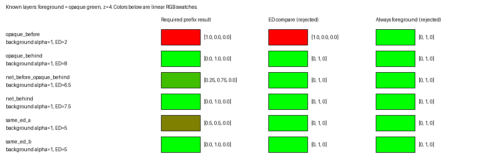
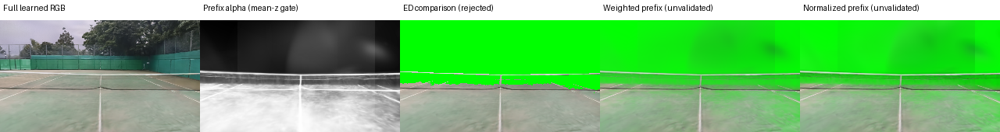
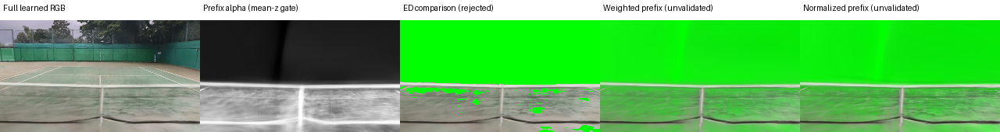

# NHTと不透明前景の奥行き合成の検証

この文書は初回調査の観察を保持する。人間の「再学習せず近似」判断を受け、
[継続run](../run-player-prefix-approximation-20261108/README.md)でfull-alpha closureを
選定した。現在のC5向け方式は[別名の近似契約](contract.md#c5-approximation)を参照する。
以下で未採用とする方式・未決の判断は初回調査時点のもの。

親 #1723 / C4 #1728。C5 #1729へ渡す方式の研究記録。**調査は完了したが、現行NHTの
RGB/alpha/EDを使う合成方式は採用していない。** 前景までのlinear RGB寄与と透過率を
返す目標契約を[contract.md](contract.md)へ固定した。数式、Blender/NHTの入出力、
座標・z/ray距離・単位・色・alpha、公開API変更案と再開条件の正本は同ファイル。

不透明前景の最前面貼り付け、ED比較、decode済みprefixをそのままRGB寄与として
加える方式は棄却する。alphaを掛け直す方式や、特徴をalphaで正規化する方式も
学習済みshaderとの物理的な整合を保証できず、採用しない。
背景再学習・NHT本体の変更・C5本番統合は実施していない。

## 既知層と実背景で確認したこと



RGB/alpha/EDが同一でも、遮蔽結果が異なる反例を[CPU出力](layers.json)へ記録した。
赤(α=.5,z=2)＋赤(α=1,z=8)と、赤(α=1,z=5)はいずれもRGB=(1,0,0)、alpha=1、ED=5。
z=4の緑前景を挿入した正解は、それぞれ(.5,.5,0)と(0,1,0)である。

L4の4つの薄いGaussian sheetでも手前opaque・奥opaque・手前net/奥opaque・奥netを
検証し、独立した期待色との差は最大1.29e-8だった。α=.25の赤い層と奥の青い面の
間へ緑を挿入すると、prefix合成は(.25,.75,0)になる。EDは6.4989なので単純比較は
緑だけを選んでしまう。この正のcontrolは通常eval3dのRGB合成であり、NHTの非線形
shaderが局所RGBを持つと仮定した試験ではない。[GPU全数値](gpu-metrics.json)を参照。

B00 court-000の3つの頭部高さ相当cameraを256×144で描いた。public renderと内部
hookによるcontrolのRGBは最大許容差2e-5で一致した。far planeを2/6/10 m相当へ変えた
研究用prefixはGaussian中心のzによる選別であり、per-pixel surface積分ではない。

| 実測 | 結果・意味 |
|---|---|
| 全背景alphaの平均 | 3視点で.999816〜.999849。ネット単体のalphaではない |
| 空のprefix | 2 mまでのalphaは全画素0なのに、shaderのdecode RGBは.2319〜.7026 |
| shaderのaffine混合からの差 | 最大.1901。特徴量の混合とRGBの混合は同一ではない |
| alpha掛け直しと特徴正規化の候補間差 | 最大.1263。正解との誤差でも、近似の誤差上限でもない |
| 元の背景と前景の完全な物理合成 | 未達。局所linear RGB寄与を取得するAPI/モデルがない |




図の右2列は未採用の候補であり、正解画像ではない。全画面の緑面は既知depthにある
不透明前景の代用で、人物の本番renderではない。ネット付近の白い帯・ぼけは既存NHTの
描画に含まれ、この調査で修復していない。

[ネット帯の検査](net-band.json)では、eye-0の保存courtから投影したネット中心は
z=8.0332 m、検査boxは(u=83:173,v=65:75)だった。全背景alphaの平均.999878に対し、
6 m prefixは.049885、10 m prefixは.401645。中央sampleの透過率はそれぞれ
.952397と.541720である。全背景がほぼ不透明でも、手前の層だけを不透明として扱えない。
このboxは位置が分かる帯であり、semantic net maskや前景色のground truthではない。

## Blenderのdepth・色を分けて確認したこと

[Blender実測](blender-metrics.json)は4.5.3 LTS / Cycles CPU、32×18、1 cameraの2 frame。
既知のz=4 m平面の273 sampleではZ passとcamera zの最大差0 m、ray距離との差は最大
.70114 mだった。このengine/versionではZを既にcamera zとして扱う。
pixel-center rayの差は最大.0005301 px。別engine/versionへは未検証である。
132の部分coverage画素を含め、Combined RGBはalpha×既知linear emission色と最大差0で
一致した。1 sampleのZと16 sampleのRGBAを同じsamplingとみなす検証ではない。

## 資産・計算資源・費用に関わる範囲

[資産metadata](asset-metadata.json)は、採用済みB00〜B03のalignmentをDriveから
取得し、manifestの内容digestと相互変換・回転を確認した結果。NHT units/mは
B00=.0698381、B01=.0422652、B02=.0662539、B03=.0633862で、court数は2/3/1/1。
実GPU描画はB00だけとし、[入力検証](input-verification.json)の6ファイルを用いた。
100万Gaussian、feature_dim=48、encoded_dim=24。既存checkpointを変更していない。

時間・VRAMはL4、batch=1、256×144の現行shaderの実測であり、新APIの性能保証ではない。

| 測定項目 | 実測 |
|---|---|
| public 3 camera、load/JIT/ファイル出力を含む | 3.800 s |
| warm後のresident scene load | .180 s |
| resident full RGB+ED、9回 | 6.34〜14.19 ms/frame |
| mean-z prefix RGB+ED、9回 | 2.80〜5.17 ms/frame（空prefixを含む） |
| 同じ視点のfull中央値＋10 m prefix | 11.64〜18.95 ms/frame。未採用候補の2 render分のみ |
| PyTorch peak allocated / reserved | 494.07 / 516.00 MiB |

最後のメモリ値はCUDA context・TCNN等の外部allocationを含む総VRAMのpeakではない。
再学習した局所radiance decoderの時間は未測定であり、現行の安価なdeferred MLPから
同じ時間になるとは予測しない。C3の実Blender設定も未確定なので、32×18の校正から
本番人物render時間を外挿しない。C5は実装後に短い実frameで時間と総VRAMを測る必要がある。

保存・tensor容量はfloat32から正確に計算できる。prefix RGB+Tは256×144で.5625 MiB、
1920×1080で31.6406 MiB/frame。full背景RGBを追加すると.4219/23.7305 MiB、前景の
RGBA+z+bool validは.7383/41.5283 MiB。現行の28ch latentをfull/prefixの2組保持すると
7.875/442.969 MiBになり、model・projection・tile intersection・workspaceは別に必要。
解像度比56.25をcheckpoint容量や描画時間全体へそのまま掛けない。
frameごとにstreamし、全動画の配列を常時保持・全量保存しない設計が必要である。

[実行終了と保存](execution-status.json): sessionの経過上限は1822.13 s（30.37分）、
3時間のGPU上限内でstop済み。初回setupはnative build後のPATH検査でreturncode=1。
PATHを明示した次のjobで公開CLIを確認し、入力検証・GPU probe・Blender校正がそれぞれ
returncode=0となり、失敗jobを含む全jobのDrive保存を確認してから解放した。

## C5に残る判断

現行checkpointを保つ近似の受容基準を人間が決めるか、局所linear radianceを学習・蒸留
する追加研究を認めるかが必要である。単なるNHT file APIの追加だけでは非線形shaderの
色の問題を解決したことにならない。必要な公開変更案は[contract.md](contract.md)にあり、
このPRでthird_party/nhtを変更していない。C3の2人分動画の人間受入も独立した開始条件。

以下は未確認であり、成功扱いにしない: 実人物/球の本番合成、任意前景のper-pixel depth
gate、ネットの局所RGB ground truth、C3が選ぶBlender version/engineでの同じ校正、
本番解像度での時間・総VRAM、全背景・全動画の網羅描画。

## 再現する入口

```bash
PYTHONDONTWRITEBYTECODE=1 .venv/bin/python knowledge/runs/run-player-depth-compositing-20261108/layers.py \
  --output tmp/player-depth-layers.json
PYTHONDONTWRITEBYTECODE=1 .venv/bin/python -m pytest -n 2 \
  knowledge/runs/run-player-depth-compositing-20261108/test_layers.py \
  tests/unit/synthetic_data_generation/rendering/nht/test_depth.py::test_nht_depth_to_metric_preserves_zero_and_converts_scale \
  tests/unit/synthetic_data_generation/rendering/nht/test_contracts.py::test_render_request_writes_strict_public_payload \
  --durations=0 --durations-min=0
```

CPUの研究用14件＋既存NHT境界21件で35 passed / 3.88 s、collect-onlyは35件 / .21 s。
最大展開6件、durationsの表示精度.01 sで最大case合計.03 s・setup.03 s。
[実測log](cpu-tests.log)、[収集結果](cpu-collection.log)、[検証summary](cpu-verification.json)を残す。
新しい研究用関数のテストは明示実行であり、通常CIのtestpathsへ研究bundleを追加しない。
既存nodeの削除・統合はない。GPU/Blender受入を通常pytestへ複写していない。

Colabの正確なprobe commandとsourceは[request](colab-request.json)、[source](colab-source.json)、
[status](colab-status.json)、[stdout](stdout.log)、[repro.sh](repro.sh)に保存した。
repro.shは指定checkoutを実験commitへcheckoutするため、独立した再現用checkoutで使う。
先に同じ[Colab skill](../../../.agents/skills/tennis-colab/SKILL.md)と
[Drive skill](../../../.agents/skills/tennis-drive/SKILL.md)に従ってruntimeを用意し、
`prepare_assets.py`で採用manifestとB00を取得・検証する。GPUの内部hookは研究専用である。

Blenderの再現入口は以下。NHTと別のbpy環境で実行する。

```bash
PYTHONDONTWRITEBYTECODE=1 uv run --no-project --python 3.11 --with bpy==4.5.3 -- \
  python knowledge/runs/run-player-depth-compositing-20261108/blender_probe.py \
  --output outputs/synthetic_data_generation/profile/player-depth-study/blender
```

数値解析`analyze_net_band.py`へは、Drive出力の`public/court-eye-0/alpha.npy`を
`eye-0-full-alpha.npy`、`court-eye-0/prefix-{6,10}m.npz`を`eye-0-prefix-{6,10}m.npz`
として取得したdirectory、採用B00のalignment.jsonを明示する。
`--output <new-json>`へ出力する。ROIの意味は同scriptと[net-band.json](net-band.json)に固定した。

raw配列・EXRはGitへ置かず、Drive root相対の
`outputs/synthetic_data_generation/profile/player-depth-study/{probe,blender}`に保持する。
各jobの運用記録は`operations/colab/player-depth-study-20261108/<job-id>`。
現行の恒常的なpublic APIの意味は[NHT consumer README](../../../src/synthetic_data_generation/rendering/nht/README.ja.md)を参照。
