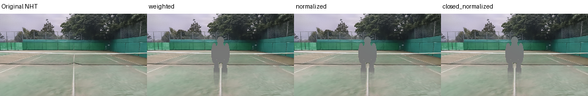
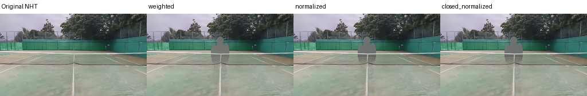
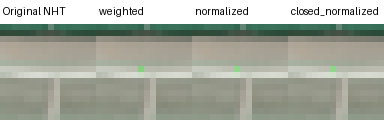
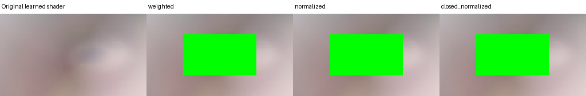
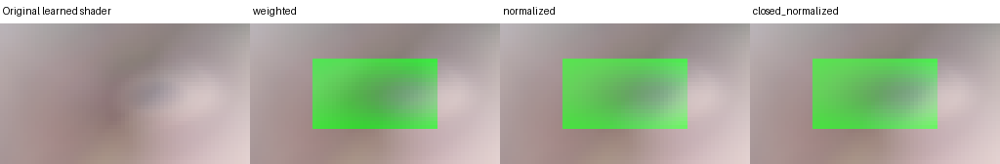

# 再学習しないNHT prefix近似の比較

**`closed_normalized`をC5向けの近似として採用する。**
[人間の「近似で進める」判断](https://github.com/Motoki0705/tennis-lab/issues/1723#issuecomment-6722754922)
を受けたC4追加runで、背景の再学習・局所radianceの学習/蒸留は行わない。
正確なlocal RGBが得られないという[初回の観察](../run-player-depth-compositing-20261108/README.md)
は変わらない。公開API実装はC5、最終的な見た目の受入は第2フェーズ動画で人間が行う。

数式・入出力・座標/深度/単位・色/alpha・数値基準・失敗条件の正本は
[contract.mdの近似契約](../run-player-depth-compositing-20261108/contract.md#c5-approximation)。
名前は`nht_prefix_alpha_closed_srgb_v1`で、未達の`radiance_prefix_linear_v1`と区別する。
`a=1-T_<`、全背景alphaを`A`として、proxy色は`D(A F_</a,ray)`、混合重みは`a/A`。
前景色とproxy色をassumed-sRGBのEOTFで逆変換して混ぜ、OETFで戻す。
これは物理的な局所radianceや正しいネット色の復元ではない。

## 候補比較と選定根拠

GPU実行前に固定した[evaluate.py](evaluate.py)の基準を、
[GPU全数値](gpu-metrics.json)へ適用した[選定結果](selection.json)である。
最大差は0〜1 floatのencoded RGB。局所色ground truthへの誤差ではない。

| 候補 | 全prefix vs元RGBの最大差（基準2e-5） | opacity減衰時のstraight proxy色の最大差（基準.005） | 判定 |
|---|---:|---:|---|
| W: `D(F_<)`をprefix alphaで掛け直す | .02032149 | .52783203 | 両条件を超過 |
| N: `D(F_</a)`をprefix alphaで掛ける | .01921538 | .00073242 | 全prefixを超過 |
| R: `D(A F_</a)`を`a/A`で掛ける | **0** | **.00061035** | **全基準を通過、採用** |

opacityの比較は同じ実特徴平均を保ち、alpha .005/.02/.1/.5/.99へ一様減衰したcontrol。
正解色が分からなくても、Wが低alphaで`D(0)`側へ色を変えてしまうことを検出できる。
Nにも全背景alphaが1でないと元画像へ戻らない差が残る。Rは全prefixで元のshader入力と
混合重み1へ戻るためclosureを満たす。最も正しい局所色だった、という選び方ではない。

全候補で前景なし・mask外は元RGBとbitwise一致、空prefixは前景色と最大差0。
raw全特徴のdecodeと同じgridのpublic RGBも全5 camera定義で最大差0だった。
Rの前景色対blackのlinearized応答は期待値`tau * L_fg`と最大差1.087e-7
（基準2e-6）。`a>A`とharmonic envelopeの超過は最大0、foreground valid上の
全背景alpha最小は.99913990（基準.98）。全出力はfiniteで[0,1]に収まった。
固定prefix/T/AでsuffixのRGBだけを変えても、有効前景は変わらないことをCPUでも守る。

## 配置・ネット・輪郭・細い球

B00 court-000、3視点を256x144から開始し、うち2視点を512x288でも描いた。
計5 camera定義＋独立した合成stress用1 cameraで、最大12 camera以内。
`probe.py`の54配置は前後の人物silhouetteと球、移動する細い球、共通SSAA2の輪郭を含む。
人物は既知の平面silhouette、球は半径.0335 mの解析球面であり、本番SMPL/C3の球ではない。
半径はfixtureの値で、本番既定には採用しない。

prefixは各有効sampleの**実際の球面z**等でscalar far-plane renderし、必要pixelの
特徴/alphaを組み立てた。depth binning・EDのsurface扱いはない。NHT本体のtracked fileも
変更していない。これはmean-center-z gateの研究用取得であり、物理的な体積切断ではない。

| 球を置いた視点 | 前景がnetより手前のprefix alpha平均 | netより奥のprefix alpha平均 |
|---|---:|---:|
| eye 0（6→10 m） | .04639196 | .40533531 |
| eye 1（2→6 m） | 0 | .12237529 |
| eye 2（6→10 m） | .01717196 | .48372084 |

3視点すべてで差が基準.02を超えた。全背景alphaがほぼ1でもprefix alphaは別の量である。
位置が分かるnet付近での試験であり、semantic net maskやnet局所色の正解を得たとはしない。




共通SSAA2で合成後にlinearized RGBを平均した。細い球は2視点x8位置すべてで
4〜13 working sampleを保持し、coverageは最低1.0出力pixel相当だった。
eye0のcoverageは1.0〜1.25、eye1は2.75〜3.25 pixel相当。今回のq1配置でも消失はなく、
q2があらゆる小球の消失やちらつきを解消するという結論ではない。
Rの球のgreen応答の総和は、eye0の8位置で.2751〜.5201（linearized/出力pixel換算）。
coverageとnet寄与が位置で変わるため、この変動を色の正解誤差や純粋なちらつきと呼ばない。



人物輪郭についてもmask外最大差0・有限/範囲・前景応答を検査した。静止した平面輪郭で
SMPLの時間的haloや照明の整合を受け入れたとはしない。共通geometry sampleと色の対応、
undersampling診断、動画での確認項目は契約に残す。


## 大きいGaussian: 解消していない失敗

独立したtoy sceneを1 unit=1 mと定義し、中心z=4.2、y軸45度回転、
sigma=(.3,.5,1.8)、opacity=.8のGaussianを置いた。奥はz=10、sigma=(20,20,.02)、
opacity=.999のsheet。学習済みprimitiveから一定の特徴を取り、同じshaderを使う。
前景は固定ROI (x16:48,y9:27) の576 sample、全背景alpha最小.98918176。
画面全体のalpha最小.94680935は前景外にあり、サポート条件を満たすと偽らない。

前景z=4.199→4.201でprefix alphaは最大**.79746884**、Rのencoded RGBは最大
**.61695677**跳んだ。388/576 sampleでGaussianのMahalanobis ray-peakは4 mより前なのに、
mean-z gateは中心4.2を奥と判定した。ray-peakを正しいsurfaceだと置き換える検査ではなく、
大きいGaussianの分布と中心の前後が異なるという独立した解析である。




このjumpと前後不一致を検出したことは、問題を解消したという合格ではない。
近似はmean-zによる突然の遮蔽や誤順序を残す。人間が第2フェーズ動画で受け入れられるかを
判断する。opacity調整・ネット除去・無記録のdepth biasで隠さない。

初回`probe`はsigma100の背景sheetにnative alpha=0の領域があり、入力検査で失敗した。
[失敗request](failed-probe-request.json)、[status](failed-probe-status.json)、
[source](failed-probe-source.json)、[log](failed-probe-stdout.log)を保持する。
[診断](stress-diagnostic-metrics.json)ではsigma40/100のsheet寄与がなく、sigma5/10/20では
finiteだった。sigma20と固定中央ROIへ修正し、alpha>=.98を検査した別job `probe-v2`が
最終結果である。alphaの不正値をclampして通したわけではない。
診断の[request](stress-diagnostic-request.json)と[status](stress-diagnostic-status.json)も保持する。

## 時間・メモリ・再現

L4でnative scalar rasterの視点別medianは256x144で1.98〜3.18 ms、512x288で
2.56〜2.95 ms。shader＋CPU readbackのmedianはそれぞれ.450〜.468 ms、.819〜.830 ms。
prefix追加1 raster＋1 shaderという初期計算見積りなら、512x288で約3.4〜3.8 msを
現在の全背景描画に加える。ただしC5のper-pixel gate、file I/O、Blender、resizeは未実測。
研究用の異なるzごとの反復renderは、本番kernelのframe性能ではない。
初回runの現行full RGB+ED（256x144、6.34〜14.19 ms/frame）とも区別する。

このprobeのPyTorch peak allocatedは558.16 MiB、reservedは610.00 MiB。
TCNN等の外部allocationを含む総VRAMの上限ではない。
F/Tの解像度依存byte数、batch1/streamingの前提は契約に置いた。
本番解像度のend-to-end性能や容量予算を承認したとはしない。

[実行状態](execution-status.json): 全jobのDrive保存を確認しColabを停止した。
割当経過の上限3151.81秒（52.53分）はこのターンの最大3時間以内。
Notebook接続が切れた同期要求はreconnect後にcancel/saveし、新IDで同期した。
大きいGaussian fixtureの初回失敗も保持し、最終probeの成功へ読み替えない。

[request](colab-request.json)、[source](colab-source.json)、[status](colab-status.json)、
[stdout](stdout.log)、[repro.sh](repro.sh)はDrive recordから検証付きで取り込んだ。
実行sourceは`c33420fd38f8fa83755830afe3a3282bebb090cd`。最終commitとは異なる。
最終CPU確認ではmask外の背景alpha=0で不要な除算検査をしないよう参照実装を修正し、
3候補の回帰テストを追加した。有効前景の式と、このB00 probeで使った正のalphaの結果は
変えない。mask外は元RGBを保存する分岐であり、前景上のサポート条件の緩和ではない。
NHT/gsplatは初回runと同じ固定submoduleで、B00の入力6 fileも同じ取得器で検証した。
再現時は[Colab skill](../../../.agents/skills/tennis-colab/SKILL.md)と
[Drive skill](../../../.agents/skills/tennis-drive/SKILL.md)で環境を準備し、初回runの
`prepare_assets.py`でB00を取得する。repro.shは独立したcheckoutで使う。

CPUは研究用の近似24件＋初回の既知層14件＋既存NHT契約21件、**59 passed / 3.72秒**。
collect-onlyは59件 / .25秒、最大関数展開6件、durations表示精度.01秒で最大case合計.04秒・
setup.02秒だった。[最終test log](cpu-tests-accepted.log)、[collection](cpu-collection-accepted.log)、
[summary](cpu-validation-accepted.json)を参照。初期55件とmask外修正前56件のlogも上書きせず保持した。
最新のCPU結果を反映した数値summaryは[accepted-metrics.json](accepted-metrics.json)。
CUDA/Blender描画を通常pytestへ重複追加していない。学習/TensorBoard曲線は対象外。
pre-commitのruff/mypyと研究scriptのlint/formatは成功、knowledgeは0 error/0 warning。
[検証summary](validation-summary.json)にcommandとlogを残す。repro path検査は0 missingで、
既存18 nodeの未取得commitによる20 unverifiableが残る。今回の2 nodeの参照は両方ok。

```bash
PYTHONDONTWRITEBYTECODE=1 .venv/bin/python -m pytest -n 2 \
  knowledge/runs/run-player-prefix-approximation-20261108/test_approximation.py \
  knowledge/runs/run-player-depth-compositing-20261108/test_layers.py \
  tests/unit/synthetic_data_generation/rendering/nht/test_depth.py \
  tests/unit/synthetic_data_generation/rendering/nht/test_contracts.py \
  --durations=0 --durations-min=0
PYTHONDONTWRITEBYTECODE=1 .venv/bin/python \
  knowledge/runs/run-player-prefix-approximation-20261108/evaluate.py \
  knowledge/runs/run-player-prefix-approximation-20261108/gpu-metrics.json \
  --output tmp/player-prefix-selection.json
```

raw配列はDrive root相対の
`outputs/synthetic_data_generation/profile/player-prefix-approximation/{probe,probe-v2,stress-diagnostic}`、
各jobの運用記録は`operations/colab/player-prefix-approx-20261108/<job-id>`に保持する。
Gitへは小さい数値・図・再現情報だけを置く。C5に残るのはNHT公開APIとkernel、
Blenderの共通sample出力、consumerの実装・固定入力受入・本番動画の人間確認であり、
近似候補の選び直しではない。C3の人間受入条件は独立に維持する。
