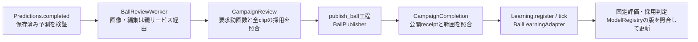

# 注釈ワークフローの接続

`python -m src.tasks.annotation` は、共通基盤とtask adapterを接続する入口。
責務分担と最終構成は[アーキテクチャ資料](../base/annotation/README.md)を正本とする。

preview campaignでは取得→プレー窓選別→clip準備→ball/player予測を実行する。
保存済み予測の定性確認には、以下の `prediction_preview` を使う。
production campaignでは、現在 **ball / framesのみ**、レビュー→全clipの採用確認→
累積snapshot公開→追加学習・固定評価・モデル採用まで接続している。
player bbox/poseを含むproduction planは明示的に拒否する。CLIのレビューは保存済みの予測receiptを
初期値にする。sceneが指定した動画の白紙入力は、以下の[サービスAPI](#ローカル動画の白紙入力登録)で登録する。
実装の経緯と未完了の受入条件は[親Issue](https://github.com/Motoki0705/tennis-lab/issues/1088)に残っている。



`reviews.py` がcampaign全体の採用範囲を、`production.py` が公開と学習の接続を所有する。
base内部には具体taskの分岐を置かない。SQLiteのworkflow進捗は表示用cacheであり、
再開時は不変の要求・実行・公開receiptを照合する。

workerの画像・注釈サービスは、各稼働attemptの未回答要求を送信順で1件ずつ集め、
全workerのうち最も古い要求から資源付き工程へ渡す。工程自身が結果receiptの保存後に
返信を確定するため、他workerの受付やcontrollerの次の巡回を待たない。
通常campaignは最大128要求・600秒のCPU service sessionを使い、同じrender枠の中で
到着した要求を続けて処理する。各要求のworker・入力・結果・返信を個別receiptに結び、
session全体を既存supervisorのPSS/空き/GPU監視と保存予約の対象にする。
`render` の保存costは1要求分とし、session受付時に最大要求数倍を予約する。
PSSとtimeoutは同時に1要求だけを実行するsession単位のままとする。予約全体が残予算や
空き容量に収まらなければ受付待ちとなり、要求数や固定costを黙って縮小しない。
各要求の前に共有scopeの永続stopを確認し、停止時は未処理要求を保留したまま
`budget stopped: ...` をsession終了理由に記録する。新規sessionは明示的な予算再開まで
起動できない。この確認は保存走査を増やさず、watchdogのcacheにも依存しない。
controllerの定期保存走査と終了時の全走査は維持し、短い要求ごとの全走査だけを避ける。
session失敗は明示的な工程再試行を必要とし、勝手に次のsessionへ進めない。
終了・交代したattemptからの要求は実行せず、旧attemptのサービス失敗は履歴に残したまま
新attemptの進行を妨げない。注釈編集のrevision照合・実画像確認・採用条件は維持する。
通常のrun/statusでは、同じcontrollerが照合済みの終了stageをメモリ内で再利用する。
`status --details` は全履歴とログhashを再照合し、再起動時にもcacheを持ち越さない。

## ローカル動画の白紙入力登録

`configure_local_videos(layout, LocalVideoConfiguration)` は、sceneが選んだ元動画を保持し、
camera別の画像manifest・白紙context・`WorkRequest`を共有台帳へ登録するサービスAPI。
checkpoint、予測receipt、YouTube取得・プレー窓選別・推論・GPU queue設定は不要である。
worker起動、注釈編集・採用、dataset writerはこの登録APIでは実行しない。
scene CLIの一連実行は[白紙注釈composition](../../tennis_scene/pipeline/direct_annotation/README.ja.md)が所有する。
統合CLIの`schema --type scene_annotation`で固定request、`blank_condition`と`blank_comparison`で
探索方針の比較入力schemaを取得できる。

```python
from src.tasks.annotation.configuration import (
    LocalVideoConfiguration,
    configure_local_videos,
)
from src.tasks.annotation.contracts import LocalVideoInput
from src.tasks.annotation.local_videos import LocalVideoConfigurationReceipt
from src.tasks.annotation.reviews import read_local_context
from src.tasks.base.annotation.artifacts import read_document
from src.tasks.base.annotation.workers.contracts import WorkRequest

# layout: 共通AnnotationLayout
# campaign_settings: ExecutionPlan（code版・worker条件・明示した資源予算）
# worker_settings: WorkerRuntimeSettings（Codex保存先・review/renderのcost）
# budget_selection: ExistingBudget または明示した NewBudget
# expected_input: sceneが固定した既存のVideoAnnotationInput。cameraごとに作る。
configuration = LocalVideoConfiguration(
    campaign=campaign_settings,
    videos=(
        LocalVideoInput(path=str(video_path.resolve()), annotation=expected_input),
    ),
    publish_dataset=publish_dataset,
    budget=budget_selection,
    runtime=worker_settings,
)
reference = configure_local_videos(layout, configuration)
receipt = read_document(layout, reference, LocalVideoConfigurationReceipt)
for entry in receipt.registrations:
    request = read_document(layout, entry.request, WorkRequest)
    camera_input = read_local_context(layout, entry.context, receipt.plan)
```

`LocalVideoInput.annotation`は[v3のVideoAnnotationInput](../ball_detection/annotation/video/README.md)
そのものを使う。元収録groupは`source.recording_id`、cameraは`source.camera_id`で指定し、
同一収録の全camera・関連clipでrecording_idを共有する。対象区間は元動画のframe indexによる
半開区間、各行のPTSは元動画の整数tickを指定する。登録時に元bytes・全動画metadata・
対象全frameの実PTSを復号して照合する。FPSからPTSを補わない。
同じ元動画/camera内の重複・重なる対象区間は1要求へ混在させない。
同じ収録group/cameraに複数の切出し済み動画がある場合も、元動画identityごとに
file-relativeなframe/PTSとworkを分ける。groupを元動画identityの代わりに使わない。

元動画は呼出元pathを削除せず、`media/sources/blobs/`にも元bytesを保持する。
指定範囲の全native frameをQ90 JPEGへ直接保存し、画像manifestから元frame/PTSを辿れる。
task入力の`frame_index`は元動画番号、画像manifestの`frame_index`はclip内の0始まりであり、
`source_frame_index`で対応付ける。
画像path・clip/worker identityはcamera別になり、数frameの短clipにも間引き・paddingを行わない。
`BlankAnnotationContext`はtask入力・画像manifest・元動画を参照し、`ReviewContext`の
必須predictionとは別型である。baseはボール状態を解釈せず、v3入力の照合はtask境界で行う。

保存されるplanは`LocalAnnotationPlan`、runtimeは`LocalAnnotationRuntime`。
共通の`ExecutionPlan`にはselection/preparation/model/inferenceを持たせず、
新規worker条件とcode版は通常planと同じ検証を行う。`review`はCodex、`render`はCPUの
明示した枠・costが必要で、予算scopeのbaseline・累計・停止状態を再送で初期化しない。
`publish_dataset`は常に明示してplanへ固定する。後続の公開処理はこの選択とrecording_idを受け取る。

同じconfigurationの再送は同じ参照と台帳行を返す。画像・要求の公開後や台帳commit後に
中断しても、再送で保存済み入力を検証して登録を補完する。異なるplan・元動画版・
camera/frame/PTS・公開選択で既存登録を上書きしない。登録結果にはcamera単位の入力だけを
`WorkRequest.inputs`として列挙し、全cameraを列挙するplan manifestは親サービスの照合用とする。
workerの実効的な画像隔離・編集・途中保存・完成は [白紙worker](../ball_detection/annotation/video/agent/README.md) が所有する。
[自動継続controller](#白紙注釈の自動継続)が時間切れを処理する。

検証は`tests/unit/tasks/annotation/test_configuration.py`、`test_local_videos.py`と
`tests/integration/tasks/annotation/test_local_videos.py`。integrationは2cameraの短いVFR動画で、
元画像を独立に復号してJPEG画像とのframe対応、元動画保持、groupと公開選択を確認する。

## 白紙注釈の自動継続

`LocalAnnotationController(layout, saved_runtime)` は上記APIで登録した全cameraを実行し、
保存したv3注釈の完成までを管理する。`LocalAnnotationRuntime` と登録完了receiptを照合し、
cameraの欠落や異なるruntimeでの起動を拒否する。通常の予測レビューにはこのpolicyを適用しない。

```python
from src.tasks.annotation.contracts import LocalAnnotationRuntime
from src.tasks.annotation.local_controller import LocalAnnotationController
from src.tasks.ball_detection.annotation.video.agent.contracts import VideoCompletion
from src.tasks.base.annotation.contracts import ArtifactRef

runtime = read_document(layout, receipt.runtime, LocalAnnotationRuntime)
controller = LocalAnnotationController(layout, runtime)
progress = controller.cycle()  # 呼出元のschedulerが、終了までcycleを進める
for camera in progress["reviews"]:
    if camera["state"] == "complete":
        completion = read_document(
            layout, ArtifactRef.model_validate(camera["completion"]), VideoCompletion
        )
        # completion.annotation がscene/datasetへ渡す保存済みv3注釈
```

各cameraの新規・継続attemptは **5400秒**。本番登録とcontrollerは異なるreview timeoutを
拒否する。`workflow/continuation-policy.json` にplan・runtime・資源scopeと事前許可を固定し、
監督プロセスが期限を判定して実worker・子孫を停止した後、終了receiptを回収してから判断する。
期限判定の時点ですでに終了したworkerは、正常終了の検証を先に行う。

時間切れで未処理が残り、当該attemptの開始revisionから新しい処理済みframeが増えた場合は、
`workflow/continuations/<work-id>/<attempt>.json` に理由・開始/終了件数・残数・head revisionを
保存して `authorize_retry` で `ready` に戻す。そのtickでは次workerを起動しない。
次tickの通常の資源受付で同じplan/scope/WorkRequestを起動し、開始revisionに保存済みheadを渡す。
許可保存前後や起動後のcontroller再起動、二重tickでも同じattemptを二重起動しない。
自動許可の確定は同じattemptの現在状態が `timed_out` の場合だけに限定し、共通lock内の
条件付き更新で照合する。保存した判断と許可の間に取消が確定した場合や、その判断を再読込した
場合も、`cancelled` と取消理由を保持する。保存済み判断は変更せず、明示retryまで起動しない。
継続ごとに未処理数の減少を要求するため、通常の継続回数も入力frame数で有限になる。
処理済みframeを未処理へ戻した保存は異常として扱う。

全frameが処理済みなら、最終unknownが残っていても完成である。timeout直前に全frameを保存し、
最終応答だけを失った場合も、taskの正式storeで完成receiptを回収し、追加workerを起動しない。
元のworker終了履歴は `timed_out` のまま保持し、cameraの `state=complete` と
`completion` で完成を表す。`worker_state` と完成判断を混同しない。
dataset公開はこのcontrollerの完了条件に含めず、planの `publish_dataset` を後続へ渡す。
`run`・`tick`・`status`・`recover`・`resume-budget`・`report`は保存済み`LocalAnnotationRuntime`も受け付ける。
sceneの公開だけの再開は上記compositionの`direct_annotation.resume=publication`を使う。
`blank-register`で作った比較conditionのruntimeも同じCLIで実行でき、benchmark namespaceを検証して
専用サービスstageを使う。通常のdataset公開へ進めず、計測は`blank-compare`で保存する。

| 状態・原因 | 保存する判断と次の対応 |
|---|---|
| 正常な時間切れ・有効な増分・未処理あり | 自動継続。手動のcontinue操作は不要 |
| 時間切れ・増分なし | `timed_out` で保留。workerと原因を確認し、明示的にretry |
| 保存欠損・hash/入力不一致・壊れたrevision | `invalid_saved_progress`。既存成果物を保持し、復元・修正後に明示的に復旧。別revisionへの自動fallbackやunknownへの置換はしない |
| quota・rate limit | `quota`。campaign全体の新規受付を停止し、未起動予約を取消。利用枠を回復して `ResumeWorkers` と `RetryWorker` を明示 |
| 外部サービス・workerの失敗 | `failed`。exit/eventsを確認して原因解消後に明示的にretry。期限前のerrorを通常timeoutで隠さない |
| 取消 | `cancelled`。保存済み編集を保持し、明示的なretryまで起動しない |
| 結果検証失敗・worker保留 | `validation_failed` / `deferred`。理由を確認して明示的に復旧 |
| 資源の一時的な枠不足 | `waiting`。同じpending要求を通常受付で再確認し、attempt・予約を重複作成しない |

明示復旧は `recover(controller, RecoveryInput(...))` に理由を渡す既存APIを使う。
`RetryWorker(request, after_attempt)` は現在のattemptを照合する。完成済みcameraのretryは拒否する。
`blocked` でも `live=true` の間は他camera・サービス工程の処理と終了回収を続ける。
完成時も、稼働中の資源stageが終了するまでcampaign全体を完了と報告しない。

代表のCPU integrationは `test_automatic_continuation.py`。controllerを独立したCPU processで動かし、
他テストが読み込んだモデル等の常駐メモリをfixtureの資源予算へ混在させない。
3camera×12frameの合成動画と正式な
画像/編集サービス、実controller・資源stage・store・supervisorを使い、cam0のframe 0〜3保存通知後に
監督側のtest clockを5399.999→5400秒へ進め、停止・回収・controller再起動・frame 4〜11完了を確認する。
cam1/cam2の完成結果とcam0の既存編集・最終unknownを保持する。
`test_clock` のsocketはtest layoutだけで許し、workerへ継承しない。本番poolとsupervisorは拒否する。
待機はファイル通知・pidfd/socketで行い、実時間90分や長いsleepは使わない。
短い実時間で実process/子孫を止める既存の `test_timeout_and_owned_stop_terminate_descendants` も実行する。
異常分類・保存途中・許可保存前後の中断と終了競合はunitに置く。実GPTの認識品質はこの検証に含めない。

## 固定入力と起動

`Runtime` はplan・資源scope・queue script版・Codex保存先・工程別のPSS/保存量/
timeout/GPU時間を参照する。設定とreceiptはmain repositoryの `outputs/chat_annotation/`
以下へ置く。`schema --type configuration` が設定JSONの契約を返し、`configure` が
plan・scope・runtimeとその参照を持つreceiptを不変保存する。実験固有のURL、件数、
モデルpathをソースへ埋め込まない。

```bash
.venv/bin/python -m src.tasks.annotation worker-decision
.venv/bin/python -m src.tasks.annotation schema --type configuration
.venv/bin/python -m src.tasks.annotation configure --configuration /absolute/configuration.json --sha256 INPUT_HASH
.venv/bin/python -m src.tasks.annotation register --runtime /absolute/runtime.json --sha256 HASH --candidates /absolute/candidates.json
.venv/bin/python -m src.tasks.annotation run --runtime /absolute/runtime.json --sha256 HASH --max-seconds 600
.venv/bin/python -m src.tasks.annotation status --runtime /absolute/runtime.json --sha256 HASH --details
.venv/bin/python -m src.tasks.annotation report --runtime /absolute/runtime.json --sha256 HASH
.venv/bin/python -m src.tasks.annotation review-progress --runtime /absolute/runtime.json --sha256 HASH
.venv/bin/python -m src.tasks.annotation continue-reviews --runtime /absolute/runtime.json --sha256 HASH --reason TEXT --max-attempts N --dry-run
```

`Configuration` は `plan`（CampaignPlan全文）、`budget`、`runtime`（plan/scope参照以外の
RuntimeSettings）を持つ。`budget.action = reuse` と既存 `scope` 参照で一連のcampaignの
使用量を継承する。新しい予算を明示作成する場合のみ `action = create` とscope ID、全計測root、
開始前の保存/GPU使用量、待機上限を指定する。作成の再送や中断後の再開でも同じbaselineを使う。
既存の停止状態をconfigureで解除しない。

新規planの `agent_model` / `agent_effort` は `worker-decision` で取得する。
運用条件の正本は [worker-decision.toml](../../../.agents/skills/annotation-workflow/worker-decision.toml)。
決定日・出典を持つ記録を固定コード版から読み、configureは予算・台帳・planを作る前に
一致を検証する。直接の `save_plan()` でも新規保存には同じ検証を行い、preview・production・
benchmark・テストモードのいずれにも例外を設けない。値は必須で、暗黙の既定値や補正はない。
既存planの読込・同一内容の再送は保存済み条件を維持する。不一致の上書きは従来どおり拒否し、
過去planへ現在の決定を遡及適用しない。親の作成手順は
[annotation-workflow skill](../../../.agents/skills/annotation-workflow/SKILL.md#planを固定する)を参照する。

計測rootはディレクトリまたは通常ファイルを指定できる。既存scopeの一時ファイルが
消えていても、元のbaselineとrootを維持して再利用する。Codex状態の保存先は、全体を
計測するディレクトリrootの配下に置く。状態ファイルの一部だけを列挙したroot集合で
Codex状態ディレクトリ全体が計測されているとは扱わない。

configureは参照hash、selection/preparation形式、対応task、工程costと枠、Codex保存先、
queue script、productionのcode版を検証してから保存する。planが別の資源scopeへ変更される
ことを拒否する。scopeを作る場合は保存量baselineの走査を行うが、動画取得・モデルロード・
Codex/学習の起動は行わない。作成後は `configuration/result.json` の `runtime` 参照のpath/hashを
以降のCLIへ渡す。`schema --type` はruntime/candidates/operation/recoveryにも対応する。
既存scopeの作成入力をscope lock下で照合し、campaignの紐付けをDB transactionで確定してから
requestとplanを保存する。scope入力や紐付けの競合で拒否された設定は保存されず、修正して再送できる。
planの詳細は[plan](../base/annotation/plan.py)、予算の計測定義は
[resources](../base/annotation/resources/README.md)を参照する。

JPEGを残すball campaignでは、[素材の保存契約](../base/annotation/collection/README.md#jpegを残して動画を削除する保存方式)
のpreparation・推論decoder・公開policyを一緒に指定する。保存済みJPEGがある通常処理は
元動画を要求しない。元動画が必要になった場合だけ、`restore_source` operationへ
`source_id` と明示した `attempt` を渡す。取得不能・元のbytesと不一致の結果も記録し、
同じattemptを自動再実行しない。controllerは再取得receiptを専用に検証し、`restored` を
`complete`、`unavailable` / `different_content` を理由の一致した `not_applicable` として受理する。
後者も正常な終端結果であり、保存済みJPEGによるcampaignの継続を妨げない。

pathは固定annotation root内の実ファイルを指定する。相対path・外部path・hash不一致は拒否する。
`CandidateManifest` はcanonical source IDと根拠参照の一覧。過去のsource/channelは収集前に
`HistoryManifest` を持つ `HistoryOperation` を `submit --operation PATH` で登録し、
完了receiptを確認する。レビュー範囲を閉じたcampaignに候補は追加しない。

player推論の `infer_player` はpreviewでもGPU工程と正のGPU時間予約を必須とする。
productionには `review`（Codex）と `publish_ball`（CPU/I/O）のplan枠・runtime costが必要。
学習を設定したplanには `train_ball` / `evaluate_ball` のGPU枠・timeoutを含む予約が必要。
両worker poolは共通台帳と同じ資源scopeを使い、screen/reviewそれぞれの予約量で受付する。
GPU工程はmain repositoryの共有queueに投入する。queue workerの起動は
[training-queue skill](../../../.agents/skills/training-queue/SKILL.md)に従う。

学習の初期モデルは、根拠artifactを持つ `BootstrapModelOperation(task, evidence)` を
`submit` して明示的に登録する。モデルを自動選択・初期登録しない。planに固定した
レビュー方針、公開split、学習recipe、validation、採用条件の仕様は各taskのREADMEを参照する。

保存方式の検証も同じ資源scopeで実行する。`inspect_storage` で既存store全体の参照を固定し、
`compare_storage` で形式・shard共有・RGB cacheを比較する。操作入力・測定定義は
[保存比較](../base/annotation/storage/comparison/README.md)を参照する。

10/25/50の並列条件は `benchmark-observe` / `benchmark-report` で既存workerの生存数と
資源・usageを記録する。固定入力、測定値の意味、未到達・欠測の扱いは
[並列条件の観測](../base/annotation/benchmarks/README.md)を参照する。
同じ固定予測を条件別にレビューするball専用の起動・再開経路は
[benchmark runner](benchmark/README.md)を参照する。

## 画像確認・公開・学習

preview campaignの初期モデル確認は `PredictionPreviewOperation` を通常の
`submit --operation PATH` で登録する。operation JSONの `plan` はruntimeと同じ参照、
`operation` は次の形にする。`PREDICTION_RECEIPT_REF` は予測工程が返した参照を使う。
これはCPUの `render` 枠を使用する。

```json
{
  "action": "prediction_preview",
  "task": "ball",
  "prediction": "PREDICTION_RECEIPT_REFをArtifactRef objectで指定",
  "drawing": "prediction",
  "view": {
    "tiles": [{"frame_index": 60, "crop": {"left": 0, "top": 0, "right": 1920, "bottom": 1080}}],
    "columns": 1,
    "tile_width": 960,
    "tile_height": 540,
    "reason": "初期候補モデルのnative座標と実画像を確認"
  }
}
```

taskは `ball` / `player`、drawingは `plain` / `prediction` を明示する。
frame/cropは実clipの範囲内で選ぶ。登録済みで未レビューの予測だけを受け付け、planの
モデル・設定、manifest、全予測行のframe/PTS・task固有の内容を検証する。表示座標は
task adapterが予測から取得するため、callerは描画座標を指定できない。推論・モデル読込や
注釈状態の変更は行わず、画像生成をレビュー・教師採用の証拠として扱わない。
結果receiptの `results` は [RenderReceipt](../base/annotation/images/contracts.py) の参照で、
その `image` が表示対象、`request` が固定した予測版と表示条件を示す。
ページの上限は [images](../base/annotation/images/README.md) に従い、playerの候補が
1 tileの描画上限を超えた場合も黙って切り捨てず停止する。

screen/review workerの画像・編集要求は親controllerへ渡す。親がrequest/attempt/版/区間を
検証し、CPU工程で処理してから不変の参照を返す。採用には実際のrollout画像提示を照合し、
単なる画像生成や自己申告では完了にしない。
受付済み要求は親所有のSQLite台帳にattempt単位で累積保存し、固定上限を判定する。
inboxの並び順・削除・親の再開で枠を戻さず、同一要求の回収で二重計上しない。
workerにソース動画の全量decodeや共有cacheへの書込みを任せない。

予測は新規clipだけをtask別に束ね、1工程で同じモデルinstanceを共有する。
保存済み予測をreview requestへ変換する際は推論しない。
要求した動画数が準備済みで、`state=prepared` のsourceの準備receiptにある全clipとレビュー対象が一致し、全workerが採用まで
完了した場合だけ公開する。保留・失敗・対象外workerを成功や公開対象外へ読み替えない。
公開と学習へ進む直前には、取得・準備・推論の各操作の最新attemptの成功終了とoperation receiptを検証し、
その成果物が対象source/clipの台帳参照と一致することを要求する。予測の保存と台帳更新だけでは
進めず、失敗・中断・未回収は明示的な新attemptによる復旧まで停止する。
内容重複で除外されたsourceの取得も、台帳の取得参照・source・除外理由と照合済みの
`not_applicable` receiptで完了照合する。除外sourceの準備receiptは理由とともにレビュー集合へ保持し、
hashとsourceの対応を検証するが、公開動画数やレビュー対象clipには数えない。
取得時・準備時いずれの重複除外でも、補充sourceの準備と全レビューの完了後に公開へ進める。

公開結果のtask/product/base snapshot・採用版・追加clip集合を照合してから
`workflow/products.json` を作り、`workflow/completion.json` でレビューと公開操作に結ぶ。
学習recipe未設定なら公開結果を保持した `blocked`。採用条件未設定、学習失敗、採用版競合も
理由を表示して停止する。`complete` は追加教師なし、または学習後の採用/不採用の確定を表す。
不採用は `workflow.learning.state = rejected` として採用と区別する。
公開clipがheatmap負例のみ、またはMDDの有効窓を持たない場合はcoverageと公開receiptを保持し、`learning.status = no_additional_teachers`で完了する。

## 再開と報告

通常の再開は同じruntimeで `tick` または `run` を実行する。完了工程を再実行せず、
`run --max-seconds` の終了時も受付済みsupervisorは自身のtimeout・資源管理に従う。
`run` は `complete`・`preview_ready`・`budget_stopped`・時間上限で終わる。判断が必要な停止
（保留・失敗したレビューや工程）があっても、稼働中のworker・工程が残る間はserviceと結果回収を
続け、それらが落ち着いてから `blocked` で終わる。statusの `live` が稼働中のworker・工程の有無を示す。
判断待ちのレビューがある間は、まだattemptのないclipの新しいレビューを始めず `held` と表示する。
系統的な原因（指示・方針・モデル）で同じ停止を量産しないためである。稼働中のworkerと、
明示的に再試行を許可したレビューは続ける。
待機列上限で受付を拒否され、launchだけが保存された工程は、枠が空いた後の再送で
同じattemptの資源要求を登録する。CPU起動・GPU queue登録前の未受付を実行失敗と扱わない。
`status --details` はworkerの現在attempt、全工程の履歴、公開完了参照、学習結果を返す。
`status` / `run` の要約も `annotation` と `workflow.learning` を分けて表示する。
`annotation.products` はplanのtask/productごとに、公開receipt・snapshot・追加/再利用clip数、
pending / blocked / failed / not_applicableの理由を保持する。未公開の件数はnullであり、0件の
公開と区別する。previewや完了receipt未保存の状態を注釈完了とは表示しない。
学習の `not_configured` / `no_additional_teachers` と、実行中・失敗・採用/不採用を区別する。
要約の失敗一覧は10件までだが、`failure_count` は全件数を返す。

`report` は詳細statusを再照合し、runtime参照とともに
`campaigns/<campaign>/reports/workflow/<content-hash>.json` へ不変保存してArtifactRefを返す。
同じ状態の再報告は同じ参照になり、注釈・学習jobを新たに投入しない。
応答単位のusage・入力画像・編集差分は各workerの
[telemetry](../base/annotation/telemetry/README.md)で確認する。
最新attemptに置き換わった古い失敗は `superseded: true` と表示し、現在の失敗と分ける。
workflowの完了cacheがあっても、最新工程の未解決の失敗をcampaign完了で隠さない。
`cycle` / `status` はsourceの状態にかかわらず登録済みworkerを照合する。
選別がsourceを更新した直後に中断しても、workerの完了receiptと台帳更新を回収する。
`preview_ready` は台帳のprepared/predictedに加え、工程ごとの最新試行の成功終了、
operation receiptと登録成果物の一致、予測receiptの入力・モデル・成果物hashを要求する。
内容重複などで除外されたsourceは、取得・選別・準備の対象外receiptの取得参照・除外理由と台帳を照合する。
重複clipを検出した準備receiptは証拠として保持するが、除外済みsourceの準備完了としては要求しない。
predictedの保存後でも終了receiptがなければ完了にしない。未回収・失敗はblockedとし、
`submit --attempt N` で新しい試行を明示して回収する。保存済み予測は検証して再利用し、
回収のために推論し直さない。

失敗を自動で再試行しない。取得・推論・公開などは、失敗または中断を確認してから
同じ `OperationInput` を `submit --attempt N`（直前の番号+1）で実行する。
実行中・成功済み工程に新しいattemptを作ることは拒否する。
取得operationは `retry` を除いた同じ論理IDで試行を管理する。
取得失敗後は `AcquireOperation(retry=True)` のsubmitでも次のattemptを作れる。
通常の再開は最新attemptに固定された入力を回収し、同じretry指定を繰り返しても再起動しない。
そのattemptが再度失敗した場合は、さらに大きい `--attempt N` を明示する。
取得工程は入力とattempt番号・保存ディレクトリを照合し、検証済み番号または明示retry指定で再取得を許可する。

選別workerの失敗・timeout・検証失敗は、同じruntimeを使う
`retry-screen --source-id SOURCE_ID` でも新しいworker attemptを明示できる。
`screen_prepare` の `submit --attempt N` はworker attemptを増やさない。
quotaによるcampaign全体のworker停止は、原因解消後に同コマンドへ
`--resume-quota` を付けて明示解除する。通常の `run` / `tick` は失敗workerを再試行しない。
Controllerは予算停止時とcampaignのquota停止確認時に、選別・review両poolの未起動資源要求を
[workerの取消契約](../base/annotation/workers/README.md)に従って取り消し、共有待機枠を返す。

### レビューの進捗・費用と継続

`review-progress` は、clipごとのレビュー済み・画像証拠の検証済み・再確認が必要・未解決のframe数と、
attemptごとの経過時間・token・検証済みframeの増分を集計し、
`campaigns/<campaign>/reports/review-progress/<content-hash>.json` へ不変保存して参照と要約を返す。
検証済みは、判断の根拠画像がそのattemptのrollout bytesと一致したframeであり、workerの申告や
画像の生成だけでは数えない。終了したattemptの合計から、worker 1時間あたりの検証済みframe数と
frameあたりのtokenを求め、固定方針が要求する確認数の残りへ外挿する。token合計は欠測を0とせず
nullにし、keyごとの欠測attempt数を返す。外挿は同じcampaignの実測からの目安であり、
モデル・方針・素材が変われば変わる。要約の `needs_decision` は判断が必要なclipを返す。

`continue-reviews --reason TEXT --max-attempts N` は、`deferred` / `timed_out` で止まったレビューのうち、
最新attemptが検証済みframeを1件以上増やし、attempt数がN未満のものに `continue_review` recoveryを
1件ずつ記録し、次のattemptを許可する。processはここで起動せず、通常の `run` / `tick` が共有枠の中で
起動する。増分がない、上限に達した、その他の失敗は `hold` と理由を返す。原因を確かめて判断する。
`--dry-run` は記録せずに判定だけを返す。recoveryは同じ判定を再計算し、呼び出し側の集計を根拠にしない。

worker/学習の再試行は、`RecoveryInput(plan, reason, operation)` を固定root内に保存し、
`recover --runtime PATH --sha256 HASH --operation PATH` で実行する。

| operation | 指定内容 |
|---|---|
| `retry_worker` | 既存WorkRequest参照、再試行元の `after_attempt`。保留・失敗だけが対象 |
| `continue_review` | 既存WorkRequest参照、`after_attempt`、`max_attempts`。最新attemptが検証済みframeを増やした `deferred` / `timed_out` のレビューだけを `ready` に戻す。processは起動しない |
| `retry_learning` | 登録済みintent参照、`train` / `evaluate`、必要なら同intentのresume checkpoint |
| `resume_workers` | quota等で止まった当該campaignのworker受付を再開。資源stopは解除しない |
| `cancel_pending_stage` | 未起動stageの `launch` 参照。理由を残して予約を取消す。稼働中stageは対象外 |
| `reopen_incomplete_screening` | `request`・`after_attempt`・`selection` を固定。未応答/失敗の画像要求が残る、準備前の誤確定selectionだけを保留へ戻す |
| `observe_host_space` | 認可記録と結んだ `ObservedHostSpacePolicy` の参照。間接host mountの予約控除を実空き監視へ変更し、下限到達時は実行中の所有処理も停止する |

再試行理由と結果を不変保存し、同じ要求の再送は結果を返す。worker開始後、結果保存前に親が
落ちた場合は、変わったattemptを再起動せず現在状態の確認を要求する。学習再試行は次のtickで
queueへ投入する。資源stopは原因解消後の `resume-budget --reason TEXT` で解除する。
scopeや累計を初期化して上限を回避しない。

### 不具合修正後に同じcampaignを続ける

controllerと所有jobを停止・終了確認し、修正版をテストしてcommitする。
`code-update --runtime PATH --sha256 HASH --verification EVIDENCE_PATH --reason TEXT`
は、旧runtime・同じplan/scope・修正commit/diff・検証記録を結ぶ不変の更新記録と
新runtimeを保存する。旧plan、候補、成果物、保存baseline、GPU積算、工程costは変更しない。
引き継いだ `render` costも1要求分として新規sessionの最大要求数倍を予約する。
旧コードが1要求分だけ予約したsessionのlaunchは変更せず、更新後は履歴として回収する。
以降は返されたreceiptのruntimeを指定する。全stage・screen/review worker・学習launchが
更新記録を参照し、子processでもコード版を照合する。コードがdirty、jobが稼働中、
またはqueue待ちなら更新を拒否する。旧controllerを同時に再起動しない。
資源待ちでlaunchだけを保存したscreen/review workerは、資源要求の登録前も含めて
更新時に旧attemptを `cancelled` として履歴へ回収し、pending予約を取消す。
新runtimeで `retry_worker`（または `retry-screen`）を明示すると、次attemptを新コードで起動する。
通常tickは取消済みworkerを自動再試行しない。取消途中で中断した更新も同じ入力で再送できる。

成功済みstageは旧launchの結果を読む。旧版で未起動のstageは勝手に新コードへ付け替えず、
`cancel_pending_stage` で取消し、必要な工程だけ通常の `submit --attempt N` で再試行する。
画像サービスの未完了を素材不足として誤確定した選別は、全関連jobの停止・予約取消後に
`reopen_incomplete_screening` で戻し、`retry_worker` を使う。旧selectionとworkerの結果は
不変保存し、撤回理由と対応先を台帳に残す。準備済みclipや公開済み教師はこの操作の対象外。

`stage` はsupervisor専用で、固定した入力digestとの対応を要求する。
旧 `src.tennis_scene.chat_annotation` の運用CLI・local_agent・独立QA・kit/REQUEST・
remote MCP/Tunnel/Docker・旧web UIは撤去済み。互換CLIは提供しない。
旧形式の読取と保存台帳への登録は [migration](migration/README.md)、既存ball storeからの
選手IDレビュー・pose生成は [player pose](../player_detection/annotation/pose/README.md) が所有する。
後者は修正bboxを受け取る新production接続ではない。player bboxの累積publisher、修正bboxから
tracking/IDレビューへの接続、pose公開receiptとplayer追加学習のcompositionが揃うまで、
3種公開・両task学習のE2E acceptanceは未達として扱う。
