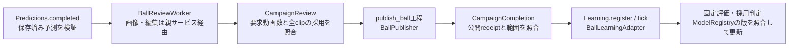

# 注釈ワークフローの接続

`python -m src.tasks.annotation` は、共通基盤とtask adapterを接続する入口。
責務分担と最終構成は[アーキテクチャ資料](../base/annotation/README.md)を正本とする。

preview campaignでは取得→プレー窓選別→clip準備→ball/player予測を実行する。
production campaignでは、現在 **ball / framesのみ**、レビュー→全clipの採用確認→
累積snapshot公開→追加学習・固定評価・モデル採用まで接続している。
player bbox/poseを含むproduction planは明示的に拒否する。実装状態と実動画検証の進捗は
[親Issue](https://github.com/Motoki0705/tennis-lab/issues/1088)で管理する。



`reviews.py` がcampaign全体の採用範囲を、`production.py` が公開と学習の接続を所有する。
base内部には具体taskの分岐を置かない。SQLiteのworkflow進捗は表示用cacheであり、
再開時は不変の要求・実行・公開receiptを照合する。

## 固定入力と起動

`Runtime` はplan・資源scope・queue script版・Codex保存先・工程別のPSS/保存量/
timeout/GPU時間を参照する。設定とreceiptはmain repositoryの `outputs/chat_annotation/`
以下へ置く。`schema --type configuration` が設定JSONの契約を返し、`configure` が
plan・scope・runtimeとその参照を持つreceiptを不変保存する。実験固有のURL、件数、
モデルpathをソースへ埋め込まない。

```bash
.venv/bin/python -m src.tasks.annotation schema --type configuration
.venv/bin/python -m src.tasks.annotation configure --configuration /absolute/configuration.json --sha256 INPUT_HASH
.venv/bin/python -m src.tasks.annotation register --runtime /absolute/runtime.json --sha256 HASH --candidates /absolute/candidates.json
.venv/bin/python -m src.tasks.annotation run --runtime /absolute/runtime.json --sha256 HASH --max-seconds 600
.venv/bin/python -m src.tasks.annotation status --runtime /absolute/runtime.json --sha256 HASH --details
```

`Configuration` は `plan`（CampaignPlan全文）、`budget`、`runtime`（plan/scope参照以外の
RuntimeSettings）を持つ。`budget.action = reuse` と既存 `scope` 参照で一連のcampaignの
使用量を継承する。新しい予算を明示作成する場合のみ `action = create` とscope ID、全計測root、
開始前の保存/GPU使用量、待機上限を指定する。作成の再送や中断後の再開でも同じbaselineを使う。
既存の停止状態をconfigureで解除しない。

configureは参照hash、selection/preparation形式、対応task、工程costと枠、Codex保存先、
queue script、productionのcode版を検証してから保存する。planが別の資源scopeへ変更される
ことを拒否する。scopeを作る場合は保存量baselineの走査を行うが、動画取得・モデルロード・
Codex/学習の起動は行わない。作成後は `configuration/result.json` の `runtime` 参照のpath/hashを
以降のCLIへ渡す。`schema --type` はruntime/candidates/operation/recoveryにも対応する。
既存scopeの作成入力をscope lock下で照合し、campaignの紐付けをDB transactionで確定してから
requestとplanを保存する。scope入力や紐付けの競合で拒否された設定は保存されず、修正して再送できる。
planの詳細は[plan](../base/annotation/plan.py)、予算の計測定義は
[resources](../base/annotation/resources/README.md)を参照する。

pathは固定annotation root内の実ファイルを指定する。相対path・外部path・hash不一致は拒否する。
`CandidateManifest` はcanonical source IDと根拠参照の一覧。過去のsource/channelは収集前に
`HistoryManifest` を持つ `HistoryOperation` を `submit --operation PATH` で登録し、
完了receiptを確認する。レビュー範囲を閉じたcampaignに候補は追加しない。

player推論の `infer_player` はpreviewでもGPU工程と正のGPU時間予約を必須とする。
productionには `review`（Codex）と `publish_ball`（CPU/I/O）のplan枠・runtime costが必要。
学習を設定したplanには `train_ball` / `evaluate_ball` のGPU枠・timeoutを含む予約が必要。
両worker poolは共通台帳と同じ資源scopeを使い、screen/reviewそれぞれの予約量で受付する。
GPU工程はmain repositoryの共有queueに投入する。queue workerの起動は
[training-queue skill](../../../.agents/skills/training-queue/SKILL.md)に従う。

学習の初期モデルは、根拠artifactを持つ `BootstrapModelOperation(task, evidence)` を
`submit` して明示的に登録する。モデルを自動選択・初期登録しない。planに固定した
レビュー方針、公開split、学習recipe、validation、採用条件の仕様は各taskのREADMEを参照する。

保存方式の検証も同じ資源scopeで実行する。`inspect_storage` で既存store全体の参照を固定し、
`compare_storage` で形式・shard共有・RGB cacheを比較する。操作入力・測定定義は
[保存比較](../base/annotation/storage/comparison/README.md)を参照する。

## 画像確認・公開・学習

screen/review workerの画像・編集要求は親controllerへ渡す。親がrequest/attempt/版/区間を
検証し、CPU工程で処理してから不変の参照を返す。採用には実際のrollout画像提示を照合し、
単なる画像生成や自己申告では完了にしない。
受付済み要求は親所有のSQLite台帳にattempt単位で累積保存し、固定上限を判定する。
inboxの並び順・削除・親の再開で枠を戻さず、同一要求の回収で二重計上しない。
workerにソース動画の全量decodeや共有cacheへの書込みを任せない。

予測は新規clipだけをtask別に束ね、1工程で同じモデルinstanceを共有する。
保存済み予測をreview requestへ変換する際は推論しない。
要求した動画数が準備済みで、全準備receiptのclipとレビュー対象が一致し、全workerが採用まで
完了した場合だけ公開する。保留・失敗・対象外workerを成功や公開対象外へ読み替えない。
公開と学習へ進む直前には、取得・準備・推論の各操作の最新attemptの成功終了とoperation receiptを検証し、
その成果物が対象source/clipの台帳参照と一致することを要求する。予測の保存と台帳更新だけでは
進めず、失敗・中断・未回収は明示的な新attemptによる復旧まで停止する。

公開結果のtask/product/base snapshot・採用版・追加clip集合を照合してから
`workflow/products.json` を作り、`workflow/completion.json` でレビューと公開操作に結ぶ。
学習recipe未設定なら公開結果を保持した `blocked`。採用条件未設定、学習失敗、採用版競合も
理由を表示して停止する。`complete` は追加教師なし、または学習後の採用/不採用の確定を表す。
不採用は `workflow.learning.state = rejected` として採用と区別する。
公開clipがheatmap負例のみ、またはMDDの有効窓を持たない場合はcoverageと公開receiptを保持し、`learning.status = no_additional_teachers`で完了する。

## 再開と報告

通常の再開は同じruntimeで `tick` または `run` を実行する。完了工程を再実行せず、
`run --max-seconds` の終了時も受付済みsupervisorは自身のtimeout・資源管理に従う。
`status --details` はworkerの現在attempt、全工程の履歴、公開完了参照、学習結果を返す。
最新attemptに置き換わった古い失敗は `superseded: true` と表示し、現在の失敗と分ける。
workflowの完了cacheがあっても、最新工程の未解決の失敗をcampaign完了で隠さない。
`cycle` / `status` はsourceの状態にかかわらず登録済みworkerを照合する。
選別がsourceを更新した直後に中断しても、workerの完了receiptと台帳更新を回収する。
`preview_ready` は台帳のprepared/predictedに加え、工程ごとの最新試行の成功終了、
operation receiptと登録成果物の一致、予測receiptの入力・モデル・成果物hashを要求する。
内容重複などで除外されたsourceは、取得・選別・準備の対象外receiptの取得参照・除外理由と台帳を照合する。
重複clipを検出した準備receiptは証拠として保持するが、除外済みsourceの準備完了としては要求しない。
predictedの保存後でも終了receiptがなければ完了にしない。未回収・失敗はblockedとし、
`submit --attempt N` で新しい試行を明示して回収する。保存済み予測は検証して再利用し、
回収のために推論し直さない。

失敗を自動で再試行しない。取得・推論・公開などは、失敗または中断を確認してから
同じ `OperationInput` を `submit --attempt N`（直前の番号+1）で実行する。
実行中・成功済み工程に新しいattemptを作ることは拒否する。
取得operationは `retry` を除いた同じ論理IDで試行を管理する。
取得失敗後は `AcquireOperation(retry=True)` のsubmitでも次のattemptを作れる。
通常の再開は最新attemptに固定された入力を回収し、同じretry指定を繰り返しても再起動しない。
そのattemptが再度失敗した場合は、さらに大きい `--attempt N` を明示する。
取得工程は入力とattempt番号・保存ディレクトリを照合し、検証済み番号または明示retry指定で再取得を許可する。

選別workerの失敗・timeout・検証失敗は、同じruntimeを使う
`retry-screen --source-id SOURCE_ID` でも新しいworker attemptを明示できる。
`screen_prepare` の `submit --attempt N` はworker attemptを増やさない。
quotaによるcampaign全体のworker停止は、原因解消後に同コマンドへ
`--resume-quota` を付けて明示解除する。通常の `run` / `tick` は失敗workerを再試行しない。

worker/学習の再試行は、`RecoveryInput(plan, reason, operation)` を固定root内に保存し、
`recover --runtime PATH --sha256 HASH --operation PATH` で実行する。

| operation | 指定内容 |
|---|---|
| `retry_worker` | 既存WorkRequest参照、再試行元の `after_attempt`。保留・失敗だけが対象 |
| `retry_learning` | 登録済みintent参照、`train` / `evaluate`、必要なら同intentのresume checkpoint |
| `resume_workers` | quota等で止まった当該campaignのworker受付を再開。資源stopは解除しない |

再試行理由と結果を不変保存し、同じ要求の再送は結果を返す。worker開始後、結果保存前に親が
落ちた場合は、変わったattemptを再起動せず現在状態の確認を要求する。学習再試行は次のtickで
queueへ投入する。資源stopは原因解消後の `resume-budget --reason TEXT` で解除する。
scopeや累計を初期化して上限を回避しない。

`stage` はsupervisor専用で、固定した入力digestとの対応を要求する。
置換済みballの旧run/qa/intakeと旧annotateのball注釈・finalize入口は撤去済み。置換先が未実装のplayer用入口は残す。旧形式の読取と保存台帳への登録は
[migration](migration/README.md)を参照する。
