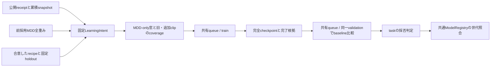

# 注釈公開後のball追加学習

`BallLearningAdapter`は[共通Learning](../../../base/annotation/learning/README.md)へ渡すtask実装。
公開snapshotのtrain所属、固定holdout、採用MDD全重みを検証してから、学習・比較評価を別工程として実行する。
production controllerへの接続は[ワークフロー](../../../annotation/README.md)を参照する。CPU合成試験は実動画受入の代替ではない。

## 固定する入力

`BallLearningRecipe`にsampling、augmentation参照、runtime、epoch/update予算と学習率等を明示する。
数値の学習予算や採用条件の既定値は置かない。32frame・upfront入力照合等の構造条件はschemaで固定する。
`FixedEvaluation`のvalidation/testは[holdout binding](../../data/windows/learning/README.md)で検証する。
testはsource/clip重複の検査だけに用い、学習・候補選択では読まない。

登録時に窓とcoverageを生成し、登録後は保存した入力が欠けていれば停止する。
追加clipに座標教師を含む窓が無い場合はcoverageを保存し、共通管理へ`NoAdditionalTeachers`を返す。公開を保持した終端結果となり、旧clipだけで追加学習しない。
初期モデル・recipe・累積snapshot・intentのdigestを通常のfull-model学習recipeへ組み込む。
新runは全重みを転送し、optimizer/scheduleは初期化する。

## 工程と再開

共通管理が返すコマンドは`python -m src.tasks.ball_detection.training.annotation`。
`--input`、`--input-sha256`、`--output`を受け取り、supervisorの入力digestと
`campaigns/<campaign>/learning/ball/<train|evaluate>/<attempt>/`の所有範囲を照合する。
CLIはproduction固定rootを使う。自身でqueue投入やモデル採用を行わない。

重みは`outputs/ball_detection/train/annotation/<intent-sha256>/attempt-<番号>/`へ保存する。
最終epochと更新回数、bestのCommon指標、親全重みhash、config、source hash、
候補specとcheckpointの一致を確認して`TrainingReceipt`を返す。
stressを指定したrecipeでは3 profileの保存結果も必要となる。

中断したepochは、共通管理の理由付きretryで同intent・同recipeの最新完了checkpointを明示する。
途中runはそのoptimizer/scheduleを再開し、既に完了したrunは追加更新せずreceiptを回収する。
完成したreceiptの再回収も同じ参照を返す。別snapshotへの入力差替えや自動retryは行わない。
最終checkpointだけがあり`COMPLETED.json`が無い場合も、同じ明示retryで再開できる。
重み・optimizer・bestを照合して更新を追加せず、指定したstress評価と完了記録の保存を実行する。

## 比較と採否

同じ固定validation・runtime・モデル構造でbaseline/candidateを比較する。
全体・Common・各sourceについて、採点FPS/clip/frame集合hash、支持数、有限な誤差と
macro平均の整合性を検証する。実checkpointのstate hash、学習manifest hash、
成功した学習工程との対応も`EvaluationReceipt`受理前に確認する。

`BallSelectionPolicy`はCommonの最小支持数・最大誤差・必要改善量、Fullの許容悪化量、
任意のsource別支持数・許容悪化量を持つ。source条件はFullのsource別macroを使う。
必要なsource/FPSが欠けていれば不合格。条件はすべて満たす必要があり、境界値は含める。
policy未設定なら共通管理が学習・評価を保存したうえで`not_configured`を返し、現行モデルを保持する。
合格後の世代照合とpointer切替は共通ModelRegistryの責務。
