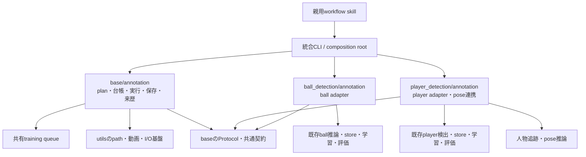
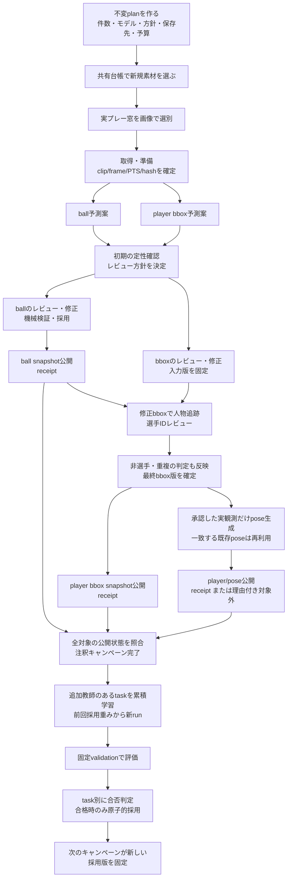
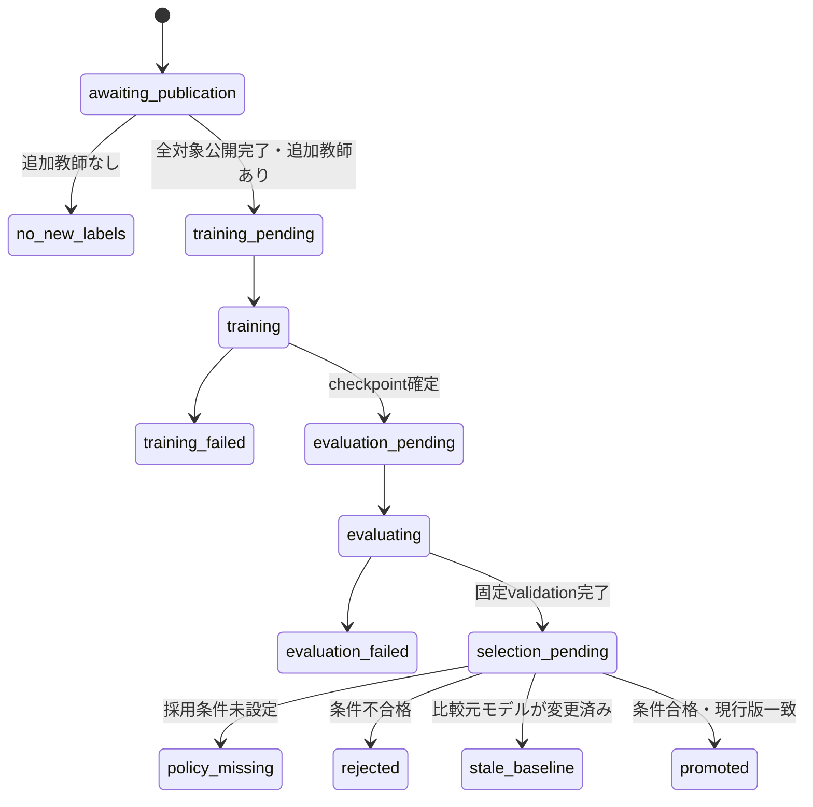
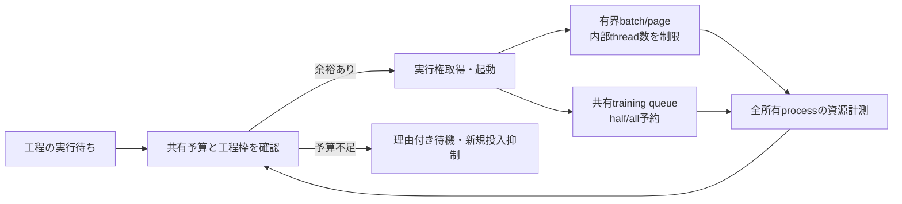
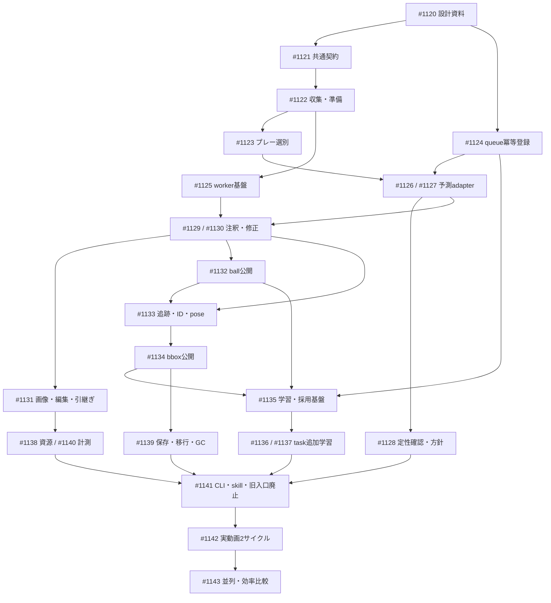

# 注釈・データセット公開・継続学習のアーキテクチャ

[親Issue #1088](https://github.com/Motoki0705/tennis-lab/issues/1088) の変更後設計。
新規クリップにball/player検出器で予測案を作り、ローカルCodexによるレビュー・修正を経て
採用データを公開する。公開が完了したキャンペーンごとに、前回の採用重みと累積教師から
検出器を追加学習し、固定validationで条件を満たすモデルを次のキャンペーンへ渡す。

この文書は責務・依存・永続化の設計契約であり、機能が実装済みであることを示さない。
実装と実データ検証の状態は各サブIssueで管理する。
初期モデルの候補や計測予算などrun固有の判断は親Issueとplanに置く。

共通契約のAPIは [contracts.py](contracts.py)、planの検証・不変保存は
[plan.py](plan.py)、出力境界は [paths.py](paths.py) が所有する。
`AnnotationLayout.production()` はgit共通rootを使用し、テストだけが
`AnnotationLayout.testing(absolute_path)` を使う。
`save_plan()` は参照ファイルのhash/sizeを検証してから原子的に保存し、
同一campaignへの異なるplanを拒否する。実行前にも `validate_inputs()` を呼ぶ。
`load_plan(expected_digest=...)` で登録済みplanの改変を検出する。
ballとposeが同じdataset versionを参照するときは、公開する `component` を分ける。
素材の共有台帳・取得・明示区間の準備APIは [collection](collection/README.md) を参照する。

## 1. 何が変わるか

| 現状 | 変更後 |
|---|---|
| `tennis_scene/chat_annotation` に共通制御とtaskの意味が同居 | baseが実行・保存・来歴、ball/playerがモデル・ラベル・教師公開を所有 |
| ChatGPT用kit・MCP受領とローカルCodexが併存 | ローカルCodexの正式なワークフローへ統合 |
| レビュー後に独立QAと追加の採用承認 | 方針に沿うレビュー・機械検証・採用から直接公開 |
| manifestをまとめて登録し、campaign単位で重複を防止 | 共有台帳で新規素材を段階登録し、campaign横断で実行権を管理 |
| 既存候補経路はheatmapモデルを前提 | MDD座標とplayer bboxをtask別adapterで予測案に変換 |
| playerのID選別が中心 | bboxの修正・追加・除去を追跡、最終教師、poseまで保持 |
| 公開・追加学習の一部が個別運用に依存 | 不変snapshot・公開receipt・学習ジョブ・モデル採用を接続 |

通常の注釈用推論は新規clipだけに行う。モデルを更新しても、公開済みデータの再推論・
再注釈・教師上書きは発生しない。固定validationへの評価推論は別工程である。
poseの生成・公開は含むが、poseモデル自体の追加学習は含まない。

## 2. コードの責務と依存の向き



矢印はコードの依存を表す。baseはball/playerのラベル・モデル出力・損失・指標を解釈しない。
task adapterを選んでbaseへ渡すcomposition rootは、baseの外側に置く
（予定入口: `python -m src.tasks.annotation`）。base内部にtask名による分岐や
具体taskのimportを置かず、共通処理をtaskごとに複製しない。

| 所有先 | 所有する責務 | taskへ委譲する部分 |
|---|---|---|
| `base/annotation/contracts`・`plan` | clip/frame/PTS、hash、plan、成果物参照、receipt、明示状態 | 球の状態、bboxの意味、教師maskの決定 |
| `base/annotation/collection`・`screening` | 新規channel/videoの履歴、取得、プレー窓選定、動画準備、段階登録 | 各検出器の前処理・予測 |
| `base/annotation/ledger`・`workers` | 排他、attempt、停止/再開、gpt-6.1-sol起動、工程制御 | workerへ渡す必須ラベル規則、編集・意味検証 |
| `base/annotation/images`・`editing`・`handoff` | ページ生成、座標変換、版照合、原子的更新、差分入力/出力 | 探索領域、補間やtrack/event境界、表示内容 |
| `base/annotation/learning`・`models` | 学習/評価ジョブ、来歴、採用版の競合検出、モデル固定 | 初期重み読込、recipe、export、指標と合否判定 |
| `base/annotation/resources`・`storage` | 工程枠、予算、参照保護、移行/GC | dataset内部の参照列挙・形式検証 |
| `base/annotation/telemetry`・`reports` | 応答ID別usage、画像/操作の来歴、時系列索引 | 工程・編集操作の分類 |
| `ball_detection/annotation` | MDD等の推論adapter、ball schema、レビュー・修正・採用 | 共通の実行・永続化はbaseを利用 |
| `ball_detection/generate_dataset/frame_store` | ball教師の増分snapshot公開 | 保存形式とreaderの正本を維持 |
| `player_detection/annotation` | bbox予測・修正・採用、修正bboxからの追跡/ID/pose連携 | 追跡・poseの既存モデル実装を再利用 |
| `player_detection/generate_dataset` | 最終bbox教師の増分公開、確認済み空target | bbox storeとpose成果物を別管理 |

ここで示すモジュール名は配置の設計である。各taskの詳細仕様は
[ball README](../../ball_detection/README.md)、[player README](../../player_detection/README.md)へ置く。
共通学習・推論の既存APIは[base README](../README.md)を参照する。

## 3. 1キャンペーンの流れ



初期の定性確認は、本格運用前にモデル・代表入力・設定を固定して行う。
レビュー方針が決まるまではpreviewで止める。方針決定後のcampaignではその版をplanに固定し、
各clipに独立したQAや親による再画像点検を追加しない。

ball、player bbox、player/poseは別々の公開receiptを持つ。poseが生成対象外でも、
条件を満たすbbox教師は公開できる。失敗・保留・未生成は「対象外」や「公開済み」と同一にしない。
全対象工程が公開済みまたは規則に基づく理由付き対象外になってから自動学習を開始する。

## 4. 素材選定とクリップ契約

件数は `channels`、`videos_per_channel`、`max_clips_per_video` の独立パラメータとする。
10×10×5は100動画・最大500clipを意味し、実際に500clipを取得したという意味ではない。
選定・取得・準備・除外・不足の件数と理由を別に報告する。

標準のクリップ選別は、確認済みの現行運用を継承する。

1. 動画の全時間から候補を探し、画像で通常速度の実プレー区間を確認する。
2. 15秒窓のうち、実プレーが厳密に7.5秒を超える窓を採用する。候補窓同士を重ねず、
   同じラリーの別リプレイを重複採用しない。
3. サーブトスで球が手から離れてからポイント終了までを実プレーとする。
   待機、球拾い、トス前の球つき、説明、客席、スロー/別角度リプレイは含めない。
   一時的な遮蔽や画面外だけを理由にプレー終了と判定しない。
4. 前後1秒をcontextとし、中央13秒を注釈対象にする。`in_play`の実区間、選定根拠画像、
   source hash、media/target範囲を別々に保存する。

これは非プレー部分を完全に除いた13秒を保証する契約ではない。
不足時には本数を捏造せず、除外・補充・不足理由を残す。
旧実装の「必ず5本」はplanの件数へ置き換える。

MDDは32枚の実フレームと単調増加する実時刻を要求する。
通常の15秒clipにpaddingは不要であり、推論前に実frame数を検証する。
契約外の入力を黙ってpaddingしたり、架空の時刻を足したりしない。
不足入力は明示的なエラー/準備の見直し対象とし、処理済みframeへ数えない。
長いclipでは32frameの窓を用い、末尾まで覆う。重複予測は既存評価の中心優先規約で選び、
同点では開始位置の早い窓を使う。

共有台帳はcanonical channel/video ID、元動画のframe/PTS区間、mediaと内容のhashを照合する。
再エンコードでbytesが変わっても同じsource区間を別の新規clipとして扱わない。
出典identityが不明な素材を、ファイル名や内容の見た目だけで同一/別物と推測しない。

## 5. 予測・確認・採用を分ける

ラベルの意味、由来、実際の画像確認範囲は別の軸として持つ。
全frameの行と時刻を保持することは、全frameをGPTが画像確認したことを意味しない。

| 軸 | 記録する内容 | 禁止する短絡 |
|---|---|---|
| 予測 | 入力/モデル/設定hash、元の座標またはbbox、予測row ID | MDDにないconfidence/presenceの生成 |
| 画像提示 | frame/PTS、crop、倍率、描画種別、注釈版、bytes hash | 画像を提示しただけで確認済みにする |
| 画像確認 | 実際に確認したframe範囲、根拠、未確認/保留 | 一括採用で未確認予測を確認済みにする |
| ラベル由来 | 元予測、修正、追加観測、補間、除去の履歴 | 補間を実観測・画像確認と同一にする |
| 意味 | task固有の対象なし/遮蔽/未解決、対象選手/非選手等 | 検出ゼロを確認済み対象なしにする |
| 採用 | 方針版、教師mask、対象revision、採用理由 | 未設定の方針で自動採用する |
| 公開 | 不変snapshot、入力hash、追加/再利用/skip、receipt | ファイルの存在だけで公開完了とする |

球の位置やbboxはtaskの元画像座標契約に従う。cropと元画像の変換は道具が行う。
crop内で球が見つからなければ広域の画像へ戻れるようにし、crop外を「対象なし」と決めない。
playerの手動追加観測には固有IDと実画像の出典を持たせ、モデルconfidenceを捏造しない。
追跡側もスコアの由来を区別する入力契約へ合わせる。

## 6. 永続化と中断再開

### planと共有台帳

planは件数・対象工程・生成条件・モデル参照・前処理/推論設定・レビュー方針・学習recipe・
固定validation・採用条件・公開先・予算・コード版を固定する。不変JSONと内容hashを保持し、
再開時に一部だけ差し替えない。preview planと本運用planを区別する。

campaign横断の共有台帳はSQLiteのtransactionで管理する設計とする。
素材identity、工程intent、所有lease、artifact参照、公開receipt、学習job、モデル採用履歴を
一つの整合性境界に置く。大きな画像・動画・checkpoint・注釈本文はDBへ格納せず、
不変ファイルの参照とhashを保存する。status用JSONは導出表示であり、第二の状態正本にしない。

### 副作用を伴う工程

| 工程 | 冪等性を決める入力 | 停止後の照合 |
|---|---|---|
| 取得・準備 | canonical source、区間、準備設定 | media/manifest hashと準備receipt |
| 予測 | clip/frame identity、task、モデル、推論設定 | 不変予測とhash。完了分は再実行しない |
| レビュー・採用 | 入力revision、方針版、編集operation ID | 履歴と現在版。古い版への編集は拒否 |
| dataset公開 | base snapshot、採用差分、split、設定 | staging、完成snapshot、receipt |
| GPU登録 | 意図した工程/attemptのidempotency keyと要求hash | queue全状態から同じjob IDを再発見 |
| 学習・評価 | snapshot、初期モデル、recipe、validation | job、checkpoint、評価receipt |
| モデル採用 | candidate、評価条件、比較元モデル版 | transaction内の現行版照合と採用履歴 |

処理の意図を保存してから副作用を実行し、成果物を検証して完了を確定する。
ファイルのrenameとDB更新は一つのtransactionにはならないため、
完成ファイルがあるがreceipt未登録、という停止点も明示的に回復する。
同じ処理を無条件にやり直すことで解決しない。

GPU queueの受付は任意の冪等keyに対応させる。同一key・同一要求なら既存IDを返し、
内容が違えば拒否する。失敗後に意図して再試行する場合は、新しいattemptのkeyを発行する。
既存queueのlogical half/all予約、process group所有・終了確認は維持する。

### 公開とreader

新しい累積データは新しいdataset version/snapshotとして公開する。
既存shardは不変のまま共有し、新しいindex/metadataと追加shardをstagingで検証する。
完成したversionを原子的に公開してからreceiptを確定する。readerは明示snapshotを開くため、
公開途中の複数ファイルや可変の最新ディレクトリを読まない。

既存clipのsplit・画素・frame/PTS・ラベル・教師mask・row identityは保持する。
player poseの再利用ではmediaだけでなく、最終bbox・IDレビュー・観測rowの対応も検証する。
旧pose manifestの参照先だけを新storeへ差し替えない。

## 7. 保存先

通常実行の注釈rootは、git共通rootにある `outputs/chat_annotation` に固定する。
worktreeのカレントディレクトリで別rootを作らない。
下記は新しい登録済み構造であり、既存データを直ちに移動する指示ではない。

```text
<main-repository>/
├── outputs/chat_annotation/
│   ├── registry.sqlite3                   # 共有台帳・工程状態・モデル採用履歴
│   ├── media/{sources,clips}/<identity>/   # 共有素材とmanifest
│   ├── predictions/<task>/<identity>/     # 入力/モデル/設定hash付き元予測
│   ├── annotations/<task>/<clip>/<rev>/    # 不変revision・確認/採用根拠
│   ├── campaigns/<campaign-id>/
│   │   ├── plan.json
│   │   ├── tasks/<task-id>/attempts/<n>/work/
│   │   ├── logs/
│   │   └── reports/                       # usage索引・応答別詳細
│   ├── cache/                             # 容量/期限/参照管理付き派生画像等
│   └── migration/{plans,staging,archive}/  # 登録済み移行と退避
├── data/ball_detection/<version>/         # ball snapshotと対応するpose
├── data/player_detection/<version>/       # bbox教師snapshot
├── outputs/<task>/train/<experiment>/<run-id>/
└── .training_queue/                       # worktree共通のGPU実行queue
```

学習出力とcheckpointの配置は[タスク出力規約](../../OUTPUTS.md)が正本である。
checkpointを注釈rootへ複製せず、版とhash付きで参照する。
dataset公開stagingは同じfilesystem上の登録済み領域に置き、対応するversionへrenameする。
任意の兄弟root、`..`、symlinkを使う境界外出力はCLI開始前に拒否する。
テスト専用一時rootは明示モードで分離する。

GCは再生成可能cache、原本、採用根拠、稼働中attempt、公開snapshot、学習入力を区別する。
dry-runと実行直前の参照再照合を行う。論理bytesとinode重複排除後の割当量を別々に測り、
hardlinkされたsnapshotの論理サイズを、そのまま削減可能量と扱わない。

## 8. 学習・評価・次回モデル採用



ball/playerは独立したモデル系列・評価条件・採用版を持つ。
新runは前回採用済みの**全モデル重み**と、既存＋新規の累積教師を使用する。
optimizer/scheduleは追加学習recipeで明示する。
同じrunのresumeは同じsnapshot・recipe・初期モデルを要求し、dataset差し替えに使わない。

train/validation/testは元動画・clip identityで分離する。
採用条件にはvalidationの指標、許容退行、支持数/評価完了条件を含める。
testをcandidateの反復的な調整へ使わない。
MDDに存在しないconfidence/presenceを指標へ使わず、playerのpartial labelを完全教師と扱わない。

採用時は「現在のモデル版が、評価した比較元と同じか」をtransaction内で照合する。
並行学習した古いcandidateが新しい採用版を上書きすることを防ぐ。
比較元が変わったcandidateは再評価待ち等の明示状態にする。
採用の有無は次campaignへだけ反映し、進行中campaignや過去の注釈を変更しない。

注釈公開が成功していても学習失敗なら、その二つを別の結果として報告する。
不合格・評価未完了・採用条件未設定では現行モデルを維持する。

## 9. 並列数・メモリ・I/O

Codexの並列数はballレビュー、bbox修正、選手IDレビューの合計で10〜50とする。
取得・decode/encode・sheet生成・書込・GPU推論/追跡/pose/学習/評価には別々の枠を持つ。
レビュー待ちの間はGPU枠を占有しない。



画像sheetはページ単位にdecode・生成・保存・解放する。
全clipのtile、全attemptログ、全rolloutを一覧のためにメモリへ読み込まない。
予測案は共有し、各Codex workerが同じモデル重みを別々にloadする構成を避ける。

planは追加保存量、最低空き容量、処理全体のPSS予算、GPU累計時間、工程別上限を持つ。
PSSは所有するprocess群の重複を除いて集計し、RSSと測定定義を併記する。
別の処理による空き容量変化も再確認する。
予算不足時には新規投入を抑制して理由を記録し、無制限retryや別root退避で続行しない。

10/25/50の比較では設定値と実際の同時稼働数を別々に記録する。
設定50・実稼働10を50並列の検証としない。未達の条件は未検証として残す。

## 10. 画像・編集・usageの計測

時系列cropは予測/確認位置に追従できるようにするが、元座標・crop原点・倍率・時刻を保持する。
固定領域や全体画像も取得できるようにし、追従表示で見かけの移動が失われる点を確認可能にする。
画像のidentityはファイル名ではなく、元clip/frame・crop・倍率・描画種別・注釈版・bytes hashで定める。

一括編集は現在版、端点、track/event境界、変更可能な派生範囲を検証してから適用する。
確認済み実観測を暗黙に上書きせず、カット・打球・バウンド・ID境界を越える補間を拒否する。
解消したnotesを現行表示から整理しても、編集履歴は保持する。
通常のtool出力は変更範囲・変更前後・件数・未解決・保存先に絞る。

usageはthread/attempt/`response_id`で重複排除する。
入力・cached入力・出力、累積量、コンテキスト近似を分ける。
IDやusageが取れない記録は欠損であり、token通知数を正確なAPI呼出し数の代用にしない。
画像とtool結果は、それらを受け取った次の応答へ結び付ける。
記録時の画像bytes/不変参照を保存し、後日更新された作業画像を過去入力に使わない。

比較の基準は既存の候補cacheと画像batch化を使う方式である。
道具の改善と推論器自体の変更を分け、ball/playerを別々に測る。
token・時間のほか、品質、GPU事前推論・追加学習コスト、探索/編集往復、引継ぎ、保存量を併記する。
この比較のために通常clipの独立QA承認を復活させない。

## 11. 移設・廃止の境界

| 旧所有先 | 新所有先/扱い |
|---|---|
| `preparation`・`sampling`・manifest/media検証 | baseのcollection/media。Chat kit依存を共通契約から外す |
| campaign worktreeの`clip_screening` | baseのscreening。未マージの元差分と内容hashを保存して移設 |
| `local_agent`のcampaign/attempt/process制御 | baseのworkers/ledger/resources |
| ball候補・ball編集・球状態のschema/検証 | ball taskのannotation |
| player候補・bbox編集・人物schema/検証 | player taskのannotation |
| `player_pose` | player taskの追跡/ID/pose連携 |
| 共通の画像ページ・版付き更新・入力組立 | baseのimages/editing/handoffとtask adapter |
| `qa`・`audit`・QA note・QA待ち・`phase2`再注釈 | 独立QA/既存clip再注釈の運用入口を廃止 |
| ChatGPT kit・Project/REQUEST・handoff・MCP/Tunnel/Docker | remote運用入口と専用依存を廃止 |
| ローカルpreview・編集・path resolver・採用履歴 | 必要な機能を新所有先へ移し、remoteと一緒に消さない |
| 旧raw JSON/ZIP・QA成果物 | 既存成果物として保管。通常経路とは別の移行readerで検証 |

新入口へ切り替える際に旧import・設定・テスト・文書も変更し、互換facadeを恒久運用しない。
既存campaignや参照中datasetを無断で変更しない。
旧データの移動・削除はコード移設とは別の操作として扱い、dry-runと参照検証を先に行う。

## 12. タスク分割と実装順

| Issue | 成果物 | 先行Issue |
|---|---|---|
| [#1120](https://github.com/Motoki0705/tennis-lab/issues/1120) | 注釈・継続学習の変更後アーキテクチャと責務境界を文書化する | — |
| [#1121](https://github.com/Motoki0705/tennis-lab/issues/1121) | 注釈キャンペーンの共通契約・不変plan・固定rootを実装する | [#1120](https://github.com/Motoki0705/tennis-lab/issues/1120) |
| [#1122](https://github.com/Motoki0705/tennis-lab/issues/1122) | 共有台帳で新規素材の選定・取得・クリップ準備を再開可能にする | [#1121](https://github.com/Motoki0705/tennis-lab/issues/1121) |
| [#1123](https://github.com/Motoki0705/tennis-lab/issues/1123) | 実プレー区間の画像選別をクリップ準備の標準経路へ移す | [#1122](https://github.com/Motoki0705/tennis-lab/issues/1122) |
| [#1124](https://github.com/Motoki0705/tennis-lab/issues/1124) | GPU queueへの同一要求の登録を冪等にする | [#1120](https://github.com/Motoki0705/tennis-lab/issues/1120) |
| [#1125](https://github.com/Motoki0705/tennis-lab/issues/1125) | task adapterでローカル注釈ワーカーを実行し独立QAを廃止する | [#1121](https://github.com/Motoki0705/tennis-lab/issues/1121), [#1122](https://github.com/Motoki0705/tennis-lab/issues/1122) |
| [#1126](https://github.com/Motoki0705/tennis-lab/issues/1126) | MDD座標モデルで新規クリップのball予測案を生成する | [#1121](https://github.com/Motoki0705/tennis-lab/issues/1121), [#1122](https://github.com/Motoki0705/tennis-lab/issues/1122), [#1124](https://github.com/Motoki0705/tennis-lab/issues/1124), [#1123](https://github.com/Motoki0705/tennis-lab/issues/1123) |
| [#1127](https://github.com/Motoki0705/tennis-lab/issues/1127) | player検出器で新規クリップのbbox予測案を生成する | [#1121](https://github.com/Motoki0705/tennis-lab/issues/1121), [#1122](https://github.com/Motoki0705/tennis-lab/issues/1122), [#1124](https://github.com/Motoki0705/tennis-lab/issues/1124), [#1123](https://github.com/Motoki0705/tennis-lab/issues/1123) |
| [#1128](https://github.com/Motoki0705/tennis-lab/issues/1128) | 新規clipの予測を定性確認しレビュー方針・固定評価条件を決める | [#1126](https://github.com/Motoki0705/tennis-lab/issues/1126), [#1127](https://github.com/Motoki0705/tennis-lab/issues/1127) |
| [#1129](https://github.com/Motoki0705/tennis-lab/issues/1129) | ball予測の差分編集・確認範囲・採用由来を保存する | [#1125](https://github.com/Motoki0705/tennis-lab/issues/1125), [#1126](https://github.com/Motoki0705/tennis-lab/issues/1126) |
| [#1130](https://github.com/Motoki0705/tennis-lab/issues/1130) | player bboxの修正・追加・除去と確認済み空targetを表現する | [#1125](https://github.com/Motoki0705/tennis-lab/issues/1125), [#1127](https://github.com/Motoki0705/tennis-lab/issues/1127) |
| [#1131](https://github.com/Motoki0705/tennis-lab/issues/1131) | 時系列crop・差分入力・一括編集・構造化引継ぎを共通化する | [#1129](https://github.com/Motoki0705/tennis-lab/issues/1129), [#1130](https://github.com/Motoki0705/tennis-lab/issues/1130) |
| [#1132](https://github.com/Motoki0705/tennis-lab/issues/1132) | ball frame storeを不変snapshotとして増分公開する | [#1129](https://github.com/Motoki0705/tennis-lab/issues/1129), [#1121](https://github.com/Motoki0705/tennis-lab/issues/1121) |
| [#1133](https://github.com/Motoki0705/tennis-lab/issues/1133) | 修正bboxから追跡・IDレビュー・選択pose公開まで接続する | [#1130](https://github.com/Motoki0705/tennis-lab/issues/1130), [#1132](https://github.com/Motoki0705/tennis-lab/issues/1132), [#1124](https://github.com/Motoki0705/tennis-lab/issues/1124) |
| [#1134](https://github.com/Motoki0705/tennis-lab/issues/1134) | 最終player bboxを空target込みの増分snapshotへ公開する | [#1130](https://github.com/Motoki0705/tennis-lab/issues/1130), [#1133](https://github.com/Motoki0705/tennis-lab/issues/1133) |
| [#1135](https://github.com/Motoki0705/tennis-lab/issues/1135) | 公開receiptから学習・評価・モデル採用を再開可能にする | [#1121](https://github.com/Motoki0705/tennis-lab/issues/1121), [#1124](https://github.com/Motoki0705/tennis-lab/issues/1124), [#1132](https://github.com/Motoki0705/tennis-lab/issues/1132), [#1134](https://github.com/Motoki0705/tennis-lab/issues/1134) |
| [#1136](https://github.com/Motoki0705/tennis-lab/issues/1136) | 採用MDD重みと累積snapshotからball追加学習・評価を行う | [#1135](https://github.com/Motoki0705/tennis-lab/issues/1135) |
| [#1137](https://github.com/Motoki0705/tennis-lab/issues/1137) | 採用player重みと累積bbox snapshotから学習・export・評価を行う | [#1135](https://github.com/Motoki0705/tennis-lab/issues/1135) |
| [#1138](https://github.com/Motoki0705/tennis-lab/issues/1138) | 10〜50ワーカーの共有資源予算と工程別バックプレッシャーを実装する | [#1125](https://github.com/Motoki0705/tennis-lab/issues/1125), [#1124](https://github.com/Motoki0705/tennis-lab/issues/1124), [#1131](https://github.com/Motoki0705/tennis-lab/issues/1131) |
| [#1139](https://github.com/Motoki0705/tennis-lab/issues/1139) | 固定root内の保存量棚卸し・旧成果物移行・参照保護GCを実装する | [#1122](https://github.com/Motoki0705/tennis-lab/issues/1122), [#1132](https://github.com/Motoki0705/tennis-lab/issues/1132), [#1133](https://github.com/Motoki0705/tennis-lab/issues/1133), [#1134](https://github.com/Motoki0705/tennis-lab/issues/1134) |
| [#1140](https://github.com/Motoki0705/tennis-lab/issues/1140) | 応答ID単位のusageと入力画像・操作・注釈差分を追跡する | [#1125](https://github.com/Motoki0705/tennis-lab/issues/1125), [#1131](https://github.com/Motoki0705/tennis-lab/issues/1131) |
| [#1141](https://github.com/Motoki0705/tennis-lab/issues/1141) | 親用workflowと正式CLIを統合し旧ChatGPT運用入口を廃止する | [#1128](https://github.com/Motoki0705/tennis-lab/issues/1128), [#1136](https://github.com/Motoki0705/tennis-lab/issues/1136), [#1137](https://github.com/Motoki0705/tennis-lab/issues/1137), [#1138](https://github.com/Motoki0705/tennis-lab/issues/1138), [#1139](https://github.com/Motoki0705/tennis-lab/issues/1139), [#1140](https://github.com/Motoki0705/tennis-lab/issues/1140) |
| [#1142](https://github.com/Motoki0705/tennis-lab/issues/1142) | 実動画で2サイクルの公開・追加学習・次回モデル選択を検証する | [#1141](https://github.com/Motoki0705/tennis-lab/issues/1141) |
| [#1143](https://github.com/Motoki0705/tennis-lab/issues/1143) | 10/25/50並列と注釈効率・保存量を同条件で比較する | [#1142](https://github.com/Motoki0705/tennis-lab/issues/1142) |



依存は開発・検証の前提であり、dataset公開の実行順は第3節の図に従う。
bbox公開とpose公開は別receiptを持ち、pose対象外を理由にbbox教師まで捨てない。
初期previewは本格運用前に行い、レビュー/教師採用の実運用はそこで確定した方針に従う。

## 13. 親Issueの受入条件との対応

| 親Issueの受入条件（原文の順） | 主な担当 |
|---|---|
| 1. 独立QAの廃止 | [#1125](https://github.com/Motoki0705/tennis-lab/issues/1125), [#1141](https://github.com/Motoki0705/tennis-lab/issues/1141) |
| 2. 共通/task責務への移設と旧経路廃止 | [#1121](https://github.com/Motoki0705/tennis-lab/issues/1121), [#1125](https://github.com/Motoki0705/tennis-lab/issues/1125), [#1141](https://github.com/Motoki0705/tennis-lab/issues/1141) |
| 3. 新規clipの定性確認と方針記録 | [#1128](https://github.com/Motoki0705/tennis-lab/issues/1128) |
| 4. MDDを含む新規clip推論とframe対応 | [#1126](https://github.com/Motoki0705/tennis-lab/issues/1126), [#1127](https://github.com/Motoki0705/tennis-lab/issues/1127) |
| 5. 10ch・100動画・最大500clipの一意な計画 | [#1121](https://github.com/Motoki0705/tennis-lab/issues/1121), [#1122](https://github.com/Motoki0705/tennis-lab/issues/1122), [#1123](https://github.com/Motoki0705/tennis-lab/issues/1123) |
| 6. 既存clipの再推論・教師上書き防止 | [#1122](https://github.com/Motoki0705/tennis-lab/issues/1122), [#1126](https://github.com/Motoki0705/tennis-lab/issues/1126), [#1127](https://github.com/Motoki0705/tennis-lab/issues/1127), [#1135](https://github.com/Motoki0705/tennis-lab/issues/1135), [#1142](https://github.com/Motoki0705/tennis-lab/issues/1142) |
| 7. ball/playerの修正・追加・除去を教師へ反映 | [#1129](https://github.com/Motoki0705/tennis-lab/issues/1129), [#1130](https://github.com/Motoki0705/tennis-lab/issues/1130), [#1134](https://github.com/Motoki0705/tennis-lab/issues/1134) |
| 8. 正式CLI/skillだけで3種datasetを公開 | [#1141](https://github.com/Motoki0705/tennis-lab/issues/1141), [#1142](https://github.com/Motoki0705/tennis-lab/issues/1142) |
| 9. 修正bbox・承認実観測だけのposeと再利用 | [#1133](https://github.com/Motoki0705/tennis-lab/issues/1133) |
| 10. 累積追加学習・評価・次回モデル採用 | [#1135](https://github.com/Motoki0705/tennis-lab/issues/1135), [#1136](https://github.com/Motoki0705/tennis-lab/issues/1136), [#1137](https://github.com/Motoki0705/tennis-lab/issues/1137), [#1142](https://github.com/Motoki0705/tennis-lab/issues/1142) |
| 11. 失敗/不合格/条件未設定/追加教師なしの区別 | [#1135](https://github.com/Motoki0705/tennis-lab/issues/1135), [#1142](https://github.com/Motoki0705/tennis-lab/issues/1142) |
| 12. 中断・再試行・同時実行の二重処理防止 | [#1124](https://github.com/Motoki0705/tennis-lab/issues/1124), [#1125](https://github.com/Motoki0705/tennis-lab/issues/1125), [#1132](https://github.com/Motoki0705/tennis-lab/issues/1132), [#1133](https://github.com/Motoki0705/tennis-lab/issues/1133), [#1134](https://github.com/Motoki0705/tennis-lab/issues/1134), [#1135](https://github.com/Motoki0705/tennis-lab/issues/1135), [#1142](https://github.com/Motoki0705/tennis-lab/issues/1142) |
| 13. 増分公開後の既存identity・mask・snapshot保持 | [#1132](https://github.com/Motoki0705/tennis-lab/issues/1132), [#1133](https://github.com/Motoki0705/tennis-lab/issues/1133), [#1134](https://github.com/Motoki0705/tennis-lab/issues/1134) |
| 14. 固定root・移行・GCの参照保護 | [#1121](https://github.com/Motoki0705/tennis-lab/issues/1121), [#1139](https://github.com/Motoki0705/tennis-lab/issues/1139) |
| 15. 保存方針の比較と実使用量の差分 | [#1139](https://github.com/Motoki0705/tennis-lab/issues/1139), [#1143](https://github.com/Motoki0705/tennis-lab/issues/1143) |
| 16. 並列10/25/50の実稼働・資源予算の実測 | [#1138](https://github.com/Motoki0705/tennis-lab/issues/1138), [#1143](https://github.com/Motoki0705/tennis-lab/issues/1143) |
| 17. 時系列crop・差分・引継ぎ・一括編集 | [#1131](https://github.com/Motoki0705/tennis-lab/issues/1131) |
| 18. 応答ID別usageと画像/操作の時系列 | [#1140](https://github.com/Motoki0705/tennis-lab/issues/1140) |
| 19. 現行方式とのtoken・時間・品質・GPUコスト比較 | [#1143](https://github.com/Motoki0705/tennis-lab/issues/1143) |
| 20. 正本と責務の一意性・別campaignの設定駆動 | [#1120](https://github.com/Motoki0705/tennis-lab/issues/1120), [#1141](https://github.com/Motoki0705/tennis-lab/issues/1141) |

CPU fixtureによる契約・障害注入・CLI E2E、実モデルでの少数clip/短時間学習、
2サイクルと10/25/50並列の実測を区別して結果を残す。
自動テストだけで実モデルの品質・GPU資源・実稼働並列数を検証済みにしない。

## 14. 本運用前に固定する判断

初期候補は明示的に登録し、最も新しいファイルや`last`を自動選択しない。
登録時にcheckpoint/exportと学習重みの対応・hashを検証する。
代表clipの実推論後に、次の事項を根拠とともに確定する。

- ball/playerそれぞれのレビュー要否・範囲、未確認予測の扱い、教師maskと採用条件。
- 元動画単位で学習から分離した固定validationと、対象なし・非選手等の評価範囲。
- 座標/bbox指標、許容退行、必須評価の完了条件、欠測やpartial教師の扱い。
- 追加学習recipeと実測に基づく各工程の資源配分。

既存runのbest scoreは採用閾値ではない。
playerの既存validationが空targetを持たない場合、誤検出の評価不足を補う固定例を用意する。
条件が決まらない、または予算内で実測できない項目を完了として扱わない。
