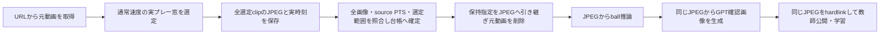

# 素材の取得・共有台帳・クリップ準備

`Collection(layout, plan)` が不変planを登録し、`register()` → `acquire()` →
`select()` → `prepare()` を再開可能に実行する。画像によるプレー窓判定は
screeningが所有し、このモジュールは明示された `SelectionReceipt` だけを準備へ渡す。
均等時刻からの自動選定、短いクリップへのpadding、品質を下げて容量に合わせる処理は行わない。
統合CLI・実行枠・資源予算監視は[全体設計](../README.md)の対応モジュールが所有する。

## 入力と進捗

- `SourceCandidate` は配信元のcanonical channel/video ID、選定理由と証拠、取得先を持つ。
  ローカル素材はhashで固定した入力参照、YouTubeは取得metadataのID/channel IDを照合する。
- `PreparationConfig` は取得format、保存方式、実フレーム最小数、未準備素材の先行上限を持つ。
  原寸・PTS・表示時間を保持する。HDR、回転、非正方pixel、途中解像度変更は理由付きで拒否する。
- `SelectionReceipt` はsource hash、policy、画像選別の証拠参照、非重複media/target区間を固定する。
  最大クリップ数に不足する場合は理由を必須にする。0件は除外であり準備完了ではない。
- `summary()` は要求件数、確保channel、sourceの各状態、準備clip数、登録task数、未準備video数を区別する。
  取得失敗を成功に数えず、再取得には `acquire(..., retry=True)` を明示する。

## 共有台帳と再開

固定rootの `registry.sqlite3` をWALと書込みtransactionで共有する。
動画名やchannel表示名ではなく `(provider, video_id)`、元動画内容hash、clip区間identityを照合する。
新規channelの予約もcampaign横断で行う。既存データは収集前に
`CollectionLedger.import_history(source, evidence)` で読取棚卸しを登録する。
取得未完了でもcanonical IDが確認できた素材は `HistoricalSource(media=None)` で履歴に
含める。未完了ファイルを取得済みmediaとして扱わず、内容hashの重複表には登録しない。
履歴sourceと根拠は再登録時も一致を要求する。
別campaignが確保済みのchannel/source、同内容の再アップロードは新規取得数に加えない。

取得/準備はsourceごとのOS file lockで多重起動を防ぐ。停止するとlockは解放される。
取得前に未準備素材の先行上限をtransaction内で確認し、満杯なら `Backpressure` を返す。
準備完了または除外までその枠を保持する。生きている別プロセスのlockを奪わない。

原動画は `media/sources/blobs/<sha256>` に1実体、取得receiptは
`media/sources/<source_id>/<preparation-config-hash>/acquisition.json` に保存する。
clipは `media/clips/<clip_id>/` を一括renameで公開する。
`retained_media=video` は `media.mp4`、`jpeg_q90` は `frames.bin` と `manifest.json` を保存する。
内容や元動画区間の異なる既存clipを上書きしない。

取得・準備receiptを先に不変公開し、最後に台帳へ反映する。公開直後に停止しても、
再開時はreceiptを検証して台帳を補完する。準備途中で停止したときは検証済みclipを再利用する。
動画を再取得・再符号化して帳尻を合わせない。改変、消失、異なるplanは明示的な失敗になる。
preparedの登録時には選別区間・sourceの実PTS・clipのPTS/表示時間・hashを照合し、
clipと各taskを1 transactionで段階追加する。

汎用動画I/Oの正本は[media.py](../media.py)。旧Chat注釈の素材処理も同じ関数を参照し、
旧manifestの検証と画像ラベルだけを旧runtimeに残す。旧運用入口の廃止は統合タスクで行う。

## JPEGを残して動画を削除する保存方式

ball単独campaignでは、準備設定を次のように固定できる。

```json
{
  "retained_media": "jpeg_q90",
  "source_retention": "delete_after_verified_frames",
  "excluded_source_retention": "delete_after_verified_exclusion",
  "crf": null,
  "preset": null
}
```

取得format、最小frame数、未準備source上限など、残りの必須項目もplanで指定する。
元動画から全native frameを直接decodeし、OpenCV Q90 JPEGへ一度だけ変換する。
短いMP4は作らない。JPEGはclipごとの連続したファイルにまとめ、各frameの位置・長さ・hashを
manifestへ記録する。画像の間引き・resize・paddingは行わない。



`annotation.clip.v2` は現存JPEGを `media` として参照し、`SourceProvenance` にURL・canonical ID・
元動画のhash/sizeとframe/PTS対応を残す。元動画は処理の必須ファイル参照から外れる。
`annotation.clip.v1` の動画入力と既存receiptは書き換えない。
JPEGと元動画decodeの画素は完全一致とは限らないため、ball推論では
`decode=opencv_jpeg_rgb24_native` を明示し、公開policyは `image_storage=jpeg, jpeg_quality=90` とする。
CLIは未対応taskや異なる保存方式の組合せを準備時に拒否する。

削除は、全selected clipの内容・寸法・frame数を検証し、元動画の実PTSとの対応を照合して
`prepared` を確定した後だけ行う。screening workerがある場合はその完了receiptも要求し、
選別画像や結果の保護を残したまま、元動画への入力保護をJPEGへ引き継ぐ。
別のreaderや成果物が元動画を保持していれば削除しない。
対象はこのcollectionが所有する `media/sources/blobs/<sha256>` の通常ファイルに限定し、
ローカル素材の入力元、hardlinkがある動画、既存の別形式の動画は自動削除しない。

`excluded_source_retention=delete_after_verified_exclusion` は、0件の選別が確定した
新規sourceにも同じ削除方式を適用する。除外理由・URL・選別画像・実提示の証拠と
workerの `not_applicable` 完了を照合し、これらの保護を残して元動画だけを削除する。
decode不能や尺の不適合で画像選別に進めない場合は、その機械的な除外記録を保持する。
内容重複による除外や選別未完了はこの対象に含めない。controllerの `retire_excluded`
operationはprepare枠で実行・再開し、除外を準備済み動画数へ加算しない。

削除intentを先に永続化し、内容hash・file identityを再確認してunlinkし、完了receiptを残す。
削除直後に停止しても `Collection.prepare()` は保存済みJPEGとintentを検証して再開する。
intentのない消失やJPEGの改変は失敗とする。controllerはprepared状態でもprepare jobの終了を追跡し、
失敗・中断は通常の明示retryで復旧する。確定後のscreening再実行は拒否する。

再取得は通常の推論・GPT確認・学習には不要で、明示した `restore_source` operationだけが実行する。
元URL・同じformatで取得した内容が元hash/sizeと一致した場合だけ元動画として戻す。
失敗は `unavailable`、異なるbytesは `different_content` として記録し、自動再試行やJPEGの置換をしない。
通信失敗だけでYouTube側の削除とは断定しない。URLが消えていても保存済みJPEGでcycleを続けられる。
意図的に再試行する場合は別の `attempt` を指定する。

検証: [test_collection.py](../../../../../tests/unit/tasks/base/annotation/test_collection.py)
で並行登録、過去素材、同内容、先行制限、実MP4のframe/PTS、公開前/後の障害、再試行を確認する。

クリップの通常選別は [screening](../screening/README.md) が担当する。
