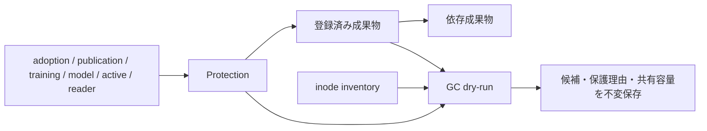

# 保存台帳・容量計測・GC dry-run

`StorageCatalog` は成果物の所有者、工程、種類、再生成可否、保持理由、依存参照を
共通SQLiteに登録する。source / clip / cache / attempt / prediction / adoption evidence /
log / shard / tracking / pose / snapshot / checkpoint / configuration を区別する。
保持期間の既定値はない。`Retention(mode="retain", reason=...)` または、明示的な
期限を持つ `mode="expire"` を指定する。登録内容とファイルのhash/sizeは検証され、
同じpathへの別内容・別保持条件の上書きを拒否する。

所有者・種類・保持期限の登録は明示APIで行う。標準writerのうち、下記の永続成果物は
業務状態の確定時に保護参照も登録する。保護対象に自動で所有者やTTLを付与しない。
全参照・実行中ownerの網羅はまだ証明していないため、すべてのplanは
`execution_ready=false` となる。削除・移動APIはない。
元データを保持する移行は[migration](migration/README.md)を参照する。
保存形式・copy/共有・RGB cacheの同入力比較は[comparison](comparison/README.md)を参照する。
一般GCの実行直前の再検査・実行journalは後続の実装範囲である。

## 参照の保護



`protect()` はhashで固定した参照を保護する。`release()` は元のprotection digestと
理由を要求し、解放履歴を残す。TTLだけでactive/readerを解放しない。
採用・学習中・公開済みの成果物や、保持期限前の成果物から依存をたどって保護する。
inventory外の登録済み成果物も保護の起点になる。roleとpathの境界は共通resolverで検証し、
物理pathを参照ノードのkeyにする。hardlinkは別pathとして扱い、容量はdevice/inodeで
共有を判定する。

公開receiptなどと保護を原子的に更新する場合、`StorageCatalog` をtransactionの前に
構築し、`protect(..., database=connection)` を同じ `Registry.transaction()` 内で呼ぶ。
別registryやtransaction外のconnectionは拒否する。内部で別の書込transactionを開かない。

## 標準writerからの接続

| 確定境界 | 保護する参照 |
|---|---|
| `RevisionStore.seal` | 採用receipt、revision全履歴、編集command/payload、context、元動画/clip、予測、方針、taskが列挙する根拠 |
| ball review adapter | 各版のlabels、画像/描画要求、actor launch、採用proof、保存済みtelemetryのresponse/HTML/image/event/error |
| ball/playerの既存store固定 | snapshot manifest、index、metadata、全clip shard |
| `BallPublisher.publish` | 公開receipt、要求、採用receipt、公開snapshotと全ファイル、base snapshotのファイル |
| `ModelRegistry.bootstrap/select` | 初期モデルの重み/config/根拠、採否判断、比較したモデルの重み、学習・評価の完了記録/receipt/要求/intent、実行receipt/launch/log、campaign完了記録/plan/公開receipt、固定学習・評価入力 |

~~~mermaid
flowchart LR
    T["taskの明示参照列挙"] --> P["版付きProtection"]
    P --> TX["同じRegistry transaction"]
    B["seal / publication / model pointer"] --> TX
    TX --> C["業務状態と参照を同時commit"]
    C --> G["GC dry-runの保護根拠"]
~~~

seal・publication pointer・model pointerと保護の追加は同じSQLite transactionに入る。
保護の検証や書込が失敗した場合、業務状態の更新もrollbackする。保存済みファイルは保持し、
再試行で同じ参照を登録する。既存store固定はmanifestを不変保存してから保護し、途中停止後は
同じ固定要求を再実行できる。既存writerの再送で過去の正常成果物を再生成しない。

model selectionは従来どおり、判断payloadとpointerを先にcommitし、そのpayloadから
receiptファイルを保存する。比較重みの保護はpointerと同時に確定し、receiptファイル自身は
保存後に保護する。commit/file間の停止では同じDB payloadから復元する。

`storage.references` は型付きDocumentの直接参照だけを扱い、物理pathのaliasを重複除外する。
同じpathに異なるhash/sizeがある場合は拒否する。task固有payloadの内部は
`ReviewAdapter.retained_references` で明示的に列挙する。JSONやpath文字列を見て未知schemaを
推測しない。保護IDにはcollector版を含め、再送で対象が変わった場合や明示解放済みIDの再利用を
拒否する。新writerの導入だけで既存DBを一括backfillしたとは扱わない。

この接続はreader lease、pending/active worker、学習途中のcheckpointや全cacheの
自動参照収集を完成させるものではない。外部Codex raw rolloutのpathはtelemetryに出典として
残るが、固定rootのGCが操作する対象ではない。未知の成果物は従来どおり候補化しない。
削除実行前には、これらの残る参照と全writerの競合を照合する仕組みが必要である。

## 計測と試算

```python
from src.tasks.base.annotation.storage import (
    InventoryScope,
    StorageCatalog,
    inventory,
    plan_gc,
    save_dry_run,
)

catalog = StorageCatalog(layout)
observed = inventory(
    layout,
    (InventoryScope(role="annotation", path="migration/staging"),),
    max_entries=10000,  # 呼出側が計測範囲に合わせて上限を決める
)
plan = plan_gc(catalog, observed)
inventory_ref, plan_ref = save_dry_run(catalog, observed, plan)
```

inventoryは明示的なrole相対ディレクトリに限定し、重複範囲やsymlinkを経由するrootを
拒否する。filesystem rootのdirectory fdから各要素を`O_NOFOLLOW`で開き、検査後に
祖先がsymlinkへ置換されても追跡しない。内部symlinkはリンク自体だけを数え、対象を走査しない。directory fdを使い、
走査中のdirectory置換・増減はエラーにする。entry上限超過時には部分集計を返さない。
計測とdry-runはschedulerの回復やownerの失効処理を呼ばない。

logical bytesは各pathのサイズ、allocated bytesは `st_blocks * 512` をinodeごとに
一度だけ合計する。directoryとsymlink自身の容量も含む。工程別のallocated bytesは
工程内で重複除外し、工程間の共有inode容量を別に示すため、工程値は単純加算できない。

期限切れでも、未登録、参照あり、非regular file、内容・metadata変更、走査範囲外の
hardlinkがあるファイルは候補にならない。保護されたpathとinodeを共有するpathも保護する。
候補のallocated bytesは、全hardlinkが候補であるinodeだけを一度数える。
これはファイルシステムのrefLink、圧縮、snapshotなどを考慮した実解放量の保証ではない。

結果は `storage/inventories/<digest>.json` と `storage/plans/<digest>.json` に保存する。
planはinventoryとcatalogのdigest、判定時刻、保持条件、各候補・保護理由を記録する。
plan作成後の参照追加は新しいcatalog digestと次のdry-runに反映される。過去のplanを
そのまま削除指示に変換してはならない。

合成fixtureでは共有hardlink、外部link、symlink、参照の推移、transaction rollback、
内容変更、境界・走査上限を検証する。実環境の全量計測と保存方式比較は別の検証である。
