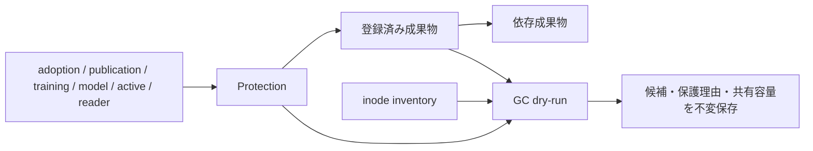

# 保存台帳・容量計測・GC dry-run

`StorageCatalog` は成果物の所有者、工程、種類、再生成可否、保持理由、依存参照を
共通SQLiteに登録する。source / clip / cache / attempt / prediction / adoption evidence /
log / shard / tracking / pose / snapshot / checkpoint / configuration を区別する。
保持期間の既定値はない。`Retention(mode="retain", reason=...)` または、明示的な
期限を持つ `mode="expire"` を指定する。登録内容とファイルのhash/sizeは検証され、
同じpathへの別内容・別保持条件の上書きを拒否する。

この実装は明示的な登録APIとdry-runまでであり、既存writer、dataset reader、worker、
学習処理からの参照を自動収集するものではない。全参照・実行中ownerの網羅を証明して
いないため、すべてのplanは `execution_ready=false` となる。削除・移動APIはない。
元データを保持する移行は[migration](migration/README.md)を参照する。
一般GCの実行直前の再検査・実行journalと保存形式比較は後続の実装範囲である。

## 参照の保護



`protect()` はhashで固定した参照を保護する。`release()` は元のprotection digestと
理由を要求し、解放履歴を残す。TTLだけでactive/readerを解放しない。
採用・学習中・公開済みの成果物や、保持期限前の成果物から依存をたどって保護する。
inventory外の登録済み成果物も保護の起点になる。roleとpathの境界は共通resolverで検証し、
物理pathを参照ノードのkeyにする。hardlinkは別pathとして扱い、容量はdevice/inodeで
共有を判定する。

公開receiptなどと保護を原子的に更新する場合、`StorageCatalog` をtransactionの前に
構築し、`protect(..., database=connection)` を同じ `Registry.transaction()` 内で呼ぶ。
別registryやtransaction外のconnectionは拒否する。内部で別の書込transactionを開かない。

## 計測と試算

```python
from src.tasks.base.annotation.storage import (
    InventoryScope,
    StorageCatalog,
    inventory,
    plan_gc,
    save_dry_run,
)

catalog = StorageCatalog(layout)
observed = inventory(
    layout,
    (InventoryScope(role="annotation", path="migration/staging"),),
    max_entries=10000,  # 呼出側が計測範囲に合わせて上限を決める
)
plan = plan_gc(catalog, observed)
inventory_ref, plan_ref = save_dry_run(catalog, observed, plan)
```

inventoryは明示的なrole相対ディレクトリに限定し、重複範囲やsymlinkを経由するrootを
拒否する。内部symlinkはリンク自体だけを数え、対象を走査しない。directory fdを使い、
走査中のdirectory置換・増減はエラーにする。entry上限超過時には部分集計を返さない。
計測とdry-runはschedulerの回復やownerの失効処理を呼ばない。

logical bytesは各pathのサイズ、allocated bytesは `st_blocks * 512` をinodeごとに
一度だけ合計する。directoryとsymlink自身の容量も含む。工程別のallocated bytesは
工程内で重複除外し、工程間の共有inode容量を別に示すため、工程値は単純加算できない。

期限切れでも、未登録、参照あり、非regular file、内容・metadata変更、走査範囲外の
hardlinkがあるファイルは候補にならない。保護されたpathとinodeを共有するpathも保護する。
候補のallocated bytesは、全hardlinkが候補であるinodeだけを一度数える。
これはファイルシステムのrefLink、圧縮、snapshotなどを考慮した実解放量の保証ではない。

結果は `storage/inventories/<digest>.json` と `storage/plans/<digest>.json` に保存する。
planはinventoryとcatalogのdigest、判定時刻、保持条件、各候補・保護理由を記録する。
plan作成後の参照追加は新しいcatalog digestと次のdry-runに反映される。過去のplanを
そのまま削除指示に変換してはならない。

合成fixtureでは共有hardlink、外部link、symlink、参照の推移、transaction rollback、
内容変更、境界・走査上限を検証する。実環境の全量計測と保存方式比較は別の検証である。
