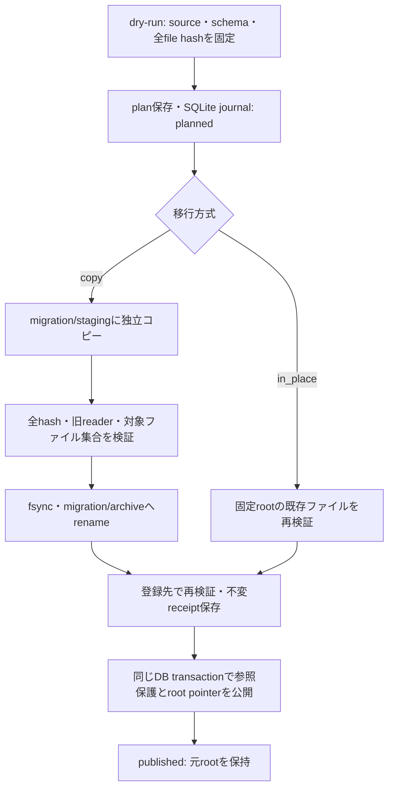

# 元データを保持する移行

`dry_run()` は旧rootを読み、taskの `MigrationReader` が列挙したファイル・依存参照・
意味上のidentityをplanに固定する。ファイル数上限を必須とし、plan作成だけでは
registryやディレクトリを作らない。sourceの絶対pathと対象schema/selectionを明示する。
task固有の旧schemaは[legacy reader](../../../../annotation/migration/README.md)が解釈する。

`MigrationStore.apply()` は明示的なファイル数・コピーpayload容量上限を受け取り、
次の順で実行する。これはライブラリAPIであり、呼出側のCPU/I/O資源受付を代行しない。
容量上限にはdirectory・journal等のmetadataを含まないため、共通資源scopeで追加保存量と
空きを監視する必要がある。

`in_place` は既存rootが固定annotation rootと同じ場合に使う。旧ファイルの内容・inode・
配置を変えず、新しい台帳へ登録する。`copy` は固定rootと重ならない旧rootに使い、
選択した相対配置を `migration/archive/<plan digest>/root/` に保持する。変更され得る
旧ファイルとのhardlinkは作らない。コピー先の想定外entry、symlink、非regular file、
hash/size不一致は停止理由になる。
各ブロックの書込み前にもファイル単位の計画サイズを検査する。事前検証後やコピー中に
元ファイルが増大しても、計画サイズを超えるブロックは書き込まず、一時コピーを削除する。

journalはコピー前に保存する。途中までコピーしたstagingは、同じplanで検証して再利用する。
再開時はplanのロック下で、そのplan専用の`partials/`に残る一時コピーを新しいコピー前に
回収する。完成済みstagingは再利用し、書込み中の強制終了を繰り返しても残存partialが
コピーpayload容量に積み上がらない。回収はdirectory fdからsymlinkを追わずに行い、
非regular entryを拒否する。別planのpartialや元ファイルは回収しない。
rename後・DB公開前の中断も、完成済みarchiveを検証して再開する。receipt・参照保護・
root pointerのDB更新は同じtransactionで行う。`root_id` の更新にはdry-run時の
`expected_previous` を要求し、別の実行による切替を上書きしない。以前のimportと保護も残す。

`imported_root()` はSQLiteの一貫したpointerを読み、plan・receipt・全ファイルと旧readerを
再検証してrootを返す。既存readerが参照している旧pathは変更しない。このAPIは旧writerを
停止・ロックするものではない。読取中の変更は拒否し、in-place登録後に旧writerが書き換えた
ファイルも次の読取で拒否する。正常に読めたことを将来の不変性の保証にはしない。

元動画、旧root、旧snapshotの移動・削除は行わない。元データの整理は別の計画と明示判断が
必要であり、このreceiptを削除許可として使わない。登録済みimportは全ファイルを保持し、
receiptから依存グラフを保護する。移行receiptはGCの削除判断を代替せず、
[GC](../README.md#gcの明示実行と再開)は保持中のimportとその依存を候補にしない。

合成fixtureで、読取のみのdry-run、元inode保持、旧reader互換、独立コピー、hash変更、
symlink/FIFO、コピー・rename・DB transaction中断、再開、pointer競合、共有参照を検証する。
receipt保存前後・DB transaction内・commit後のSIGKILLからも別processで再開し、
同じplanの並行再送が一つのpointer/receiptへ収束することを検証する。
実データの移行実行・全legacy成果物の網羅・保存方式比較を完了したという証拠ではない。
