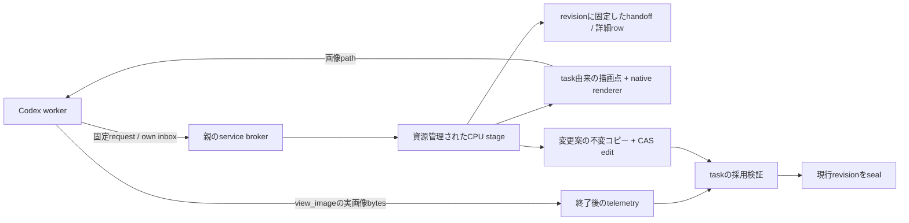

# Review worker services

taskごとの `TaskAdapter` から共通revision・画像・handoffを呼ぶための境界。
workerは自分の `work/` にrequestと変更案を書き、親の資源管理された工程が適用する。
画像を生成したことは画像提示の証拠にならない。

`ReviewWorkerInput` はWorkRequest・attempt path・初期handoffを固定する。
`resolve_attempt()` はrequest/launch/plan/clip/predictionを照合し、`service_input()` は
自分のcontent-addressed inbox以外を拒否する。実行時には共有worker台帳の現行attemptと
稼働状態を確認し、終了receiptがあるattemptの新規操作は受け付けない。
serviceのlockはpoolの再試行・終了検証と共有するため、適用中に別attemptへ切り替わらない。
worker終了と重なった処理は採用検証より先に完了し、実画像証拠がなければ採用できない。

| operation | 入力と応答の上限 |
|---|---|
| `review_handoff` | 最大64 frameの要約、revision固定のrow cursor、最大20件の変更履歴 |
| `review_rows` | 最大8 frameの完全なtask row、応答64 KiB以内。超過時は範囲を縮めて明示再要求 |
| `review_image` | 最大16 tile、描画点はtask側で決定。画像形状とpixel上限は[images](../../images/README.md) |
| `review_edit` | own work内の変更案1 MiB以内。不変コピーを作り、固定actorと期待revisionでbatch適用 |

service envelopeは32 KiB以内。さらにcampaign runtimeがattemptごとのサービス回数を制限する。
汎用CLI `python -m src.tasks.base.annotation.workers.review` は固定request/hash、operation、
own work内のparameters JSONを受け、親の応答を待つ。handoff・変更要約・少数row、または
`view_image` に渡す画像pathを出力する。直接のrender/edit CLIではない。
失敗したrequestを自動で別requestや別revisionへ置き換えない。

taskは `ReviewServiceAdapter` でrow内容と描画を決め、`TaskAdapter.validate()` で
終了telemetry・教師方針を検証する。baseからball/playerへのimportはない。
composition rootの `ReviewOperation` はsupervisorで固定したoperation digestを要求する。
ballの具体実装と再試行時の証拠は[ball review](../../../../ball_detection/annotation/review/README.md)。
production全工程の自動進行はcomposition root側の別責務である。
