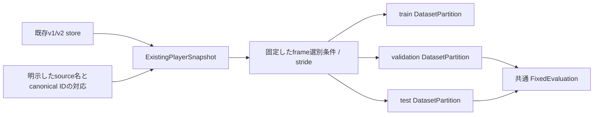

# 既存player storeと固定評価partition

追加学習前に既存storeの教師・RGB・splitを固定する。`build_dataset` のsplit再割当は呼ばず、
既存ファイルを変更せずにannotation rootへ参照manifestを保存する。
この入口は既存データの固定であり、新規bboxのレビュー・追跡・増分公開の完了receiptではない。

`freeze_existing_store(layout, directory, bindings)` は全sourceへの明示的な対応を要求する。
旧source名からYouTube ID等を推測しない。複数の旧名が同じcanonical sourceを指す場合も、
train/val/testを跨ぐ割当は拒否する。既存clipのIDはcanonical source・旧clip名・動画hashから
固定する。新しいcampaignやモデルに合わせて再生成しない。

snapshotはindex、metadata、clipごとのJPEG shardのhash/sizeを固定する。
clipごとの意味的hashにはnative frame/PTS、画像byte範囲、対象/確認済み状態、確認済み不在、
track名・bbox・由来・遮蔽/切断を含める。globalなclip番号とinstance開始位置は除く。
load時は全ファイルと内容を照合し、別clip/shard、改変、source漏洩、不正なPTSや重複byte範囲を拒否する。
v1の未保存frameは欠測のままで、negativeや画像を補わない。

`freeze_partition(layout, snapshot_ref, split, policy)` は学習・評価と同じ
`select_detection_frames` でframeを選び、選別条件とstride、順序付きのframe/GT digest、
frame数・instance数・負例frame数を固定する。RGBのdecodeやGPU処理は行わない。
共通 `DatasetPartition` のmembershipには、選別で教師が残らないclipを含め、そのsplitの全clip/sourceを
保持する。これによりsource漏洩検査が選別条件によって弱まらない。

`validate_partition` は同じ支持対象を再計算して照合する。既存の選別コード変更で対象が変わった場合も、
古い評価結果と同条件とは扱わない。AP用validation/testでは正例instanceを必須とし、
負例だけの集合をmAPとして比較しない。負例だけのtrainは許可する。
入力サイズ・検出閾値・重み・評価runtimeは後段のLearningAdapterが別途固定する責務である。

本実装は合成storeによるCPU検証。既存の本番データの固定処理、実DINO評価、新規採用bboxの
累積snapshot公開は実行していない。
