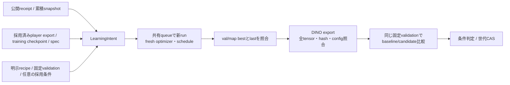

# 注釈公開後のplayer追加学習

`PlayerLearningAdapter`を[共通Learning](../../../base/annotation/learning/README.md)へ渡し、
`player / boxes`の公開後に学習・固定validation評価・採否判定を進める。
実行CLIは `python -m src.tasks.player_detection.training.annotation`。
新規bboxのレビュー・追跡・累積snapshot公開とproduction controllerへの接続は別工程である。

## 入力と学習

`PlayerLearningRecipe`は学習settingsのJSON参照、選別条件、augmentation、入力サイズ、
検出閾値、batch/サンプル予算、seed、backbone設定を固定する。数値の予算・採用条件の
既定値は置かない。settingsは共通 `BaseTrainingConfig.from_mapping` の完全な契約で、
未知keyは拒否する（optimizerは共通AdamW契約であり、未使用の`optimizer.name`は含めない）。

実行の構造条件はCUDA 1台・fp32、全epoch実行、各epochのval/map最大化・best 1件と
独立したlast checkpointである。early stopping・GAN・compile・旧manifestに依存する
定性出力はこの経路で有効にしない。初期の定性確認はpilot工程が担当する。

既存のplayer snapshot/partition readerを使い、登録時にtrainの実際の選別結果も固定する。
登録後にそのmanifestが欠けた場合は再生成せず停止する。追加clipから学習対象frameが
一つも残らない場合も停止し、旧教師だけの追加学習にしない。空targetはstoreの
確認済み不在規則に従う。欠測frameや未解決bboxを新たな負例へ変換しない。

validationは累積train storeとは別の固定snapshotから読む。native frame/PTS・教師・
選別条件・strideのsupport digestとsource/clip分離を毎回検証する。
先頭batchだけでは負例しか含まれない場合があるため、Lightningのsanity validationは
無効にし、各epochでは固定validation全体を評価する。正例必須のmAP条件は維持する。
testはmembershipの漏洩検査に用い、モデル推論・評価には使わない。専用DataModuleも
test読み出しを拒否する。

親DINO repositoryのcommitとtracked差分、exportの元training checkpoint hash・epoch・stepを
照合する。初期値は`model.init_checkpoint`に固定したplayer exportで、既存DINOのstrict loadを
使う。`run.init_weights`は用いない。新snapshotは新runと新optimizer/scheduleになる。

## 完了・再開・来歴

重みは `outputs/player_detection/train/annotation/<intent>/attempt-<番号>/`、exportは
`ckpt/player_detection/annotation/<intent>/attempt-<番号>/best.pth` に保存する。
不変の初期config・run binding・完了記録はannotation rootの
`models/player/training-runs/<intent>/attempt-<番号>/`に置く。

checkpoint自身にintent、初期重み、recipe、train/validation partition、config、予定更新数を
埋め込む。最終epoch・更新数・optimizer/scheduler/loop state、last内のbest callback状態を
照合し、選択したcheckpointの全DINO tensorとexportを比較してからTrainingReceiptを返す。
export metadataだけが正しくても、tensorやconfigが違えば受理しない。

中断再開は、まず `freeze_resume_checkpoint(layout, intent, latest_ref)` でlastを
`logs/learning/checkpoints/resume/<sha256>.ckpt`へ不変コピーし、その参照を共通
`Learning.retry(..., reason=..., resume_checkpoint=...)` に渡す。このコピーもI/O工程として
資源受付・追加保存予算に含める必要がある。関数は自分でqueue投入や予算変更を行わない。
可変なlastを直接渡す再開は拒否する。再開後も元の入力bytesを保持し、同じ出力rootと
logger版・学習予算のまま残りの更新を行う。

最終checkpoint保存後にexport/receipt前で停止した場合は、同じ明示retryで残った後処理を
回収する。最終更新数に達していれば追加学習しない。入力差替え、別intent、bestからの
optimizer再開、古い中間状態の暗黙選択、自動retryは許可しない。

## 評価と採否

baseline/candidateのDINO exportを同一の固定validation・前処理・検出閾値・float runtimeで
評価する。保存したnative bbox/confidence/frame keyからCPUで指標を再計算し、metrics、
summary、checkpoint・dataset hashと照合する。frameの欠落・順序違い・不正座標・NaN・
異なる入力やモデルの評価は受理しない。途中出力だけが残る評価は、新しい明示attemptで行う。

`matmul_precision`と`allow_tf32`は一つの精度契約として登録時に検証する。
許容する組み合わせは`highest / false`、`high / true`、`medium / true`。
学習・評価ともmatmul precisionのsetterだけでCUDA matmulを設定し、cuDNNのTF32は別に
設定する。適用後の実効値を契約と照合し、評価来歴にも同じ値を要求する。

全体のmAP/precision/recall等に加え、確認済み不在frame数、その上の誤検出総数、誤検出が
ある不在frame数を記録する。負例の支持が無い場合、負例FP条件は測定不能として扱う。
評価の範囲は固定した選別済み教師であり、partial labelで欠けた人物や未review領域まで
完全に注釈されたことを意味しない。`label_scope=pinned_selected_labels_only`を保存する。

`PlayerSelectionPolicy`には最小支持数、mAPと改善量、precision/recallの許容悪化、任意の
負例frame当たり最大誤検出数と最小負例数を明示する。policy未設定時は共通管理が
学習・評価を保存したうえで`not_configured`とし、現行モデルを維持する。
採用時の世代比較とpointer更新は共通ModelRegistryが所有する。
共通の必須`retained_references`契約には、recipe、固定partition、run binding、
学習完了・来歴、比較評価文書の型付き参照を渡す。

合成CPU試験は小さなDINO代替を使う。実Lightningのstrict初期重み読込、optimizer/schedule、
best/last、途中再開、exportと共通lifecycleを通すが、実DINOのCUDA loss/勾配・検出品質・
本番の追加学習2サイクルを検証したことにはならない。
