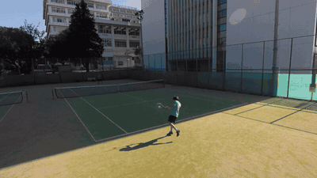

# Blender export・撮影

保存済みSceneResult v2と元動画から、Blenderで「入力映像 → グリッド → コート → 選手・ボール」へ
切り替わり、最後にカメラが移動するアニメーションを生成します。



実データの過去runの条件と検証結果は[検証記録](../../../../../knowledge/nodes/tennis_scene/000027-run-blender-reveal-meiji-cam1-20261016.md)を参照してください。

- 書き出し: `python -m src.tennis_scene.scripts.export_blender`（設定 `configs/blender_export.yaml`）
- 撮影: `src/tennis_scene/visualization/blender/shots/reveal.py`（Blender 5.2同梱Python。repoをimportしない）
- Blender上の検証: `src/tennis_scene/visualization/blender/shots/validate_reveal.py`

## shotの共通部品

`../shots/common.py` はBlender同梱Pythonだけで動く部品です。各shotは
`sys.path.insert(0, str(Path(__file__).parent))` の後に `common` をimportします。
repo側の `export/` はimportしません。Blenderスクリプトは移動前と同じく
通常のpre-commitのruff・mypyの対象外とし、Blenderで動作を検証します。

- `Nodes`・`_group_socket`・`_new_material`: shaderと材質の生成。reveal固有の材質の切り替えは `reveal.py` に置きます。
- `player_shader(n, color)`・`net_shader(n)`・`ball_shader(n, color, *, fade_attribute)`: 選手・ネット・球の共通の見た目。`_new_material` が返す `surface` へ接続して使います。
- `court_image(court, *, court_color, runoff_color, px_per_m=100)`・`_net_geometry(court)`: court manifestから表面画像とネットの頂点・面・tape属性を生成します。
- `_disk`・`_dome`・`_grid_lines`・`_distance_fade`: 地面・背景とgridの部品。
- `_pc2_frame0`・`_write_pc2`: frame 0を原点とするPC2の読み書き。
- `_look_rotation`・`_key_visibility`: カメラの向きと、frame 0からの有効性maskによる表示キー。
- `_build_compositor(scene, *, name)`: Bloomのcompositorを設定します。

repo側の `bundle._write_plate(video_path, output_dir, *, frame_range, max_width, quality)` は
SceneResultに依存しません。`frame_range=range(start, stop)`（stopは含まず、stepは1）で
指定区間だけを読み、`output_dir/%05d.jpg` に元動画のframe番号で保存します。
`max_width=None` は元解像度を保ち、正の整数は縦横比を保って幅を制限します（拡大しません）。
複数カメラでは `output_dir` をカメラごとに指定します。動画とcameraの整合検査・失敗時の
bundle削除は呼出側の責務です。既存のreveal exporterは全区間・元解像度で呼びます。

## 入力と書き出し

`input`はARTIFACT root相対のscene archive、component storeのdirectory、または`scene.json`です。
標準のarchive readerで検証したv2 sceneの`player_smpl_valid`・`ball_3d_valid`を使います。
有効性maskを持たない旧sceneを推測で補完しません。

```bash
.venv/bin/python -m src.tennis_scene.scripts.export_blender \
  input=tennis_scene/evaluate/<experiment>/<run>/scene.npz camera_id=cam1
```

worktreeから共有データを使う場合は`paths.project_root=<main repoの絶対パス>`を明示します。
SMPL facesはCHECKPOINT root、regressorはPROJECT rootから解決します。
元動画はscene metadataの`camera_ids`と`video_paths`を対応させて読み、解像度・FPS・フレーム数の一致を要求します。

カメラは`metadata.court_reference.camera_fits`のpinhole fit（歪みなし、主点=画像中心、fx=fy）を使います。
書き出し前に有効な3D球と2D観測の再投影誤差中央値を`max_ball_reprojection_median_px`と比較し、
カメラとsceneの不一致を拒否します。検証できる球観測がないsceneも拒否します。

## bundle

```text
<OUTPUT>/tennis_scene/visualize/blender_export/<run-id>/bundle/
├── manifest.json        # schema、カメラ、FPS、補間frame、コート形状、出典
├── smpl_faces.npy
├── player_<p>.pc2       # コート座標のSMPL頂点（Mesh Cache用）
├── player_valid.npy
├── ball_positions.npy   # 無効frameはNaN
├── ball_valid.npy
└── plate/%05d.jpg       # 元動画のframe 0からの連番
```

world座標はコート座標（m、XY地面、+Z上）です。rendererと同じSMPL配置変換を使います。
`player_max_gap_frames` / `ball_max_gap_frames`以下の内側の欠損だけを線形補間し、
補間frameと残った欠損をmanifestに記録します。残った欠損はBlenderで非表示にし、球の軌跡も欠損を跨ぎません。
コート線・ネット形状の正本は`src/utils/schema/court.py`で、bundleに書き出します。
既存bundleは上書きせず、途中失敗の出力は削除します。

## 配置bundle（player placement）

GVHMRパラメータからCPUでSMPL meshを復元し、本番と同じ`trace_player_placement`の
`u_t`・`q_t`・`ψ_t`・`scale`を`tennis_scene_blender_placement_v1`として書き出します。
画像推論・学習・Blenderは実行しません。

```bash
.venv/bin/python -m src.tennis_scene.scripts.export_blender_placement \
  store=<component store directory> identity=0 frames=2:120 t0=60 \
  plate_camera_id=cam0 plate_video_path=<clip>/cam0.mp4 human_vis_threshold=0.15
```

`store`は`scene.json`を持つcomponent storeのdirectoryです。`identity`・`frames`・`t0`・
`plate_camera_id`・`plate_video_path`・`human_vis_threshold`は必須の明示指定です。
`human_vis_threshold`は本番pipelineの`person_observations.visibility_threshold`と同じ値を
渡します。`frames`は1つのGVHMR区間内に収める必要があり、跨いだ場合は拒否します。
`plate_video_path`はstore sourceの`plate_camera_id`の`video.sha256`と一致しなければ停止します。

`StoreReader`で`camera_alignment`・`player_triangulation`・`gvhmr`・`body_placement`・
`person_poses`・`person_identities`（v3のみ）を読み取り専用で読み、checksum・schema/version・
依存の整合を検査します。camera順と時間軸を本番の`input_assembly`に合わせるため、
`player_triangulation`の依存である`court_calibration`も読み取り専用で参照します。SMPL資産は`body_placement`の`identity.settings.assets`のpathと
SHA-256を検証して束縛し、自動探索しません。配置configも保存済みの
`identity.settings.config`を使い、source pixel scaleを本番と同じく適用します。

```text
bundle/
├── manifest.json          # schema, fps, frames, t0, identity, gvhmr_camera_id,
│                          # scale, coco17_skeleton, court, plate, provenance
├── smpl_faces.npy
├── body_local.pc2         # (F,V,3) u_t。無効frameは0
├── joints_local.npy       # (F,17,3) J_src
├── target_joints.npy      # (F,17,3) NaN=無効
├── target_weights.npy     # (F,17)
├── hip_position.npy       # (F,3) q_t
├── yaw_correction.npy     # (F,) psi_t
├── valid.npy              # (F,)
├── placed_vertices_t0.npy # (V,3) 保存済み配置のt0をworld座標にした検証用頂点
└── plate/%05d.jpg         # plate_camera_idの指定区間
```

`t0`は有効frameでなければなりません。再計算した
`q_t + s·Rz(ψ_t)·u_t`は保存済み`body_placement`のworld頂点と、保存側で有効な全frame
（t0を含む）で比較します。差が1e-4 m以上、または比較対象のworld座標が非有限なら、
元frame・identity・頂点位置・最大差を報告して停止します。保存済み`root_valid`と
再計算した`trace.valid`も`trace.frames`上で一致しなければ停止します。`trace.valid`と
`smpl_valid`は同一視しません（mesh reprojection gateはtraceの外側です）。

`plate_camera_id`は`camera_alignment`で校正済みのカメラから明示的に選び、校正がない
カメラなら拒否します。manifestにはreveal exporterと同じ`width`・`height`・
`camera.opencv`（K/R/t）・`camera.blender`（location/rotation_matrix/lens/sensor）を
記録します。Blender cameraはrevealと同じ36.0 mmのhorizontal sensor widthで変換します。

出力先が存在すれば上書きせず、途中失敗した新規bundleは削除します。

## 撮影・動画化

GPUを使うレンダリングは共有training queue経由で実行します。
Linux版Blenderには通常のLinuxパスを渡します。Windows版BlenderにWSLのパスを渡す場合は`\\wsl.localhost\Ubuntu\...`形式を使います。
Windowsで作成した`.blend`の外部参照はWindows形式になるため、同じOS側のBlenderで開いてください。

現在の配置での再生成は、repo rootをcwdにして次のコマンドを使います。
bundleの作り方は[入力と書き出し](#入力と書き出し)を参照してください。
Meiji cam1の既存bundleは
`/home/kamimura/projects/tennis-lab/outputs/tennis_scene/visualize/blender_export/pr1203-meiji-cam1/bundle`
です。`BUNDLE` に入力bundle、`SHOT_DIR` に新しい出力先を指定します。
既存の出力先は描画前に拒否します。以下の撮影コマンドはtraining queueへ登録してください。

```bash
set -euo pipefail
BUNDLE=/absolute/path/to/bundle
SHOT_DIR=/absolute/path/to/new-shot-dir
if [ -e "$SHOT_DIR" ]; then
  printf 'Output already exists: %s\n' "$SHOT_DIR" >&2
  exit 1
fi
blender --background --factory-startup --python-exit-code 1 \
  --python src/tennis_scene/visualization/blender/shots/reveal.py -- \
  --bundle "$BUNDLE" --output "$SHOT_DIR" --render
# fpsはmanifest.jsonの値に合わせる。例は59.94fpsの入力。
ffmpeg -n -framerate 60000/1001 -start_number 0 -i "$SHOT_DIR/frames/%05d.png" \
  -c:v libx264 -crf 16 -pix_fmt yuv420p -movflags +faststart "$SHOT_DIR/reveal.mp4"
```

`tennis_reveal.blend`には出力先と描画範囲も保存します。`.blend`はbundleのPC2とplate連番を参照するため、
bundleも一緒に保持してください。`--render`を外すとシーン作成・保存だけを実行します。
`--frames 100:100`で部分描画、`--samples 8 --resolution-percentage 50`で軽量なプレビューができます。
部分描画の動画化では`-start_number`も開始frameに合わせます。
`--frame-step 4`なら4frameごとのプレビューになります。動画のFPSを入力の1/4にし、連番をglobで読みます。

```bash
ffmpeg -n -framerate 15000/1001 -pattern_type glob -i "$SHOT_DIR/frames/*.png" \
  -c:v libx264 -crf 16 -pix_fmt yuv420p -movflags +faststart "$SHOT_DIR/preview.mp4"
```

色・切り替えのタイミング・カメラ終点は撮影スクリプトの`Shot`にまとまっています。
タイミングは入力のframe単位で、既定では150から切り替わり、420の後にカメラが移動します。
短いclipではこの範囲に合わせて`Shot`を調整してください。スクリプトを再実行するとシーンを作り直します。

## 検証

撮影時と同じ `BUNDLE`・`SHOT_DIR` を使います。

```bash
blender --background "$SHOT_DIR/tennis_reveal.blend" --python-exit-code 1 \
  --python src/tennis_scene/visualization/blender/shots/validate_reveal.py -- \
  --bundle "$BUNDLE" --report "$SHOT_DIR/validation.json"
```

Blenderで評価したmesh頂点とPC2、球の位置、全frameの有効性と非表示設定、入力カメラとの投影一致、
FPSとカメラ移動を検査します。不一致は非ゼロ終了し、成功時にJSONの検証結果を保存します。
映像側は切り替え前のframeと元動画、切り替え中、自由視点の各場面も確認してください。
